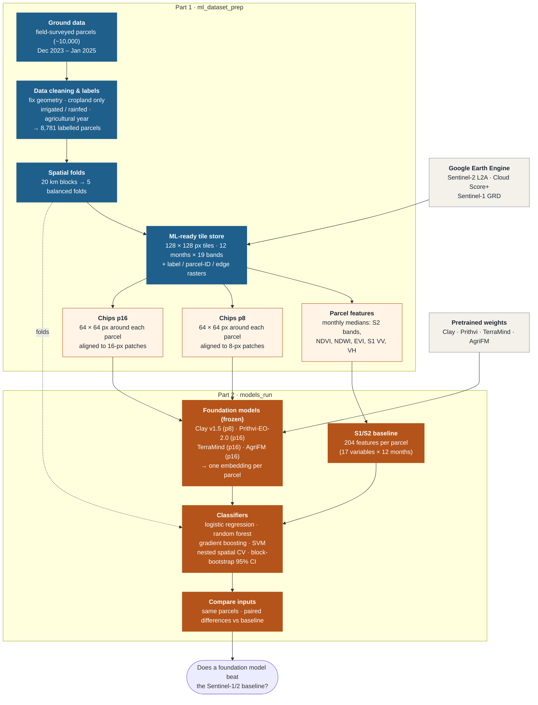

# Irrigated Cropland Mapping using Geospatial Foundation Models

Maps **irrigated** and **rainfed** cropland at parcel level in Morocco from Sentinel-1 and Sentinel-2 time series. It compares two ways of describing each parcel: classic satellite features (monthly band values and indices) and embeddings from four geospatial foundation models (**Clay v1.5, Prithvi-EO-2.0, TerraMind, AgriFM**). Every approach uses the same imagery and the same parcels, and is tested on areas it has never seen.

| Part | Folder | What it does | Details |
| --- | --- | --- | --- |
| 1 · ML-ready dataset | [`ml_dataset_prep/`](ml_dataset_prep/) | labels, spatial folds, Sentinel-1/2 tile store, model inputs | [ml_dataset_prep/README.md](ml_dataset_prep/README.md) |
| 2 · Study | [`models_run/`](models_run/) | dataset checks, embeddings, training and evaluation, comparison | [models_run/README.md](models_run/README.md) |
| Tools | [`tools/`](tools/) | extra scripts for viewing and side checks (not needed for the results) | top of each script |

The two parts are independent: part 1 builds a ready-to-use dataset that any model can train on, and part 2 uses it to compare the models.

---

## Workflow



**Method in one paragraph.** Each surveyed parcel gets the 12 monthly Sentinel-1/2 composites of its agricultural year (1 Sep – 31 Aug), cut from a shared, non-overlapping tile store.
- **Baseline:** a parcel's monthly medians of the Sentinel-2 bands, NDVI, NDWI, EVI and Sentinel-1 VV/VH.
- **Foundation models:** each embeds a 64 × 64 px chip, shifted so that the parcel centroid sits at the centre of a model patch. The patch embeddings over the parcel are then averaged.
- **Classifiers:** logistic regression, random forest, gradient boosting and an SVM, tuned and tested with nested spatial cross-validation on 20 km blocks.
- **Comparison:** inputs are compared on the same parcels with block-bootstrap confidence intervals, Holm-adjusted.

---

## Project structure

```
irrigated_area_mapping_code/
├── README.md                this file: setup and overview
├── PROGRESS.md              decisions, change log, open points
├── environment.yml          conda environment "condaml"
├── ml_dataset_prep/         PART 1 · dataset (README.md + scripts 01–04)
├── models_run/              PART 2 · study (README.md + scripts 01–04)
├── tools/                   extra scripts (see below)
├── data/                    input data                          (not in git)
│   ├── field_survey/            lulc_fielddata.shp (+ .dbf .shx .prj .cpg)
│   ├── admin/                   gadm41_MAR_0.json …  (GADM 4.1 Morocco)
│   └── worldcover/              ESA_WorldCover_10m_2021.tif
├── checkpoints/             model weights: clay/, agrifm/       (not in git)
├── external/                third-party code: AgriFM/           (not in git)
├── secrets/                 Earth Engine service-account key    (never commit)
├── docs/                    papers, dataset documentation
└── outputs/                 everything the scripts write        (not in git)
    ├── dataset/                 01_labels · 02_folds · 03_tiles/agyear (tiles, views, vrt)
    ├── study/                   01_inspection · 02_embeddings · 03_models · 04_comparison
    └── analysis/                figures and pages from tools/
```

---

## Setup

### 1. Environment

```bash
conda env create -f environment.yml                 # creates "condaml" (or: conda env update -n condaml -f environment.yml)
conda activate condaml
pip install --no-deps git+https://github.com/Clay-foundation/model.git   # Clay (--no-deps: avoids an einops conflict with TerraTorch)
pip install mmengine                                 # AgriFM
```

A GPU (CUDA or Apple Silicon) is recommended for the embedding scripts. Everything else runs on a CPU.

### 2. Earth Engine

Only `ml_dataset_prep/03_build_tiles.py` uses Earth Engine. Put the service-account key in `secrets/` (path set at the top of the script), or run `earthengine authenticate` once. **Never commit the key.** `secrets/` and `*service-account*.json` are in `.gitignore`.

### 3. Input data

| File | Source | Where |
| --- | --- | --- |
| Field survey (parcels with land use and irrigation method) | Ouassanouan et al. (2026), *Scientific Data* | `data/field_survey/lulc_fielddata.shp` |
| Morocco boundary | GADM 4.1 | `data/admin/gadm41_MAR_0.json` |
| ESA WorldCover 2021, 10 m (optional cropland check) | ESA WorldCover v200 | `data/worldcover/ESA_WorldCover_10m_2021.tif` |

The Sentinel-1/2 imagery is not downloaded by hand. `03_build_tiles.py` fetches it from Earth Engine.

### 4. Model weights

| Model | How |
| --- | --- |
| Clay v1.5 | `curl -L -o checkpoints/clay/clay-v1.5.ckpt https://huggingface.co/made-with-clay/Clay/resolve/main/v1.5/clay-v1.5.ckpt`<br/>`curl -L -o checkpoints/clay/metadata.yaml https://raw.githubusercontent.com/Clay-foundation/model/main/configs/metadata.yaml` |
| Prithvi-EO-2.0-300M-TL | downloaded automatically from Hugging Face on the first run |
| TerraMind-1.0-base | downloaded automatically from Hugging Face on the first run |
| AgriFM | weights (`checkpoints/agrifm/AgriFM.pth`) and code (`external/AgriFM`) fetched automatically by `models_run/02d_embed_agrifm.py` |

---

## Running

Run every script from the project folder. Each script has its **settings at the top**: there are no command-line arguments. A description at the top of each script explains what it does and what it writes.

```bash
# Part 1 · dataset
python ml_dataset_prep/01_prepare_labels.py
python ml_dataset_prep/02_make_spatial_folds.py
python ml_dataset_prep/03_build_tiles.py        # Earth Engine; hours; resumable (N_TEST_TILES = 20 for a test)
python ml_dataset_prep/04_make_views.py

# Part 2 · study
python models_run/01_inspect_dataset.py          # check the data before training
python models_run/02a_embed_clay.py              # 02a–02d: GPU recommended, resumable
python models_run/02b_embed_prithvi.py
python models_run/02c_embed_terramind.py
python models_run/02d_embed_agrifm.py
python models_run/03_train_evaluate.py           # once per INPUT: s1s2, clay, prithvi, terramind, agrifm
python models_run/04_compare_models.py
```

For a quick check before a full run, set `N_TEST_TILES = 20` in `03_build_tiles.py` and `QUICK_TEST = True` in `03_train_evaluate.py`.


---

## Documentation

- **[ml_dataset_prep/README.md](ml_dataset_prep/README.md):** dataset design, every script, tiles and label rasters, the two agricultural years, file formats, flow diagrams.
- **[models_run/README.md](models_run/README.md):** research questions, inputs compared, embedding models, nested spatial CV, metrics, comparison.
- **[PROGRESS.md](PROGRESS.md):** current status, method decisions, open points, change log.
