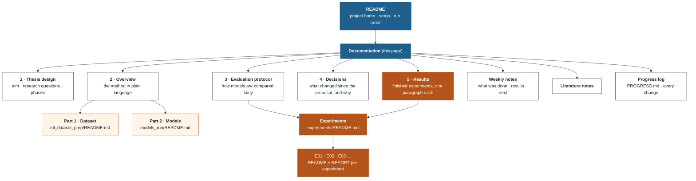

[Home](../README.md) › Documentation

# Documentation

Everything about the thesis is written down here, from the research design to the latest result. Each page answers
one question and links to the pages below it.



## Read in this order

| # | Page | Answers | For |
| --- | --- | --- | --- |
| 1 | [Thesis design](01_thesis_design.md) | What is the thesis about? Which questions, which phases, where do we stand? | everyone |
| 2 | [Overview](02_overview.md) | How does the method work, step by step, without the code? | everyone |
| 3 | [Evaluation protocol](03_protocol.md) | How are the inputs compared so that the comparison is fair? | supervisors, reviewers |
| 4 | [Decisions](04_decisions.md) | What differs from the proposal, and why? | supervisors |
| 5 | [Results](05_results.md) | What have the experiments shown so far? | weekly meetings |

## Reference

| Page | Holds |
| --- | --- |
| [Part 1 · Dataset](../ml_dataset_prep/README.md) | labels, spatial folds, tile store, chips: every script and file format |
| [Part 2 · Models](../models_run/README.md) | embeddings, classifiers, validation, metrics: every script and setting |
| [Experiments](../experiments/README.md) | the list of experiments, how to run one again, how to add one |
| [Weekly notes](weekly/README.md) | one page per supervisor meeting |
| [Literature notes](research/README.md) | the papers the method relies on, with what we took from each |
| [Progress log](../PROGRESS.md) | every change to code or method, newest first |
| [Data source](data_source/readme.md) | the Moroccan field-survey dataset |

## Website

All these pages, with navigation tabs, search and rendered diagrams: **[https://amanchry.github.io/irrimapping-geofm/](https://amanchry.github.io/irrimapping-geofm/)**.
The markdown files in the repository are the only source; the website is built from them with
[MkDocs Material](https://squidfunk.github.io/mkdocs-material/) (configuration: `mkdocs.yml`, page collector:
`mkdocs/gen_pages.py`).

```bash
mkdocs serve        # preview on http://127.0.0.1:8000, reloads on every change
mkdocs gh-deploy    # publish to GitHub Pages
```

A push to `main` also rebuilds and publishes the website automatically (`.github/workflows/docs.yml`).
