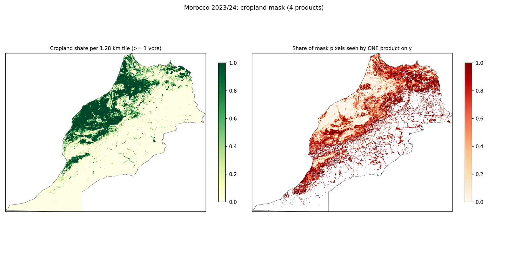
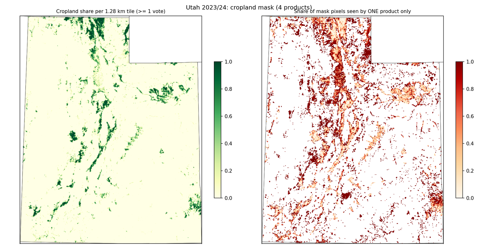
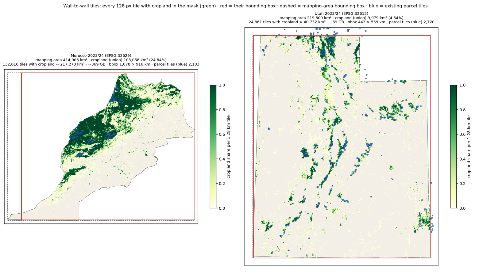
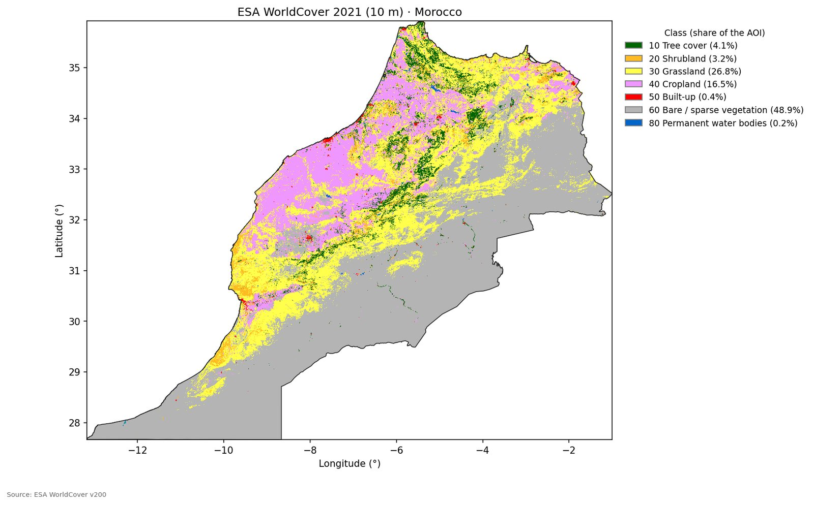
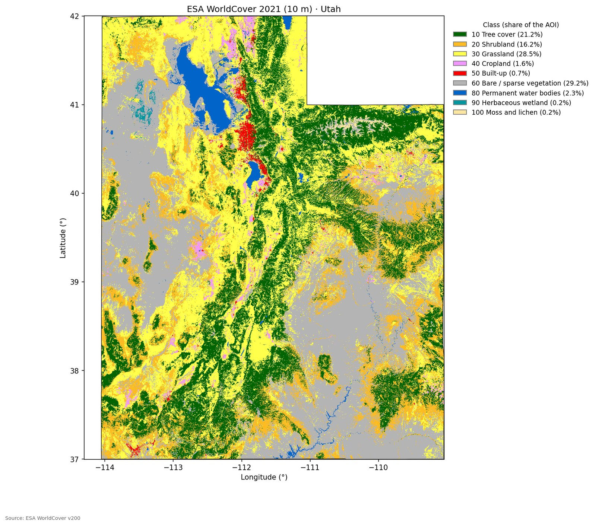
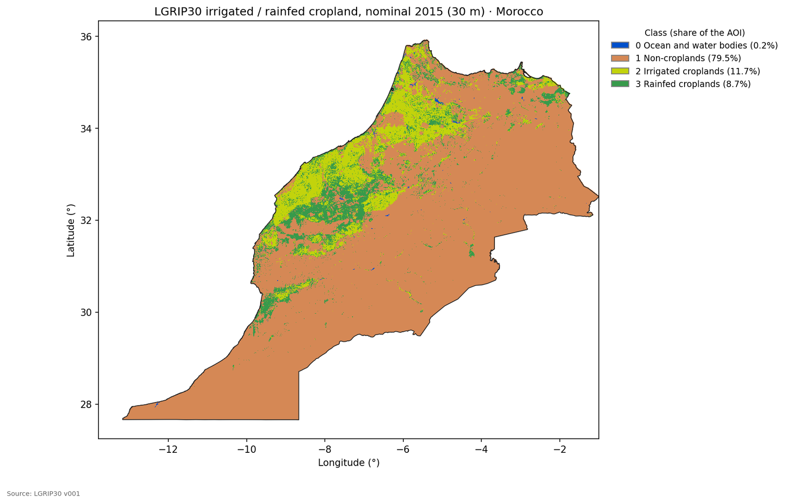
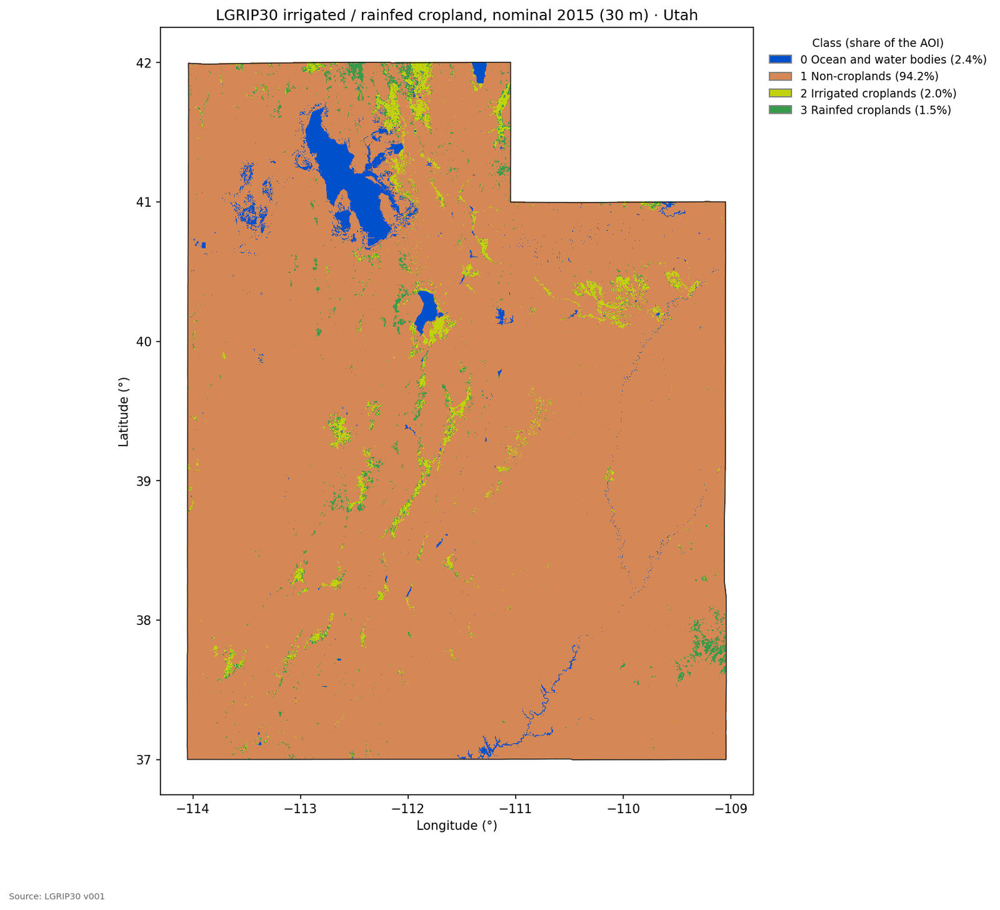

# Union cropland mask (archived)

!!! warning "Archived"
    This union of four cropland products is **not used**. The project uses the annual Dynamic World cropland of
    `data_download/02a_dynamic_world.py` only ([Cropland extent](../phase1_data/cropland_extent.md)). The script is
    kept in `data_download/archive/00_union_cropland_mask.py`, and the page is kept as the record of the products,
    the method and the 2023/24 results.

The annual irrigated / rainfed maps are **continuous (wall-to-wall)**: every 10 m pixel of a region's cropland gets a
class, not only the surveyed parcels. This page describes the area those maps cover, the cropland mask, and the
reference layers drawn for comparison. The code is in `data_download/` (formerly `cropland_extent/`); the mask and
the reference layers are written to `outputs/<region>/data_download/reference/`.

!!! note "Mapping phase only"
    The cropland mask belongs to the **mapping phase** ([Phase 5](../phase5_maps/index.md)). The labels, the pixel
    samples and the experiments E01–E05 do not use it: they classify the labelled pixels of the surveyed parcels,
    which are all cropland, as irrigated or rainfed ([pixel samples](../phase1_data/pixel_samples.md)). The download of the
    wall-to-wall imagery is restricted to the blocks with Dynamic World cropland (`02a_dynamic_world.py`), not to the
    union mask described here
    (§5; [D20](../decisions.md#d20-download-once-on-1024-km-blocks-from-earth-engine-training-tiles-cut-from-them)). Which mask the maps
    use, and how land that is not cropland is handled, is decided later, for example by comparing the union of
    products described here with Dynamic World alone ([D19](../decisions.md#d19-two-class-experiments-cropland-extent-in-the-mapping-phase)).

| Script | What it does | Output (in `outputs/<region>/data_download/reference/`) |
| --- | --- | --- |
| `00_union_cropland_mask.py` (formerly `cropland_extent/make_cropland_mask.py`) | cropland mask per region and agricultural year from 4 cropland products (Earth Engine); kept for later as a candidate for the mapping phase, not used by the download | `cropland_mask/<season>/` |
| `04a_ref_esa_worldcover.py` (formerly `download_esa_worldcover.py`) | ESA WorldCover 2021, 10 m GeoTIFF + PNG map | `esa_worldcover/` |
| `04b_ref_lgrip30.py` (formerly `download_lgrip30.py`) | LGRIP30 irrigated / rainfed cropland, 30 m GeoTIFF + PNG map | `lgrip30/` |
| `04c_ref_dynamic_world_annual.py` (formerly `download_dynamic_world.py`) | annual Dynamic World 10 m layer per calendar year (Earth Engine, one GeoTIFF per region with `geemap`): one band, the most frequent class of all 9 (cropland = crops); optional crop frequency; land-cover and cropland PNG maps | `dynamic_world/` |

All four use the same area: the region's **mapping area** in `data_download/regions.py`, i.e. Morocco without
Western Sahara (FAO GAUL 2015, 414,905 km²) and the state of Utah (FAO GAUL 2024, 219,809 km²).

## 1. Why a mask from several products

A single cropland product misses cropland: small fields, fallow land, orchards, recent expansion. On the parcels of
the first test (3,498 surveyed irrigated parcels in Morocco), single products covered 78% (WorldCover) to 99%
(GCEP30) of them; their **union covered 100%**. A pixel is therefore cropland if **at least one** of the products
calls it cropland. Combining products to reduce omission is established practice: Meier et al. (2018) restricted
irrigation mapping to cropland of two land-cover products combined, LANID (Xie et al. 2021) took the cultivated
area of any year, and LGRIP30 added cropland that its own extent map missed (Teluguntla et al. 2023).

The price of the union is extra non-cropland inside the mask. How the maps handle it is open and is decided in the
mapping phase: a stricter mask (more votes, or a single product such as Dynamic World), or an extra "not cropland"
class learnt by the classifier, as IrrMapper did instead of an external mask (Ketchum et al. 2020). The mask is
applied to the map output; the model never sees masked inputs.

The mask uses **no field labels** (neither the Moroccan survey nor WRLU), so its quality is the same in labelled and
unlabelled areas. The training data do not depend on the mask: no labelled parcel is checked against it or dropped.

## 2. Products

The year of a product is the calendar year in which the agricultural year ends, clipped to the years the product has
(2023/24 → 2024).

| Product | Earth Engine asset | Resolution · year(s) | Cropland = | Source |
| --- | --- | --- | --- | --- |
| **ESA WorldCover v200** | `ESA/WorldCover/v200` | 10 m · 2021 | class 40 | Zanaga et al. 2022, [doi:10.5281/zenodo.7254221](https://doi.org/10.5281/zenodo.7254221) · [GEE catalogue](https://developers.google.com/earth-engine/datasets/catalog/ESA_WorldCover_v200) |
| **Esri / Impact Observatory LULC** | `projects/sat-io/open-datasets/landcover/ESRI_Global-LULC_10m_TS` | 10 m · annual 2017–2025 | class 5 (crops) | Karra et al. 2021 (IGARSS) · [community catalogue](https://gee-community-catalog.org/projects/S2TSLULC/) |
| **GCEP30** (GFSAD) | `projects/sat-io/open-datasets/GFSAD/GCEP30` | 30 m · 2015 | value 2 | Thenkabail et al. 2021, [USGS PP 1868](https://doi.org/10.3133/pp1868) · [community catalogue](https://gee-community-catalog.org/projects/gcep30/) |
| **GLAD global cropland** | `users/potapovpeter/Global_cropland_2019` | 30 m · 2003, 2007, 2011, 2015, 2019 | value 1 | Potapov et al. 2022, [doi:10.1038/s43016-021-00429-z](https://doi.org/10.1038/s43016-021-00429-z) · [GLAD](https://glad.umd.edu/dataset/croplands) |

- **GCEP30** is stored as continental tiles that overlap and disagree in Morocco (the Europe / Middle East tile has
  almost no cropland there). The flags are combined with the maximum over the tiles, not with a mosaic.
- **Tree crops:** WorldCover maps orchards as tree cover and GLAD excludes perennial woody crops, so orchards depend
  on the Esri and GCEP30 layers.
- **Not used in the union** (kept in the script as options with fixed bit numbers): Dynamic World (too slow per block
  and Earth Engine memory errors; an annual Dynamic World layer is downloaded separately by
  `04c_ref_dynamic_world_annual.py`, §7), ESA WorldCereal 2021 temporary crops, LGRIP30 (same extent as GCEP30 in the test),
  GLC_FCS30D, and the USDA Cropland Data Layer for Utah.
- **Always removed:** WorldCover 2021 built-up (50), snow and ice (70) and permanent water (80); these pixels are
  never mapped.

## 3. How the mask is made

1. **Blocks on the tile grid.** Earth Engine returns at most 48 MB per request, and Morocco at 10 m has about
   10 billion pixels. The mapping area is cut into blocks of 1024 × 1024 px (10.24 km) on the same grid as the
   tiles of `data_training_prep/03_plan_tiles.py` (x = ix × 1280 m), so every block holds whole 128 px tiles. Morocco has 4,199 blocks,
   Utah 2,213; 8 blocks are downloaded in parallel at about 0.5 s per block; finished blocks are skipped on a re-run.
2. **One request per block** returns one bit per product and the exclusion flag; votes and the mask are computed
   locally.
3. **One raster per agricultural year.** `cropland_mask.vrt` joins all blocks into one seamless layer.
4. **Tile table.** `tiles_cropland.parquet` lists every 128 px tile with its number of cropland pixels. It was the
   input of the earlier wall-to-wall tile routes (STAC and Earth Engine, both retired); the block download now
   uses Dynamic World cropland instead (§5).

**Bands of the mask** (uint16, NODATA 65535 outside the mapping area):

| Band | Content |
| --- | --- |
| `cropland` | the mask: 1 if ≥ `MIN_VOTES` products (1 = union) call the pixel cropland and it is not excluded |
| `votes` | number of products that call the pixel cropland (0–4) |
| `products` | bit flags, one bit per product (WorldCover 0, Esri 1, GCEP30 4, GLAD 6) |
| `excluded` | 1 = WorldCover built-up, snow / ice or water |

The vote count and the flags allow a stricter mask (for example ≥ 2 votes) or another product set later without a
new download.

## 4. Results, 2023/24

| | Morocco | Utah |
| --- | --- | --- |
| Mapping area | 414,906 km² | 219,809 km² |
| **Cropland (union, ≥ 1 vote)** | **103,068 km²** (24.8%) | **9,979 km²** (4.5%) |
| Cropland with ≥ 2 votes | 73,886 km² | 6,000 km² |
| Removed as built-up / snow / water | 3,087 km² | 6,382 km² |
| 128 px tiles with cropland | 132,616 | 24,861 |

Cropland of each product, and the area that **only** this product calls cropland (what it adds to the union):

| Product | Morocco: cropland | Morocco: only this product | Utah: cropland | Utah: only this product |
| --- | --- | --- | --- | --- |
| WorldCover 2021 | 64,122 km² (62% of the union) | 6,474 km² | 3,427 km² (34%) | 110 km² |
| Esri LULC 2024 | 50,876 km² (49%) | 2,950 km² | 5,977 km² (60%) | 1,251 km² |
| GCEP30 2015 | 83,937 km² (81%) | 16,233 km² | 7,742 km² (78%) | 2,121 km² |
| GLAD 2019 | 62,998 km² (61%) | 3,526 km² | 5,650 km² (57%) | 498 km² |

GCEP30 is the most generous product and adds most of the area seen by one product only, mostly at the margins of
the cropland belts (right-hand panels below). Most of the union's false cropland is expected there; the choice of
mask in the mapping phase and the map accuracy assessment address it.

*Left: share of cropland per 1.28 km tile. Right: share of the mask's pixels that only one product calls cropland.*

## 5. Extent of the wall-to-wall tiles

Mapping the whole cropland means imagery for every tile that contains cropland. With the union mask this is
132,616 tiles in Morocco (about 370 GB of monthly Sentinel-2 composites per year) and 24,861 in Utah (about 69 GB),
against 2,183 and 2,720 tiles around the labelled parcels (2023/24). Morocco's cropland forms one continuous belt
from Tangier to Agadir (a quarter of the country), and scattered fields pull in whole 1.64 km² tiles.

**Block download from Earth Engine.** All imagery is downloaded once per region and agricultural year on one grid
of 10.24 km blocks (1024 × 1024 px at 10 m: the 128 px tile grid grouped 8 × 8), with an Earth Engine service
account ([D20](../decisions.md#d20-download-once-on-1024-km-blocks-from-earth-engine-training-tiles-cut-from-them)). `01_plan_blocks.py` plans **every** block that touches the region's
mapping area, without a cropland mask, and counts the training tiles in each block (a training tile outside the
mapping area is reported; none is in Morocco). Blocks with training tiles are always downloaded by `02b` and `02c`,
even where Dynamic World finds no cropland, so every training tile can be cut out. In Morocco this gives 4,199 blocks (one grid, the same every year) over the 414,906 km² mapping
area; 169 of them hold training tiles in 2023/24 and 65 in 2024/25.

The cropland layer that selects the further downloads is **Dynamic World**. `02a_dynamic_world.py` downloads it for
the whole mapping area as one binary 10 m GeoTIFF per agricultural year, downloaded with
`geemap.download_ee_image` like the reference maps and covering exactly the blocks, so every block and training
tile is a window of it. `CROPLAND` is 1 where "crops" is the most frequent Dynamic World class in at least two of the
12 months of the agricultural year (Morocco September – August, Utah October – September), 0 elsewhere and 255
without an image (uint8). Dynamic World classifies every Sentinel-2 image and has no annual product; a rainfed
cereal field is green for a few months and bare or dry grass for the rest of the year, so the most frequent class of
the whole year often misses it. On three Morocco blocks with rainfed parcels the two-month rule flagged 100% of the
rainfed parcel pixels (the class of the whole calendar year: 98–100%) and found no cropland in two desert blocks. For each year it also draws two maps in `outputs/<region>/data_download/dynamic_world/`: the cropland share
of every 320 m cell of the downloaded blocks (`cropland_map_<season>.png`) and the block extents with the blocks
that hold cropland highlighted (`cropland_blocks_<season>.png`). The full Dynamic World land cover with all nine
classes is drawn by `04c_ref_dynamic_world_annual.py`. `02b_s2.py` (Sentinel-2 monthly composites, Cloud Score+) and
`02c_s1.py` (Sentinel-1, ascending and descending) download only the blocks with cropland (≥ 164 Dynamic World cropland pixels, 1% of a 128 px tile) or with
training tiles; later sources (ERA5) follow the same rule. Each download writes one file per block to
`outputs/<region>/data_download/<source>/<season>/<bx>_<by>.tif`; `03_build_vrt.py` joins the blocks of each source and
year into one VRT mosaic. The union mask of this page is kept for later as a candidate for the mapping phase and is
not used by the download.

Measured on one Morocco block (2023/24):

| Source | Size per block | Download time per block |
| --- | --- | --- |
| Sentinel-2 | 159 MB | 164 s |
| Sentinel-1 | 82 MB | 92 s |
| Dynamic World (binary cropland) | one region-wide file per year | 2 test blocks: 64 s |

The training tiles are cut from the planned blocks (`data_training_prep/04_cut_tiles.py`). For the maps, each block is
classified on its own, on its cropland pixels only (tile models read 128 px windows from the block, pixel models read
each pixel's series), and the block maps are merged at the end, so no further tile files are written. The block grid is planned once per region (the same blocks every year) in `outputs/<region>/data_download/grid/blocks.parquet`
and `.geojson`, with a map of the block extents (`blocks.png`).

!!! note "Retired: STAC and Earth Engine tile routes"
    The wall-to-wall Sentinel-2 tiles were at first downloaded from the public Earth Search STAC catalogue
    (`s2_download/`, collection `sentinel-2-c1-l2a`, SCL cloud mask; [D18](../decisions.md#d18-wall-to-wall-composites-from-stac-for-the-maps)),
    for every tile with at least 1% cropland in the union mask: 112,536 tiles in Morocco and 18,472 in Utah for
    2023/24 (Morocco 2024/25: 113,319). On 20 November 2026, 17,278 of the 18,472 Utah tiles were downloaded;
    Morocco was on hold. An earlier Earth Engine route per tile (`pixelwise_run/06_build_cropland_tiles.py`) existed
    as well. Both routes are retired and their code was removed from the pipeline; the maps use the
    `data_download/` blocks ([D20](../decisions.md#d20-download-once-on-1024-km-blocks-from-earth-engine-training-tiles-cut-from-them)).

The figure below shows the tile extent of the retired STAC download (2023/24).

## 6. Check against the labelled parcels

The label scripts (`data_training_prep/01_prepare_labels_*.py`) no longer read the mask, and the pixel samples contain
the surveyed parcels only, whether or not they lie inside the mask. The check of a candidate mask against the
surveyed parcels is part of the mask choice in the mapping phase: the **omission** of surveyed irrigated and of
surveyed rainfed parcels (cropland the mask misses) and the **commission** (land in the mask that is not cropland),
for the union of products, for Dynamic World alone and for stricter variants ([Phase 5](../phase5_maps/index.md)).

## 7. Reference layers

ESA WorldCover and LGRIP30 are drawn as reference maps for the documentation and for comparing the final maps;
the mask reads its products directly in Earth Engine. `04c_ref_dynamic_world_annual.py` builds an annual Dynamic World
layer per calendar year (Brown et al. 2022; Morocco 2024 and 2025, Utah 2021 and 2024, the years in which the
agricultural years of the labels end), downloaded for the whole region as one GeoTIFF with
`geemap.download_ee_image` (geedim splits it into tiles), on the 10 m grid of the blocks. By default it holds one
band, the most frequent of the nine classes (`label`); cropland is the class "crops", the same rule as `02a`. One band
keeps Morocco at about 11 GB before compression (the rectangle around the country). The share of images labelled
crops (`crop_freq`) can be added to apply a frequency threshold instead (`CROP_THRESHOLD`, 50%). It draws a land-cover
map with all classes and a cropland map. It is a candidate for the mask of the maps; no model or dataset
script uses it. (The Dynamic World cropland that selects the downloads, §5, is
computed per block by `02a_dynamic_world.py`.) Colours: WorldCover's official palette; LGRIP30 water
`#0050cb`, non-cropland `#d58855`, irrigated `#c2d30c`, rainfed `#379a4b`. The PNG maps are reduced to 2,500 px
for display (mode resampling) from the original 10 m and 30 m GeoTIFFs.

| | Morocco | Utah |
| --- | --- | --- |
| ESA WorldCover 2021 |  |  |
| LGRIP30 (nominal 2015) |  |  |

LGRIP30 calls 11.7% of Morocco irrigated and 8.7% rainfed, including large parts of the rainfed Gharb and Chaouia
plains; it is a reference layer, not ground truth.

## References

- Brown, C. F. et al. (2022). Dynamic World, near real-time global 10 m land use land cover mapping. *Scientific Data* 9, 251. [doi:10.1038/s41597-022-01307-4](https://doi.org/10.1038/s41597-022-01307-4)
- Karra, K. et al. (2021). Global land use / land cover with Sentinel-2 and deep learning. *IGARSS 2021*.
- Ketchum, D. et al. (2020). IrrMapper. *Remote Sensing* 12, 2328. [doi:10.3390/rs12142328](https://doi.org/10.3390/rs12142328)
- Meier, J., Zabel, F. & Mauser, W. (2018). A global approach to estimate irrigated areas. *HESS* 22, 1119–1133. [doi:10.5194/hess-22-1119-2018](https://hess.copernicus.org/articles/22/1119/2018/)
- Potapov, P. et al. (2022). Global maps of cropland extent and change show accelerated cropland expansion in the twenty-first century. *Nature Food* 3, 19–28. [doi:10.1038/s43016-021-00429-z](https://doi.org/10.1038/s43016-021-00429-z)
- Teluguntla, P. et al. (2023). LGRIP30 v001. NASA LP DAAC. [doi:10.5067/Community/LGRIP/LGRIP30.001](https://doi.org/10.5067/COMMUNITY/LGRIP/LGRIP30.001)
- Thenkabail, P. S. et al. (2021). Global Cropland-Extent Product at 30-m Resolution (GCEP30). *USGS Professional Paper 1868*. [doi:10.3133/pp1868](https://doi.org/10.3133/pp1868)
- Xie, Y., Gibbs, H. K. & Lark, T. J. (2021). Landsat-based Irrigation Dataset (LANID). *ESSD* 13, 5689–5710. [doi:10.5194/essd-13-5689-2021](https://essd.copernicus.org/articles/13/5689/2021/)
- Zanaga, D. et al. (2022). ESA WorldCover 10 m 2021 v200. [doi:10.5281/zenodo.7254221](https://doi.org/10.5281/zenodo.7254221)
