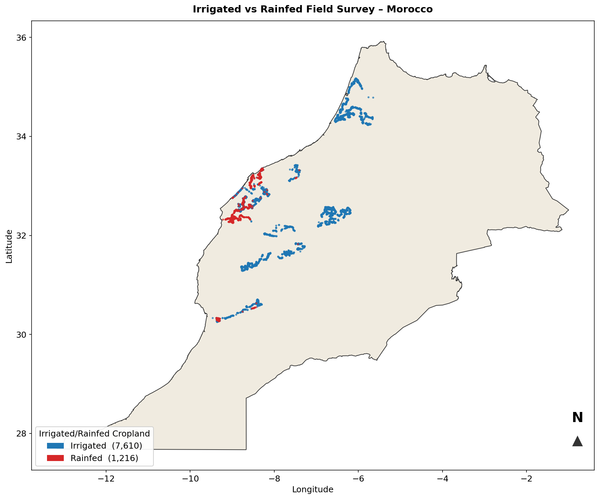
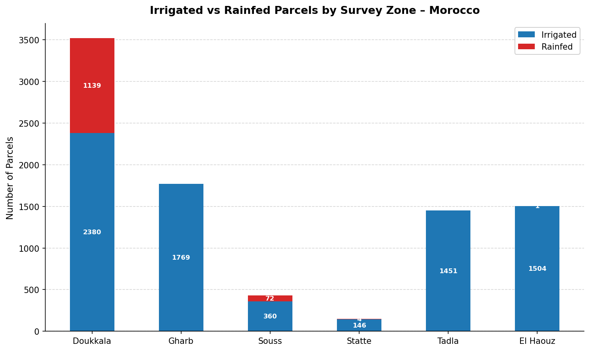
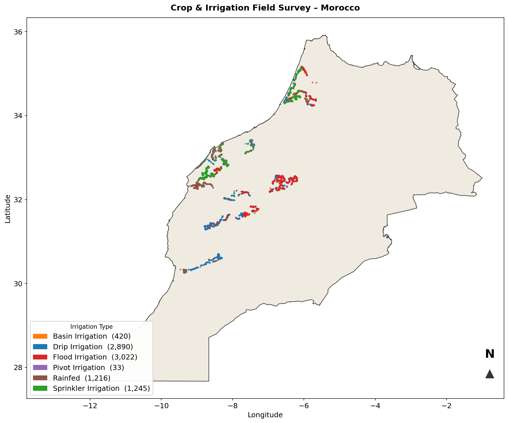

# Data sources

Dataset used in this research, or planned for later phases, with its provider and source links. 

**Status:** ✅ used · 🟦 used in a side check · 📝 planned · 🔍 candidate (under review)

## Ground truth

| Dataset | Provider | Content | Period | Use here | Access | Status |
| --- | --- | --- | --- | --- | --- | --- |
| **Crop and irrigation ground-truth dataset for Moroccan agricultural regions** | Ouassanouan et al. (2026), *Scientific Data* | ~10,000 geolocated parcels in El Gharb, Tadla, Doukkala, El Haouz, Souss; 45 crop types, 6 irrigation systems, a photo per parcel | Dec 2023 – Jan 2025 | labels: 8,781 cropland parcels after cleaning (7,585 irrigated, 1,196 rainfed) | open, citation required · [paper](https://doi.org/10.1038/s41597-026-06993-y) | ✅ |
| **GMIA-NEXT** reference points ([summary](../references/kebede-2026-gmia-next.md)) | Kebede et al. (2026) | 380,696 global irrigated / non-irrigated point labels (paper: 230,683 + 153,194) | 2023/24 | independent test points (Morocco check; Tunisia: 54 points, 44 irrigated, 10 rainfed) | open · [maps](https://doi.org/10.5281/zenodo.17627111) · [points](https://zenodo.org/records/20732681) | 🟦 |
| **WSDA Agricultural Land Use** (Washington, USA) | Washington State Department of Agriculture | field polygons with crop and irrigation method; `Irrigation = None` for non-irrigated fields | 2025 (yearly) | candidate transfer region (eastern Washington) | open · [WSDA](https://agr.wa.gov/departments/land-and-water/natural-resources/agricultural-land-use) | 🔍 |
| **Water-Related Land Use** (Utah, USA) | Utah Division of Water Resources | field polygons; `IRR_Method` incl. *Dry Crop* (rainfed) | 2017 – 2025 (yearly) | **second study area** and temporal test (labels of the [Utah training data](../phase1_data/utah.md): WRLU 2024 and 2021); `data/Utah_field_data/` | open · [WRLU](https://dwre-utahdnr.opendata.arcgis.com/pages/wrlu-data) | ✅ |
| Verified irrigated agricultural lands, 2002–2017 | USGS | irrigated fields only, 14 US states | 2002 – 2017 | not usable (no rainfed class) | open · [ScienceBase](https://www.sciencebase.gov/catalog/item/5ece996d82ce30fd9808527b) | – |
| CRDSS irrigated parcels, Division 5 (Colorado, USA) | Colorado Division of Water Resources | irrigated parcels only | 2000 – 2023 | not usable (no rainfed class) | open · [CDSS GIS](https://cdss.colorado.gov/gis-data/gis-data-by-category) | – |

## Satellite imagery (Google Earth Engine)

| Collection | Provider | Bands / variables | Resolution | Use here | Earth Engine ID | Status |
| --- | --- | --- | --- | --- | --- | --- |
| **Sentinel-2 Level-2A** (surface reflectance, harmonised) | ESA Copernicus | B1–B12 (12 bands) | 10–60 m, resampled to 10 m; 5-day revisit | monthly median composites of clear pixels | `COPERNICUS/S2_SR_HARMONIZED` | ✅ |
| **Cloud Score+** for Sentinel-2 | Google (Pasquarella et al., 2023) | `cs_cdf` (clear-sky probability) | 10 m | cloud mask: keep pixels with cs_cdf ≥ 0.60 | `GOOGLE/CLOUD_SCORE_PLUS/V1/S2_HARMONIZED` | ✅ |
| **Sentinel-1 GRD** | ESA Copernicus | VV, VH backscatter, ascending and descending | 10 m; 6–12-day revisit | monthly mean in linear power, stored in dB | `COPERNICUS/S1_GRD` | ✅ |

Access: open (Copernicus data policy); Earth Engine account or service account needed. Processing details:
[Dataset pipeline](../phase1_data/morocco.md).

## Auxiliary and reference maps

| Dataset | Provider | Content | Resolution | Use here | Access | Status |
| --- | --- | --- | --- | --- | --- | --- |
| **GADM 4.1** | GADM | Morocco boundary | vector | study-area clip | open (non-commercial) · [gadm.org](https://gadm.org/download_country.html) | ✅ |
| **ESA WorldCover 2021 v200** | Zanaga et al. (2022), ESA | 11 land-cover classes (cropland = 40) | 10 m | cropland check of the survey parcels; reference map | CC-BY 4.0 · [Zenodo](https://doi.org/10.5281/zenodo.7254221) | ✅ |
| **LGRIP30** | Teluguntla et al. (2023), USGS / NASA LP DAAC | irrigated and rainfed cropland | 30 m, nominal 2015 | reference map; comparison of the final maps | open · [LP DAAC](https://doi.org/10.5067/COMMUNITY/LGRIP/LGRIP30.001) | 🟦 |
| **GMIE** | Wu et al. (2023) | global maximum irrigation extent | 30 m | comparison of the final maps | open, citation required · [paper](https://doi.org/10.1016/j.gloenvcha.2023.102652) | 📝 |
| **WorldCereal** cropland / irrigation | Van Tricht et al. (2023) | cropland and irrigation products | 10 m | comparison; cropland mask for mapping | open · [ESSD paper](https://doi.org/10.5194/essd-15-5491-2023) | 📝 |
| **GLAD global cropland** | Potapov et al. (2021) | cropland extent and change | 30 m | cropland mask for mapping | open · [paper](https://doi.org/10.1038/s43016-021-00429-z) | 📝 |
| **FAO WaPOR** | FAO | evapotranspiration, water productivity | 20–250 m | interpretation of irrigation patterns; optional extra variables | open (registration) · [WaPOR](https://www.fao.org/in-action/remote-sensing-for-water-productivity/en) | 📝 |
| **FAO AQUASTAT** | FAO | national irrigated-area statistics | country | check of the annual map series (RQ3) | open · [AQUASTAT](https://www.fao.org/aquastat/en/) | 📝 |

## Pretrained models

Clay v1.5, Prithvi-EO-2.0-300M-TL, TerraMind-1.0-base and AgriFM, with open weights. Developers, papers and download
locations are listed in [Foundation models](../foundation_models.md).

---

## The Moroccan field survey in detail

Ouassanouan, Y., Elfarkh, J., Grich, S., Liblab, A., & Chehbouni, A. (2026). Crop and irrigation types ground-truth
dataset for Moroccan agricultural regions. *Scientific Data*, 13, 746.
[doi:10.1038/s41597-026-06993-y](https://doi.org/10.1038/s41597-026-06993-y)

> About 10,000 geolocated agricultural parcels were collected across the five major agricultural regions of
> Morocco (El Gharb, Tadla, Doukkala, El Haouz and Souss) between December 2023 and January 2025, with the GIS mobile
> application QField. The dataset covers 45 crop types, from seasonal crops such as wheat, maize and alfalfa to
> perennial crops such as olives, citrus and argan, and six irrigation systems, from traditional flood irrigation to
> pivots. Each record has a geo-referenced photograph. NDVI time series of 2024 were used to check the consistency
> of the records. *(Summary of the paper's abstract.)*

| Region | Irrigation and crops | Parcels used here |
| --- | --- | --- |
| El Gharb | surface-water irrigation; rice, vegetables | 2023/24 survey |
| Tadla | large-scale irrigation; sugar beet, cereals | 2023/24 survey |
| Doukkala | mixed irrigated and rainfed systems (most rainfed parcels) | both seasons |
| El Haouz | groundwater irrigation; olives, citrus | both seasons |
| Souss | advanced drip systems; export crops | 2024/25 survey |

How the parcels were cleaned and labelled: [ML-ready dataset](../phase1_data/morocco.md). Paper summary: [Moroccan field survey](../references/ouassanouan-2026-morocco-survey.md).

