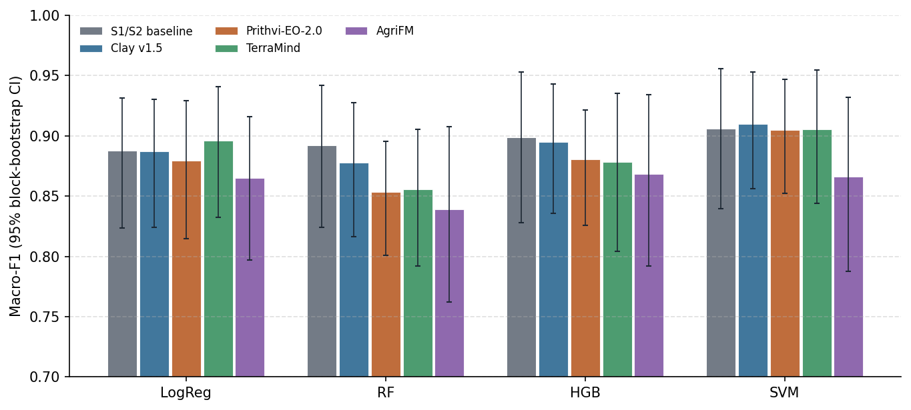
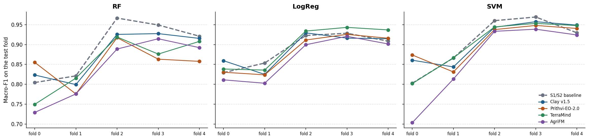
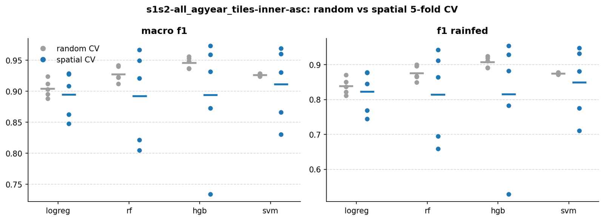
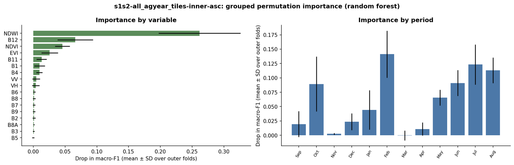

# E01 · Frozen GeoFMs + PCA vs the S1/S2 baseline (nested spatial CV) — report

> **Answer.** No frozen foundation model classifies irrigated vs rainfed parcels better than the Sentinel-1/2
> baseline. The best pair, Clay + SVM (macro-F1 **0.910**), is level with the baseline + SVM (**0.906**;
> Δ +0.003, 95% CI −0.022 to +0.030). The embeddings carry about the same information as well-designed monthly
> S1/S2 features, and they hold up better in the hardest region.

## Key findings
- **No input differs from the baseline after correcting for multiple tests** for Clay, Prithvi and TerraMind,
  whatever the classifier. The four best results lie within 0.005 of each other (0.905–0.910, all with the SVM).
- **Linear probe:** TerraMind 0.896, Clay 0.887 and the baseline 0.887 are level. The frozen embeddings are about as
  linearly separable as the hand-built features, which is the standard test of what an encoder already knows.
- **Random forest is the weakest classifier on embeddings** (0.839–0.878 against 0.892 for the baseline). PCA
  components spread the information over many dense features, which suits SVM and LogReg better than axis-aligned
  tree splits.
- **AgriFM is clearly behind** (0.839–0.868; significantly worse with RF and SVM). Its input normalisation is still
  an open point, so this is not yet a fair verdict on the model.
- **The hardest test fold separates the models.** In fold 0 (rainfed parcels in Doukkala and Souss), the baseline
  drops to 0.80 (RF, SVM) while Clay and Prithvi stay higher with every classifier (Prithvi 0.87 and Clay 0.86 with
  the SVM). Across the five folds Clay and Prithvi vary about as much as or less than the baseline (SD 0.045–0.054
  with LogReg/SVM, vs 0.044–0.075 for the baseline).
- **Rainfed is the hard class:** rainfed F1 ~0.81–0.84 for the best pairs against irrigated F1 ~0.97.

<!-- AUTO:RESULTS:START -->
<!-- generated by experiments/make_report.py: do not edit between these markers -->

## Setup

| | |
| --- | --- |
| Question | Do frozen foundation-model embeddings separate irrigated from rainfed parcels better than Sentinel-1/2 features, with the same parcels, folds and classifiers? |
| Research question | RQ1 |
| Inputs | S1/S2 baseline, Clay v1.5, Prithvi-EO-2.0, TerraMind, AgriFM |
| Temporal aggregation (GeoFMs) | 12 monthly embeddings side by side → standardise → PCA 128 (fitted on the training folds only) |
| Classifiers | logistic regression (linear probe), random forest, gradient boosting (HGB), RBF SVM |
| Validation | 5 spatial folds (20 km blocks); hyperparameters by inner spatial CV on the 4 training folds, model refit on all 4 (nested spatial CV) |
| Parcels | 8,775 / 8,781 (inputs scored on the parcels common to all runs) |
| Uncertainty | 95% CI from a block bootstrap (1,000 draws of whole 20 km blocks), the same draws for every run → paired differences; p-values Holm-adjusted |
| Changed from | first experiment on the shared 128 px tile store with patch-aligned chips |

## Results

### Macro-F1 of every input and classifier

Out-of-fold predictions of all 5 spatial folds; **bold** = best input for that classifier.

| Input | LogReg | RF | HGB | SVM |
| --- | ---: | ---: | ---: | ---: |
| S1/S2 baseline | 0.887 | **0.892** | **0.899** | 0.906 |
| Clay v1.5 | 0.887 | 0.878 | 0.895 | **0.910** |
| Prithvi-EO-2.0 | 0.880 | 0.853 | 0.881 | 0.905 |
| TerraMind | **0.896** | 0.856 | 0.878 | 0.905 |
| AgriFM | 0.865 | 0.839 | 0.868 | 0.866 |

### Difference from the S1/S2 baseline (headline classifiers)

Δ = input minus baseline with the same classifier, on the same parcels and the same bootstrap draws. **Better / worse** = the 95% CI excludes 0 **and** the Holm-adjusted p < 0.05 (Holm corrects for testing all inputs × classifiers at once).

| Input | Classifier | Δ macro-F1 | 95% CI | p (Holm) | Verdict |
| --- | --- | ---: | ---: | ---: | --- |
| Clay v1.5 | RF | -0.014 | [-0.035, +0.011] | 1.000 | no clear difference |
| Clay v1.5 | LogReg | -0.000 | [-0.018, +0.017] | 1.000 | no clear difference |
| Prithvi-EO-2.0 | RF | -0.039 | [-0.071, +0.006] | 0.760 | no clear difference |
| Prithvi-EO-2.0 | LogReg | -0.008 | [-0.027, +0.013] | 1.000 | no clear difference |
| TerraMind | RF | -0.036 | [-0.057, -0.013] | 0.056 | lower, not significant after Holm |
| TerraMind | LogReg | +0.008 | [-0.012, +0.030] | 1.000 | no clear difference |
| AgriFM | RF | -0.053 | [-0.084, -0.021] | < 0.001 | **worse** |
| AgriFM | LogReg | -0.023 | [-0.045, -0.003] | 0.176 | lower, not significant after Holm |

Other classifiers (robustness check)

| Input | Classifier | Δ macro-F1 | 95% CI | p (Holm) | Verdict |
| --- | --- | ---: | ---: | ---: | --- |
| Clay v1.5 | HGB | -0.003 | [-0.041, +0.033] | 1.000 | no clear difference |
| Clay v1.5 | SVM | +0.003 | [-0.022, +0.030] | 1.000 | no clear difference |
| Prithvi-EO-2.0 | HGB | -0.018 | [-0.056, +0.024] | 1.000 | no clear difference |
| Prithvi-EO-2.0 | SVM | -0.001 | [-0.028, +0.030] | 1.000 | no clear difference |
| TerraMind | HGB | -0.020 | [-0.039, -0.005] | 0.056 | lower, not significant after Holm |
| TerraMind | SVM | -0.001 | [-0.022, +0.024] | 1.000 | no clear difference |
| AgriFM | HGB | -0.030 | [-0.062, -0.009] | 0.056 | lower, not significant after Holm |
| AgriFM | SVM | -0.040 | [-0.066, -0.015] | < 0.001 | **worse** |

### Per-class metrics (headline classifiers, 95% CI)

| Input | Classifier | Macro-F1 | F1 rainfed | Balanced acc. | Overall acc. |
| --- | --- | ---: | ---: | ---: | ---: |
| S1/S2 baseline | RF | 0.892 [0.82–0.94] | 0.813 [0.69–0.90] | 0.893 [0.82–0.95] | 0.949 [0.92–0.98] |
| S1/S2 baseline | LogReg | 0.887 [0.82–0.93] | 0.810 [0.69–0.89] | 0.931 [0.90–0.96] | 0.941 [0.91–0.97] |
| Clay v1.5 | RF | 0.878 [0.82–0.93] | 0.787 [0.67–0.88] | 0.866 [0.81–0.92] | 0.944 [0.91–0.97] |
| Clay v1.5 | LogReg | 0.887 [0.82–0.93] | 0.809 [0.69–0.89] | 0.926 [0.89–0.95] | 0.942 [0.91–0.97] |
| Prithvi-EO-2.0 | RF | 0.853 [0.80–0.90] | 0.746 [0.65–0.82] | 0.848 [0.80–0.90] | 0.932 [0.90–0.96] |
| Prithvi-EO-2.0 | LogReg | 0.880 [0.81–0.93] | 0.796 [0.68–0.88] | 0.922 [0.89–0.95] | 0.937 [0.90–0.97] |
| TerraMind | RF | 0.856 [0.79–0.91] | 0.748 [0.62–0.84] | 0.832 [0.78–0.89] | 0.937 [0.91–0.97] |
| TerraMind | LogReg | 0.896 [0.83–0.94] | 0.823 [0.70–0.90] | 0.929 [0.89–0.96] | 0.947 [0.92–0.97] |
| AgriFM | RF | 0.839 [0.76–0.91] | 0.719 [0.57–0.84] | 0.821 [0.74–0.89] | 0.928 [0.89–0.96] |
| AgriFM | LogReg | 0.865 [0.80–0.92] | 0.772 [0.64–0.86] | 0.909 [0.87–0.95] | 0.929 [0.90–0.96] |

### Macro-F1 per test fold

Each fold is a set of 20 km blocks, used once as the test fold. Rainfed test parcels per fold: fold 0: Doukkala 180, Souss 59; fold 1: Doukkala 237; fold 2: Doukkala 241; fold 3: Doukkala 234; fold 4: Doukkala 230.

**RF**

| Input | Fold 0 | Fold 1 | Fold 2 | Fold 3 | Fold 4 | Mean ± SD |
| --- | ---: | ---: | ---: | ---: | ---: | ---: |
| S1/S2 baseline | 0.804 | 0.821 | 0.967 | 0.949 | 0.921 | 0.893 ± 0.075 |
| Clay v1.5 | 0.823 | 0.799 | 0.926 | 0.928 | 0.915 | 0.878 ± 0.062 |
| Prithvi-EO-2.0 | 0.855 | 0.776 | 0.917 | 0.863 | 0.858 | 0.854 ± 0.051 |
| TerraMind | 0.750 | 0.816 | 0.919 | 0.876 | 0.908 | 0.854 ± 0.071 |
| AgriFM | 0.729 | 0.776 | 0.889 | 0.915 | 0.892 | 0.840 ± 0.082 |

**LogReg**

| Input | Fold 0 | Fold 1 | Fold 2 | Fold 3 | Fold 4 | Mean ± SD |
| --- | ---: | ---: | ---: | ---: | ---: | ---: |
| S1/S2 baseline | 0.829 | 0.853 | 0.923 | 0.928 | 0.909 | 0.889 ± 0.044 |
| Clay v1.5 | 0.859 | 0.825 | 0.929 | 0.916 | 0.915 | 0.889 ± 0.045 |
| Prithvi-EO-2.0 | 0.830 | 0.824 | 0.911 | 0.926 | 0.916 | 0.881 ± 0.050 |
| TerraMind | 0.839 | 0.836 | 0.934 | 0.943 | 0.937 | 0.898 ± 0.055 |
| AgriFM | 0.811 | 0.803 | 0.900 | 0.921 | 0.902 | 0.867 ± 0.056 |

**SVM**

| Input | Fold 0 | Fold 1 | Fold 2 | Fold 3 | Fold 4 | Mean ± SD |
| --- | ---: | ---: | ---: | ---: | ---: | ---: |
| S1/S2 baseline | 0.803 | 0.866 | 0.960 | 0.969 | 0.930 | 0.906 ± 0.070 |
| Clay v1.5 | 0.861 | 0.844 | 0.944 | 0.958 | 0.949 | 0.911 ± 0.054 |
| Prithvi-EO-2.0 | 0.874 | 0.831 | 0.938 | 0.948 | 0.940 | 0.906 ± 0.051 |
| TerraMind | 0.802 | 0.867 | 0.944 | 0.953 | 0.948 | 0.903 ± 0.067 |
| AgriFM | 0.703 | 0.813 | 0.933 | 0.939 | 0.924 | 0.863 ± 0.103 |

### Files

- Tables: [`experiments/E01_frozen_pca_nested/results/comparison/`](https://github.com/amanchry/irrimapping-geofm/tree/main/experiments/E01_frozen_pca_nested/results/comparison) (all metrics with CI, differences vs baseline)
- Per run ([`experiments/E01_frozen_pca_nested/results/<run>/`](https://github.com/amanchry/irrimapping-geofm/tree/main/experiments/E01_frozen_pca_nested/results)): out-of-fold predictions, metrics per fold, selected hyperparameters, run log
- Settings: [`experiments/E01_frozen_pca_nested/config.yaml`](https://github.com/amanchry/irrimapping-geofm/blob/main/experiments/E01_frozen_pca_nested/config.yaml)
- Confusion matrices: [AgriFM](figures/confusion_agrifm_agyear_tiles_concat.png) · [Clay v1.5](figures/confusion_clay_agyear_tiles_concat.png) · [Prithvi-EO-2.0](figures/confusion_prithvi_agyear_tiles_concat.png) · [S1/S2 baseline](figures/confusion_s1s2-all_agyear_tiles-inner-asc.png) · [TerraMind](figures/confusion_terramind_agyear_tiles_concat.png)
- Code version: `858cb3d (with uncommitted changes)`, run 2026-11-05 17:39 – 2026-11-05 17:40

<!-- AUTO:RESULTS:END -->

## Additional analyses

Computed in the same runs (`cv_random_vs_spatial.csv`, `importance.csv` and `selected_hyperparameters.csv` of each
run).

### Random versus spatial cross-validation

The same hyperparameters were re-evaluated with a stratified random 5-fold split that ignores the spatial blocks.

| Input | Classifier | Random CV, mean macro-F1 | Spatial CV, mean macro-F1 | Spatial CV, worst fold |
| --- | --- | ---: | ---: | ---: |
| S1/S2 baseline | LogReg | 0.904 | 0.895 | 0.847 |
| S1/S2 baseline | RF | 0.928 | 0.893 | 0.804 |
| S1/S2 baseline | HGB | 0.946 | 0.894 | 0.734 |
| S1/S2 baseline | SVM | 0.926 | 0.911 | 0.830 |
| Clay v1.5 | SVM | 0.936 | 0.911 | 0.844 |
| Prithvi-EO-2.0 | SVM | 0.916 | 0.906 | 0.831 |
| TerraMind | SVM | 0.933 | 0.903 | 0.802 |
| AgriFM | SVM | 0.913 | 0.863 | 0.703 |

Random cross-validation is 1–5 points more optimistic for every input, and its folds lie within about one point of
each other (SD ≤ 0.014), whereas the spatial folds differ by up to 0.24 (SD 0.04–0.10). Random validation thus both
overstates accuracy and conceals the dependence of accuracy on the region.

<figure markdown="span">
  
  <figcaption><b>Figure E01.1.</b> Macro-F1 (left) and rainfed F1 (right) per fold for the S1/S2 baseline under random (grey) and spatial (blue) 5-fold cross-validation; bars mark the mean.</figcaption>
</figure>

### What the baseline relies on

Grouped permutation importance of the random forest, computed on the test fold of each outer round: all features of
one variable (or of one month) are permuted together and the drop in macro-F1 is recorded.

| Variable | Drop in macro-F1 | | Month | Drop in macro-F1 |
| --- | ---: | --- | --- | ---: |
| NDWI | 0.262 | | February | 0.141 |
| B12 (SWIR 2) | 0.066 | | July | 0.123 |
| NDVI | 0.046 | | August | 0.113 |
| EVI | 0.026 | | June | 0.091 |
| B11 (SWIR 1) | 0.013 | | October | 0.089 |

Water-sensitive variables (NDWI, SWIR) dominate, and the most informative months are the peak of the rainfed season
(February) and the dry summer (June–August), when only irrigated fields remain green. This supports the use of the
full agricultural year. For the foundation-model embeddings, permuting a single month changes macro-F1 by at most
0.011 (Clay and Prithvi: February and May; TerraMind: July–September), i.e. the information is spread over the months.

<figure markdown="span">
  
  <figcaption><b>Figure E01.2.</b> Grouped permutation importance of the S1/S2 baseline (random forest) by variable (left) and by month (right); mean ± SD over the five outer folds.</figcaption>
</figure>

### Selected hyperparameters

Setting chosen most often over the five outer rounds (count in brackets).

| Input | LogReg | RF | HGB | SVM |
| --- | --- | --- | --- | --- |
| S1/S2 baseline | C = 1 (2/5) | √p · leaf 5 · balanced (5/5) | lr 0.1 · 15 leaves · balanced (2/5) | C = 1 · γ = scale (3/5) |
| Clay v1.5 | C = 0.01 (4/5) | 0.3 · leaf 5 · balanced (5/5) | lr 0.05 · 15 leaves · balanced (3/5) | C = 1 · γ = scale (5/5) |
| Prithvi-EO-2.0 | C = 0.01 (4/5) | 0.3 · leaf 5 · balanced (5/5) | lr 0.1 · 15 leaves · balanced (2/5) | C = 1 · γ = scale (5/5) |
| TerraMind | C = 0.01 (5/5) | 0.3 · leaf 5 · balanced (5/5) | lr 0.05 · 15 leaves · balanced (4/5) | C = 1 · γ = scale (5/5) |
| AgriFM | C = 0.01 (5/5) | 0.3 · leaf 5 · balanced (4/5) | lr 0.05 · 15 leaves · balanced (2/5) | C = 1 · γ = scale (5/5) |

The embeddings require strong regularisation of the linear probe (C = 0.01), whereas the baseline features prefer
weaker regularisation. Class weighting and small trees are selected almost everywhere, and the SVM keeps its default
setting for every foundation model.

## Interpretation
For RQ1, the frozen foundation models reach the accuracy of a conventional Sentinel-1/2 classifier but do not exceed
it on average. This matches PANGAEA (Marsocci et al. 2024), where GeoFMs do not consistently beat supervised
baselines. Where they may add value is **robustness**: in the region the baseline handles worst, Clay and Prithvi do
better with every classifier. That points to the next questions: is this fold effect stable under the final validation
design (E02), and does a learned temporal aggregation (E04) let the embeddings use the 12 months better than PCA?

## Caveats
- **Nested validation design**, replaced by the PASTIS rotation in [E02](../E02_frozen_pca/index.md); E01 is
  kept as a sensitivity check.
- **AgriFM normalisation** not yet confirmed (open point in [PROGRESS.md](../../progress.md)).
- **Small rainfed class** (1,196 parcels, ~240 per fold): per-fold scores for rainfed rest on few parcels, hence the
  wide intervals.
- **Region and year are partly confounded** (Gharb and Tadla only 2023/24; Souss only 2024/25), so the fold
  differences cannot be attributed to region alone.

## Next steps
- Run [E02](../E02_frozen_pca/index.md): the main RQ1 result.
- Resolve the AgriFM normalisation and re-embed if needed.
- Implement the L-TAE pipeline ([E04](../E04_frozen_ltae/index.md)).
