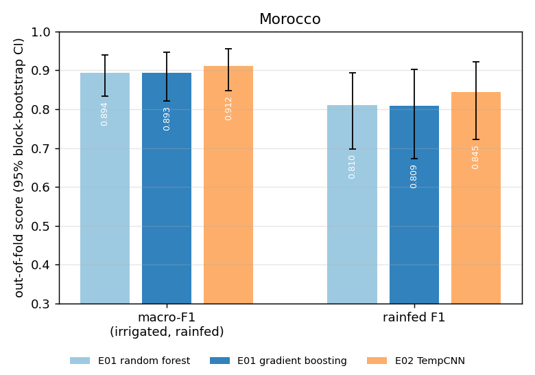
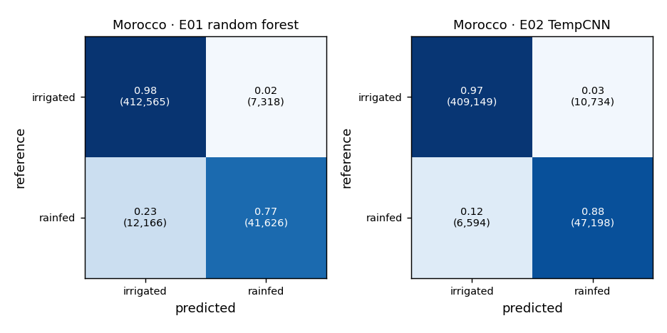
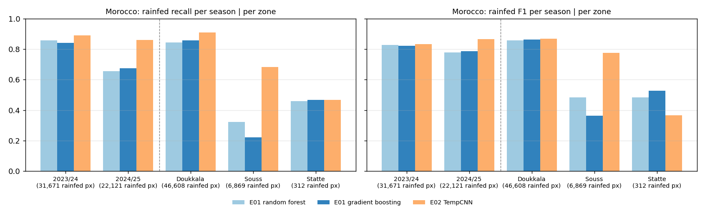
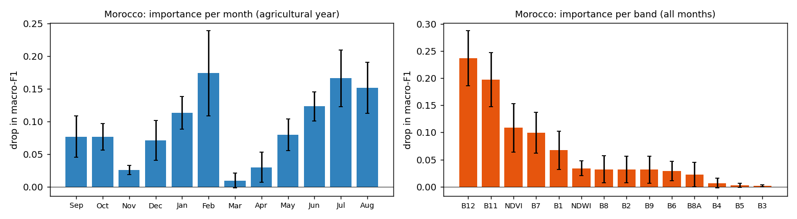

# E01 · Sentinel-2 pixel baseline

!!! success "Status: Morocco done (20 November 2026); Utah later"
    Two classes (irrigated, rainfed) on the labelled pixels of the surveyed parcels: Morocco 2023/24 and 2024/25
    pooled, 473,675 pixels of 8,775 parcels. Random forest **macro-F1 0.894** [0.834, 0.940], rainfed F1 0.810;
    gradient boosting the same (0.893). [Results](#results)

**Question.** How well do the Sentinel-2 time series of single pixels separate irrigated from rainfed pixels? E01
is the reference for every later experiment: the paired tests compare each run with the E01 random forest.

**Why.** Random forests on per-pixel time series are the standard in operational irrigation mapping (Ketchum et al.
2020; Xie et al. 2021). Any more complex model has to beat this reference on the same pixels.

## Set-up

| Item | Choice |
| --- | --- |
| **Samples** | the labelled pixels of the surveyed parcels ([Pixel samples](../phase1_data/pixel_samples.md)): inner pixels, at most 100 per parcel; Morocco 2023/24 and 2024/25 pooled |
| **Classes** | 1 irrigated · 2 rainfed |
| **Input** | 12 months × (12 Sentinel-2 bands + NDVI + NDWI) = 168 features. Months without a clear observation are filled by linear interpolation in time (first / last month: nearest observed month); a band never observed is filled with the training median |
| **Models** | random forest (500 trees, `class_weight = "balanced"`); histogram gradient boosting (`class_weight = "balanced"`, at most 1,000 iterations, early stopping on an internal 10% split) |
| **Hyperparameters** | grid evaluated on the validation fold of each round (macro-F1): random forest `max_features` ∈ {√p, 0.33} × `min_samples_leaf` ∈ {1, 5}; gradient boosting learning rate ∈ {0.05, 0.1} × `max_leaf_nodes` ∈ {31, 63} |
| **Validation** | PASTIS rotation over the 5 spatial folds: round *k* tests fold *k*, validates on fold *k*+1 and trains on the other three |
| **Importance** | grouped permutation importance of the random forest: drop in macro-F1 when all features of one month, or one band over all months, are shuffled (20,000 test pixels per round) |
| **Seed** | 42 |

??? info "How the random forest works"
    A **decision tree** splits the pixels step by step on single features ("NDVI in July > 0.45?", "B11 in March <
    0.2?"), each time choosing the split that best separates the classes, until the groups are pure or small. One
    tree overfits easily. A **random forest** (Breiman 2001) grows many trees (here 500), each on a bootstrap sample
    of the training pixels and, at every split, on a random subset of the features (`max_features`: √168 ≈ 13 or
    33%). The trees therefore make different mistakes, and the forest averages their votes into class
    probabilities. `min_samples_leaf` stops a tree from splitting groups smaller than 1 or 5 pixels.

    `class_weight = "balanced"` counts each rainfed pixel more, in inverse proportion to its share, so the forest
    does not simply favour the irrigated majority. The months are 168 separate features: the forest has no notion
    of their order, but it can still use any month that separates the classes.

??? info "How histogram gradient boosting works"
    **Gradient boosting** (Friedman 2001) also combines many trees, but builds them **one after another**: each new
    small tree is fitted to the errors (the gradient of the loss) of all trees before it, and its prediction is
    added with a small weight (the learning rate, 0.05 or 0.1). Many weak trees in sequence give a strong model.
    The **histogram** variant (as in LightGBM, Ke et al. 2017; scikit-learn `HistGradientBoostingClassifier`)
    first bins every feature into at most 255 value ranges, which makes training on hundreds of thousands of
    pixels fast. `max_leaf_nodes` (31 or 63) limits the size of each tree; training stops when an internal 10%
    validation split no longer improves for 20 iterations.

??? info "How the permutation importance works"
    After training, the values of one group of features are shuffled across the test pixels (e.g. all 14 values of
    July, or one band in all 12 months), which breaks their link to the label while keeping their distribution.
    The drop in macro-F1 compared with the unshuffled data is the importance of that group: a large drop means the
    forest relies on it. Grouping by month answers "which months matter", grouping by band "which bands matter".

## How to run

Script: [`experiments/E01_s2_pixel_baseline/run.py`](https://github.com/amanchry/irrimapping-geofm/blob/main/experiments/E01_s2_pixel_baseline/run.py)
(shared code: [`pixelwise_run/pixel_common.py`](https://github.com/amanchry/irrimapping-geofm/blob/main/pixelwise_run/pixel_common.py)).

```bash
sbatch --export=ALL,SCRIPT=experiments/E01_s2_pixel_baseline/run.py,EXPERIMENT_REGION=morocco jobs/step_cpu.sbatch
```

`EXPERIMENT_QUICK_TEST=1` runs the whole chain on 20,000 pixels with one grid point (output in `results_quick/`).
CPU only; the random-forest grid dominates the run time.

## Outputs

`experiments/E01_s2_pixel_baseline/results/<region>/<rf|hgb>/`; only `results/` is copied from the cluster.

| File | Content |
| --- | --- |
| `oof_predictions.parquet` | per pixel: year, sample index, true label, class probabilities, predicted class, fold, block, zone, tile, coordinates |
| `metrics.csv` | macro-F1 (headline), rainfed and irrigated F1 / precision / recall, overall accuracy, with 95% block-bootstrap CI |
| `metrics_by_group.csv` | the same per year and per zone |
| `confusion.png` | confusion matrix (row shares and counts) |
| `chosen_params.csv` | hyperparameters chosen in each round |
| `importance_month.csv`, `importance_band.csv` | permutation importance (random forest) |
| `run_config.json`, `run.log` | settings, code version, log |

## Results

Morocco, 2023/24 and 2024/25 pooled: 473,675 out-of-fold pixels (419,883 irrigated, 53,792 rainfed). Every pixel is
predicted once, by the model of the round in which its fold was the test fold. The comparison with the other
experiments is on the [comparison page](comparison.md).

### Scores

| Model | Macro-F1 [95% CI] | Irrigated F1 | Rainfed F1 [95% CI] | Rainfed precision | Rainfed recall | Overall accuracy |
| --- | --- | --- | --- | --- | --- | --- |
| **Random forest** (reference) | **0.894** [0.834, 0.940] | 0.977 | **0.810** [0.697, 0.894] | 0.850 | 0.774 | 0.959 |
| Gradient boosting | 0.893 [0.822, 0.946] | 0.977 | 0.809 [0.673, 0.903] | 0.850 | 0.773 | 0.959 |

95% confidence intervals from the block bootstrap over the 20 km blocks. The two models are practically identical:
gradient boosting minus random forest is −0.000 macro-F1 [−0.017, 0.014] (paired test, Holm-adjusted p = 0.98).





*Row-normalised confusion matrices (share of the reference pixels of each class; pixel counts in brackets).*

**Errors are one-sided.** 98% of the irrigated pixels are classified correctly, but 23% of the rainfed pixels
(12,166 of 53,792) are classified as irrigated. Rainfed precision (0.85) is higher than rainfed recall (0.77): when
the random forest says "rainfed" it is mostly right, but it misses about one rainfed pixel in four.

### Scores per year and zone



*Rainfed recall and F1 per season and per zone with rainfed parcels (number of rainfed pixels in brackets).*

| Group | Rainfed pixels | Random forest: rainfed recall | Random forest: rainfed F1 | Gradient boosting: rainfed F1 |
| --- | --- | --- | --- | --- |
| 2023/24 | 31,671 | 0.857 | 0.828 | 0.822 |
| 2024/25 | 22,121 | **0.655** | 0.779 | 0.788 |
| Doukkala | 46,608 | 0.843 | 0.858 | 0.864 |
| Souss | 6,869 | **0.322** | 0.485 | 0.363 |
| Statte | 312 | 0.458 | 0.485 | 0.526 |

- **The rainfed class comes almost entirely from Doukkala.** 87% of the rainfed pixels (1,122 of 1,196 rainfed
  parcels) lie in Doukkala, 13% in Souss and Statte; Gharb and Tadla have no rainfed parcel and el Haouz one. In the
  three irrigation-only zones the classifier marks almost every pixel irrigated (accuracy ≥ 0.985), so the rainfed
  score of E01 is in practice a score of Doukkala and, to a lesser extent, Souss.
- **2024/25 is harder for rainfed.** Rainfed recall falls from 0.86 (2023/24) to 0.66 (2024/25), while rainfed
  precision rises to 0.96. In 2024/25 more rainfed pixels are taken for irrigated. A plausible reason is the rainfall
  of the two years: 2023/24 was a drought year, while in a wetter winter rainfed cereals stay green longer and look
  more like irrigated fields in the winter months. This is an interpretation; the rainfall of the two years has not
  been checked here.
- **Souss is the weakest zone.** Only 32% of the rainfed pixels of Souss are found (gradient boosting: 22%). Its
  69 rainfed parcels are few, and the random forest learns rainfed mostly from Doukkala.

**Per test fold.** Macro-F1 of the random forest per test fold: 0.762 (fold 0), 0.911, 0.921, 0.942, 0.928 (folds
1–4). Fold 0 is the hardest: it holds the 5,869 rainfed pixels of Souss in 2024/25, of which only 31% are found,
and 2,617 irrigated pixels of Doukkala classified as rainfed. Round 5, which validates on fold 0, also had the lowest
validation scores (0.73–0.76), so the spread between folds is a property of the data, not of the model.

### Which months and bands matter



*Drop in macro-F1 when the features of one month (left) or one band over all months (right) are shuffled; mean and
standard deviation over the 5 rounds.*

- **Months:** February (0.17), July (0.17), August (0.15), June (0.12) and January (0.11) matter most; March and
  November hardly at all (≤ 0.03). The winter peak (January–February) is when rainfed cereals and irrigated crops
  are both green but differ in vigour; the summer months (June–August) are when rainfed fields are bare and many
  irrigated fields still carry a crop or orchard.
- **Bands:** the two shortwave-infrared bands dominate: B12 (0.24) and B11 (0.20), then NDVI (0.11) and the red-edge
  band B7 (0.10). SWIR responds to the water content of soil and vegetation, which is what irrigation changes. The
  visible bands B3, B4 and B5 add almost nothing once the other bands are known (correlated bands share their
  importance).

### Chosen settings and run time

| Round (test fold) | Random forest `max_features`, `min_samples_leaf` | Validation macro-F1 | Gradient boosting learning rate, `max_leaf_nodes` | Validation macro-F1 |
| --- | --- | --- | --- | --- |
| 1 (0) | √p, 5 | 0.893 | 0.05, 31 | 0.915 |
| 2 (1) | √p, 5 | 0.968 | 0.1, 63 | 0.967 |
| 3 (2) | √p, 5 | 0.891 | 0.05, 31 | 0.909 |
| 4 (3) | 0.33, 5 | 0.941 | 0.1, 31 | 0.944 |
| 5 (4) | 0.33, 5 | 0.761 | 0.05, 63 | 0.729 |

`min_samples_leaf = 5` won in every round. Run time on one CPU node: random forest 45 min, gradient boosting 4 min
(including the grid search).

### Interpretation

- A pixel classifier on the Sentinel-2 time series already reaches macro-F1 0.89 for irrigated vs rainfed in
  Morocco. Every later model is measured against this reference on the same pixels.
- Random forest and gradient boosting give the same answer, so the result reflects the information in the input,
  not the choice of tree ensemble.
- The weak point is the rainfed class outside Doukkala and in the wetter year 2024/25: the errors are rainfed
  pixels taken for irrigated. Whether temporal or spatial context (E02–E04) helps is tested on these pixels.
- Because rainfed parcels exist in only three of six zones, part of what any model learns may be "which zone"
  rather than "how the crop behaves". The per-zone scores are reported for every experiment to keep this visible.

## References

- Breiman, L. (2001). Random forests. *Machine Learning* 45, 5–32.
- Friedman, J. H. (2001). Greedy function approximation: a gradient boosting machine. *Annals of Statistics* 29,
  1189–1232.
- Ke, G. et al. (2017). LightGBM: a highly efficient gradient boosting decision tree. *NeurIPS*.
- Ketchum, D. et al. (2020). IrrMapper. *Remote Sensing* 12, 2328.
- Xie, Y., Gibbs, H. K. & Lark, T. J. (2021). LANID. *ESSD* 13, 5689–5710.
