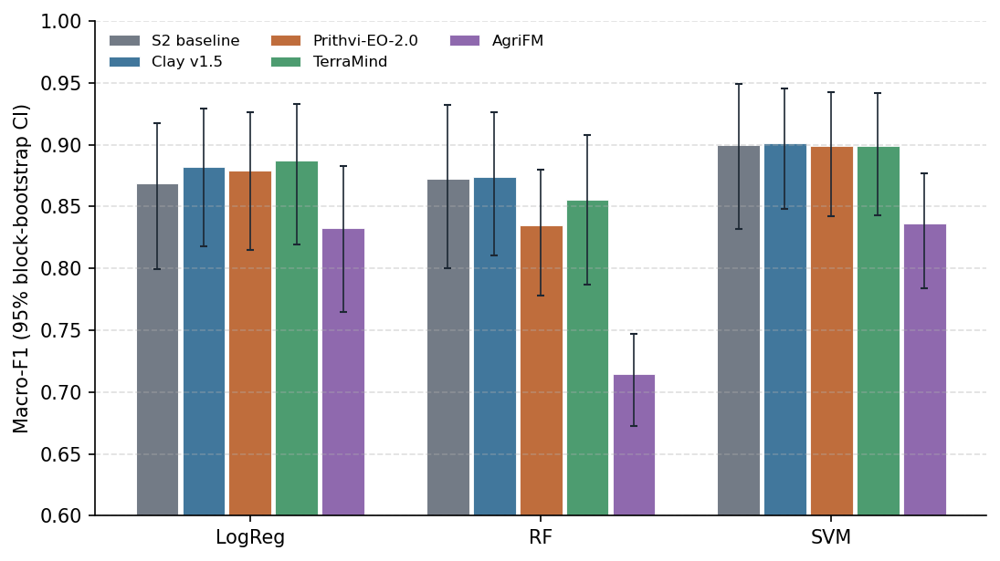
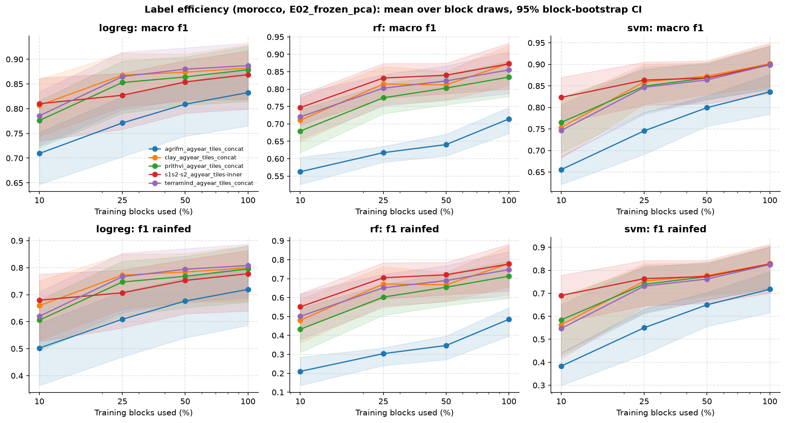
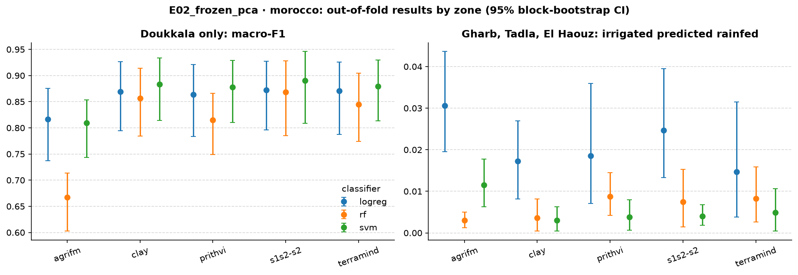
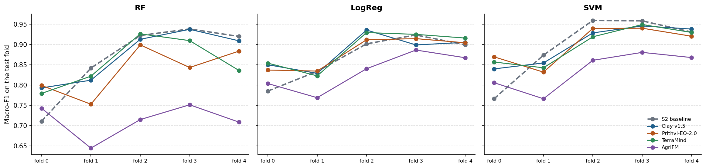
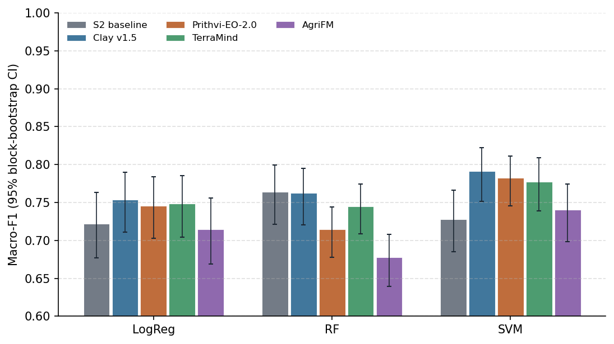
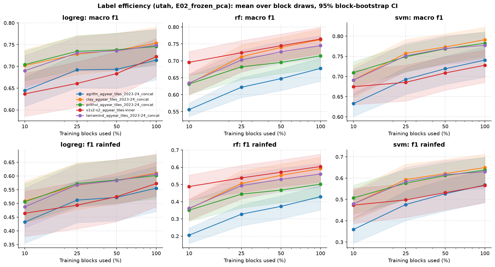
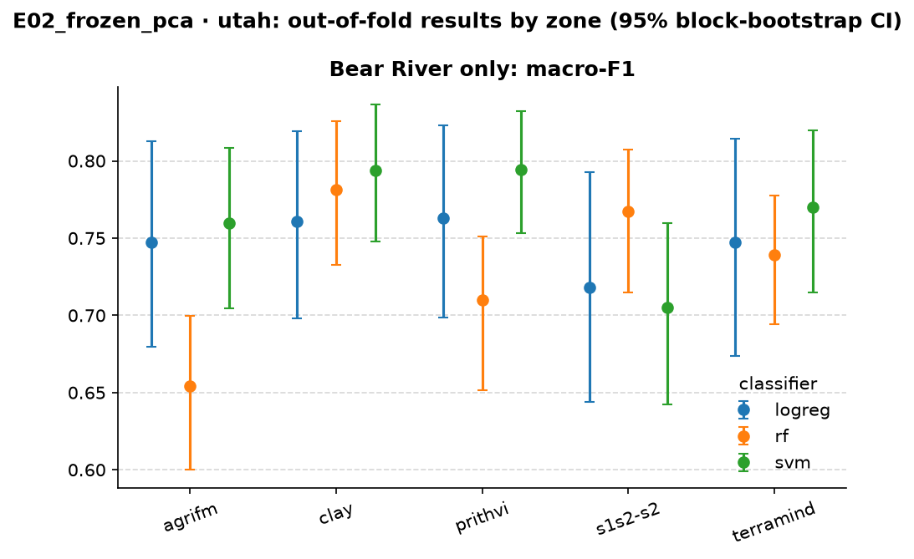
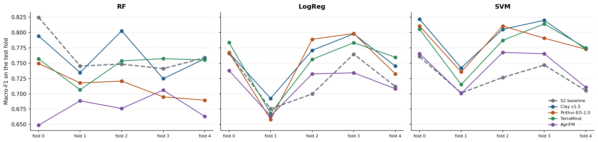

<!-- Report page of an experiment: created by make_report.py as docs/experiments/<name>/report.md -->
# E02 · Frozen GeoFMs + PCA + classical classifiers — report

> **Answer.** Only in Utah, and only with some heads. In Morocco, Clay, Prithvi and TerraMind match the Sentinel-2
> baseline (macro-F1 ≈ 0.90 with SVM), and AgriFM is clearly worse. In Utah, Clay, Prithvi and TerraMind beat the
> baseline by 0.05–0.06 with SVM, and Clay also beats it with the linear probe. The best GeoFM (Clay + SVM, 0.791) is
> 0.03 above the baseline's best head (RF, 0.764).

## Key findings
- **Morocco: no gain.** Clay, Prithvi and TerraMind are within ±0.02 of the S2 baseline with LogReg and SVM, and every CI
  includes 0. With RF they are 0.00–0.04 lower. AgriFM is the only clearly different input: −0.16 with RF and −0.06
  with SVM (significant after Holm).
- **Utah: a small gain that depends on the head.** With SVM, Clay (+0.063), Prithvi (+0.055) and TerraMind (+0.049) are
  significantly better than the S2 baseline, and Clay is also better with LogReg (+0.031). With RF there is no gain,
  and Prithvi is worse (−0.049). Utah is harder than Morocco for every input (best macro-F1 0.79 vs 0.90).
- **The head matters as much as the input.** RF is the weakest head on embeddings (AgriFM in Morocco: 0.71 with RF,
  0.84 with SVM), but the best head on the hand-crafted S2 features in Utah. SVM is the best head for every GeoFM in
  both regions.
- **Label efficiency: no advantage for the GeoFMs in Morocco.** At 10% of the training blocks (≈ 590 parcels per round),
  the S2 baseline is the best input with every head (SVM 0.82 vs 0.75–0.77). The GeoFMs catch up at 25%. In Utah at
  10%, the best GeoFM (Prithvi + SVM, 0.71) is level with the baseline's RF (0.70).
- **With these heads, the GeoFMs do better in an under-represented zone.** In Morocco's Souss zone (69 rainfed
  parcels, test fold 0), SVM finds 61–71% of the rainfed parcels with Clay, Prithvi or TerraMind, but only 22% with the
  S2 features. This explains the baseline's drop in fold 0. Inside Doukkala, where most rainfed training parcels are,
  the baseline is as good as or better than every GeoFM. *Corrected by [E03](../E03_frozen_pca_mlp/report.md): with an MLP head, the S2 features find
  84% of Souss's rainfed parcels, so this gap comes from the classical heads, not from the inputs.*

<!-- AUTO:RESULTS:START -->
<!-- generated by experiments/make_report.py: do not edit between these markers -->

## Setup

| | |
| --- | --- |
| Question | Do frozen foundation-model embeddings separate irrigated from rainfed parcels better than Sentinel-2 features, with the same parcels, folds and classifiers? (Sentinel-2 only for every input, D14) |
| Research question | RQ1 |
| Regions | Morocco, Utah 2023/24 |
| Inputs | S2 baseline, Clay v1.5, Prithvi-EO-2.0, TerraMind, AgriFM |
| Temporal aggregation | 12 monthly embeddings side by side → standardise → PCA 128 (fitted on the training folds only) |
| Head | logistic regression (linear probe), random forest, RBF SVM |
| Validation | 5 spatial folds (20 km blocks); per round 3 folds train, the next fold chooses the hyperparameters or stops training, 1 fold tests (PASTIS rotation) |
| Label efficiency | also trained on 10%, 25%, 50% of the training blocks, 3 block draws each (same draws in every experiment) |
| Parcels | 6,011 / 6,013 / 8,781 (inputs scored on the parcels common to all runs) |
| Uncertainty | 95% CI from a block bootstrap (1,000 draws of whole 20 km blocks), the same draws for every run → paired differences; p-values Holm-adjusted |
| Changed from | E01: validation nested -> pastis (3 folds train, next fold validation, 1 fold test) |

## Morocco

### Macro-F1 of every input and head

Out-of-fold predictions of all 5 spatial folds; **bold** = best input for that head. Runs marked [E0x] come from an earlier experiment, on the same parcels and bootstrap draws.

??? info "How to read this table"

    **What:** one score per input (row) and classifier (column), between 0 and 1. Higher is better.

    **Macro-F1:** F1 is computed for each class separately (irrigated, rainfed) and the two are averaged. Rainfed
    parcels are the minority, so a model that labels everything "irrigated" still gets a high overall accuracy but a
    low macro-F1. That is why macro-F1 is the main metric.

    **How:** every parcel is predicted once, by the model that did *not* see its 20 km block in training (out-of-fold).
    All inputs are scored on the same parcels, so the numbers can be compared directly.

    **Read it as:** about 0.90 = very good; 0.75 = clear errors on the rainfed class; 0.50 = no better than guessing one class.

| Input | LogReg | RF | SVM |
| --- | ---: | ---: | ---: |
| S2 baseline | 0.869 | 0.873 | 0.900 |
| Clay v1.5 | 0.882 | **0.874** | **0.901** |
| Prithvi-EO-2.0 | 0.879 | 0.835 | 0.899 |
| TerraMind | **0.887** | 0.855 | 0.899 |
| AgriFM | 0.833 | 0.714 | 0.836 |

### Difference from the S2 baseline (headline heads)

Δ = input minus baseline with the same head (runs with their own model against the baseline's random forest), on the same parcels and the same bootstrap draws. **Better / worse** = the 95% CI excludes 0 **and** the Holm-adjusted p < 0.05.

??? info "How to read this table"

    **What:** each row compares one input with the S2 baseline, using the same classifier.

    - **Δ macro-F1:** the input's score minus the baseline's. +0.013 means 0.013 higher than the baseline; −0.158
      means 0.158 lower.
    - **95% CI, e.g. [−0.021, +0.025]:** the range in which the true difference probably lies. It comes from
      resampling whole 20 km blocks 1,000 times (block bootstrap) and recomputing Δ each time.
        - The range **includes 0** (one end negative, the other positive): the data cannot tell which input is
          better.
        - The range is **entirely above 0**, e.g. [+0.011, +0.049]: the input is better.
        - The range is **entirely below 0**, e.g. [−0.215, −0.085]: the input is worse.
    - **p (Holm):** how likely a difference this large would be if the two inputs were really equal. Many pairs are
      tested at once, so each p-value is raised (Holm correction) to avoid false "wins" by chance. 1.000 = no evidence
      of a difference.
    - **Verdict:** "better" or "worse" only if the CI excludes 0 **and** p (Holm) < 0.05. "Higher/lower, not
      significant after Holm" = the CI excludes 0, but the evidence does not survive the correction.

    **Why paired:** both inputs are scored on the same parcels and the same bootstrap draws, so a difference reflects
    the inputs, not which parcels happened to be drawn.

| Input | Classifier | Δ macro-F1 | 95% CI | p (Holm) | Verdict |
| --- | --- | ---: | ---: | ---: | --- |
| Clay v1.5 | RF | +0.001 | [-0.021, +0.025] | 1.000 | no clear difference |
| Clay v1.5 | LogReg | +0.013 | [-0.008, +0.040] | 1.000 | no clear difference |
| Prithvi-EO-2.0 | RF | -0.038 | [-0.075, +0.011] | 0.918 | no clear difference |
| Prithvi-EO-2.0 | LogReg | +0.010 | [-0.010, +0.038] | 1.000 | no clear difference |
| TerraMind | RF | -0.017 | [-0.063, +0.020] | 1.000 | no clear difference |
| TerraMind | LogReg | +0.018 | [-0.006, +0.050] | 1.000 | no clear difference |
| AgriFM | RF | -0.158 | [-0.215, -0.085] | < 0.001 | **worse** |
| AgriFM | LogReg | -0.036 | [-0.066, -0.009] | 0.140 | lower, not significant after Holm |

Other heads (robustness check)

| Input | Classifier | Δ macro-F1 | 95% CI | p (Holm) | Verdict |
| --- | --- | ---: | ---: | ---: | --- |
| Clay v1.5 | SVM | +0.002 | [-0.025, +0.031] | 1.000 | no clear difference |
| Prithvi-EO-2.0 | SVM | -0.000 | [-0.034, +0.036] | 1.000 | no clear difference |
| TerraMind | SVM | -0.001 | [-0.034, +0.036] | 1.000 | no clear difference |
| AgriFM | SVM | -0.063 | [-0.098, -0.029] | 0.022 | **worse** |

### Per-class metrics (headline heads, 95% CI)

??? info "How to read this table"

    **What:** the main metric and three others for the headline classifiers, each with its 95% CI in brackets
    (the range the true value probably lies in).

    - **Macro-F1:** mean F1 of the two classes (main metric).
    - **F1 rainfed:** how well the minority class is found. Precision and recall of "rainfed" are combined, so it is
      usually the lowest number and the most informative one.
    - **Balanced accuracy:** mean recall of the two classes. 0.5 = guessing.
    - **Overall accuracy:** share of all parcels labelled correctly. It looks high even for weak models, because most
      parcels are irrigated, so do not compare inputs on it alone.

    **Wide CIs** (e.g. 0.63–0.88) mean the score changes a lot from block to block, so small differences between
    rows are not meaningful.

| Input | Classifier | Macro-F1 | F1 rainfed | Balanced acc. | Overall acc. |
| --- | --- | ---: | ---: | ---: | ---: |
| S2 baseline | RF | 0.873 [0.80–0.93] | 0.777 [0.63–0.88] | 0.850 [0.77–0.93] | 0.944 [0.91–0.97] |
| S2 baseline | LogReg | 0.869 [0.80–0.92] | 0.778 [0.64–0.86] | 0.906 [0.86–0.95] | 0.932 [0.90–0.96] |
| Clay v1.5 | RF | 0.874 [0.81–0.93] | 0.779 [0.66–0.87] | 0.849 [0.78–0.91] | 0.945 [0.92–0.97] |
| Clay v1.5 | LogReg | 0.882 [0.82–0.93] | 0.800 [0.68–0.88] | 0.916 [0.88–0.95] | 0.940 [0.91–0.97] |
| Prithvi-EO-2.0 | RF | 0.835 [0.78–0.88] | 0.713 [0.60–0.79] | 0.827 [0.76–0.88] | 0.924 [0.89–0.96] |
| Prithvi-EO-2.0 | LogReg | 0.879 [0.81–0.93] | 0.795 [0.67–0.88] | 0.923 [0.89–0.95] | 0.937 [0.90–0.96] |
| TerraMind | RF | 0.855 [0.79–0.91] | 0.747 [0.61–0.84] | 0.837 [0.77–0.90] | 0.935 [0.90–0.96] |
| TerraMind | LogReg | 0.887 [0.82–0.93] | 0.808 [0.69–0.89] | 0.922 [0.89–0.96] | 0.942 [0.91–0.97] |
| AgriFM | RF | 0.714 [0.67–0.75] | 0.485 [0.40–0.55] | 0.668 [0.63–0.70] | 0.898 [0.85–0.94] |
| AgriFM | LogReg | 0.833 [0.77–0.88] | 0.719 [0.59–0.81] | 0.886 [0.84–0.93] | 0.909 [0.88–0.94] |

### Label efficiency

Macro-F1 when trained on a share of the training blocks (validation and test folds complete); mean ± SD over the 3 block draws. Draws are nested (the 10% blocks are part of the 25% and 50% blocks) and identical in every experiment. Neural heads: every point is a single-seed result (the 100% point is the mean over its 3 seeds scored one by one).

??? info "How to read this table"

    **What:** how the score changes when the model is trained with fewer labelled parcels.

    - **Columns:** share of the training blocks used (10%, 25%, 50%; 100% = the main result). The row *training
      parcels per round* gives the actual number of parcels. Validation and test folds are always complete, so every
      column is tested on the same parcels.
    - **0.807 ± 0.091:** the mean over 3 different random draws of blocks ± their standard deviation. A large ± means
      the result depends on *which* blocks were drawn.
    - **Read it as:** an input that stays high at 10% needs fewer labels (it is "label-efficient"). If its curve rises
      steeply, it needs many labels.

    **Why whole blocks:** dropping single parcels would leave neighbours of every parcel in training. Dropping whole
    20 km blocks simulates having field data from fewer places.

| Input | Head | 10% | 25% | 50% | 100% |
| --- | --- | ---: | ---: | ---: | ---: |
| *training parcels per round* | | 590 | 1,266 | 2,530 | all |
| S2 baseline | RF | 0.747 ± 0.041 | 0.832 ± 0.009 | 0.840 ± 0.015 | 0.873 |
| S2 baseline | LogReg | 0.810 ± 0.043 | 0.827 ± 0.004 | 0.854 ± 0.011 | 0.869 |
| S2 baseline | SVM | 0.823 ± 0.070 | 0.863 ± 0.009 | 0.868 ± 0.014 | 0.900 |
| Clay v1.5 | RF | 0.710 ± 0.045 | 0.815 ± 0.014 | 0.812 ± 0.008 | 0.874 |
| Clay v1.5 | LogReg | 0.807 ± 0.091 | 0.868 ± 0.004 | 0.874 ± 0.009 | 0.882 |
| Clay v1.5 | SVM | 0.753 ± 0.065 | 0.859 ± 0.004 | 0.873 ± 0.014 | 0.901 |
| Prithvi-EO-2.0 | RF | 0.679 ± 0.060 | 0.775 ± 0.029 | 0.803 ± 0.016 | 0.835 |
| Prithvi-EO-2.0 | LogReg | 0.776 ± 0.074 | 0.853 ± 0.013 | 0.864 ± 0.011 | 0.879 |
| Prithvi-EO-2.0 | SVM | 0.765 ± 0.077 | 0.849 ± 0.017 | 0.868 ± 0.011 | 0.899 |
| TerraMind | RF | 0.720 ± 0.064 | 0.803 ± 0.024 | 0.823 ± 0.011 | 0.855 |
| TerraMind | LogReg | 0.785 ± 0.088 | 0.865 ± 0.012 | 0.880 ± 0.011 | 0.887 |
| TerraMind | SVM | 0.746 ± 0.086 | 0.847 ± 0.017 | 0.864 ± 0.009 | 0.899 |
| AgriFM | RF | 0.563 ± 0.051 | 0.617 ± 0.023 | 0.641 ± 0.019 | 0.714 |
| AgriFM | LogReg | 0.709 ± 0.059 | 0.771 ± 0.015 | 0.809 ± 0.001 | 0.833 |
| AgriFM | SVM | 0.656 ± 0.072 | 0.746 ± 0.015 | 0.799 ± 0.004 | 0.836 |

### Which months matter (permutation importance, random forest)

Drop in macro-F1 when a month (or a baseline variable) is shuffled on the test fold: [Clay v1.5](figures/morocco_importance_clay_agyear_tiles_concat.png) · [Prithvi-EO-2.0](figures/morocco_importance_prithvi_agyear_tiles_concat.png) · [S2 baseline](figures/morocco_importance_s1s2-s2_agyear_tiles-inner.png) · [TerraMind](figures/morocco_importance_terramind_agyear_tiles_concat.png)

??? info "How to read this figure"

    **What:** one month (or one variable) at a time is shuffled on the test fold, and the drop in macro-F1 is measured.
    A large drop = the model relies on that month. Close to 0 = the model does not need it. Bars below 0 are noise.

    For foundation models after PCA, importance is usually spread thinly over all months, so it says little about which
    months the embedding encodes.

### Results by zone

Only the focus zone, where both classes are common (3,498 parcels, 1122 rainfed, 26 blocks): does the input separate the classes inside one region, or does it recognise the region? Script `05_breakdown_oof.py`.

??? info "How to read this table"

    **What:** the score inside the one zone where both classes are common (the focus zone), not over the whole region.

    **Why:** across a whole region, a model can score well just by learning *where* parcels are (one zone is almost all
    irrigated, another has the rainfed parcels). Inside one zone, location does not help, so this shows whether the
    input separates irrigated from rainfed fields themselves.

    **Δ vs baseline [95% CI]:** as in the difference table. A CI that includes 0 means no clear difference.

| Input | Head | Macro-F1 [95% CI] | Δ vs baseline [95% CI] |
| --- | --- | ---: | ---: |
| S2 baseline | LogReg | 0.873 [0.80–0.93] | – |
| S2 baseline | RF | 0.868 [0.79–0.93] | – |
| S2 baseline | SVM | 0.890 [0.81–0.95] | – |
| Clay v1.5 | LogReg | 0.869 [0.79–0.93] | -0.004 [-0.022, +0.013] |
| Clay v1.5 | RF | 0.857 [0.78–0.91] | -0.011 [-0.036, +0.013] |
| Clay v1.5 | SVM | 0.883 [0.81–0.93] | -0.007 [-0.034, +0.020] |
| Prithvi-EO-2.0 | LogReg | 0.864 [0.78–0.92] | -0.009 [-0.025, +0.006] |
| Prithvi-EO-2.0 | RF | 0.815 [0.75–0.87] | -0.053 [-0.104, +0.004] |
| Prithvi-EO-2.0 | SVM | 0.878 [0.81–0.93] | -0.012 [-0.045, +0.019] |
| TerraMind | LogReg | 0.871 [0.79–0.93] | -0.002 [-0.020, +0.015] |
| TerraMind | RF | 0.845 [0.77–0.90] | -0.023 [-0.076, +0.023] |
| TerraMind | SVM | 0.879 [0.81–0.93] | -0.011 [-0.042, +0.018] |
| AgriFM | LogReg | 0.817 [0.74–0.88] | -0.056 [-0.096, -0.029] |
| AgriFM | RF | 0.667 [0.60–0.71] | -0.201 [-0.277, -0.110] |
| AgriFM | SVM | 0.809 [0.74–0.85] | -0.081 [-0.133, -0.044] |

Tables per zone and season, patch purity and parcel area: `experiments/E02_frozen_pca/results/morocco/breakdown/`.

### Macro-F1 per test fold

Each fold is a set of 20 km blocks, used once as the test fold. Rainfed test parcels per fold: fold 0: Doukkala 180, Souss 59; fold 1: Doukkala 237; fold 2: Doukkala 241; fold 3: Doukkala 234; fold 4: Doukkala 230.

??? info "How to read this table"

    **What:** the score on each test fold separately. Each fold is a different set of 20 km blocks, so the five numbers
    show how much the result changes from one part of the region to another.

    - **Mean ± SD:** average of the five folds and their spread. This can differ slightly from the main table, which
      scores all parcels at once.
    - **Read it as:** a low fold points to a part of the region where the model struggles. The fold description above
      lists where its rainfed parcels are. An input with a smaller SD is more consistent across space.

**RF**

| Input | Fold 0 | Fold 1 | Fold 2 | Fold 3 | Fold 4 | Mean ± SD |
| --- | ---: | ---: | ---: | ---: | ---: | ---: |
| S2 baseline | 0.711 | 0.842 | 0.922 | 0.938 | 0.920 | 0.867 ± 0.095 |
| Clay v1.5 | 0.793 | 0.812 | 0.913 | 0.937 | 0.909 | 0.873 ± 0.065 |
| Prithvi-EO-2.0 | 0.799 | 0.753 | 0.899 | 0.843 | 0.884 | 0.835 ± 0.060 |
| TerraMind | 0.779 | 0.822 | 0.926 | 0.909 | 0.836 | 0.855 ± 0.062 |
| AgriFM | 0.743 | 0.645 | 0.715 | 0.751 | 0.709 | 0.713 ± 0.042 |

**LogReg**

| Input | Fold 0 | Fold 1 | Fold 2 | Fold 3 | Fold 4 | Mean ± SD |
| --- | ---: | ---: | ---: | ---: | ---: | ---: |
| S2 baseline | 0.785 | 0.834 | 0.901 | 0.923 | 0.899 | 0.869 ± 0.057 |
| Clay v1.5 | 0.850 | 0.829 | 0.935 | 0.899 | 0.905 | 0.884 ± 0.043 |
| Prithvi-EO-2.0 | 0.837 | 0.834 | 0.911 | 0.914 | 0.904 | 0.880 ± 0.041 |
| TerraMind | 0.854 | 0.823 | 0.929 | 0.925 | 0.916 | 0.889 ± 0.048 |
| AgriFM | 0.804 | 0.769 | 0.840 | 0.886 | 0.867 | 0.833 ± 0.048 |

**SVM**

| Input | Fold 0 | Fold 1 | Fold 2 | Fold 3 | Fold 4 | Mean ± SD |
| --- | ---: | ---: | ---: | ---: | ---: | ---: |
| S2 baseline | 0.766 | 0.874 | 0.959 | 0.958 | 0.931 | 0.898 ± 0.081 |
| Clay v1.5 | 0.840 | 0.854 | 0.928 | 0.946 | 0.938 | 0.901 ± 0.050 |
| Prithvi-EO-2.0 | 0.869 | 0.832 | 0.940 | 0.940 | 0.920 | 0.900 ± 0.048 |
| TerraMind | 0.857 | 0.843 | 0.919 | 0.949 | 0.930 | 0.899 ± 0.047 |
| AgriFM | 0.806 | 0.766 | 0.861 | 0.880 | 0.868 | 0.836 ± 0.048 |

### Files

- Tables: [`experiments/E02_frozen_pca/results/morocco/comparison/`](https://github.com/amanchry/irrimapping-geofm/tree/main/experiments/E02_frozen_pca/results/morocco/comparison) (all metrics with CI, differences vs baseline, learning curves)
- Per run ([`experiments/E02_frozen_pca/results/morocco/<run>/`](https://github.com/amanchry/irrimapping-geofm/tree/main/experiments/E02_frozen_pca/results/morocco)): out-of-fold predictions, metrics per fold (and per seed), run settings and log
- Confusion matrices: [AgriFM](figures/morocco_confusion_agrifm_agyear_tiles_concat.png) · [Clay v1.5](figures/morocco_confusion_clay_agyear_tiles_concat.png) · [Prithvi-EO-2.0](figures/morocco_confusion_prithvi_agyear_tiles_concat.png) · [S2 baseline](figures/morocco_confusion_s1s2-s2_agyear_tiles-inner.png) · [TerraMind](figures/morocco_confusion_terramind_agyear_tiles_concat.png)

## Utah 2023/24

### Macro-F1 of every input and head

Out-of-fold predictions of all 5 spatial folds; **bold** = best input for that head. Runs marked [E0x] come from an earlier experiment, on the same parcels and bootstrap draws.

??? info "How to read this table"

    **What:** one score per input (row) and classifier (column), between 0 and 1. Higher is better.

    **Macro-F1:** F1 is computed for each class separately (irrigated, rainfed) and the two are averaged. Rainfed
    parcels are the minority, so a model that labels everything "irrigated" still gets a high overall accuracy but a
    low macro-F1. That is why macro-F1 is the main metric.

    **How:** every parcel is predicted once, by the model that did *not* see its 20 km block in training (out-of-fold).
    All inputs are scored on the same parcels, so the numbers can be compared directly.

    **Read it as:** about 0.90 = very good; 0.75 = clear errors on the rainfed class; 0.50 = no better than guessing one class.

| Input | LogReg | RF | SVM |
| --- | ---: | ---: | ---: |
| S2 baseline | 0.722 | **0.764** | 0.728 |
| Clay v1.5 | **0.753** | 0.763 | **0.791** |
| Prithvi-EO-2.0 | 0.746 | 0.715 | 0.782 |
| TerraMind | 0.749 | 0.745 | 0.777 |
| AgriFM | 0.714 | 0.677 | 0.741 |

### Difference from the S2 baseline (headline heads)

Δ = input minus baseline with the same head (runs with their own model against the baseline's random forest), on the same parcels and the same bootstrap draws. **Better / worse** = the 95% CI excludes 0 **and** the Holm-adjusted p < 0.05.

??? info "How to read this table"

    **What:** each row compares one input with the S2 baseline, using the same classifier.

    - **Δ macro-F1:** the input's score minus the baseline's. +0.013 means 0.013 higher than the baseline; −0.158
      means 0.158 lower.
    - **95% CI, e.g. [−0.021, +0.025]:** the range in which the true difference probably lies. It comes from
      resampling whole 20 km blocks 1,000 times (block bootstrap) and recomputing Δ each time.
        - The range **includes 0** (one end negative, the other positive): the data cannot tell which input is
          better.
        - The range is **entirely above 0**, e.g. [+0.011, +0.049]: the input is better.
        - The range is **entirely below 0**, e.g. [−0.215, −0.085]: the input is worse.
    - **p (Holm):** how likely a difference this large would be if the two inputs were really equal. Many pairs are
      tested at once, so each p-value is raised (Holm correction) to avoid false "wins" by chance. 1.000 = no evidence
      of a difference.
    - **Verdict:** "better" or "worse" only if the CI excludes 0 **and** p (Holm) < 0.05. "Higher/lower, not
      significant after Holm" = the CI excludes 0, but the evidence does not survive the correction.

    **Why paired:** both inputs are scored on the same parcels and the same bootstrap draws, so a difference reflects
    the inputs, not which parcels happened to be drawn.

| Input | Classifier | Δ macro-F1 | 95% CI | p (Holm) | Verdict |
| --- | --- | ---: | ---: | ---: | --- |
| Clay v1.5 | RF | -0.002 | [-0.024, +0.021] | 1.000 | no clear difference |
| Clay v1.5 | LogReg | +0.031 | [+0.011, +0.049] | < 0.001 | **better** |
| Prithvi-EO-2.0 | RF | -0.049 | [-0.078, -0.018] | 0.016 | **worse** |
| Prithvi-EO-2.0 | LogReg | +0.023 | [+0.004, +0.042] | 0.080 | higher, not significant after Holm |
| TerraMind | RF | -0.019 | [-0.042, +0.008] | 0.512 | no clear difference |
| TerraMind | LogReg | +0.026 | [+0.005, +0.044] | 0.072 | higher, not significant after Holm |
| AgriFM | RF | -0.087 | [-0.131, -0.046] | < 0.001 | **worse** |
| AgriFM | LogReg | -0.008 | [-0.029, +0.013] | 1.000 | no clear difference |

Other heads (robustness check)

| Input | Classifier | Δ macro-F1 | 95% CI | p (Holm) | Verdict |
| --- | --- | ---: | ---: | ---: | --- |
| Clay v1.5 | SVM | +0.063 | [+0.036, +0.087] | < 0.001 | **better** |
| Prithvi-EO-2.0 | SVM | +0.055 | [+0.026, +0.082] | < 0.001 | **better** |
| TerraMind | SVM | +0.049 | [+0.020, +0.076] | 0.016 | **better** |
| AgriFM | SVM | +0.013 | [-0.020, +0.042] | 1.000 | no clear difference |

### Per-class metrics (headline heads, 95% CI)

??? info "How to read this table"

    **What:** the main metric and three others for the headline classifiers, each with its 95% CI in brackets
    (the range the true value probably lies in).

    - **Macro-F1:** mean F1 of the two classes (main metric).
    - **F1 rainfed:** how well the minority class is found. Precision and recall of "rainfed" are combined, so it is
      usually the lowest number and the most informative one.
    - **Balanced accuracy:** mean recall of the two classes. 0.5 = guessing.
    - **Overall accuracy:** share of all parcels labelled correctly. It looks high even for weak models, because most
      parcels are irrigated, so do not compare inputs on it alone.

    **Wide CIs** (e.g. 0.63–0.88) mean the score changes a lot from block to block, so small differences between
    rows are not meaningful.

| Input | Classifier | Macro-F1 | F1 rainfed | Balanced acc. | Overall acc. |
| --- | --- | ---: | ---: | ---: | ---: |
| S2 baseline | RF | 0.764 [0.72–0.80] | 0.604 [0.51–0.68] | 0.753 [0.71–0.79] | 0.873 [0.85–0.89] |
| S2 baseline | LogReg | 0.722 [0.68–0.76] | 0.572 [0.49–0.65] | 0.794 [0.76–0.82] | 0.803 [0.77–0.83] |
| Clay v1.5 | RF | 0.763 [0.72–0.79] | 0.592 [0.50–0.66] | 0.729 [0.69–0.76] | 0.886 [0.87–0.90] |
| Clay v1.5 | LogReg | 0.753 [0.71–0.79] | 0.611 [0.53–0.68] | 0.807 [0.77–0.83] | 0.836 [0.81–0.86] |
| Prithvi-EO-2.0 | RF | 0.715 [0.68–0.74] | 0.501 [0.42–0.56] | 0.674 [0.64–0.70] | 0.875 [0.85–0.90] |
| Prithvi-EO-2.0 | LogReg | 0.746 [0.70–0.78] | 0.602 [0.52–0.68] | 0.805 [0.77–0.83] | 0.828 [0.80–0.85] |
| TerraMind | RF | 0.745 [0.71–0.77] | 0.561 [0.48–0.62] | 0.712 [0.68–0.74] | 0.878 [0.86–0.90] |
| TerraMind | LogReg | 0.749 [0.70–0.79] | 0.607 [0.53–0.68] | 0.812 [0.78–0.84] | 0.828 [0.80–0.85] |
| AgriFM | RF | 0.677 [0.64–0.71] | 0.429 [0.35–0.49] | 0.639 [0.61–0.67] | 0.869 [0.84–0.89] |
| AgriFM | LogReg | 0.714 [0.67–0.76] | 0.555 [0.47–0.63] | 0.774 [0.74–0.80] | 0.803 [0.77–0.83] |

### Label efficiency

Macro-F1 when trained on a share of the training blocks (validation and test folds complete); mean ± SD over the 3 block draws. Draws are nested (the 10% blocks are part of the 25% and 50% blocks) and identical in every experiment. Neural heads: every point is a single-seed result (the 100% point is the mean over its 3 seeds scored one by one).

??? info "How to read this table"

    **What:** how the score changes when the model is trained with fewer labelled parcels.

    - **Columns:** share of the training blocks used (10%, 25%, 50%; 100% = the main result). The row *training
      parcels per round* gives the actual number of parcels. Validation and test folds are always complete, so every
      column is tested on the same parcels.
    - **0.807 ± 0.091:** the mean over 3 different random draws of blocks ± their standard deviation. A large ± means
      the result depends on *which* blocks were drawn.
    - **Read it as:** an input that stays high at 10% needs fewer labels (it is "label-efficient"). If its curve rises
      steeply, it needs many labels.

    **Why whole blocks:** dropping single parcels would leave neighbours of every parcel in training. Dropping whole
    20 km blocks simulates having field data from fewer places.

| Input | Head | 10% | 25% | 50% | 100% |
| --- | --- | ---: | ---: | ---: | ---: |
| *training parcels per round* | | 399 | 862 | 1,732 | all |
| S2 baseline | RF | 0.696 ± 0.016 | 0.724 ± 0.008 | 0.745 ± 0.007 | 0.764 |
| S2 baseline | LogReg | 0.637 ± 0.023 | 0.661 ± 0.018 | 0.683 ± 0.014 | 0.722 |
| S2 baseline | SVM | 0.675 ± 0.030 | 0.685 ± 0.012 | 0.709 ± 0.004 | 0.728 |
| Clay v1.5 | RF | 0.633 ± 0.038 | 0.712 ± 0.021 | 0.740 ± 0.004 | 0.763 |
| Clay v1.5 | LogReg | 0.702 ± 0.018 | 0.728 ± 0.017 | 0.737 ± 0.011 | 0.753 |
| Clay v1.5 | SVM | 0.691 ± 0.030 | 0.757 ± 0.011 | 0.773 ± 0.005 | 0.791 |
| Prithvi-EO-2.0 | RF | 0.631 ± 0.050 | 0.682 ± 0.024 | 0.695 ± 0.009 | 0.715 |
| Prithvi-EO-2.0 | LogReg | 0.704 ± 0.022 | 0.735 ± 0.014 | 0.738 ± 0.019 | 0.746 |
| Prithvi-EO-2.0 | SVM | 0.710 ± 0.019 | 0.749 ± 0.014 | 0.769 ± 0.005 | 0.782 |
| TerraMind | RF | 0.634 ± 0.040 | 0.703 ± 0.007 | 0.727 ± 0.014 | 0.745 |
| TerraMind | LogReg | 0.690 ± 0.021 | 0.731 ± 0.016 | 0.736 ± 0.011 | 0.749 |
| TerraMind | SVM | 0.691 ± 0.025 | 0.751 ± 0.013 | 0.770 ± 0.004 | 0.777 |
| AgriFM | RF | 0.556 ± 0.027 | 0.622 ± 0.026 | 0.647 ± 0.012 | 0.677 |
| AgriFM | LogReg | 0.644 ± 0.025 | 0.692 ± 0.015 | 0.694 ± 0.003 | 0.714 |
| AgriFM | SVM | 0.633 ± 0.030 | 0.693 ± 0.003 | 0.719 ± 0.005 | 0.741 |

### Which months matter (permutation importance, random forest)

Drop in macro-F1 when a month (or a baseline variable) is shuffled on the test fold: [Clay v1.5](figures/utah_importance_clay_agyear_tiles_2023-24_concat.png) · [Prithvi-EO-2.0](figures/utah_importance_prithvi_agyear_tiles_2023-24_concat.png) · [S2 baseline](figures/utah_importance_s1s2-s2_agyear_tiles-inner.png) · [TerraMind](figures/utah_importance_terramind_agyear_tiles_2023-24_concat.png)

??? info "How to read this figure"

    **What:** one month (or one variable) at a time is shuffled on the test fold, and the drop in macro-F1 is measured.
    A large drop = the model relies on that month. Close to 0 = the model does not need it. Bars below 0 are noise.

    For foundation models after PCA, importance is usually spread thinly over all months, so it says little about which
    months the embedding encodes.

### Results by zone

Only the focus zone, where both classes are common (2,015 parcels, 595 rainfed, 40 blocks): does the input separate the classes inside one region, or does it recognise the region? Script `05_breakdown_oof.py`.

??? info "How to read this table"

    **What:** the score inside the one zone where both classes are common (the focus zone), not over the whole region.

    **Why:** across a whole region, a model can score well just by learning *where* parcels are (one zone is almost all
    irrigated, another has the rainfed parcels). Inside one zone, location does not help, so this shows whether the
    input separates irrigated from rainfed fields themselves.

    **Δ vs baseline [95% CI]:** as in the difference table. A CI that includes 0 means no clear difference.

| Input | Head | Macro-F1 [95% CI] | Δ vs baseline [95% CI] |
| --- | --- | ---: | ---: |
| S2 baseline | LogReg | 0.718 [0.64–0.79] | – |
| S2 baseline | RF | 0.767 [0.71–0.81] | – |
| S2 baseline | SVM | 0.705 [0.64–0.76] | – |
| Clay v1.5 | LogReg | 0.761 [0.70–0.82] | +0.043 [+0.002, +0.077] |
| Clay v1.5 | RF | 0.781 [0.73–0.83] | +0.014 [-0.023, +0.049] |
| Clay v1.5 | SVM | 0.794 [0.75–0.84] | +0.088 [+0.041, +0.137] |
| Prithvi-EO-2.0 | LogReg | 0.763 [0.70–0.82] | +0.045 [+0.006, +0.083] |
| Prithvi-EO-2.0 | RF | 0.710 [0.65–0.75] | -0.058 [-0.106, -0.014] |
| Prithvi-EO-2.0 | SVM | 0.794 [0.75–0.83] | +0.089 [+0.037, +0.142] |
| TerraMind | LogReg | 0.747 [0.67–0.81] | +0.029 [-0.010, +0.061] |
| TerraMind | RF | 0.739 [0.69–0.78] | -0.028 [-0.068, +0.012] |
| TerraMind | SVM | 0.770 [0.71–0.82] | +0.065 [+0.007, +0.121] |
| AgriFM | LogReg | 0.747 [0.68–0.81] | +0.029 [-0.011, +0.070] |
| AgriFM | RF | 0.654 [0.60–0.70] | -0.113 [-0.174, -0.048] |
| AgriFM | SVM | 0.760 [0.70–0.81] | +0.054 [-0.003, +0.106] |

Tables per zone and season, patch purity and parcel area: `experiments/E02_frozen_pca/results/utah/breakdown/`.

### Macro-F1 per test fold

Each fold is a set of 20 km blocks, used once as the test fold. Rainfed test parcels per fold: fold 0: Bear River 105, Southeast Colorado River 30, Sevier River 29, Weber River 14; fold 1: Bear River 144, Southeast Colorado River 29, Sevier River 12; fold 2: Bear River 118, Sevier River 28, Cedar/Beaver 10; fold 3: Bear River 116, Sevier River 54, Uintah 10, Southeast Colorado River 10; fold 4: Bear River 112, West Desert 26, Southeast Colorado River 22, Sevier River 12, Utah Lake 10.

??? info "How to read this table"

    **What:** the score on each test fold separately. Each fold is a different set of 20 km blocks, so the five numbers
    show how much the result changes from one part of the region to another.

    - **Mean ± SD:** average of the five folds and their spread. This can differ slightly from the main table, which
      scores all parcels at once.
    - **Read it as:** a low fold points to a part of the region where the model struggles. The fold description above
      lists where its rainfed parcels are. An input with a smaller SD is more consistent across space.

**RF**

| Input | Fold 0 | Fold 1 | Fold 2 | Fold 3 | Fold 4 | Mean ± SD |
| --- | ---: | ---: | ---: | ---: | ---: | ---: |
| S2 baseline | 0.825 | 0.745 | 0.748 | 0.741 | 0.759 | 0.764 ± 0.035 |
| Clay v1.5 | 0.794 | 0.735 | 0.803 | 0.725 | 0.757 | 0.763 ± 0.035 |
| Prithvi-EO-2.0 | 0.750 | 0.718 | 0.721 | 0.695 | 0.690 | 0.715 ± 0.024 |
| TerraMind | 0.757 | 0.706 | 0.754 | 0.757 | 0.755 | 0.746 ± 0.022 |
| AgriFM | 0.649 | 0.688 | 0.676 | 0.706 | 0.663 | 0.676 ± 0.022 |

**LogReg**

| Input | Fold 0 | Fold 1 | Fold 2 | Fold 3 | Fold 4 | Mean ± SD |
| --- | ---: | ---: | ---: | ---: | ---: | ---: |
| S2 baseline | 0.766 | 0.675 | 0.700 | 0.765 | 0.712 | 0.724 ± 0.040 |
| Clay v1.5 | 0.767 | 0.692 | 0.771 | 0.798 | 0.745 | 0.755 ± 0.039 |
| Prithvi-EO-2.0 | 0.767 | 0.658 | 0.789 | 0.798 | 0.733 | 0.749 ± 0.057 |
| TerraMind | 0.784 | 0.668 | 0.756 | 0.784 | 0.760 | 0.750 ± 0.048 |
| AgriFM | 0.738 | 0.664 | 0.733 | 0.734 | 0.708 | 0.715 ± 0.031 |

**SVM**

| Input | Fold 0 | Fold 1 | Fold 2 | Fold 3 | Fold 4 | Mean ± SD |
| --- | ---: | ---: | ---: | ---: | ---: | ---: |
| S2 baseline | 0.761 | 0.701 | 0.727 | 0.747 | 0.705 | 0.728 ± 0.026 |
| Clay v1.5 | 0.822 | 0.742 | 0.805 | 0.820 | 0.773 | 0.792 ± 0.034 |
| Prithvi-EO-2.0 | 0.811 | 0.736 | 0.811 | 0.791 | 0.773 | 0.784 ± 0.031 |
| TerraMind | 0.805 | 0.715 | 0.787 | 0.814 | 0.775 | 0.779 ± 0.039 |
| AgriFM | 0.765 | 0.701 | 0.768 | 0.765 | 0.710 | 0.742 ± 0.033 |

### Files

- Tables: [`experiments/E02_frozen_pca/results/utah/comparison/`](https://github.com/amanchry/irrimapping-geofm/tree/main/experiments/E02_frozen_pca/results/utah/comparison) (all metrics with CI, differences vs baseline, learning curves)
- Per run ([`experiments/E02_frozen_pca/results/utah/<run>/`](https://github.com/amanchry/irrimapping-geofm/tree/main/experiments/E02_frozen_pca/results/utah)): out-of-fold predictions, metrics per fold (and per seed), run settings and log
- Confusion matrices: [AgriFM](figures/utah_confusion_agrifm_agyear_tiles_2023-24_concat.png) · [Clay v1.5](figures/utah_confusion_clay_agyear_tiles_2023-24_concat.png) · [Prithvi-EO-2.0](figures/utah_confusion_prithvi_agyear_tiles_2023-24_concat.png) · [S2 baseline](figures/utah_confusion_s1s2-s2_agyear_tiles-inner.png) · [TerraMind](figures/utah_confusion_terramind_agyear_tiles_2023-24_concat.png)

## Code and settings

- Settings: [`experiments/E02_frozen_pca/config.yaml`](https://github.com/amanchry/irrimapping-geofm/blob/main/experiments/E02_frozen_pca/config.yaml)
- Code version: `eeadbbc (with uncommitted changes)`, run 2026-11-13 12:02 – 2026-11-13 12:02

<!-- AUTO:RESULTS:END -->

## Interpretation

**RQ1 with frozen embeddings, PCA and a classical head.** When both are classified the same way, frozen GeoFM
embeddings do not separate irrigated from rainfed parcels better than a well-built Sentinel-2 feature set. Where they
are better (Utah, with SVM or the linear probe), the gain is 0.03–0.06 macro-F1. If each input gets its best head, the
gain shrinks to 0.03, and that comparison is not tested. E01 (nested CV, S1/S2 baseline) found the same, so the
conclusion does not depend on the validation design or on Sentinel-1.

**Why the head changes the ranking.** After PCA, an embedding is 128 dense, rotated components, and no single component
means "July NDVI". Margin-based heads (SVM, logistic regression) use such features well. A random forest splits on one
feature at a time, which suits the S2 features: each variable (NDVI in August, SWIR in December) carries meaning on
its own. E02 compares inputs only through these three heads, so E03 (MLP head) and E04 (L-TAE, which keeps the months
apart) are needed before calling a GeoFM weaker or stronger.

**Where the GeoFMs help.** With these heads, their clearest advantage is outside the training distribution. In
Morocco, the GeoFMs recognise rainfed parcels in Souss, a zone with few rainfed training parcels, much better than the
S2 features do. *[E03](../E03_frozen_pca_mlp/report.md) shows that this is a head effect: with an MLP, the S2 features find 84% of them, more than any
GeoFM.* In Utah, the GeoFMs gain in Bear River, the zone
with most rainfed parcels (+0.04–0.09 with SVM and LogReg). In the small zones (Sevier River, Uintah, West Colorado
River), every input misses most rainfed parcels, and the S2 features miss fewer than the GeoFMs. Whether this
robustness to new zones holds up across regions is tested in RQ4 (transfer to another region).

**AgriFM.** AgriFM is the weakest input in both regions and with every head, even with the region's chip statistics
(D15). It is the only model that returns one embedding for the whole year: the video encoder pools the time axis, so
the classifier never sees the seasonal shape that separates irrigated from rainfed fields. Its RF score is the lowest
of the experiment. For the same reason, there is no permutation importance by month for it.

**What the S2 baseline uses.** In Utah, the random forest relies on NDVI, EVI and SWIR (B11, B12) in July–September,
the irrigated summer, and in December–January. For Clay in Morocco, importance is spread thinly over all months
(≤ 0.015 each). This is expected for PCA components, and it says little about which months the embedding encodes.

**Label efficiency.** Fewer labels do not favour the GeoFMs here. With 10% of the training blocks, the hand-crafted
features are the most reliable input in Morocco, and the spread between draws is large for every input (SD up to
0.09). At that size, which blocks are drawn matters more than the input. From 25% on, the curves of S2, Clay, Prithvi
and TerraMind overlap. With frozen embeddings and classical heads at parcel level, the foundation models show no
label-efficiency advantage.

## Caveats
- Classical heads are deterministic and run once per draw; the spread over seeds is measured from E03 on.
- The hyperparameter grids are small (2–8 settings per head) and the same for every input. A larger grid could favour some inputs.
- Differences are tested per head. "Each input with its best head" is reported here but not tested.
- Utah covers one season (2023/24); Morocco's two seasons are mixed within the folds.
- The Holm correction covers this experiment's own runs only.
- The S2 baseline is built from the same 128 px tiles (inner pixels of each parcel), so both inputs use the same imagery.
- Per-zone results for small zones (< 50 rainfed parcels) are indicative only.

## Next steps
- **E03:** an MLP head on the same PCA input. Does a trained head close the gap between heads?
- **E04:** L-TAE on the 12 monthly embeddings, without PCA. Does keeping the months apart help the GeoFMs? AgriFM is
  excluded because it has one time step.
- **E05:** PSE-TAE trained from scratch on the S2 pixels, the neural baseline the GeoFMs have to beat.
- **RQ4:** test robustness to new zones and regions directly (the Souss gap of this experiment disappears with an MLP head, see E03).
