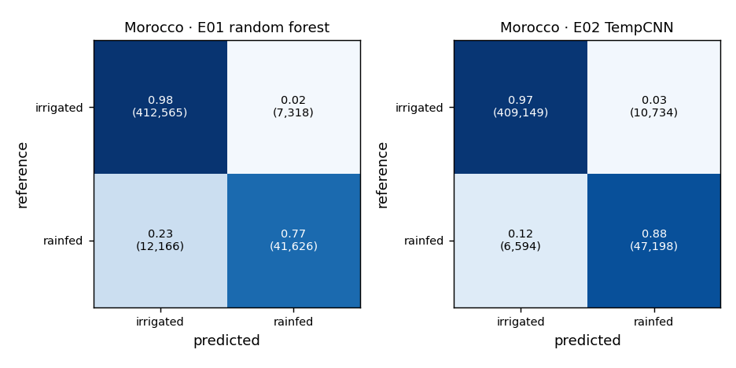
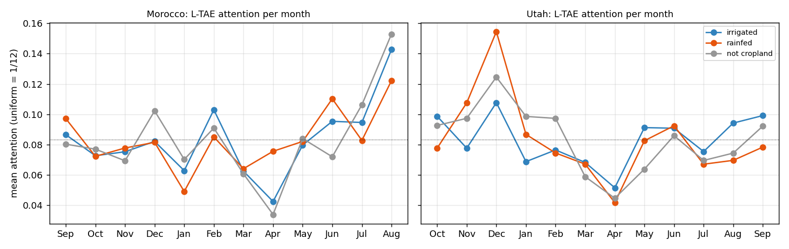

# E02 · Temporal neural networks

!!! success "Status: done in both regions"
    Same pixels as [E01](E01_s2_pixel_baseline.md): Morocco 522,003 (2023/24 and 2024/25), Utah 654,382 (2023/24);
    3 seeds per round on one GPU.

**Question.** Does a temporal neural network beat the classical baseline (E01) on the same pixels and the same
input?

**What changes from E01.** Only the model: the input is the same 12-month Sentinel-2 series with NDVI and NDWI.

| | E01 | E02 |
| --- | --- | --- |
| Model | random forest, gradient boosting | TempCNN; L-TAE on single pixels |
| Input format | 168 features (months concatenated) | sequence of 12 months × 14 channels |
| Missing months | interpolated | TempCNN: interpolated; L-TAE: interpolated and masked in the attention |

## Set-up

| Item | Choice |
| --- | --- |
| **TempCNN** | Pelletier et al. (2019): three 1-D convolutions over the months (64 filters, kernel 5, batch normalisation, ReLU, dropout 0.2), dense layer of 256, output 3 classes |
| **L-TAE** | Garnot & Landrieu (2020): 16 heads, d<sub>k</sub> 8, d<sub>model</sub> 256, output MLP 256–128, sinusoidal encoding of the day in the agricultural year; months without a clear observation get no attention |
| **Normalisation** | per channel with the training pixels of each round; values still missing after interpolation set to 0 (the training mean) |
| **Training** | AdamW (learning rate 10⁻³, weight decay 10⁻⁴), batch 512, class-weighted cross-entropy, early stopping on the validation fold's 3-class macro-F1 (patience 10, at most 100 epochs); the best epoch is kept |
| **Seeds** | 3 per round (42, 1042, 2042); the out-of-fold probability is their mean |
| **Validation and metrics** | as E01 |

L-TAE also saves the mean attention of every month per class on the test folds (`attention_by_month.csv`), which
shows which months the model relies on.

## How to run

Script: [`experiments/E02_temporal_nn/run.py`](https://github.com/amanchry/irrimapping-geofm/blob/main/experiments/E02_temporal_nn/run.py)
(networks: [`pixelwise_run/nn_common.py`](https://github.com/amanchry/irrimapping-geofm/blob/main/pixelwise_run/nn_common.py)).

```bash
sbatch --export=ALL,SCRIPT=experiments/E02_temporal_nn/run.py,EXPERIMENT_REGION=morocco jobs/step_gpu.sbatch
```

## Outputs

`experiments/E02_temporal_nn/results/<region>/<tempcnn|ltae>/`: the E01 files, plus `training_history.csv` and
`attention_by_month.csv` (L-TAE).

## Results

### Scores

Out-of-fold scores with 95% block-bootstrap CI; the E01 rows are repeated for comparison.

| Region | Model | Cropland macro-F1 | 3-class macro-F1 | F1 irrigated | F1 rainfed | F1 not cropland |
| --- | --- | --- | --- | --- | --- | --- |
| Morocco | E01 random forest | 0.876 [0.801, 0.929] | 0.838 [0.773, 0.887] | 0.959 | 0.784 | 0.770 |
| Morocco | TempCNN | 0.886 [0.798, 0.944] | 0.851 [0.784, 0.903] | 0.960 | 0.807 | 0.786 |
| Morocco | L-TAE | **0.890** [0.811, 0.945] | **0.859** [0.791, 0.911] | 0.964 | 0.805 | 0.809 |
| Utah | E01 random forest | 0.729 [0.682, 0.765] | 0.746 [0.714, 0.772] | 0.870 | 0.559 | 0.809 |
| Utah | TempCNN | 0.721 [0.674, 0.762] | 0.745 [0.712, 0.775] | 0.862 | 0.545 | 0.829 |
| Utah | L-TAE | **0.741** [0.697, 0.776] | **0.760** [0.730, 0.785] | 0.879 | 0.560 | 0.840 |

Paired difference to the E01 random forest on the same pixels (block bootstrap, 95% CI; Holm correction over the
eight runs of E01–E04 compared with the E01 random forest; **bold** = CI excludes 0 and p<sub>Holm</sub> < 0.05):

| Region | Model | Δ cropland macro-F1 | Δ 3-class macro-F1 |
| --- | --- | --- | --- |
| Morocco | TempCNN | +0.010 [−0.013, 0.032], p<sub>Holm</sub> 1.00 | +0.013 [−0.005, 0.030], p<sub>Holm</sub> 0.22 |
| Morocco | L-TAE | +0.014 [−0.004, 0.031], p<sub>Holm</sub> 0.63 | **+0.022** [0.009, 0.034], p<sub>Holm</sub> < 0.001 |
| Utah | TempCNN | −0.008 [−0.022, 0.007], p<sub>Holm</sub> 0.62 | −0.001 [−0.010, 0.009], p<sub>Holm</sub> 0.87 |
| Utah | L-TAE | +0.012 [−0.001, 0.026], p<sub>Holm</sub> 0.26 | **+0.014** [0.004, 0.023], p<sub>Holm</sub> 0.018 |


- **L-TAE is the best pixel model in both regions**, but its gain on the headline metric (+0.014 Morocco, +0.012
  Utah) is not significant: the CIs include 0. On the 3-class score the gain is significant in both regions, mostly
  from the not-cropland class (F1 0.809 vs 0.770 in Morocco, 0.840 vs 0.809 in Utah).
- **TempCNN** is on par with the random forest (Morocco +0.010, Utah −0.008, both not significant).
- The neural networks therefore do not change the picture of E01: with the same 12-month input, a better temporal
  model adds at most about one point of cropland macro-F1.

### Errors



Compared with the random forest, L-TAE recovers more rainfed pixels (recall Morocco 0.77 vs 0.73, Utah 0.60 vs 0.52)
and sends fewer cropland pixels to not cropland (Utah irrigated 8% vs 13%), at the cost of more irrigated pixels
predicted as rainfed (Utah 8% vs 5%). The rainfed class remains the main error in Utah (F1 0.56 for every model).

| Region | Group | Cropland macro-F1 (RF / TempCNN / L-TAE) | F1 rainfed (RF / TempCNN / L-TAE) |
| --- | --- | --- | --- |
| Morocco | 2023/24 | 0.893 / 0.903 / 0.899 | 0.822 / 0.839 / 0.827 |
| Morocco | 2024/25 | 0.844 / 0.854 / 0.874 | 0.718 / 0.751 / 0.769 |
| Morocco | Doukkala | 0.891 / 0.902 / 0.902 | 0.849 / 0.873 / 0.868 |
| Morocco | Souss | 0.583 / 0.499 / 0.621 | 0.205 / 0.075 / 0.291 |
| Utah | Bear River | 0.736 / 0.713 / 0.735 | 0.641 / 0.628 / 0.647 |
| Utah | Southeast Colorado River | 0.644 / 0.779 / 0.705 | 0.817 / 0.939 / 0.921 |
| Utah | Sevier River | 0.484 / 0.519 / 0.575 | 0.048 / 0.127 / 0.215 |
| Utah | West Desert | 0.677 / 0.702 / 0.707 | 0.687 / 0.677 / 0.662 |

The largest gains of L-TAE are in the difficult groups: Morocco 2024/25 (+0.030), Souss (+0.038) and Sevier River
(+0.091); the rainfed class in Souss and Sevier River is still poorly recognised (F1 0.29 and 0.22).

### Which months L-TAE attends to



Mean attention of each month on the test pixels (uniform = 1/12). In **Morocco** the attention rises towards the
end of the dry season (June–August, highest in August for every class), with smaller peaks in February
(irrigated) and June (rainfed); this matches the months the random forest relies on (E01). In **Utah** the attention is highest in December for every class
(rainfed pixels 0.15), and in August–September for irrigated pixels. April receives the least attention, except for
rainfed pixels in Morocco (January). Attention weights show what the model looks at, not what causes its decision; the December peak in Utah may
again reflect snow and missing observations (as in E01).

### Training

- Early stopping on the validation fold selected the best epoch after on average 10 (TempCNN) and 14 (L-TAE)
  epochs in Morocco, but after only 5 and 2–3 epochs in Utah. In Utah the validation score peaks almost immediately:
  the models fit the training blocks quickly, and more epochs do not transfer to the held-out blocks.
- GPU time per region: 12–15 min per model in Morocco and 11–13 min in Utah (5 rounds × 3 seeds).

### Conclusion

Temporal neural networks on the same pixel series give **at most a small gain** over the random forest: L-TAE is
best in both regions (cropland macro-F1 0.890 Morocco, 0.741 Utah) but the difference to E01 (+0.01) is within
the uncertainty of the spatial folds; only the 3-class score improves significantly. The limits of the per-pixel
input (rainfed class, zones with few rainfed parcels) remain. The tile models test whether **spatial context** helps where the temporal model alone does
not: it does in Utah ([E04](E04_utae.md) U-TAE +0.037, [E03](E03_frozen_geofm.md) foundation models up to +0.068),
not significantly in Morocco.

## References

- Garnot, V. S. F. & Landrieu, L. (2020). Lightweight temporal self-attention for classifying satellite image time
  series. *AALTD*.
- Pelletier, C., Webb, G. I. & Petitjean, F. (2019). Temporal convolutional neural network for the classification of
  satellite image time series. *Remote Sensing* 11, 523.
