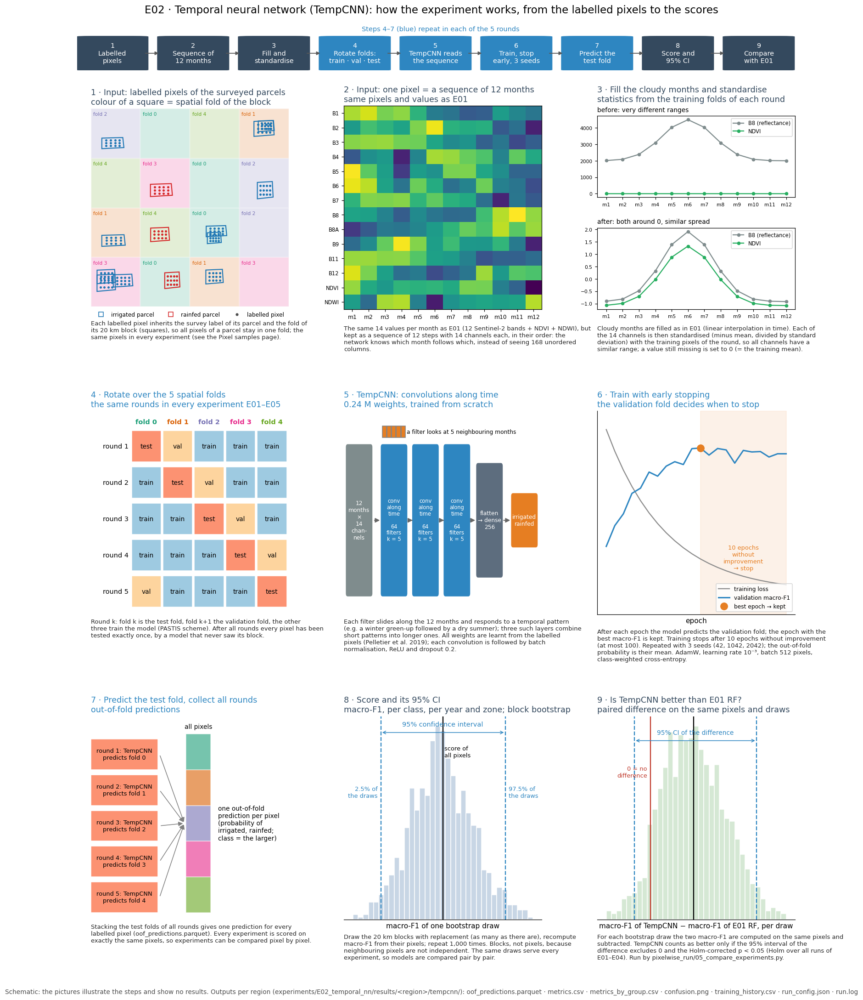
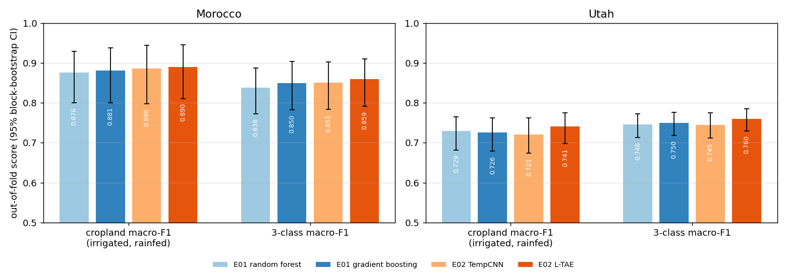

# E02 · Temporal neural network (TempCNN)

!!! success "Status: Morocco done (20 November 2026); Utah later"
    Same pixels as [E01](E01_s2_pixel_baseline.md): Morocco 2023/24 and 2024/25 pooled, 473,675 pixels, two classes
    (irrigated, rainfed); 3 seeds per round on one GPU. TempCNN **macro-F1 0.912** [0.848, 0.955], rainfed F1 0.845;
    +0.018 over the E01 random forest, not significant. [Results](#results)

**Question.** Does a temporal neural network beat the classical baseline (E01) on the same pixels and the same
input?

**What changes from E01.** Only the model: the input is the same 12-month Sentinel-2 series with NDVI and NDWI,
read as a sequence instead of 168 separate features.

| | E01 | E02 |
| --- | --- | --- |
| Model | random forest, gradient boosting | TempCNN |
| Input format | 168 features (months concatenated) | sequence of 12 months × 14 channels |
| Missing months | interpolated | interpolated |

## How E02 works, step by step



*E02 from start to end (schematic: the pictures illustrate the steps and show no results, so the figure holds for any region and year; `tools/a9_experiment_explainers.py`). Steps 4–7 repeat in each of the five rounds. The results of each region are under [Results](#results).*

1. **Labelled pixels.** The same pixel samples, folds and blocks as [E01](E01_s2_pixel_baseline.md).
2. **A sequence, not a table.** Each pixel keeps its 12 months × 14 values (12 Sentinel-2 bands, NDVI, NDWI) as a
   sequence of 12 time steps in their order, instead of 168 unordered columns.
3. **Fill and standardise.** Cloudy months are filled as in E01; each channel is then standardised with the
   training pixels of the round, so that reflectances and indices have a similar range.
4. **Rotation over the folds.** The same five rounds as every experiment: test fold *k*, validation fold *k*+1,
   three training folds.
5. **TempCNN.** Three 1-D convolutions slide along the months and detect temporal patterns (a filter sees five
   neighbouring months); a dense layer and the output give the two class scores. All 0.24 M weights are learnt from
   the labelled pixels.
6. **Training.** Class-weighted cross-entropy with AdamW; after each epoch the validation fold is scored, the best
   epoch is kept, and training stops after 10 epochs without improvement. Three seeds per round; their
   probabilities are averaged.
7. **Out-of-fold prediction.** Each round predicts its test fold; together they give one prediction per pixel, on
   the same pixels as E01.
8. **Score and uncertainty.** Macro-F1 and the per-class scores, per year and zone, with the 95% block-bootstrap
   interval, exactly as in E01.
9. **Comparison with E01.** The paired difference to the E01 random forest on the same pixels and bootstrap draws,
   Holm-corrected over all runs of E01–E04 ([comparison](comparison.md)).

## Set-up

| Item | Choice |
| --- | --- |
| **TempCNN** | Pelletier et al. (2019): three 1-D convolutions over the months (64 filters, kernel 5, batch normalisation, ReLU, dropout 0.2), dense layer of 256, output 2 classes |
| **Normalisation** | per channel with the training pixels of each round; values still missing after interpolation set to 0 (the training mean) |
| **Training** | AdamW (learning rate 10⁻³, weight decay 10⁻⁴), batch 512, class-weighted cross-entropy, early stopping on the validation fold's macro-F1 (patience 10, at most 100 epochs); the best epoch is kept |
| **Seeds** | 3 per round (42, 1042, 2042); the seed also sets the initial weights; the out-of-fold probability is their mean |
| **Validation and metrics** | as E01 |

??? info "How TempCNN works"
    TempCNN (Temporal Convolutional Neural Network; Pelletier et al. 2019) is a convolutional network that slides
    along the **time axis** of one pixel, the way an image CNN slides over the two image axes. It was designed for
    pixel-wise classification of Sentinel-2 time series and is a standard baseline for crop mapping.

    **Input.** One pixel as a small table of 12 months × 14 channels (12 bands, NDVI, NDWI), normalised per channel;
    months without a clear observation are filled by linear interpolation, because a convolution needs a value at
    every step.

    ```mermaid
    flowchart LR
        A["one pixel<br/>12 months × 14 channels"] --> B["Conv 1-D, 64 filters,<br/>window 5 months<br/>+ BatchNorm, ReLU, dropout"]
        B --> C["Conv 1-D, 64 filters,<br/>window 5 months"]
        C --> D["Conv 1-D, 64 filters,<br/>window 5 months"]
        D --> E["flatten<br/>12 × 64 = 768 values"]
        E --> F["dense layer 256<br/>+ BatchNorm, ReLU, dropout"]
        F --> G["2 class scores<br/>irrigated · rainfed"]
    ```

    **1. Convolutions over time.** A filter is a small set of weights over a window of 5 consecutive months and all
    14 channels. It is moved one month at a time along the year (padded at both ends, so the output still has 12
    steps) and at each position gives one number: how strongly this 5-month stretch matches the pattern the filter
    has learnt. Typical learnt patterns are a green-up (NDVI rising over a few months), a harvest drop, or wet soil
    (NDWI) during the dry season. 64 filters give 64 such pattern detectors per month.

    **2. Three layers in a row.** The second and third layers combine the patterns found by the layer before, so
    they detect longer and more complex shapes, e.g. "green-up in winter, harvest in spring, then green again in
    summer" (an irrigated double crop). Each layer looks 5 steps wide, so after three layers one output step sees
    1 + 3 × 4 = 13 months, the whole agricultural year. Batch normalisation keeps the values on a stable scale,
    ReLU keeps only positive matches, and dropout (20%) switches off random units during training against
    overfitting.

    **3. Flatten and classify.** The 12 × 64 outputs are laid out as one vector of 768 values, so the network still
    knows **when** in the year each pattern occurred (a green summer means something else than a green winter). A
    dense layer of 256 units and a final layer turn this into two class scores (irrigated, rainfed); softmax gives probabilities.

    **Size and training.** 0.24 M weights. Trained with class-weighted cross-entropy, AdamW (learning rate 10⁻³),
    batch 512 pixels, early stopping on the validation fold; 3 seeds per round.

    **TempCNN compared with the random forest.**

    | | Random forest (E01) | TempCNN |
    | --- | --- | --- |
    | Reads the months | as 168 unordered features | as a sequence, through sliding 5-month windows |
    | Learns | splits on single values (e.g. "NDVI in July > 0.4") | local temporal shapes and their combinations |
    | Missing months | interpolated | interpolated |
    | Uses position in the year | implicitly (each feature is one month) | yes, the flattened output keeps the order |

    Code: `TempCNN` in [`pixelwise_run/nn_common.py`](https://github.com/amanchry/irrimapping-geofm/blob/main/pixelwise_run/nn_common.py).

## How to run

Script: [`experiments/E02_temporal_nn/run.py`](https://github.com/amanchry/irrimapping-geofm/blob/main/experiments/E02_temporal_nn/run.py)
(network: [`pixelwise_run/nn_common.py`](https://github.com/amanchry/irrimapping-geofm/blob/main/pixelwise_run/nn_common.py)).

```bash
sbatch --export=ALL,SCRIPT=experiments/E02_temporal_nn/run.py,EXPERIMENT_REGION=morocco jobs/step_gpu.sbatch
```

## Outputs

`experiments/E02_temporal_nn/results/<region>/tempcnn/`: the E01 files, plus `training_history.csv`.

## Results

Morocco, 2023/24 and 2024/25 pooled: the same 473,675 out-of-fold pixels as E01. The comparison with the other
experiments is on the [comparison page](comparison.md).

### Scores

| Model | Macro-F1 [95% CI] | Irrigated F1 | Rainfed F1 [95% CI] | Rainfed precision | Rainfed recall | Overall accuracy |
| --- | --- | --- | --- | --- | --- | --- |
| E01 random forest (reference) | 0.894 [0.834, 0.940] | 0.977 | 0.810 [0.697, 0.894] | 0.850 | 0.774 | 0.959 |
| **E02 TempCNN** | **0.912** [0.848, 0.955] | 0.979 | **0.845** [0.722, 0.922] | 0.815 | **0.877** | 0.963 |

**Paired difference to the E01 random forest** (same pixels, same bootstrap draws, Holm correction over the nine runs of
E01–E04):

| Metric | TempCNN − random forest | 95% CI | Holm-adjusted p | Counts as a difference? |
| --- | --- | --- | --- | --- |
| Macro-F1 | +0.018 | [−0.017, +0.053] | 1.0 | no |
| Rainfed F1 | +0.035 | [−0.030, +0.097] | 1.0 | no |




*Row-normalised confusion matrices (share of the reference pixels of each class; pixel counts in brackets).*

**A different balance of errors.** TempCNN finds more rainfed pixels than the random forest (recall 0.88 vs 0.77;
missed rainfed pixels 6,594 vs 12,166) at the cost of more irrigated pixels taken for rainfed (10,734 vs 7,318), so
its rainfed precision is lower (0.81 vs 0.85). Overall it makes fewer errors (17,328 vs 19,484 pixels).

### Scores per year and zone


| Group | Rainfed pixels | Random forest: rainfed recall | TempCNN: rainfed recall | Random forest: rainfed F1 | TempCNN: rainfed F1 |
| --- | --- | --- | --- | --- | --- |
| 2023/24 | 31,671 | 0.857 | 0.890 | 0.828 | 0.832 |
| 2024/25 | 22,121 | 0.655 | **0.860** | 0.779 | **0.864** |
| Doukkala | 46,608 | 0.843 | 0.909 | 0.858 | 0.869 |
| Souss | 6,869 | 0.322 | **0.684** | 0.485 | **0.776** |
| Statte | 312 | 0.458 | 0.468 | 0.485 | 0.365 |

- **The gain comes from the two weak spots of E01.** In 2024/25 TempCNN finds 86% of the rainfed pixels against 66%
  for the random forest, and in Souss 68% against 32%. In 2023/24 and in Doukkala, where the random forest is
  already good, the two are close.
- **Statte** (312 rainfed pixels of 4 parcels) is too small to judge.
- **Not better everywhere.** In fold 0 TempCNN finds only 35% of the rainfed pixels of Doukkala 2023/24 (4,130
  pixels), against 74% for the random forest; it makes up for it in the Souss pixels of the same fold (63% vs 31%).
  Per test fold, TempCNN's macro-F1 is 0.780, 0.916, 0.944, 0.970 and 0.936 (random forest: 0.762, 0.911, 0.921,
  0.942, 0.928): higher in every fold, but by 0.005 to 0.028.

### Training

- 15 models (5 rounds × 3 seeds). Early stopping ended training after 11 to 45 epochs (median 21); the best epoch
  was between 1 and 35 (median 11). The network reaches most of its validation score within the first few epochs.
- Best validation macro-F1 per round (mean of the 3 seeds): 0.921, 0.952, 0.961, 0.940 and 0.820. Round 5 validates on
  fold 0, the hardest fold also for E01.
- Run time: 14 min on one GPU for all 15 models.

### Interpretation

- Reading the 12 months as a sequence helps a little: TempCNN is ahead of the random forest overall (+0.018 macro-F1)
  and in every test fold, and clearly ahead for the rainfed pixels of 2024/25 and Souss. But the difference over all
  pixels is within the uncertainty of the block bootstrap (CI includes 0), so E02 does **not** show that the
  temporal network is better than the tree ensemble.
- The block bootstrap is wide because the rainfed pixels sit in few blocks, mainly in Doukkala; differences of a
  few hundredths will be hard to establish in Morocco with any model. This holds for all comparisons of E01–E05.
- TempCNN moves the decision towards rainfed (more recall, less precision). Both experiments use balanced class weights, so
  the shift comes from the model; the map phase will need to check which balance holds outside
  the surveyed parcels.

## References

- Pelletier, C., Webb, G. I. & Petitjean, F. (2019). Temporal convolutional neural network for the classification of
  satellite image time series. *Remote Sensing* 11, 523.
