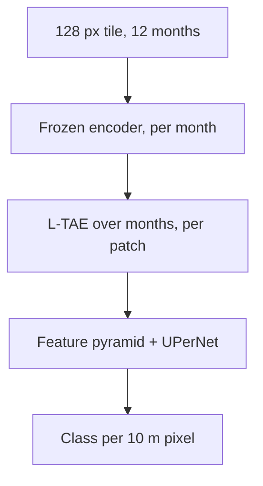

# E03 · Frozen foundation models + decoder (RQ1)

!!! info "Status: ready to run"
    Script written; each encoder checked on a small tile subset. Runs after E04 (which tests the tile pipeline
    without the large encoders).

**Question (RQ1).** Do frozen geospatial foundation models with a light decoder classify the pixels better than the
pixel models (E01–E03) and a spatio-temporal network trained from scratch (E04)?

**What changes from E04.** The image encoder: a pretrained, frozen foundation model instead of a convolutional
encoder trained from scratch. Tiles, labelled pixels, loss, training and metrics are the same.

## Model

The encoders see whole 128 × 128 px tiles; the model predicts every pixel and is scored at the labelled pixels of the [pixel samples](../phase1_data/pixel_samples.md).



| Encoder | Bands | Months per pass | Patch | Feature size |
| --- | --- | --- | --- | --- |
| Prithvi-EO-2.0-300M-TL | B2 B3 B4 B8A B11 B12 | 4, with date and location | 16 px | 1024 |
| Clay v1.5 | 10 bands (no B1, B9) | 1, with week and location | 8 px | 1024 |
| TerraMind 1.0 base | 12 bands (S2L2A) | 1 | 16 px | 768 |
| AgriFM | 10 bands | all 12 (time merged inside the model) | 4 px, pyramid to 32 px | multi-scale |
| Presto | 10 bands + NDVI | all 12 (per pixel, inside the model) | 1 pixel | 128 per pixel |
| TESSERA v2 Medium | 10 bands | the clear months, dated by day of year (per pixel) | 1 pixel | 128 per pixel |

All six encoders are loaded by [`pixelwise_run/encoders.py`](https://github.com/amanchry/irrimapping-geofm/blob/main/pixelwise_run/encoders.py) with the band order,
normalisation and weights of their pretraining (the four image models exactly as in the archived embedding scripts);
AgriFM is normalised with the region's band statistics, Presto and TESSERA with their own input scaling. The two pixel models encode every pixel of the tile, so their output is already a
10 m feature map
([D15](../decisions.md#d15-agrifm-normalised-with-the-statistics-of-the-regions-chips)). Details of the models:
[Foundation models](../foundation_models.md).

| Part | Choice |
| --- | --- |
| **Temporal head** | L-TAE (16 heads, d<sub>k</sub> 8, d<sub>model</sub> 256, output 256) over the 12 months at every patch position; months without a clear pixel in the patch are masked. AgriFM, Presto, TESSERA: none (the encoder handles time) |
| **Decoder** | 4-scale feature pyramid from the single-scale ViT features (×4, ×2, ×1, ×½, as for plain ViTs in PANGAEA; Marsocci et al. 2024) and a UPerNet head (Xiao et al. 2018; pool sizes 1, 2, 4), upsampled to 10 m. AgriFM: its own 4-level pyramid goes straight into the UPerNet head. Presto, TESSERA: the 10 m map average-pooled to 4 scales (×1, ×½, ×¼, ×⅛) |
| **Trained** | temporal head and decoder only (about 1.7–3.5 M parameters); the encoder stays frozen in evaluation mode |

## Training

| Item | Choice |
| --- | --- |
| **Labels** | the labelled pixels of the round's training folds only; every other pixel of the tile is ignored in the loss. A tile with pixels of two folds contributes only its training-fold labels |
| **Loss** | class-weighted cross-entropy (weights from the training pixels) |
| **Optimiser** | AdamW, learning rate 10⁻⁴, weight decay 10⁻⁴, batch 8 tiles, mixed precision (bfloat16) |
| **Augmentation** | random flips and 90° rotations |
| **Early stopping** | 3-class macro-F1 of the validation pixels, patience 8, at most 50 epochs |
| **Seeds** | 3 per round, mean probability |
| **Scoring** | the test tiles are predicted and read at their labelled pixels: the same out-of-fold pixels as every other experiment |

## How to run

Script: [`experiments/E03_frozen_geofm/run.py`](https://github.com/amanchry/irrimapping-geofm/blob/main/experiments/E03_frozen_geofm/run.py)
(models and training: [`pixelwise_run/tile_common.py`](https://github.com/amanchry/irrimapping-geofm/blob/main/pixelwise_run/tile_common.py)).
One GPU job per encoder and region; needs the tile store `outputs/<region>/dataset/03_tiles_128px/agyear/tiles/`
(on the cluster) and the model weights in `checkpoints/`.

```bash
for enc in prithvi clay terramind agrifm presto tessera; do sbatch --export=ALL,SCRIPT=experiments/E03_frozen_geofm/run.py,EXPERIMENT_REGION=morocco,EXPERIMENT_ENCODER=$enc jobs/step_gpu.sbatch; done
```

Run one encoder with `EXPERIMENT_QUICK_TEST=1` first (60 tiles, 2 epochs) and read the epoch time in the log to
check the 12-hour job limit.

## Outputs

`experiments/E03_frozen_geofm/results/<region>/<encoder>/`: the E01 files plus `training_history.csv`.

## Results

*To be filled after the run.*

| Region | Encoder | Cropland macro-F1 | 3-class macro-F1 | Δ vs E01 RF |
| --- | --- | --- | --- | --- |
| Morocco | Prithvi | | | |
| Morocco | Clay | | | |
| Morocco | TerraMind | | | |
| Morocco | AgriFM | | | |
| Morocco | Presto | | | |
| Morocco | TESSERA | | | |
| Utah | Prithvi | | | |
| Utah | Clay | | | |
| Utah | TerraMind | | | |
| Utah | AgriFM | | | |
| Utah | Presto | | | |
| Utah | TESSERA | | | |

## References

- Marsocci, V. et al. (2024). PANGAEA: a global and inclusive benchmark for geospatial foundation models.
  arXiv:2412.04204.
- Xiao, T., Liu, Y., Zhou, B., Jiang, Y. & Sun, J. (2018). Unified perceptual parsing for scene understanding.
  *ECCV*.
