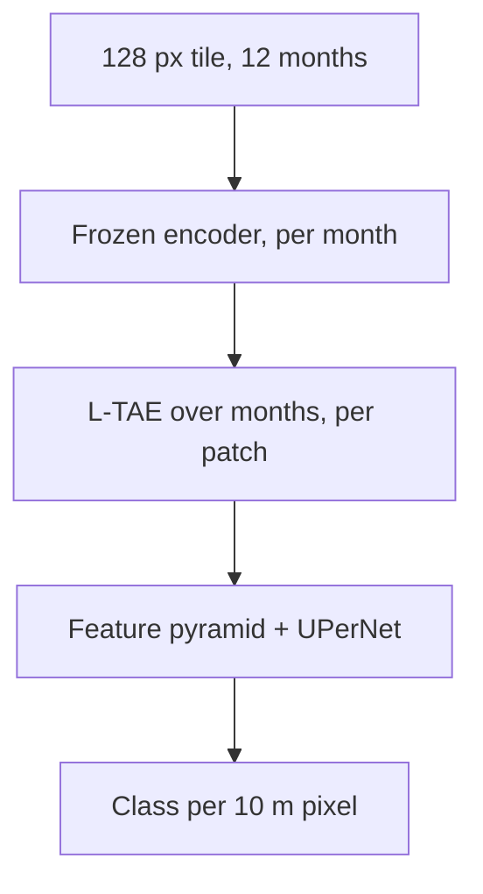
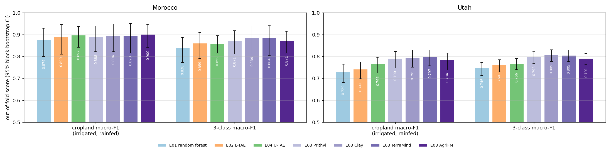
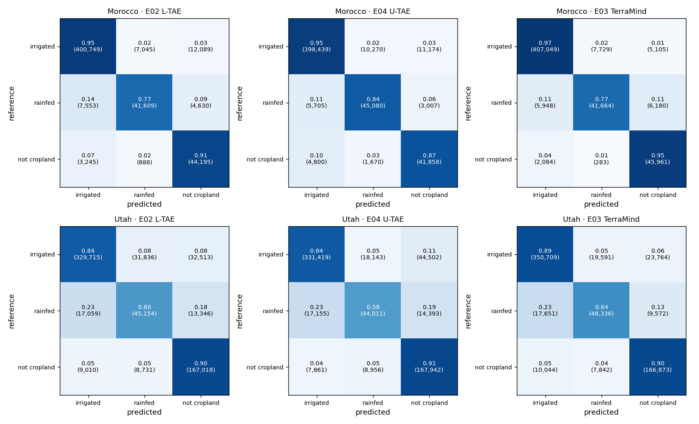

# E03 · Frozen foundation models + decoder (RQ1)

!!! success "Status: done in both regions for Prithvi, Clay, TerraMind and AgriFM"
    Same pixels as [E01](E01_s2_pixel_baseline.md): Morocco 522,003 in 2,230 tiles (2023/24 and 2024/25), Utah
    654,382 in 2,405 tiles (2023/24); 3 seeds per round on one GPU. The Presto and TESSERA jobs were cancelled before
    they finished; their results will be added later.

**Question (RQ1).** Do frozen geospatial foundation models with a light decoder classify the pixels better than the
pixel models (E01–E03) and a spatio-temporal network trained from scratch (E04)?

**What changes from E04.** The image encoder: a pretrained, frozen foundation model instead of a convolutional
encoder trained from scratch. Tiles, labelled pixels, loss, training and metrics are the same.

## Model

The encoders see whole 128 × 128 px tiles; the model predicts every pixel and is scored at the labelled pixels of the [pixel samples](../phase1_data/pixel_samples.md).



| Encoder | Bands | Months per pass | Patch | Feature size |
| --- | --- | --- | --- | --- |
| Prithvi-EO-2.0-300M-TL | B2 B3 B4 B8A B11 B12 | 4, with date and location | 16 px | 1024 |
| Clay v1.5 | 10 bands (no B1, B9) | 1, with week and location | 8 px | 1024 |
| TerraMind 1.0 base | 12 bands (S2L2A) | 1 | 16 px | 768 |
| AgriFM | 10 bands | all 12 (time merged inside the model) | 4 px, pyramid to 32 px | multi-scale |
| Presto | 10 bands + NDVI | all 12 (per pixel, inside the model) | 1 pixel | 128 per pixel |
| TESSERA v2 Medium | 10 bands | the clear months, dated by day of year (per pixel) | 1 pixel | 128 per pixel |

All six encoders are loaded by [`pixelwise_run/encoders.py`](https://github.com/amanchry/irrimapping-geofm/blob/main/pixelwise_run/encoders.py) with the band order,
normalisation and weights of their pretraining (the four image models exactly as in the archived embedding scripts);
AgriFM is normalised with the region's band statistics, Presto and TESSERA with their own input scaling. The two pixel models encode every pixel of the tile, so their output is already a
10 m feature map
([D15](../decisions.md#d15-agrifm-normalised-with-the-statistics-of-the-regions-chips)). Details of the models:
[Foundation models](../foundation_models.md).

| Part | Choice |
| --- | --- |
| **Temporal head** | L-TAE (16 heads, d<sub>k</sub> 8, d<sub>model</sub> 256, output 256) over the 12 months at every patch position; months without a clear pixel in the patch are masked. AgriFM, Presto, TESSERA: none (the encoder handles time) |
| **Decoder** | 4-scale feature pyramid from the single-scale ViT features (×4, ×2, ×1, ×½, as for plain ViTs in PANGAEA; Marsocci et al. 2024) and a UPerNet head (Xiao et al. 2018; pool sizes 1, 2, 4), upsampled to 10 m. AgriFM: its own 4-level pyramid goes straight into the UPerNet head. Presto, TESSERA: the 10 m map average-pooled to 4 scales (×1, ×½, ×¼, ×⅛) |
| **Trained** | temporal head and decoder only (2.41 M TerraMind, 2.48 M Prithvi and Clay, 3.23 M AgriFM); the encoder stays frozen in evaluation mode |

## Training

| Item | Choice |
| --- | --- |
| **Labels** | the labelled pixels of the round's training folds only; every other pixel of the tile is ignored in the loss. A tile with pixels of two folds contributes only its training-fold labels |
| **Loss** | class-weighted cross-entropy (weights from the training pixels) |
| **Optimiser** | AdamW, learning rate 10⁻⁴, weight decay 10⁻⁴, batch 8 tiles, mixed precision (bfloat16) |
| **Augmentation** | random flips and 90° rotations |
| **Early stopping** | 3-class macro-F1 of the validation pixels, patience 8, at most 50 epochs |
| **Seeds** | 3 per round, mean probability |
| **Scoring** | the test tiles are predicted and read at their labelled pixels: the same out-of-fold pixels as every other experiment |

## How to run

Script: [`experiments/E03_frozen_geofm/run.py`](https://github.com/amanchry/irrimapping-geofm/blob/main/experiments/E03_frozen_geofm/run.py)
(models and training: [`pixelwise_run/tile_common.py`](https://github.com/amanchry/irrimapping-geofm/blob/main/pixelwise_run/tile_common.py)).
One GPU job per encoder and region; needs the tile store `outputs/<region>/dataset/03_tiles_128px/agyear/tiles/`
(on the cluster) and the model weights in `checkpoints/`.

```bash
for enc in prithvi clay terramind agrifm presto tessera; do sbatch --export=ALL,SCRIPT=experiments/E03_frozen_geofm/run.py,EXPERIMENT_REGION=morocco,EXPERIMENT_ENCODER=$enc jobs/step_gpu.sbatch; done
```

Run one encoder with `EXPERIMENT_QUICK_TEST=1` first (60 tiles, 2 epochs) and read the epoch time in the log to
check the 12-hour job limit.

## Outputs

`experiments/E03_frozen_geofm/results/<region>/<encoder>/`: the E01 files plus `training_history.csv`.

## Results

### Scores

Out-of-fold scores with 95% block-bootstrap CI. The best model trained from scratch on pixels (E02 L-TAE) and on
tiles (E04 U-TAE) and the E01 random forest are repeated for comparison.

| Region | Model | Cropland macro-F1 | 3-class macro-F1 | F1 irrigated | F1 rainfed | F1 not cropland |
| --- | --- | --- | --- | --- | --- | --- |
| Morocco | E01 random forest | 0.876 [0.801, 0.929] | 0.838 [0.773, 0.887] | 0.959 | 0.784 | 0.770 |
| Morocco | E02 L-TAE | 0.890 [0.811, 0.945] | 0.859 [0.791, 0.911] | 0.964 | 0.805 | 0.809 |
| Morocco | E04 U-TAE | 0.897 [0.843, 0.936] | 0.859 [0.815, 0.896] | 0.961 | 0.814 | 0.802 |
| Morocco | Prithvi | 0.888 [0.822, 0.939] | 0.871 [0.812, 0.918] | 0.968 | 0.794 | 0.852 |
| Morocco | Clay | 0.894 [0.822, 0.949] | 0.884 [0.812, 0.939] | 0.974 | 0.808 | 0.868 |
| Morocco | TerraMind | 0.893 [0.816, 0.950] | **0.884** [0.806, 0.940] | 0.975 | 0.805 | 0.871 |
| Morocco | AgriFM | **0.900** [0.842, 0.946] | 0.871 [0.816, 0.916] | 0.967 | 0.815 | 0.831 |
| Utah | E01 random forest | 0.729 [0.682, 0.765] | 0.746 [0.714, 0.772] | 0.870 | 0.559 | 0.809 |
| Utah | E02 L-TAE | 0.741 [0.697, 0.776] | 0.760 [0.730, 0.785] | 0.879 | 0.560 | 0.840 |
| Utah | E04 U-TAE | 0.766 [0.725, 0.797] | 0.766 [0.739, 0.791] | 0.883 | 0.600 | 0.816 |
| Utah | Prithvi | 0.790 [0.748, 0.823] | 0.798 [0.769, 0.822] | 0.905 | 0.627 | 0.863 |
| Utah | Clay | 0.795 [0.751, 0.829] | **0.805** [0.777, 0.831] | 0.909 | 0.634 | 0.872 |
| Utah | TerraMind | **0.797** [0.757, 0.829] | **0.805** [0.777, 0.829] | 0.908 | 0.639 | 0.867 |
| Utah | AgriFM | 0.784 [0.739, 0.816] | 0.791 [0.762, 0.815] | 0.900 | 0.621 | 0.852 |



Paired difference on the same pixels (block bootstrap, 95% CI; Holm correction over the eight runs of E01–E04
compared with the same reference; **bold** = CI excludes 0 and p<sub>Holm</sub> < 0.05). Against the E01 random
forest (does the foundation model beat the baseline?) and against E04 U-TAE (does pretraining add anything beyond
the spatial context of the tile?):

| Region | Encoder | Δ cropland vs E01 RF | Δ 3-class vs E01 RF | Δ cropland vs E04 U-TAE | Δ 3-class vs E04 U-TAE |
| --- | --- | --- | --- | --- | --- |
| Morocco | Prithvi | +0.012 [−0.019, 0.041], 1.00 | **+0.033** [0.011, 0.053], 0.016 | −0.009 [−0.031, 0.009], 1.00 | +0.012 [−0.006, 0.028], 0.98 |
| Morocco | Clay | +0.018 [−0.001, 0.038], 0.48 | **+0.046** [0.028, 0.068], < 0.001 | −0.002 [−0.042, 0.023], 1.00 | +0.024 [−0.009, 0.051], 0.98 |
| Morocco | TerraMind | +0.017 [−0.002, 0.037], 0.54 | **+0.046** [0.026, 0.071], < 0.001 | −0.004 [−0.049, 0.027], 1.00 | +0.025 [−0.013, 0.054], 0.98 |
| Morocco | AgriFM | +0.024 [0.002, 0.050], 0.27 | **+0.033** [0.017, 0.050], 0.010 | +0.003 [−0.017, 0.020], 1.00 | +0.012 [−0.004, 0.027], 0.90 |
| Utah | Prithvi | **+0.061** [0.044, 0.080], < 0.001 | **+0.052** [0.039, 0.066], < 0.001 | **+0.025** [0.007, 0.045], 0.030 | **+0.032** [0.018, 0.046], < 0.001 |
| Utah | Clay | **+0.065** [0.047, 0.085], < 0.001 | **+0.059** [0.045, 0.073], < 0.001 | **+0.029** [0.011, 0.047], < 0.001 | **+0.039** [0.026, 0.050], < 0.001 |
| Utah | TerraMind | **+0.068** [0.046, 0.091], < 0.001 | **+0.058** [0.043, 0.075], < 0.001 | **+0.031** [0.013, 0.050], < 0.001 | **+0.038** [0.024, 0.052], < 0.001 |
| Utah | AgriFM | **+0.055** [0.038, 0.072], < 0.001 | **+0.045** [0.034, 0.056], < 0.001 | +0.018 [−0.001, 0.038], 0.064 | **+0.024** [0.012, 0.038], < 0.001 |

(Each cell: difference [95% CI], p<sub>Holm</sub>.)

- **Utah: the frozen foundation models are clearly better.** All four beat the random forest by 0.055–0.068
  cropland macro-F1, and three of them (Prithvi, Clay, TerraMind) also beat U-TAE by 0.025–0.031. So in Utah the
  gain is not only spatial context: the pretrained features add about as much again as the tile context did
  (U-TAE +0.037 over the random forest).
- **Morocco: no significant gain on the headline metric.** The cropland macro-F1 of all models lies between 0.876
  and 0.900, with CIs 0.09–0.14 wide; no foundation model differs significantly from the random forest or U-TAE.
  On the 3-class score all four beat the random forest (+0.033 to +0.046), through the not-cropland class (F1
  0.83–0.87 vs 0.77).
- **The encoders are close to each other.** In each region the four encoders lie within 0.012 (Morocco) and 0.013
  (Utah) cropland macro-F1, well inside each other's CIs. TerraMind and Clay are first on the 3-class score in both
  regions; AgriFM is first in Morocco and last in Utah on the cropland score. The data do not single out one
  encoder.

### Errors



TerraMind is shown in the right column; the shares below are taken from the confusion matrices of all runs.

- **Fewer cropland pixels are lost to not cropland.** The share of irrigated pixels predicted as not cropland is
  1.2–2.1% for the four encoders in Morocco (2.7–3.9% for the models trained from scratch) and 5.6–7.1% in Utah
  (8.3–12.9%). The precision of the not-cropland class therefore rises from 0.67–0.75 (E01, E02, E04) to 0.78–0.81
  in Morocco and from 0.71–0.79 to 0.81–0.84 in Utah, while its recall stays about the same (0.89–0.95).
- **Rainfed remains the weak class.** In Utah the foundation models lose fewer rainfed pixels to not cropland
  (12–14% vs 18–25%), which raises the rainfed recall to 0.61–0.64, but a rainfed pixel is predicted as irrigated in
  23–26% of the cases, as often as with the models trained from scratch (19–25%): the pretrained features do not
  resolve the confusion between rainfed and irrigated fields. In Morocco the rainfed errors depend on the encoder:
  Clay and TerraMind send 11% of the rainfed pixels to not cropland, Prithvi and AgriFM 6–8%.

Cropland macro-F1 per group (Prithvi / Clay / TerraMind / AgriFM; E01 random forest and E04 U-TAE for comparison):

| Region | Group | Pixels | RF | U-TAE | Prithvi | Clay | TerraMind | AgriFM |
| --- | --- | --- | --- | --- | --- | --- | --- | --- |
| Morocco | 2023/24 | 402,659 | 0.893 | 0.906 | 0.910 | 0.915 | **0.920** | 0.917 |
| Morocco | 2024/25 | 119,344 | 0.844 | **0.879** | 0.843 | 0.853 | 0.839 | 0.866 |
| Morocco | Doukkala | 142,356 | 0.891 | 0.887 | 0.881 | **0.901** | 0.899 | **0.901** |
| Morocco | Souss | 33,687 | 0.583 | **0.813** | 0.714 | 0.568 | 0.535 | 0.711 |
| Morocco | Statte | 10,355 | **0.748** | 0.655 | 0.611 | 0.729 | 0.596 | 0.721 |
| Utah | Bear River | 158,422 | 0.736 | 0.781 | **0.810** | **0.810** | 0.806 | 0.798 |
| Utah | Sevier River | 119,599 | 0.484 | 0.562 | **0.587** | 0.545 | 0.581 | 0.541 |
| Utah | Utah Lake | 25,386 | 0.465 | 0.648 | 0.676 | 0.686 | **0.691** | 0.632 |
| Utah | Weber River | 23,822 | 0.577 | 0.665 | 0.719 | 0.665 | **0.785** | 0.739 |
| Utah | West Desert | 15,906 | 0.677 | 0.721 | 0.675 | 0.694 | **0.755** | 0.703 |

- **Morocco, by year:** the foundation models are best in 2023/24 (0.910–0.920), but in 2024/25 the three
  single-date image encoders (Prithvi, Clay, TerraMind) fall back to the level of the random forest (0.839–0.853),
  below U-TAE (0.879) and L-TAE (0.874). AgriFM, which merges the 12 months inside the encoder, keeps more of its
  score (0.866). 2024/25 has fewer labelled pixels (23% of the total), so the temporal head and decoder are trained
  mostly on 2023/24; the frozen features of the image encoders seem to generalise less well to the other year than
  the models trained end to end.
- **Small zones are unstable.** In Souss and Statte (10,000–34,000 pixels, few rainfed fields) the ranking of the
  models changes from zone to zone; these numbers should not be over-read.
- **Utah:** the foundation models are better than the random forest in every zone of the table except West Desert
  (Prithvi), and better than U-TAE in most. Sevier River stays the weakest zone for every model (at most 0.587).

### Training

- Early stopping selected the best epoch after on average 9–15 epochs (range 1–31), earlier than U-TAE (17–19),
  as expected for a small head on fixed features.
- GPU time per region (5 rounds × 3 seeds, one job each): Morocco TerraMind 2.7 h, AgriFM 2.2 h, Clay 4.1 h, Prithvi
  6.7 h; Utah TerraMind 2.7 h, AgriFM 6.2 h, Clay 4.5 h, Prithvi 5.8 h. The jobs ran on different GPU nodes, so the
  times compare the encoders only roughly; per epoch Prithvi (300 M parameters, 4 months per pass) is the slowest
  in both regions (75 and 70 s) and TerraMind among the fastest (29 and 33 s).

### Conclusion

On RQ1: **frozen geospatial foundation models with a light decoder classify the pixels better than the pixel
models in Utah, and not significantly better in Morocco.**

- In **Utah** all four encoders improve the cropland macro-F1 by 0.055–0.068 over the random forest (0.729 →
  0.784–0.797) and three of them by 0.025–0.031 over U-TAE trained from scratch on the same tiles. Pretraining
  therefore adds to spatial context.
- In **Morocco** the cropland macro-F1 is 0.876–0.900 for every model; the differences are within the uncertainty
  of the spatial folds. The foundation models separate cropland from not cropland better (3-class score +0.03 to
  +0.05), but do not improve the irrigated / rainfed distinction, and the single-date image encoders lose their
  advantage in the second year.
- The four encoders are statistically indistinguishable. TerraMind (among the fastest; best or joint-best in Utah and on
  the 3-class score in Morocco) is a reasonable default for the maps; the choice should be confirmed with Presto and
  TESSERA and with the STAC tiles.

## References

- Marsocci, V. et al. (2024). PANGAEA: a global and inclusive benchmark for geospatial foundation models.
  arXiv:2412.04204.
- Xiao, T., Liu, Y., Zhou, B., Jiang, Y. & Sun, J. (2018). Unified perceptual parsing for scene understanding.
  *ECCV*.
