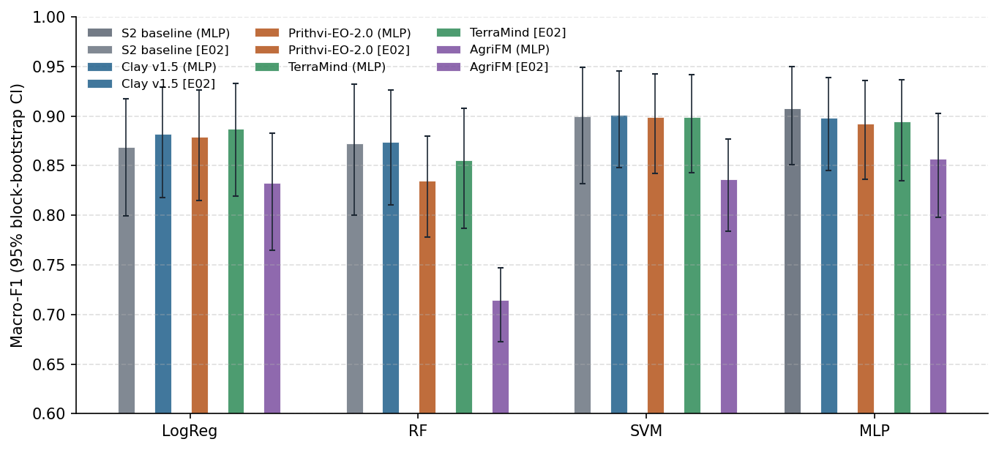
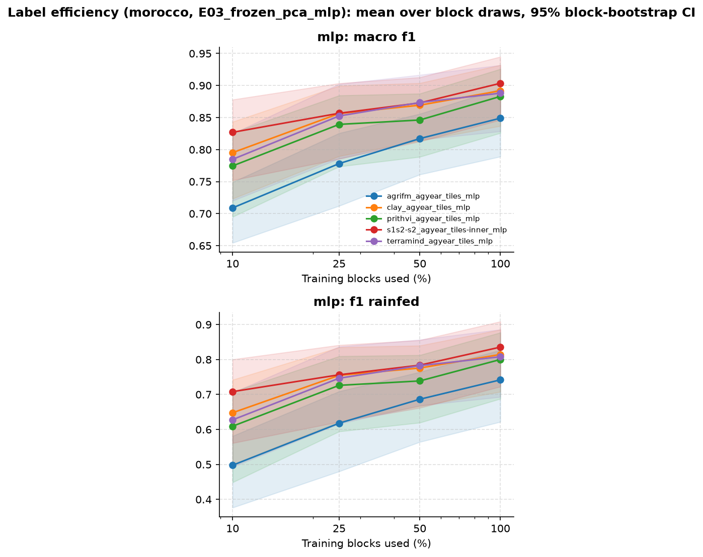
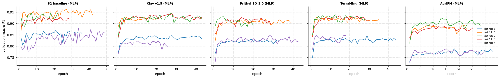
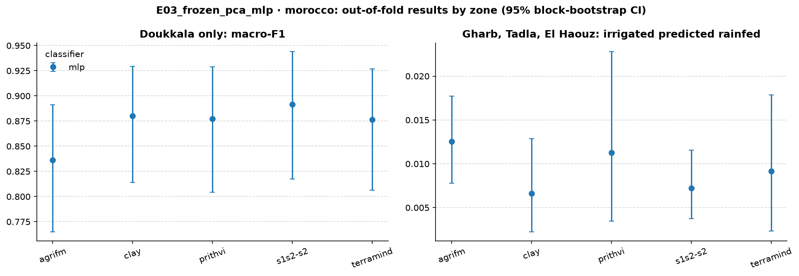
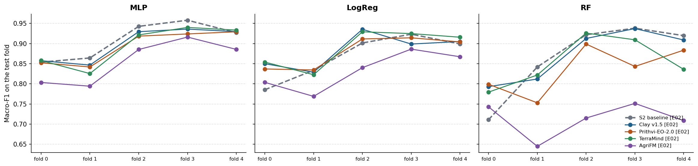
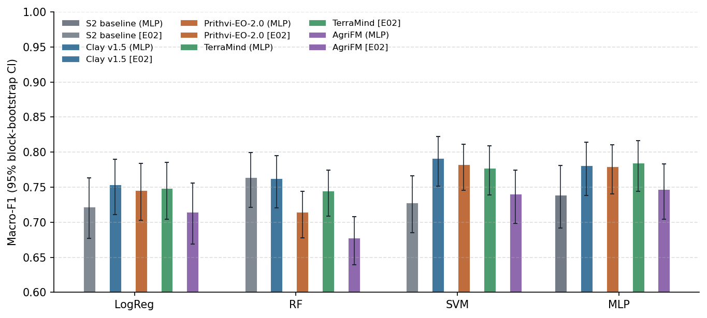
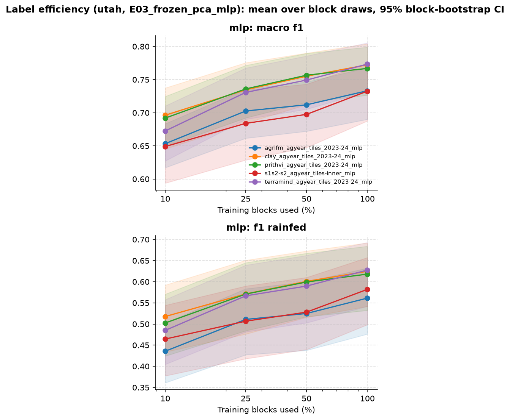
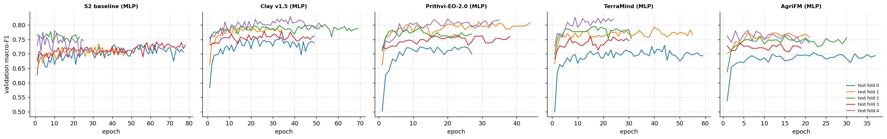
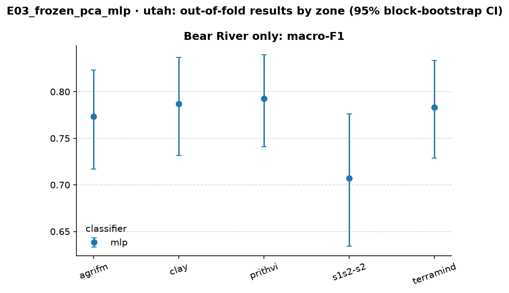
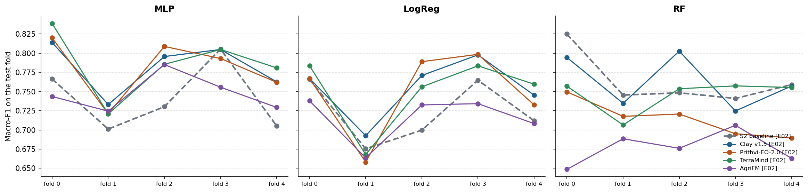

<!-- Report page of an experiment: created by make_report.py as docs/experiments/<name>/report.md -->
# E03 · Frozen GeoFMs + PCA + MLP head — report

> **Answer.** A trained MLP head is as good as the best classical head (SVM) for every input, but not better. It removes
> the weak-head problem (RF, LogReg) without changing the conclusion of E02. In Morocco, the S2 baseline with an MLP is
> the best single result so far (0.908), and the GeoFMs are 0.01–0.02 below it. In Utah, the GeoFMs with an MLP beat the
> S2 baseline with an MLP by 0.04–0.05, but not the baseline's random forest from E02.

## Key findings
- **MLP ≈ SVM for every input, in both regions.** Against E02's SVM, the MLP is within ±0.01 for all 10 input–region
  pairs, and none of these differences is significant. It is clearly better than LogReg and RF for most GeoFMs, by up to
  +0.14 (AgriFM vs RF, Morocco).
- **Morocco: the S2 baseline is still on top.** S2 + MLP scores 0.908. Clay, Prithvi and TerraMind score 0.892–0.898
  (−0.010 to −0.016, not significant after Holm), and AgriFM is worse (−0.051).
- **Utah: the GeoFMs beat the S2 baseline with the same head.** Clay (+0.042), Prithvi (+0.041) and TerraMind (+0.046)
  are significantly better than S2 + MLP. In the focus zone, Bear River, the gap is +0.08–0.09. But S2 + MLP (0.739) is
  below S2 + RF from E02 (0.764), so against the baseline's best head the GeoFMs gain only about 0.02.
- **E02's Souss finding came from the head, not the input.** With an MLP, the S2 features find 84% of the rainfed parcels
  in Souss (E02 SVM: 22%), more than any GeoFM (64–74%). The S2 baseline's weak fold 0 in E02 was a weakness of the
  classical heads.
- **Label efficiency differs by region.** In Morocco at 10% of the training blocks, S2 + MLP is the best input (0.827 vs
  0.71–0.80) and the most stable (SD 0.019). In Utah, every GeoFM except AgriFM is above S2 + MLP at every fraction. With
  25% of the blocks, Clay and Prithvi (0.735) already equal S2 + MLP with all blocks (0.733).
- **Seeds are stable.** Single-seed macro-F1 varies by at most ±0.008, which is less than the differences between inputs
  in Utah. Averaging the 3 seeds adds about +0.005 over a single seed.

<!-- AUTO:RESULTS:START -->
<!-- generated by experiments/make_report.py: do not edit between these markers -->

## Setup

| | |
| --- | --- |
| Question | Does a trainable neural head get more out of the same PCA input than logistic regression, random forest and SVM? |
| Research question | RQ1 |
| Regions | Morocco, Utah 2023/24 |
| Inputs | S2 baseline, Clay v1.5, Prithvi-EO-2.0, TerraMind, AgriFM |
| Temporal aggregation | 12 monthly embeddings side by side → standardise → PCA 128 (training folds only) |
| Head | MLP head 128 → 256 → 128 → 2 (batch normalisation, dropout 0.2), 3 seeds |
| Validation | 5 spatial folds (20 km blocks); per round 3 folds train, the next fold chooses the hyperparameters or stops training, 1 fold tests (PASTIS rotation) |
| Label efficiency | also trained on 10%, 25%, 50% of the training blocks, 3 block draws each (same draws in every experiment) |
| Parcels | 6,011 / 6,013 / 8,781 (inputs scored on the parcels common to all runs) |
| Uncertainty | 95% confidence interval (CI) from a block bootstrap (1,000 draws of whole 20 km blocks), the same draws for every run → paired differences; p-values Holm-adjusted |
| Changed from | E02: classifier LogReg / RF / SVM -> MLP head (128-256-128-2), 3 seeds |

## Morocco

### Macro-F1 of every input and head

Out-of-fold predictions of all 5 spatial folds; **bold** = best input for that head. Runs marked [E0x] come from an earlier experiment, on the same parcels and bootstrap draws.

??? info "How to read this table"

    **What:** one score per input (row) and classifier (column), between 0 and 1. Higher is better.

    **Macro-F1:** F1 is computed for each class separately (irrigated, rainfed) and the two are averaged. Rainfed
    parcels are the minority, so a model that labels everything "irrigated" still gets a high overall accuracy but a
    low macro-F1. That is why macro-F1 is the main metric.

    **How:** every parcel is predicted once, by the model that did *not* see its 20 km block in training (out-of-fold).
    All inputs are scored on the same parcels, so the numbers can be compared directly.

    **Read it as:** about 0.90 = very good; 0.75 = clear errors on the rainfed class; 0.50 = no better than guessing one class.

| Input | Logistic regression (LogReg) | Random forest (RF) | Support vector machine (SVM) | Multilayer perceptron (MLP) |
| --- | ---: | ---: | ---: | ---: |
| S2 baseline (MLP) | – | – | – | **0.908** |
| S2 baseline [E02] | 0.869 | 0.873 | 0.900 | – |
| Clay v1.5 (MLP) | – | – | – | 0.898 |
| Clay v1.5 [E02] | 0.882 | **0.874** | **0.901** | – |
| Prithvi-EO-2.0 (MLP) | – | – | – | 0.892 |
| Prithvi-EO-2.0 [E02] | 0.879 | 0.835 | 0.899 | – |
| TerraMind (MLP) | – | – | – | 0.894 |
| TerraMind [E02] | **0.887** | 0.855 | 0.899 | – |
| AgriFM (MLP) | – | – | – | 0.857 |
| AgriFM [E02] | 0.833 | 0.714 | 0.836 | – |

### Difference from the S2 baseline (headline heads)

Δ = input minus baseline with the same head (runs with their own model against the baseline's random forest), on the same parcels and the same bootstrap draws. **Better / worse** = the 95% confidence interval (CI) excludes 0 **and** the Holm-corrected p-value < 0.05.

??? info "How to read this table"

    **What:** each row compares one input with the baseline (the Sentinel feature classifier), using the same classifier.

    - **Difference in macro-F1 (Δ):** the input's score minus the baseline's. +0.013 means 0.013 higher than the baseline; −0.158
      means 0.158 lower.
    - **95% confidence interval (CI), e.g. [−0.021, +0.025]:** the range in which the true difference probably lies. It comes from
      resampling whole 20 km blocks 1,000 times (block bootstrap) and recomputing Δ each time.
        - The range **includes 0** (one end negative, the other positive): the data cannot tell which input is
          better.
        - The range is **entirely above 0**, e.g. [+0.011, +0.049]: the input is better.
        - The range is **entirely below 0**, e.g. [−0.215, −0.085]: the input is worse.
    - **p-value (Holm-corrected):** how likely a difference this large would be if the two inputs were really equal. Many pairs are
      tested at once, so each p-value is raised (Holm correction) to avoid false "wins" by chance. 1.000 = no evidence
      of a difference.
    - **Verdict:** "better" or "worse" only if the CI excludes 0 **and** the Holm-corrected p-value < 0.05. "Higher/lower, not
      significant after Holm" = the CI excludes 0, but the evidence does not survive the correction.

    **Why paired:** both inputs are scored on the same parcels and the same bootstrap draws, so a difference reflects
    the inputs, not which parcels happened to be drawn.

| Input | Classifier | Difference in macro-F1 (Δ) | 95% confidence interval (CI) | p-value (Holm-corrected) | Verdict |
| --- | --- | ---: | ---: | ---: | --- |
| Clay v1.5 (MLP) | Multilayer perceptron (MLP) | -0.010 | [-0.030, +0.006] | 0.276 | no clear difference |
| Prithvi-EO-2.0 (MLP) | Multilayer perceptron (MLP) | -0.016 | [-0.036, -0.001] | 0.114 | lower, not significant after Holm |
| TerraMind (MLP) | Multilayer perceptron (MLP) | -0.014 | [-0.038, +0.004] | 0.276 | no clear difference |
| AgriFM (MLP) | Multilayer perceptron (MLP) | -0.051 | [-0.083, -0.026] | < 0.001 | **worse** |

### Same input, earlier experiments' heads

Δ = this experiment's head minus the head of an earlier experiment on the same input, same parcels and bootstrap draws (own Holm family). E03: MLP vs the E02 classifiers; E04: L-TAE vs the E03 MLP and the E02 classifiers.

??? info "How to read this table"

    **What:** the same input with two different classifiers, e.g. Clay + MLP (this experiment) minus Clay + SVM (E02).
    It shows whether the classifier, not the input, makes the difference.

    Δ, the 95% confidence interval and the verdict are read as in the table above: a CI that includes 0 means no clear difference.

| Input | This experiment | Earlier run | Difference in macro-F1 (Δ) | 95% confidence interval (CI) | p-value (Holm-corrected) | Verdict |
| --- | --- | --- | ---: | ---: | ---: | --- |
| S2 baseline | Multilayer perceptron (MLP) | E02 LogReg | +0.039 | [+0.022, +0.070] | < 0.001 | **better** |
| S2 baseline | Multilayer perceptron (MLP) | E02 RF | +0.036 | [-0.007, +0.082] | 0.564 | no clear difference |
| S2 baseline | Multilayer perceptron (MLP) | E02 SVM | +0.009 | [-0.011, +0.036] | 1.000 | no clear difference |
| Clay v1.5 | Multilayer perceptron (MLP) | E02 LogReg | +0.016 | [+0.004, +0.032] | 0.054 | higher, not significant after Holm |
| Clay v1.5 | Multilayer perceptron (MLP) | E02 RF | +0.025 | [+0.001, +0.051] | 0.322 | higher, not significant after Holm |
| Clay v1.5 | Multilayer perceptron (MLP) | E02 SVM | -0.003 | [-0.017, +0.009] | 1.000 | no clear difference |
| Prithvi-EO-2.0 | Multilayer perceptron (MLP) | E02 LogReg | +0.013 | [+0.005, +0.025] | 0.022 | **better** |
| Prithvi-EO-2.0 | Multilayer perceptron (MLP) | E02 RF | +0.058 | [+0.027, +0.088] | < 0.001 | **better** |
| Prithvi-EO-2.0 | Multilayer perceptron (MLP) | E02 SVM | -0.007 | [-0.022, +0.005] | 1.000 | no clear difference |
| TerraMind | Multilayer perceptron (MLP) | E02 LogReg | +0.007 | [-0.005, +0.022] | 1.000 | no clear difference |
| TerraMind | Multilayer perceptron (MLP) | E02 RF | +0.039 | [+0.004, +0.085] | 0.208 | higher, not significant after Holm |
| TerraMind | Multilayer perceptron (MLP) | E02 SVM | -0.004 | [-0.018, +0.006] | 1.000 | no clear difference |
| AgriFM | Multilayer perceptron (MLP) | E02 LogReg | +0.024 | [+0.010, +0.044] | < 0.001 | **better** |
| AgriFM | Multilayer perceptron (MLP) | E02 RF | +0.143 | [+0.091, +0.188] | < 0.001 | **better** |
| AgriFM | Multilayer perceptron (MLP) | E02 SVM | +0.021 | [+0.007, +0.035] | 0.022 | **better** |

### Per-class metrics (headline heads, 95% confidence interval)

??? info "How to read this table"

    **What:** the main metric and three others for the headline classifiers, each with its 95% confidence interval in brackets
    (the range the true value probably lies in).

    - **Macro-F1:** mean F1 of the two classes (main metric).
    - **F1 of the rainfed class:** how well the minority class is found. Precision and recall of "rainfed" are combined, so it is
      usually the lowest number and the most informative one.
    - **Balanced accuracy:** mean recall of the two classes. 0.5 = guessing.
    - **Overall accuracy:** share of all parcels labelled correctly. It looks high even for weak models, because most
      parcels are irrigated, so do not compare inputs on it alone.

    **Wide CIs** (e.g. 0.63–0.88) mean the score changes a lot from block to block, so small differences between
    rows are not meaningful.

| Input | Classifier | Macro-F1 | F1 of the rainfed class | Balanced accuracy | Overall accuracy |
| --- | --- | ---: | ---: | ---: | ---: |
| S2 baseline (MLP) | Multilayer perceptron (MLP) | 0.908 [0.85–0.95] | 0.843 [0.74–0.92] | 0.937 [0.91–0.97] | 0.954 [0.93–0.98] |
| S2 baseline [E02] | Logistic regression (LogReg) | 0.869 [0.80–0.92] | 0.778 [0.64–0.86] | 0.906 [0.86–0.95] | 0.932 [0.90–0.96] |
| S2 baseline [E02] | Random forest (RF) | 0.873 [0.80–0.93] | 0.777 [0.63–0.88] | 0.850 [0.77–0.93] | 0.944 [0.91–0.97] |
| Clay v1.5 (MLP) | Multilayer perceptron (MLP) | 0.898 [0.85–0.94] | 0.825 [0.72–0.90] | 0.909 [0.87–0.95] | 0.951 [0.93–0.97] |
| Clay v1.5 [E02] | Logistic regression (LogReg) | 0.882 [0.82–0.93] | 0.800 [0.68–0.88] | 0.916 [0.88–0.95] | 0.940 [0.91–0.97] |
| Clay v1.5 [E02] | Random forest (RF) | 0.874 [0.81–0.93] | 0.779 [0.66–0.87] | 0.849 [0.78–0.91] | 0.945 [0.92–0.97] |
| Prithvi-EO-2.0 (MLP) | Multilayer perceptron (MLP) | 0.892 [0.84–0.94] | 0.816 [0.71–0.89] | 0.913 [0.87–0.95] | 0.947 [0.92–0.97] |
| Prithvi-EO-2.0 [E02] | Logistic regression (LogReg) | 0.879 [0.81–0.93] | 0.795 [0.67–0.88] | 0.923 [0.89–0.95] | 0.937 [0.90–0.96] |
| Prithvi-EO-2.0 [E02] | Random forest (RF) | 0.835 [0.78–0.88] | 0.713 [0.60–0.79] | 0.827 [0.76–0.88] | 0.924 [0.89–0.96] |
| TerraMind (MLP) | Multilayer perceptron (MLP) | 0.894 [0.84–0.94] | 0.819 [0.71–0.89] | 0.905 [0.86–0.94] | 0.949 [0.92–0.97] |
| TerraMind [E02] | Logistic regression (LogReg) | 0.887 [0.82–0.93] | 0.808 [0.69–0.89] | 0.922 [0.89–0.96] | 0.942 [0.91–0.97] |
| TerraMind [E02] | Random forest (RF) | 0.855 [0.79–0.91] | 0.747 [0.61–0.84] | 0.837 [0.77–0.90] | 0.935 [0.90–0.96] |
| AgriFM (MLP) | Multilayer perceptron (MLP) | 0.857 [0.80–0.90] | 0.755 [0.64–0.84] | 0.871 [0.82–0.92] | 0.930 [0.90–0.96] |
| AgriFM [E02] | Logistic regression (LogReg) | 0.833 [0.77–0.88] | 0.719 [0.59–0.81] | 0.886 [0.84–0.93] | 0.909 [0.88–0.94] |
| AgriFM [E02] | Random forest (RF) | 0.714 [0.67–0.75] | 0.485 [0.40–0.55] | 0.668 [0.63–0.70] | 0.898 [0.85–0.94] |

### Label efficiency

Macro-F1 when trained on a share of the training blocks (validation and test folds complete); mean ± SD over the 3 block draws. Draws are nested (the 10% blocks are part of the 25% and 50% blocks) and identical in every experiment. Neural heads: every point is a single-seed result (the 100% point is the mean over its 3 seeds scored one by one).

??? info "How to read this table"

    **What:** how the score changes when the model is trained with fewer labelled parcels.

    - **Columns:** share of the training blocks used (10%, 25%, 50%; 100% = the main result). The row *training
      parcels per round* gives the actual number of parcels. Validation and test folds are always complete, so every
      column is tested on the same parcels.
    - **0.807 ± 0.091:** the mean over 3 different random draws of blocks ± their standard deviation. A large ± means
      the result depends on *which* blocks were drawn.
    - **Read it as:** an input that stays high at 10% needs fewer labels (it is "label-efficient"). If its curve rises
      steeply, it needs many labels.

    **Why whole blocks:** dropping single parcels would leave neighbours of every parcel in training. Dropping whole
    20 km blocks simulates having field data from fewer places.

| Input | Head | 10% | 25% | 50% | 100% |
| --- | --- | ---: | ---: | ---: | ---: |
| *training parcels per round* | | 590 | 1,266 | 2,530 | all |
| S2 baseline (MLP) | Multilayer perceptron (MLP) | 0.827 ± 0.019 | 0.857 ± 0.008 | 0.873 ± 0.017 | 0.903 |
| Clay v1.5 (MLP) | Multilayer perceptron (MLP) | 0.795 ± 0.050 | 0.856 ± 0.025 | 0.869 ± 0.008 | 0.892 |
| Prithvi-EO-2.0 (MLP) | Multilayer perceptron (MLP) | 0.774 ± 0.045 | 0.839 ± 0.022 | 0.846 ± 0.007 | 0.883 |
| TerraMind (MLP) | Multilayer perceptron (MLP) | 0.785 ± 0.070 | 0.853 ± 0.015 | 0.873 ± 0.005 | 0.888 |
| AgriFM (MLP) | Multilayer perceptron (MLP) | 0.709 ± 0.065 | 0.778 ± 0.014 | 0.817 ± 0.008 | 0.849 |

### Spread over seeds (neural heads)

Macro-F1 of each seed on its own; the result above is the mean probability of the seeds.

??? info "How to read this table"

    **What:** neural networks start from random weights, so each run (seed) gives a slightly different result. The
    table shows each seed on its own. Small differences between seeds (≈ 0.01) mean the result is stable, and a
    difference between inputs smaller than this spread is not meaningful.

| Input | Head | Macro-F1 per seed | Mean ± standard deviation (SD) |
| --- | --- | --- | ---: |
| S2 baseline | Multilayer perceptron (MLP) | 0.896, 0.911, 0.903 | 0.903 ± 0.008 |
| Clay v1.5 | Multilayer perceptron (MLP) | 0.883, 0.896, 0.896 | 0.892 ± 0.008 |
| Prithvi-EO-2.0 | Multilayer perceptron (MLP) | 0.886, 0.877, 0.886 | 0.883 ± 0.005 |
| TerraMind | Multilayer perceptron (MLP) | 0.892, 0.884, 0.888 | 0.888 ± 0.004 |
| AgriFM | Multilayer perceptron (MLP) | 0.849, 0.853, 0.845 | 0.849 ± 0.004 |

### Training curves

Validation macro-F1 per epoch in each round (first seed); the best epoch is kept (early stopping).

### Results by zone

Only the focus zone, where both classes are common (3,498 parcels, 1122 rainfed, 26 blocks): does the input separate the classes inside one region, or does it recognise the region? Script `05_breakdown_oof.py`.

??? info "How to read this table"

    **What:** the score inside the one zone where both classes are common (the focus zone), not over the whole region.

    **Why:** across a whole region, a model can score well just by learning *where* parcels are (one zone is almost all
    irrigated, another has the rainfed parcels). Inside one zone, location does not help, so this shows whether the
    input separates irrigated from rainfed fields themselves.

    **Difference from the baseline [95% confidence interval]:** as in the difference table. A CI that includes 0 means no clear difference.

| Input | Head | Macro-F1 [95% confidence interval] | Difference from the baseline [95% confidence interval] |
| --- | --- | ---: | ---: |
| S2 baseline (MLP) | Multilayer perceptron (MLP) | 0.891 [0.82–0.94] | – |
| Clay v1.5 (MLP) | Multilayer perceptron (MLP) | 0.880 [0.81–0.93] | -0.011 [-0.033, +0.009] |
| Prithvi-EO-2.0 (MLP) | Multilayer perceptron (MLP) | 0.877 [0.80–0.93] | -0.014 [-0.034, +0.005] |
| TerraMind (MLP) | Multilayer perceptron (MLP) | 0.876 [0.81–0.93] | -0.015 [-0.040, +0.007] |
| AgriFM (MLP) | Multilayer perceptron (MLP) | 0.836 [0.76–0.89] | -0.055 [-0.096, -0.020] |

Tables per zone and season, patch purity and parcel area: `experiments/E03_frozen_pca_mlp/results/morocco/breakdown/`.

### Macro-F1 per test fold

Each fold is a set of 20 km blocks, used once as the test fold. Rainfed test parcels per fold: fold 0: Doukkala 180, Souss 59; fold 1: Doukkala 237; fold 2: Doukkala 241; fold 3: Doukkala 234; fold 4: Doukkala 230.

??? info "How to read this table"

    **What:** the score on each test fold separately. Each fold is a different set of 20 km blocks, so the five numbers
    show how much the result changes from one part of the region to another.

    - **Mean ± standard deviation (SD):** average of the five folds and their spread. This can differ slightly from the main table, which
      scores all parcels at once.
    - **Read it as:** a low fold points to a part of the region where the model struggles. The fold description above
      lists where its rainfed parcels are. An input with a smaller SD is more consistent across space.

**MLP**

| Input | Fold 0 | Fold 1 | Fold 2 | Fold 3 | Fold 4 | Mean ± standard deviation (SD) |
| --- | ---: | ---: | ---: | ---: | ---: | ---: |
| S2 baseline (MLP) | 0.854 | 0.864 | 0.943 | 0.958 | 0.927 | 0.909 ± 0.047 |
| Clay v1.5 (MLP) | 0.857 | 0.847 | 0.930 | 0.936 | 0.930 | 0.900 ± 0.044 |
| Prithvi-EO-2.0 (MLP) | 0.852 | 0.842 | 0.919 | 0.924 | 0.929 | 0.893 ± 0.042 |
| TerraMind (MLP) | 0.858 | 0.825 | 0.922 | 0.940 | 0.933 | 0.896 ± 0.051 |
| AgriFM (MLP) | 0.803 | 0.794 | 0.885 | 0.916 | 0.886 | 0.857 ± 0.055 |

**LogReg**

| Input | Fold 0 | Fold 1 | Fold 2 | Fold 3 | Fold 4 | Mean ± standard deviation (SD) |
| --- | ---: | ---: | ---: | ---: | ---: | ---: |
| S2 baseline [E02] | 0.785 | 0.834 | 0.901 | 0.923 | 0.899 | 0.869 ± 0.057 |
| Clay v1.5 [E02] | 0.850 | 0.829 | 0.935 | 0.899 | 0.905 | 0.884 ± 0.043 |
| Prithvi-EO-2.0 [E02] | 0.837 | 0.834 | 0.911 | 0.914 | 0.904 | 0.880 ± 0.041 |
| TerraMind [E02] | 0.854 | 0.823 | 0.929 | 0.925 | 0.916 | 0.889 ± 0.048 |
| AgriFM [E02] | 0.804 | 0.769 | 0.840 | 0.886 | 0.867 | 0.833 ± 0.048 |

**RF**

| Input | Fold 0 | Fold 1 | Fold 2 | Fold 3 | Fold 4 | Mean ± standard deviation (SD) |
| --- | ---: | ---: | ---: | ---: | ---: | ---: |
| S2 baseline [E02] | 0.711 | 0.842 | 0.922 | 0.938 | 0.920 | 0.867 ± 0.095 |
| Clay v1.5 [E02] | 0.793 | 0.812 | 0.913 | 0.937 | 0.909 | 0.873 ± 0.065 |
| Prithvi-EO-2.0 [E02] | 0.799 | 0.753 | 0.899 | 0.843 | 0.884 | 0.835 ± 0.060 |
| TerraMind [E02] | 0.779 | 0.822 | 0.926 | 0.909 | 0.836 | 0.855 ± 0.062 |
| AgriFM [E02] | 0.743 | 0.645 | 0.715 | 0.751 | 0.709 | 0.713 ± 0.042 |

### Files

- Tables: [`experiments/E03_frozen_pca_mlp/results/morocco/comparison/`](https://github.com/amanchry/irrimapping-geofm/tree/main/experiments/E03_frozen_pca_mlp/results/morocco/comparison) (all metrics with CI, differences vs baseline, learning curves)
- Per run ([`experiments/E03_frozen_pca_mlp/results/morocco/<run>/`](https://github.com/amanchry/irrimapping-geofm/tree/main/experiments/E03_frozen_pca_mlp/results/morocco)): out-of-fold predictions, metrics per fold (and per seed), run settings and log
- Confusion matrices: –

## Utah 2023/24

### Macro-F1 of every input and head

Out-of-fold predictions of all 5 spatial folds; **bold** = best input for that head. Runs marked [E0x] come from an earlier experiment, on the same parcels and bootstrap draws.

??? info "How to read this table"

    **What:** one score per input (row) and classifier (column), between 0 and 1. Higher is better.

    **Macro-F1:** F1 is computed for each class separately (irrigated, rainfed) and the two are averaged. Rainfed
    parcels are the minority, so a model that labels everything "irrigated" still gets a high overall accuracy but a
    low macro-F1. That is why macro-F1 is the main metric.

    **How:** every parcel is predicted once, by the model that did *not* see its 20 km block in training (out-of-fold).
    All inputs are scored on the same parcels, so the numbers can be compared directly.

    **Read it as:** about 0.90 = very good; 0.75 = clear errors on the rainfed class; 0.50 = no better than guessing one class.

| Input | Logistic regression (LogReg) | Random forest (RF) | Support vector machine (SVM) | Multilayer perceptron (MLP) |
| --- | ---: | ---: | ---: | ---: |
| S2 baseline (MLP) | – | – | – | 0.739 |
| S2 baseline [E02] | 0.722 | **0.764** | 0.728 | – |
| Clay v1.5 (MLP) | – | – | – | 0.781 |
| Clay v1.5 [E02] | **0.753** | 0.763 | **0.791** | – |
| Prithvi-EO-2.0 (MLP) | – | – | – | 0.780 |
| Prithvi-EO-2.0 [E02] | 0.746 | 0.715 | 0.782 | – |
| TerraMind (MLP) | – | – | – | **0.785** |
| TerraMind [E02] | 0.749 | 0.745 | 0.777 | – |
| AgriFM (MLP) | – | – | – | 0.747 |
| AgriFM [E02] | 0.714 | 0.677 | 0.741 | – |

### Difference from the S2 baseline (headline heads)

Δ = input minus baseline with the same head (runs with their own model against the baseline's random forest), on the same parcels and the same bootstrap draws. **Better / worse** = the 95% confidence interval (CI) excludes 0 **and** the Holm-corrected p-value < 0.05.

??? info "How to read this table"

    **What:** each row compares one input with the baseline (the Sentinel feature classifier), using the same classifier.

    - **Difference in macro-F1 (Δ):** the input's score minus the baseline's. +0.013 means 0.013 higher than the baseline; −0.158
      means 0.158 lower.
    - **95% confidence interval (CI), e.g. [−0.021, +0.025]:** the range in which the true difference probably lies. It comes from
      resampling whole 20 km blocks 1,000 times (block bootstrap) and recomputing Δ each time.
        - The range **includes 0** (one end negative, the other positive): the data cannot tell which input is
          better.
        - The range is **entirely above 0**, e.g. [+0.011, +0.049]: the input is better.
        - The range is **entirely below 0**, e.g. [−0.215, −0.085]: the input is worse.
    - **p-value (Holm-corrected):** how likely a difference this large would be if the two inputs were really equal. Many pairs are
      tested at once, so each p-value is raised (Holm correction) to avoid false "wins" by chance. 1.000 = no evidence
      of a difference.
    - **Verdict:** "better" or "worse" only if the CI excludes 0 **and** the Holm-corrected p-value < 0.05. "Higher/lower, not
      significant after Holm" = the CI excludes 0, but the evidence does not survive the correction.

    **Why paired:** both inputs are scored on the same parcels and the same bootstrap draws, so a difference reflects
    the inputs, not which parcels happened to be drawn.

| Input | Classifier | Difference in macro-F1 (Δ) | 95% confidence interval (CI) | p-value (Holm-corrected) | Verdict |
| --- | --- | ---: | ---: | ---: | --- |
| Clay v1.5 (MLP) | Multilayer perceptron (MLP) | +0.042 | [+0.015, +0.067] | < 0.001 | **better** |
| Prithvi-EO-2.0 (MLP) | Multilayer perceptron (MLP) | +0.041 | [+0.013, +0.068] | 0.004 | **better** |
| TerraMind (MLP) | Multilayer perceptron (MLP) | +0.046 | [+0.018, +0.073] | < 0.001 | **better** |
| AgriFM (MLP) | Multilayer perceptron (MLP) | +0.008 | [-0.020, +0.034] | 0.646 | no clear difference |

### Same input, earlier experiments' heads

Δ = this experiment's head minus the head of an earlier experiment on the same input, same parcels and bootstrap draws (own Holm family). E03: MLP vs the E02 classifiers; E04: L-TAE vs the E03 MLP and the E02 classifiers.

??? info "How to read this table"

    **What:** the same input with two different classifiers, e.g. Clay + MLP (this experiment) minus Clay + SVM (E02).
    It shows whether the classifier, not the input, makes the difference.

    Δ, the 95% confidence interval and the verdict are read as in the table above: a CI that includes 0 means no clear difference.

| Input | This experiment | Earlier run | Difference in macro-F1 (Δ) | 95% confidence interval (CI) | p-value (Holm-corrected) | Verdict |
| --- | --- | --- | ---: | ---: | ---: | --- |
| S2 baseline | Multilayer perceptron (MLP) | E02 LogReg | +0.017 | [-0.003, +0.037] | 0.560 | no clear difference |
| S2 baseline | Multilayer perceptron (MLP) | E02 RF | -0.025 | [-0.052, +0.002] | 0.480 | no clear difference |
| S2 baseline | Multilayer perceptron (MLP) | E02 SVM | +0.011 | [-0.003, +0.027] | 0.560 | no clear difference |
| Clay v1.5 | Multilayer perceptron (MLP) | E02 LogReg | +0.028 | [+0.015, +0.042] | < 0.001 | **better** |
| Clay v1.5 | Multilayer perceptron (MLP) | E02 RF | +0.018 | [-0.000, +0.037] | 0.432 | no clear difference |
| Clay v1.5 | Multilayer perceptron (MLP) | E02 SVM | -0.010 | [-0.022, +0.001] | 0.432 | no clear difference |
| Prithvi-EO-2.0 | Multilayer perceptron (MLP) | E02 LogReg | +0.034 | [+0.018, +0.048] | < 0.001 | **better** |
| Prithvi-EO-2.0 | Multilayer perceptron (MLP) | E02 RF | +0.065 | [+0.038, +0.093] | < 0.001 | **better** |
| Prithvi-EO-2.0 | Multilayer perceptron (MLP) | E02 SVM | -0.003 | [-0.016, +0.009] | 0.702 | no clear difference |
| TerraMind | Multilayer perceptron (MLP) | E02 LogReg | +0.036 | [+0.022, +0.052] | < 0.001 | **better** |
| TerraMind | Multilayer perceptron (MLP) | E02 RF | +0.040 | [+0.020, +0.059] | < 0.001 | **better** |
| TerraMind | Multilayer perceptron (MLP) | E02 SVM | +0.007 | [-0.005, +0.020] | 0.702 | no clear difference |
| AgriFM | Multilayer perceptron (MLP) | E02 LogReg | +0.033 | [+0.012, +0.050] | < 0.001 | **better** |
| AgriFM | Multilayer perceptron (MLP) | E02 RF | +0.069 | [+0.034, +0.105] | < 0.001 | **better** |
| AgriFM | Multilayer perceptron (MLP) | E02 SVM | +0.006 | [-0.007, +0.019] | 0.702 | no clear difference |

### Per-class metrics (headline heads, 95% confidence interval)

??? info "How to read this table"

    **What:** the main metric and three others for the headline classifiers, each with its 95% confidence interval in brackets
    (the range the true value probably lies in).

    - **Macro-F1:** mean F1 of the two classes (main metric).
    - **F1 of the rainfed class:** how well the minority class is found. Precision and recall of "rainfed" are combined, so it is
      usually the lowest number and the most informative one.
    - **Balanced accuracy:** mean recall of the two classes. 0.5 = guessing.
    - **Overall accuracy:** share of all parcels labelled correctly. It looks high even for weak models, because most
      parcels are irrigated, so do not compare inputs on it alone.

    **Wide CIs** (e.g. 0.63–0.88) mean the score changes a lot from block to block, so small differences between
    rows are not meaningful.

| Input | Classifier | Macro-F1 | F1 of the rainfed class | Balanced accuracy | Overall accuracy |
| --- | --- | ---: | ---: | ---: | ---: |
| S2 baseline (MLP) | Multilayer perceptron (MLP) | 0.739 [0.69–0.78] | 0.591 [0.51–0.67] | 0.797 [0.77–0.83] | 0.823 [0.79–0.85] |
| S2 baseline [E02] | Logistic regression (LogReg) | 0.722 [0.68–0.76] | 0.572 [0.49–0.65] | 0.794 [0.76–0.82] | 0.803 [0.77–0.83] |
| S2 baseline [E02] | Random forest (RF) | 0.764 [0.72–0.80] | 0.604 [0.51–0.68] | 0.753 [0.71–0.79] | 0.873 [0.85–0.89] |
| Clay v1.5 (MLP) | Multilayer perceptron (MLP) | 0.781 [0.74–0.81] | 0.636 [0.55–0.71] | 0.783 [0.75–0.81] | 0.876 [0.86–0.89] |
| Clay v1.5 [E02] | Logistic regression (LogReg) | 0.753 [0.71–0.79] | 0.611 [0.53–0.68] | 0.807 [0.77–0.83] | 0.836 [0.81–0.86] |
| Clay v1.5 [E02] | Random forest (RF) | 0.763 [0.72–0.79] | 0.592 [0.50–0.66] | 0.729 [0.69–0.76] | 0.886 [0.87–0.90] |
| Prithvi-EO-2.0 (MLP) | Multilayer perceptron (MLP) | 0.780 [0.74–0.81] | 0.637 [0.56–0.70] | 0.791 [0.76–0.82] | 0.872 [0.85–0.89] |
| Prithvi-EO-2.0 [E02] | Logistic regression (LogReg) | 0.746 [0.70–0.78] | 0.602 [0.52–0.68] | 0.805 [0.77–0.83] | 0.828 [0.80–0.85] |
| Prithvi-EO-2.0 [E02] | Random forest (RF) | 0.715 [0.68–0.74] | 0.501 [0.42–0.56] | 0.674 [0.64–0.70] | 0.875 [0.85–0.90] |
| TerraMind (MLP) | Multilayer perceptron (MLP) | 0.785 [0.74–0.82] | 0.645 [0.56–0.71] | 0.795 [0.76–0.82] | 0.875 [0.85–0.89] |
| TerraMind [E02] | Logistic regression (LogReg) | 0.749 [0.70–0.79] | 0.607 [0.53–0.68] | 0.812 [0.78–0.84] | 0.828 [0.80–0.85] |
| TerraMind [E02] | Random forest (RF) | 0.745 [0.71–0.77] | 0.561 [0.48–0.62] | 0.712 [0.68–0.74] | 0.878 [0.86–0.90] |
| AgriFM (MLP) | Multilayer perceptron (MLP) | 0.747 [0.70–0.78] | 0.581 [0.49–0.65] | 0.752 [0.71–0.78] | 0.855 [0.83–0.88] |
| AgriFM [E02] | Logistic regression (LogReg) | 0.714 [0.67–0.76] | 0.555 [0.47–0.63] | 0.774 [0.74–0.80] | 0.803 [0.77–0.83] |
| AgriFM [E02] | Random forest (RF) | 0.677 [0.64–0.71] | 0.429 [0.35–0.49] | 0.639 [0.61–0.67] | 0.869 [0.84–0.89] |

### Label efficiency

Macro-F1 when trained on a share of the training blocks (validation and test folds complete); mean ± SD over the 3 block draws. Draws are nested (the 10% blocks are part of the 25% and 50% blocks) and identical in every experiment. Neural heads: every point is a single-seed result (the 100% point is the mean over its 3 seeds scored one by one).

??? info "How to read this table"

    **What:** how the score changes when the model is trained with fewer labelled parcels.

    - **Columns:** share of the training blocks used (10%, 25%, 50%; 100% = the main result). The row *training
      parcels per round* gives the actual number of parcels. Validation and test folds are always complete, so every
      column is tested on the same parcels.
    - **0.807 ± 0.091:** the mean over 3 different random draws of blocks ± their standard deviation. A large ± means
      the result depends on *which* blocks were drawn.
    - **Read it as:** an input that stays high at 10% needs fewer labels (it is "label-efficient"). If its curve rises
      steeply, it needs many labels.

    **Why whole blocks:** dropping single parcels would leave neighbours of every parcel in training. Dropping whole
    20 km blocks simulates having field data from fewer places.

| Input | Head | 10% | 25% | 50% | 100% |
| --- | --- | ---: | ---: | ---: | ---: |
| *training parcels per round* | | 399 | 862 | 1,732 | all |
| S2 baseline (MLP) | Multilayer perceptron (MLP) | 0.649 ± 0.023 | 0.684 ± 0.007 | 0.698 ± 0.010 | 0.733 |
| Clay v1.5 (MLP) | Multilayer perceptron (MLP) | 0.696 ± 0.012 | 0.735 ± 0.006 | 0.755 ± 0.003 | 0.772 |
| Prithvi-EO-2.0 (MLP) | Multilayer perceptron (MLP) | 0.692 ± 0.018 | 0.736 ± 0.014 | 0.757 ± 0.011 | 0.767 |
| TerraMind (MLP) | Multilayer perceptron (MLP) | 0.672 ± 0.013 | 0.731 ± 0.013 | 0.749 ± 0.017 | 0.773 |
| AgriFM (MLP) | Multilayer perceptron (MLP) | 0.653 ± 0.017 | 0.703 ± 0.004 | 0.712 ± 0.006 | 0.733 |

### Spread over seeds (neural heads)

Macro-F1 of each seed on its own; the result above is the mean probability of the seeds.

??? info "How to read this table"

    **What:** neural networks start from random weights, so each run (seed) gives a slightly different result. The
    table shows each seed on its own. Small differences between seeds (≈ 0.01) mean the result is stable, and a
    difference between inputs smaller than this spread is not meaningful.

| Input | Head | Macro-F1 per seed | Mean ± standard deviation (SD) |
| --- | --- | --- | ---: |
| S2 baseline | Multilayer perceptron (MLP) | 0.731, 0.733, 0.733 | 0.733 ± 0.001 |
| Clay v1.5 | Multilayer perceptron (MLP) | 0.770, 0.777, 0.769 | 0.772 ± 0.004 |
| Prithvi-EO-2.0 | Multilayer perceptron (MLP) | 0.765, 0.771, 0.765 | 0.767 ± 0.004 |
| TerraMind | Multilayer perceptron (MLP) | 0.774, 0.775, 0.770 | 0.773 ± 0.003 |
| AgriFM | Multilayer perceptron (MLP) | 0.727, 0.737, 0.735 | 0.733 ± 0.005 |

### Training curves

Validation macro-F1 per epoch in each round (first seed); the best epoch is kept (early stopping).

### Results by zone

Only the focus zone, where both classes are common (2,015 parcels, 595 rainfed, 40 blocks): does the input separate the classes inside one region, or does it recognise the region? Script `05_breakdown_oof.py`.

??? info "How to read this table"

    **What:** the score inside the one zone where both classes are common (the focus zone), not over the whole region.

    **Why:** across a whole region, a model can score well just by learning *where* parcels are (one zone is almost all
    irrigated, another has the rainfed parcels). Inside one zone, location does not help, so this shows whether the
    input separates irrigated from rainfed fields themselves.

    **Difference from the baseline [95% confidence interval]:** as in the difference table. A CI that includes 0 means no clear difference.

| Input | Head | Macro-F1 [95% confidence interval] | Difference from the baseline [95% confidence interval] |
| --- | --- | ---: | ---: |
| S2 baseline (MLP) | Multilayer perceptron (MLP) | 0.707 [0.63–0.78] | – |
| Clay v1.5 (MLP) | Multilayer perceptron (MLP) | 0.787 [0.73–0.84] | +0.080 [+0.027, +0.132] |
| Prithvi-EO-2.0 (MLP) | Multilayer perceptron (MLP) | 0.793 [0.74–0.84] | +0.086 [+0.037, +0.139] |
| TerraMind (MLP) | Multilayer perceptron (MLP) | 0.783 [0.73–0.83] | +0.076 [+0.026, +0.134] |
| AgriFM (MLP) | Multilayer perceptron (MLP) | 0.773 [0.72–0.82] | +0.066 [+0.019, +0.114] |

Tables per zone and season, patch purity and parcel area: `experiments/E03_frozen_pca_mlp/results/utah/breakdown/`.

### Macro-F1 per test fold

Each fold is a set of 20 km blocks, used once as the test fold. Rainfed test parcels per fold: fold 0: Bear River 105, Southeast Colorado River 30, Sevier River 29, Weber River 14; fold 1: Bear River 144, Southeast Colorado River 29, Sevier River 12; fold 2: Bear River 118, Sevier River 28, Cedar/Beaver 10; fold 3: Bear River 116, Sevier River 54, Uintah 10, Southeast Colorado River 10; fold 4: Bear River 112, West Desert 26, Southeast Colorado River 22, Sevier River 12, Utah Lake 10.

??? info "How to read this table"

    **What:** the score on each test fold separately. Each fold is a different set of 20 km blocks, so the five numbers
    show how much the result changes from one part of the region to another.

    - **Mean ± standard deviation (SD):** average of the five folds and their spread. This can differ slightly from the main table, which
      scores all parcels at once.
    - **Read it as:** a low fold points to a part of the region where the model struggles. The fold description above
      lists where its rainfed parcels are. An input with a smaller SD is more consistent across space.

**MLP**

| Input | Fold 0 | Fold 1 | Fold 2 | Fold 3 | Fold 4 | Mean ± standard deviation (SD) |
| --- | ---: | ---: | ---: | ---: | ---: | ---: |
| S2 baseline (MLP) | 0.766 | 0.701 | 0.730 | 0.805 | 0.705 | 0.742 ± 0.044 |
| Clay v1.5 (MLP) | 0.814 | 0.733 | 0.796 | 0.805 | 0.763 | 0.782 ± 0.034 |
| Prithvi-EO-2.0 (MLP) | 0.820 | 0.721 | 0.809 | 0.793 | 0.762 | 0.781 ± 0.040 |
| TerraMind (MLP) | 0.839 | 0.721 | 0.786 | 0.805 | 0.781 | 0.786 ± 0.043 |
| AgriFM (MLP) | 0.744 | 0.724 | 0.785 | 0.756 | 0.729 | 0.748 ± 0.024 |

**LogReg**

| Input | Fold 0 | Fold 1 | Fold 2 | Fold 3 | Fold 4 | Mean ± standard deviation (SD) |
| --- | ---: | ---: | ---: | ---: | ---: | ---: |
| S2 baseline [E02] | 0.766 | 0.675 | 0.700 | 0.765 | 0.712 | 0.724 ± 0.040 |
| Clay v1.5 [E02] | 0.767 | 0.692 | 0.771 | 0.798 | 0.745 | 0.755 ± 0.039 |
| Prithvi-EO-2.0 [E02] | 0.767 | 0.658 | 0.789 | 0.798 | 0.733 | 0.749 ± 0.057 |
| TerraMind [E02] | 0.784 | 0.668 | 0.756 | 0.784 | 0.760 | 0.750 ± 0.048 |
| AgriFM [E02] | 0.738 | 0.664 | 0.733 | 0.734 | 0.708 | 0.715 ± 0.031 |

**RF**

| Input | Fold 0 | Fold 1 | Fold 2 | Fold 3 | Fold 4 | Mean ± standard deviation (SD) |
| --- | ---: | ---: | ---: | ---: | ---: | ---: |
| S2 baseline [E02] | 0.825 | 0.745 | 0.748 | 0.741 | 0.759 | 0.764 ± 0.035 |
| Clay v1.5 [E02] | 0.794 | 0.735 | 0.803 | 0.725 | 0.757 | 0.763 ± 0.035 |
| Prithvi-EO-2.0 [E02] | 0.750 | 0.718 | 0.721 | 0.695 | 0.690 | 0.715 ± 0.024 |
| TerraMind [E02] | 0.757 | 0.706 | 0.754 | 0.757 | 0.755 | 0.746 ± 0.022 |
| AgriFM [E02] | 0.649 | 0.688 | 0.676 | 0.706 | 0.663 | 0.676 ± 0.022 |

### Files

- Tables: [`experiments/E03_frozen_pca_mlp/results/utah/comparison/`](https://github.com/amanchry/irrimapping-geofm/tree/main/experiments/E03_frozen_pca_mlp/results/utah/comparison) (all metrics with CI, differences vs baseline, learning curves)
- Per run ([`experiments/E03_frozen_pca_mlp/results/utah/<run>/`](https://github.com/amanchry/irrimapping-geofm/tree/main/experiments/E03_frozen_pca_mlp/results/utah)): out-of-fold predictions, metrics per fold (and per seed), run settings and log
- Confusion matrices: –

## Code and settings

- Settings: [`experiments/E03_frozen_pca_mlp/config.yaml`](https://github.com/amanchry/irrimapping-geofm/blob/main/experiments/E03_frozen_pca_mlp/config.yaml)
- Code version: `710f917 (with uncommitted changes)`, run 2026-11-13 12:46 – 2026-11-13 12:46

<!-- AUTO:RESULTS:END -->

## Interpretation

**The head question is settled for the PCA input.** E02 left open whether the GeoFMs only looked weak because of the
classical heads. With a trained MLP, every input reaches about the level of its SVM result and no further. So E02's
SVM column was already close to what this input can give. What remains is a real difference between inputs, not
between heads, and it is small: none in Morocco, 0.02–0.05 in Utah depending on the comparison.

**Morocco and Utah disagree, and the reason is probably the data.** In Morocco, the rainfed parcels are concentrated
in Doukkala and have a clear seasonal signal (winter cereals without a summer crop), which hand-crafted indices (NDVI,
EVI, SWIR per month) capture well. A flexible head on these features is hard to beat. In Utah, rainfed and irrigated
parcels share crop types and are spread over many zones. There, the GeoFM embeddings separate the classes better inside
the main zone (Bear River +0.08–0.09), so they seem to carry field-level information the indices miss. Utah is
also where the GeoFMs help with few labels: 25% of the blocks with Clay or Prithvi match all blocks with S2 + MLP.

**The S2 baseline needs the right head.** The S2 features gain most from flexible heads in Morocco (MLP +0.039 vs
LogReg), but in Utah their best head is still the random forest (0.764 vs 0.739 for the MLP). In Utah the MLP on S2
features predicts "rainfed" too often: highest balanced accuracy (0.797) and rainfed recall (0.86 in Bear River), but
lower precision and overall accuracy (0.823). The fairest single comparison is therefore each input with its best head:
Morocco S2 0.908 vs best GeoFM 0.901 (Clay SVM, E02); Utah S2 0.764 vs best GeoFM 0.791 (Clay SVM, E02).

**Correction to E02.** E02 suggested that the GeoFMs transfer better to Souss, a zone with few rainfed training
parcels. E03 shows that this was an effect of the classical heads on the S2 features. With an MLP, the S2 baseline finds
84% of Souss's rainfed parcels, more than any GeoFM. The E02 report now points to this.

**AgriFM** gains the most from a trained head (+0.14 over RF in Morocco), which confirms that its single pooled
embedding needs a non-linear head. It stays the weakest input in Morocco, and in Utah it equals the S2 baseline with the
same head.

## Caveats
- The MLP has fixed settings (no grid search), while E02's heads chose from a small grid on the validation fold. A tuned
  MLP might do slightly better, but the MLP already equals SVM, so a large change is unlikely.
- The main MLP result averages 3 seeds (≈ +0.005 over a single seed); the E02 heads run once. The label-efficiency
  table uses single seeds throughout, so its 100% column (mean of the seeds scored one by one) is slightly below the
  main table.
- The Holm correction covers this experiment's own runs only: the 4 differences from the baseline, and the 15 MLP vs E02
  comparisons, each family on its own.
- Confusion matrices and permutation importance are not produced for the neural heads. The per-zone tables are in
  `results/<region>/breakdown/`.
- Per-zone results for zones with fewer than 50 rainfed parcels are indicative only.

## Next steps
- **E04:** L-TAE on the 12 monthly embeddings, without concatenation and PCA, with the same MLP after attention.
  E03 → E04 isolates the effect of temporal attention. AgriFM is excluded because it has one time step.
- **E05:** PSE-TAE trained from scratch on the S2 pixels, the neural baseline. Utah is the region to watch: does a
  temporal model on raw pixels close the gap to the GeoFMs there?
- **Reporting:** for the RQ1 summary, compare each input with its best head (Morocco S2 0.908 vs Clay 0.901; Utah Clay
  0.791 vs S2 0.764) and test that comparison explicitly.
