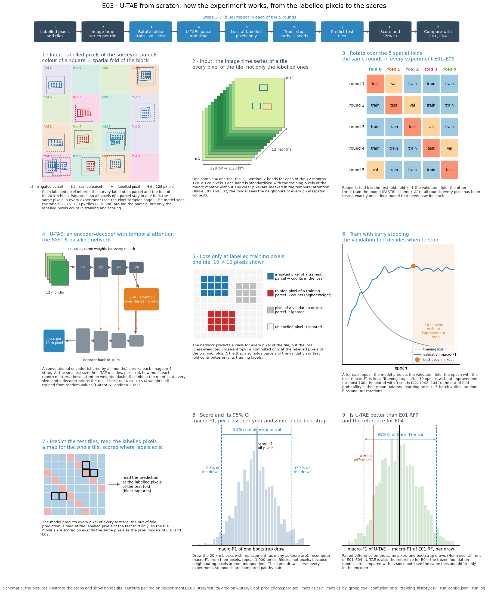
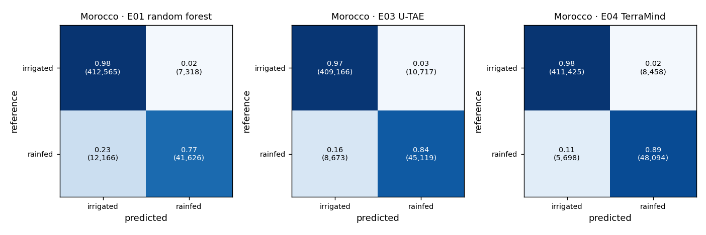
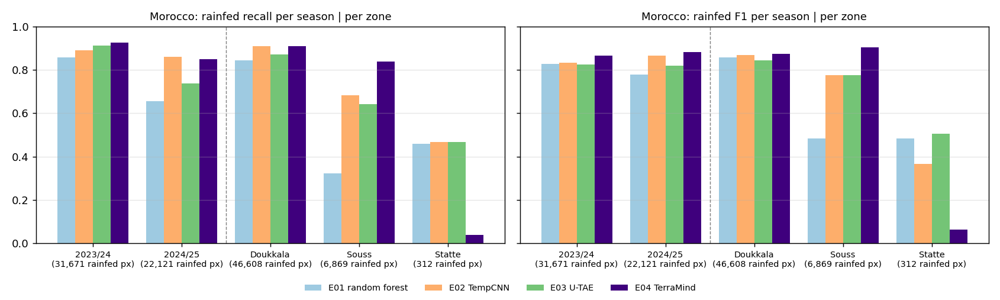

# E03 · U-TAE from scratch

!!! success "Status: Morocco done (21 November 2026); Utah later"
    Same labelled pixels as [E01](E01_s2_pixel_baseline.md) (Morocco 2023/24 and 2024/25 pooled, 473,675 pixels in
    2,015 tiles; two classes), but the model sees the whole 128 px tile; 3 seeds per round on one GPU. U-TAE
    **macro-F1 0.900** [0.845, 0.941], rainfed F1 0.823: on a par with the pixel models; the frozen foundation models
    of E04 beat it. [Results](#results)

**Question.** Does a spatio-temporal network trained from scratch on the whole tile beat the pixel models (E01,
E02)? It is also the reference for the frozen foundation models of [E04](E04_frozen_geofm.md): it shows how much the
pretrained encoders add beyond spatial context.

**What changes from E02.** The model sees the whole 128 px tile (spatial context) instead of one pixel. The
labelled pixels, folds and metrics are the same.

## How E03 works, step by step



*E03 from start to end (schematic: the pictures illustrate the steps and show no results, so the figure holds for any region and year; `tools/a9_experiment_explainers.py`). Steps 3–7 repeat in each of the five rounds. The results of each region are under [Results](#results).*

1. **Labelled pixels and tiles.** The same labelled pixels, folds and blocks as E01 and E02, but the model receives
   the whole 128 × 128 px tile (1.28 km) around them.
2. **Image time series.** One sample is one tile: 12 Sentinel-2 bands for each of the 12 months, standardised per
   band with the training pixels of the round; months without any clear pixel are masked.
3. **Rotation over the folds.** The same five rounds as every experiment.
4. **U-TAE.** A convolutional encoder (shared by all months) shrinks each image in four steps; at the smallest size
   a temporal attention (L-TAE) decides, per pixel, how much each month matters, and these weights combine the months
   at every size; a decoder brings the result back to 10 m. 1.15 M weights, all trained from random values.
5. **Loss only where labels exist.** The network predicts every pixel of the tile, but the loss counts only the
   labelled pixels of the training folds; pixels of validation or test parcels in the same tile are ignored.
6. **Training.** AdamW, random flips and rotations; early stopping on the validation pixels (patience 10); three
   seeds per round, probabilities averaged.
7. **Predicting the test tiles.** The model maps every test tile; the prediction is read at the labelled pixels of
   the test fold, so U-TAE is scored on the same pixels as the pixel models.
8. **Score and uncertainty.** As in E01.
9. **Comparison.** Paired difference to the E01 random forest; U-TAE is itself the reference for E04, which keeps
   the tiles and the head and changes only the encoder.

## Model

U-TAE (Garnot & Landrieu 2021), the PASTIS semantic-segmentation baseline: a convolutional encoder shared by all
months, a lightweight temporal attention encoder (L-TAE) at the coarsest resolution that produces one attention
mask per head and pixel, these masks aggregate the skip features of every resolution over time, and a
convolutional decoder brings the result back to 10 m.

| Item | Choice |
| --- | --- |
| **Input** | 12 Sentinel-2 bands × 12 months of the whole tile, standardised per band with the training pixels of the round; missing values 0, months without any clear pixel masked in the attention |
| **Widths** | encoder 64–64–64–128, decoder 32–32–64–128 (the PASTIS configuration) |
| **Temporal attention** | L-TAE at 1/8 resolution: 16 heads, d<sub>k</sub> 4, d<sub>model</sub> 256 |
| **Output** | 2 class scores (irrigated, rainfed) for every 10 m pixel of the tile |
| **Parameters** | 1.15 M, all trained from random weights |

??? info "How U-TAE works"
    U-TAE (U-Net with Temporal Attention Encoder; Garnot & Landrieu 2021) classifies every pixel of an image time
    series. It combines a **U-Net**, which sees the neighbourhood of each pixel at several resolutions, with
    **temporal attention**, which decides which months matter at each place.

    ```mermaid
    flowchart TD
        A["tile 128 × 128 px · 12 months · 12 bands"] --> B["CNN encoder, the same for every month:<br/>maps at 128², 64², 32², 16² px"]
        B --> C["L-TAE on the 16² map:<br/>month weights per position (16 heads)"]
        C --> D["month weights upsampled and applied at every size:<br/>12 months → one map per size"]
        D --> E["U-Net decoder: 16² → 128²,<br/>adding the map of each size (skip connections)"]
        E --> F["2 class scores per 10 m pixel"]
    ```

    1. **Encoder per month.** A small convolutional network describes the image of each month on its own (the same
       weights for all 12 months) and halves the resolution three times: 128, 64, 32 and 16 px.
    2. **Temporal attention at the coarsest level.** At each position of the 16 × 16 map, an L-TAE looks at the 12
       months and gives each one a weight (per head), from the data of that position: months without a clear
       observation get no weight.
    3. **The same month weights at every level.** The weights are upsampled and used at all four resolutions to
       collapse the 12 months into one map per resolution.
    4. **Decoder.** Starting from the coarsest map, the decoder upsamples step by step and adds the map of the same
       resolution from step 3 (skip connections), so the result keeps the 10 m detail of the image while using the
       context of the coarser maps.

    Everything is trained from random weights on our labels only; it is the counterpart of E04 without
    pretraining.

??? info "How L-TAE works (temporal attention)"
    L-TAE (Lightweight Temporal Attention Encoder; Garnot & Landrieu 2020) turns a sequence of 12 monthly feature
    vectors into one vector. Each month gets a code for its position in the agricultural year; each of the 16 heads
    has a learnt **master query** and scores every month against it; a softmax turns the scores into weights that
    sum to 1 (months without data get weight 0); each head takes the weighted average of the months, and the heads
    are joined. Unlike a convolution, the weights depend on the data of each pixel or position. The same module is
    the temporal head of the foundation models in E04 and E05.

## Training

| Item | Choice |
| --- | --- |
| **Labels** | the labelled pixels of the round's training folds; every other pixel of the tile is ignored in the loss. A tile with pixels of two folds contributes only its training-fold labels |
| **Loss** | class-weighted cross-entropy (weights from the training pixels: rainfed counts about 8 times more) |
| **Optimiser** | AdamW, learning rate 10⁻³, weight decay 10⁻⁴, batch 4 tiles |
| **Augmentation** | random flips and 90° rotations |
| **Early stopping** | macro-F1 of the validation pixels, patience 10, at most 100 epochs |
| **Seeds** | 3 per round (42, 1042, 2042), mean probability |
| **Scoring** | the test tiles are predicted and read at their labelled pixels: the same out-of-fold pixels as every other experiment |

## How to run

Script: [`experiments/E03_utae/run.py`](https://github.com/amanchry/irrimapping-geofm/blob/main/experiments/E03_utae/run.py)
(model and training loop: [`pixelwise_run/tile_common.py`](https://github.com/amanchry/irrimapping-geofm/blob/main/pixelwise_run/tile_common.py)).

```bash
sbatch --export=ALL,SCRIPT=experiments/E03_utae/run.py,EXPERIMENT_REGION=morocco jobs/step_gpu.sbatch
```

`EXPERIMENT_QUICK_TEST=1` runs the chain on 60 tiles for 2 epochs (output in `results_quick/`; too short to learn
the rainfed class, it only checks the code).

## Outputs

`experiments/E03_utae/results/<region>/utae/`: the E01 files plus `training_history.csv` (per epoch: training loss,
validation loss, validation macro-F1 and rainfed F1, seconds).

## Results

Morocco, 2023/24 and 2024/25 pooled: the same 473,675 out-of-fold pixels as E01 and E02. The comparison with all
other runs is on the [comparison page](comparison.md).

### Scores

| Model | Macro-F1 [95% CI] | Irrigated F1 | Rainfed F1 [95% CI] | Rainfed precision | Rainfed recall |
| --- | --- | --- | --- | --- | --- |
| E01 random forest (reference) | 0.894 [0.834, 0.940] | 0.977 | 0.810 [0.697, 0.894] | 0.850 | 0.774 |
| E02 TempCNN | 0.912 [0.848, 0.955] | 0.979 | 0.845 [0.722, 0.922] | 0.815 | 0.877 |
| **E03 U-TAE** | **0.900** [0.845, 0.941] | 0.977 | **0.823** [0.716, 0.896] | 0.808 | 0.839 |

**Paired difference to the E01 random forest** (Holm correction over the nine runs of E01–E04): +0.006 macro-F1
[−0.027, +0.043], Holm-adjusted p = 1.0; rainfed F1 +0.012 [−0.047, +0.080], p = 1.0. U-TAE is neither better nor
worse than the pixel random forest.




*Row-normalised confusion matrices of the E01 random forest, E03 U-TAE and the best frozen foundation model (E04
TerraMind).*

### Scores per year, zone and fold



| Group | Rainfed pixels | RF: rainfed recall | U-TAE: rainfed recall | RF: rainfed F1 | U-TAE: rainfed F1 |
| --- | --- | --- | --- | --- | --- |
| 2023/24 | 31,671 | 0.857 | 0.911 | 0.828 | 0.826 |
| 2024/25 | 22,121 | 0.655 | 0.736 | 0.779 | 0.819 |
| Doukkala | 46,608 | 0.843 | 0.870 | 0.858 | 0.843 |
| Souss | 6,869 | 0.322 | 0.641 | 0.485 | 0.774 |
| Statte | 312 | 0.458 | 0.468 | 0.485 | 0.506 |

| Test fold | 0 | 1 | 2 | 3 | 4 |
| --- | --- | --- | --- | --- | --- |
| E01 random forest | 0.762 | **0.911** | 0.921 | 0.942 | **0.928** |
| E03 U-TAE | **0.855** | 0.865 | **0.935** | **0.957** | 0.893 |

- **Spatial context helps where the pixel models fail.** In fold 0, which holds the Souss rainfed parcels of 2024/25,
  U-TAE reaches 0.855 against 0.762 for the random forest; in Souss as a whole it finds 64% of the rainfed pixels
  against 32%.
- **But it loses elsewhere.** In folds 1 and 4 U-TAE is 0.035–0.046 below the random forest. Over all pixels the
  gains and losses cancel out, which is why the paired difference is close to zero with a wide interval.
- More rainfed pixels are found (recall 0.84 vs 0.77) at a lower precision (0.81 vs 0.85), the same shift as with
  TempCNN.

### Training

- 15 models (5 rounds × 3 seeds), 1.15 M weights, all trained from random initialisation. Early stopping after a
  median of 19 epochs, 34 s per epoch; 3.6 GPU hours in total.
- The first job hung after a crashed data-loader worker on the cluster and was restarted; the scores are from the
  complete second run.

### Interpretation

- A spatio-temporal network trained from scratch on these labels does not beat the pixel models: 0.900 against
  0.894 (random forest) and 0.912 (TempCNN), with intervals that overlap almost entirely.
- Seeing the neighbourhood changes *which* pixels are right (fold 0 and Souss better, folds 1 and 4 worse) more than
  how many. With 1,196 rainfed parcels, most of them in one zone, a network of 1.15 M weights trained from scratch
  has little to learn the spatial patterns of rainfed land from.
- E03 is the reference that isolates the effect of pretraining: [E04](E04_frozen_geofm.md) keeps the tiles, the
  labelled pixels, the temporal head and the training, and replaces the encoder trained from scratch by a
  pretrained, frozen one.

## References

- Garnot, V. S. F. & Landrieu, L. (2020). Lightweight temporal self-attention for classifying satellite images time
  series (L-TAE). *AALTD*.
- Garnot, V. S. F. & Landrieu, L. (2021). Panoptic segmentation of satellite image time series with convolutional
  temporal attention networks. *ICCV*.
