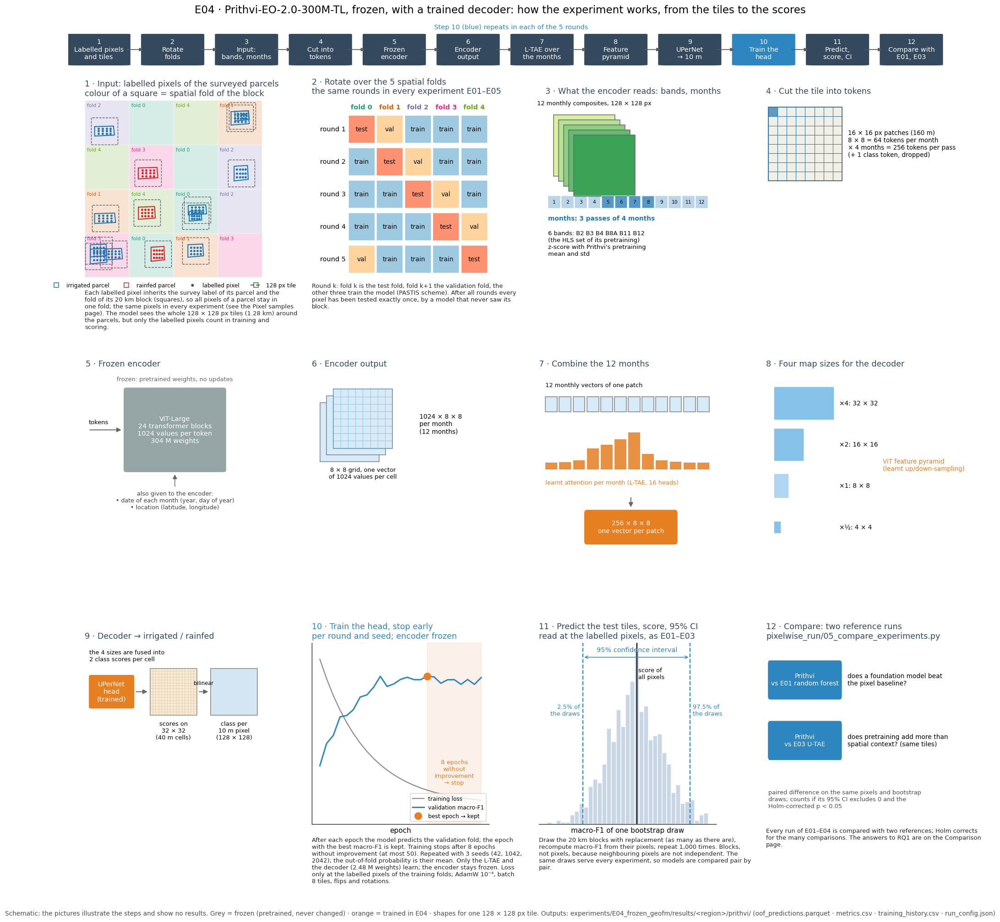
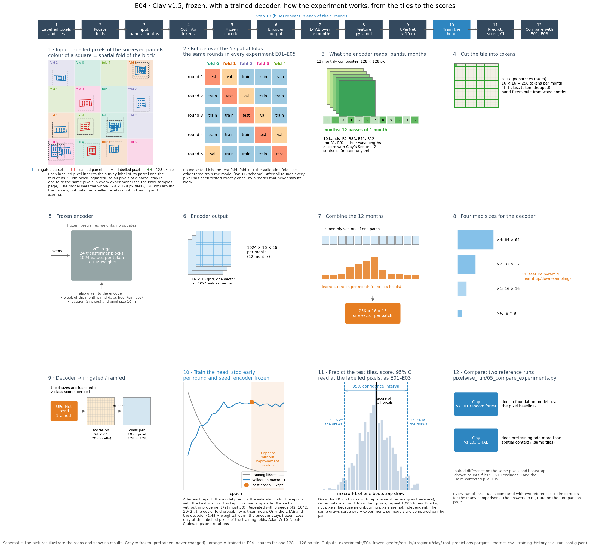
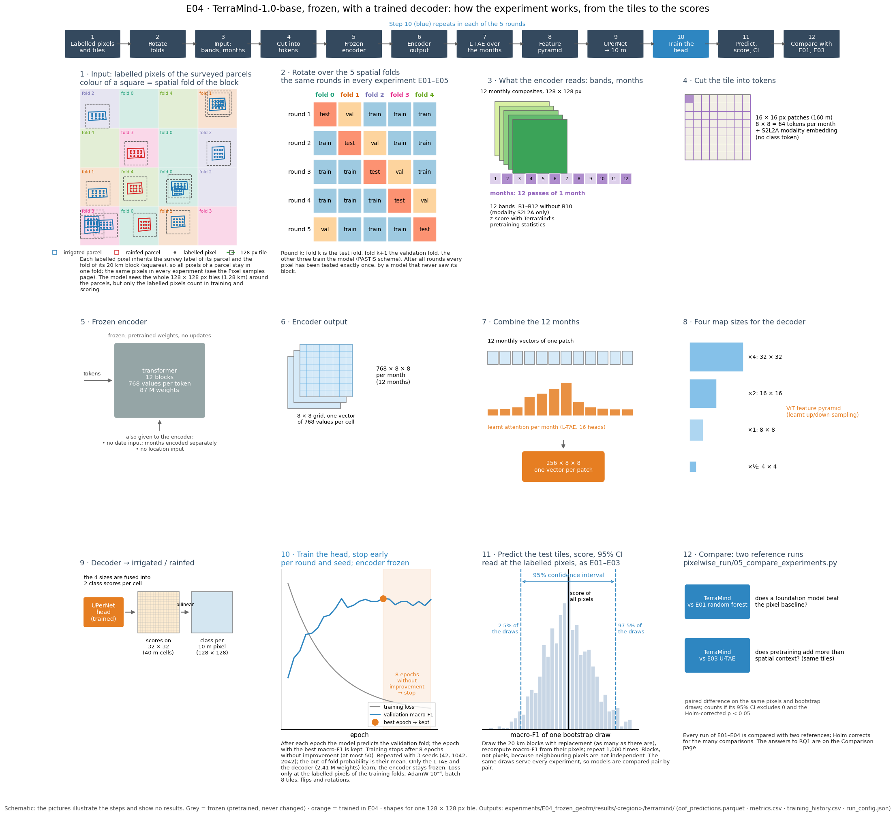
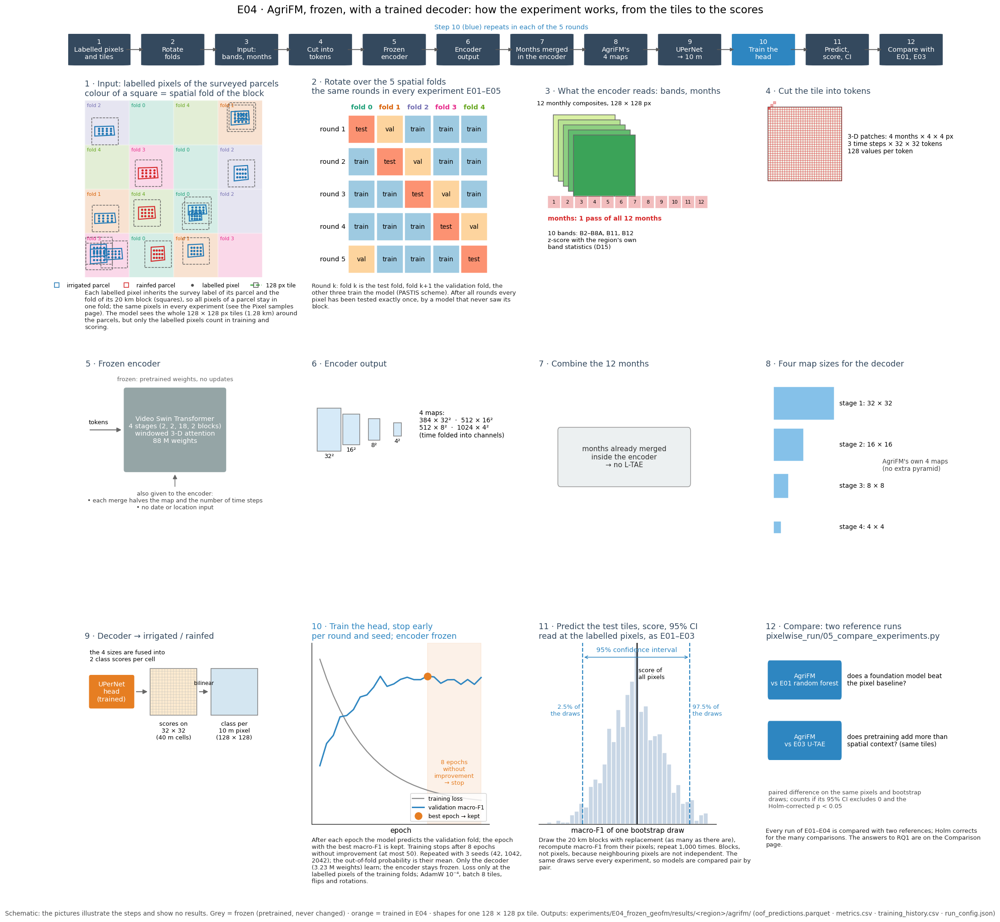
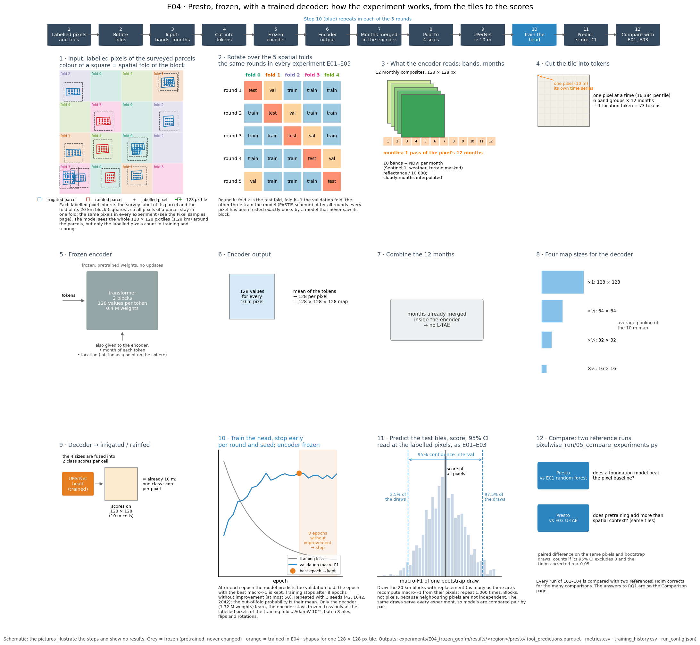
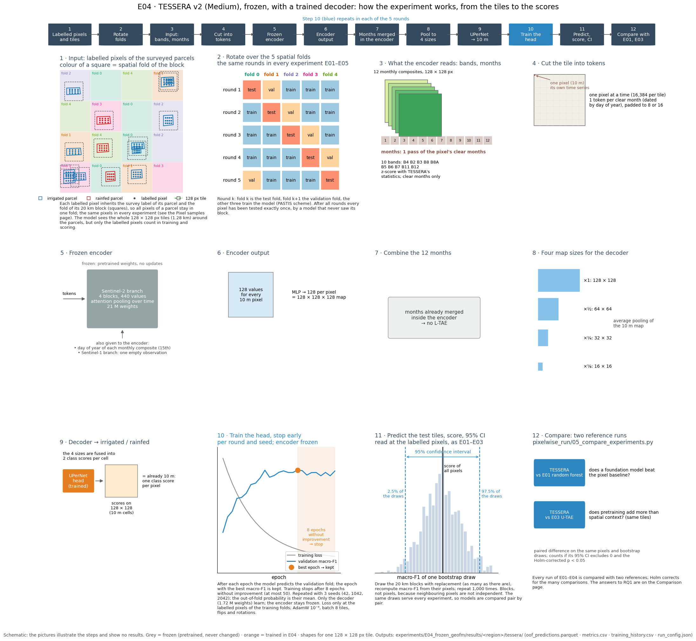
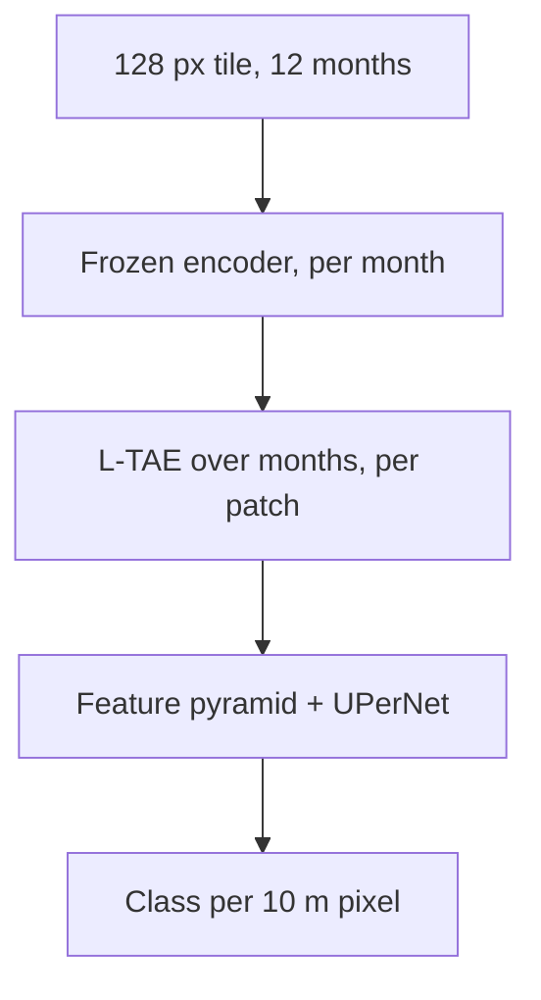
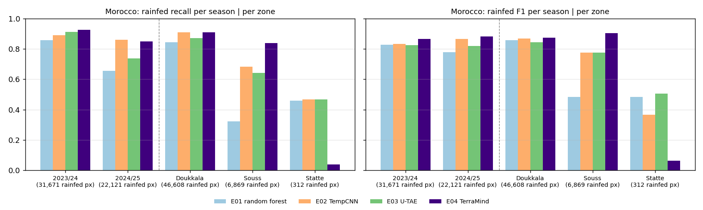

# E04 · Frozen foundation models + decoder (RQ1)

!!! success "Status: Morocco done, all six encoders (21 November 2026); Utah later"
    Same labelled pixels and tiles as [E03](E03_utae.md) (Morocco 2023/24 and 2024/25 pooled, 473,675 pixels in
    2,015 tiles; two classes); six encoders, one GPU job each, 3 seeds per round. Best: **TerraMind macro-F1 0.927**
    [0.880, 0.964], then Clay 0.923, AgriFM 0.921, Prithvi 0.917. These four beat U-TAE trained from scratch
    (significant); none is significantly better than the E01 random forest. [Results](#results)

**Question (RQ1).** Do frozen geospatial foundation models with a light decoder classify the pixels better than the
pixel models (E01, E02) and a spatio-temporal network trained from scratch (E03)? (Answered on the [comparison page](comparison.md).)

**What changes from E03.** The image encoder: a pretrained, frozen foundation model instead of a convolutional
encoder trained from scratch. Tiles, labelled pixels, loss, training and metrics are the same.

## How E04 works, step by step

E04 is run once per encoder, and the encoders do not all go through the same steps: the image models (Prithvi, Clay,
TerraMind) need an L-TAE to merge the months and a feature pyramid to build four map sizes; AgriFM merges the months
itself and returns its own four maps; Presto and TESSERA encode each 10 m pixel separately, so their map is only
pooled to four sizes. Each encoder therefore has its own figure, from the labelled pixels to the comparison, with
the settings of this study (bands, patches, months per pass, output sizes). Grey parts are frozen, orange parts are
trained (schematic: the pictures illustrate the steps and show no results, so the figures hold for any region and
year; `tools/a9_experiment_explainers.py`). How each model works in general:
[Foundation models](../foundation_models/index.md). The results of each region are under
[Results](#results).

=== "Prithvi-EO-2.0"

    

    Six bands, 16 px patches, four months per pass with their dates and the tile's location; the L-TAE merges the 12 monthly outputs of each 160 m patch; decisions on a 40 m grid.

=== "Clay v1.5"

    

    Ten bands, each read through a filter built from its wavelength; 8 px patches, one month per pass with week and location; the finest grid of the image models (64 × 64, 20 m).

=== "TerraMind"

    

    All twelve bands as the S2L2A modality, 16 px patches, one month per pass without any date; the L-TAE alone orders the months.

=== "AgriFM"

    

    All twelve months in one pass as 3-D blocks of 4 months × 4 × 4 px; the Swin stages shrink space and time together and return four maps, which go straight to the decoder (no L-TAE, no extra pyramid).

=== "Presto"

    

    Encodes each of the 16,384 pixels of a tile separately from its 12-month series (band groups × months); the 10 m map of 128-value vectors is pooled to four sizes, so the decision is made per 10 m pixel.

=== "TESSERA v2"

    

    Encodes each pixel from its clear months only, each dated by day of year, and pools them with attention; like Presto, a 10 m feature map and decisions per 10 m pixel.

The twelve steps:

1. **Labelled pixels and tiles.** As in E03: the model sees whole 128 px tiles and is scored at the same labelled
   pixels as every experiment.
2. **Rotation over the folds.** The same five rounds as every experiment.
3. **What the encoder reads.** The bands, normalisation and grouping of months of the encoder's own pretraining.
4. **Tokens.** Patches of 8 or 16 px (one month at a time), 3-D blocks of 4 months × 4 × 4 px (AgriFM), or single
   pixels (Presto, TESSERA).
5. **Frozen encoder.** The pretrained network, unchanged, with the extra inputs it was trained with (dates,
   location, wavelengths, or none).
6. **Encoder output.** One vector per patch and month (image models), four maps with time merged (AgriFM), or one
   128-value vector per 10 m pixel (Presto, TESSERA).
7. **Combining the months.** An L-TAE learns which months matter for the image models; the other three encoders have
   already merged the months.
8. **Four map sizes.** A learnt feature pyramid (image models), AgriFM's own four maps, or average pooling of the
   10 m map (Presto, TESSERA).
9. **Decoder.** A UPerNet head fuses the four sizes into class scores on a 20–40 m grid (image models, AgriFM),
   upsampled to 10 m, or directly per 10 m pixel (Presto, TESSERA).
10. **Training.** Only the L-TAE and the decoder learn (1.7–3.2 M weights), at the labelled pixels of the training
    folds; early stopping (patience 8) and three seeds per round.
11. **Prediction and scores.** The test tiles are read at their labelled pixels; scores and 95% intervals as in E01.
12. **Two comparisons.** Each encoder against the E01 random forest (does it beat the pixel baseline?) and against
    E03 U-TAE (does pretraining add more than spatial context?), paired and Holm-corrected; the RQ1 answers are on
    the [comparison page](comparison.md).

## Model

The encoders see whole 128 × 128 px tiles; the model predicts every pixel and is scored at the labelled pixels of the [pixel samples](../phase1_data/pixel_samples.md).



The six encoders are loaded by [`pixelwise_run/encoders.py`](https://github.com/amanchry/irrimapping-geofm/blob/main/pixelwise_run/encoders.py)
with the bands, band order, normalisation and weights of their own pretraining; AgriFM is normalised with the
region's band statistics ([D15](../decisions.md#d15-agrifm-normalised-with-the-statistics-of-the-regions-chips)).
What each encoder receives here (bands, tokens, months per pass, output on a tile) is on
[Foundation models in this study](../foundation_models/in_this_study.md); how each model works as published is on
its own page ([overview](../foundation_models/index.md)). This page covers only what E04 adds: the head, the training
and the scoring.

| Part | Choice |
| --- | --- |
| **Temporal head** | L-TAE (16 heads, d<sub>k</sub> 8, d<sub>model</sub> 256, output 256) over the 12 months at every patch position; months without a clear pixel in the patch are masked. AgriFM, Presto, TESSERA: none (the encoder handles time) |
| **Decoder** | 4-scale feature pyramid from the single-scale ViT features (×4, ×2, ×1, ×½, as for plain ViTs in PANGAEA; Marsocci et al. 2024) and a UPerNet head (Xiao et al. 2018; pool sizes 1, 2, 4), upsampled to 10 m. AgriFM: its own 4-level pyramid goes straight into the UPerNet head. Presto, TESSERA: the 10 m map average-pooled to 4 scales (×1, ×½, ×¼, ×⅛) |
| **Output** | 2 class scores (irrigated, rainfed) on a 32 × 32 grid (40 m; Clay 64 × 64, 20 m; Presto and TESSERA 128 × 128, 10 m), upsampled to every 10 m pixel |
| **Trained** | temporal head and decoder only (1.7–3.2 M weights, depending on the encoder); the encoder stays frozen in evaluation mode |

??? info "What \"frozen encoder\" means"
    A foundation model has been pretrained once, without labels, on millions of images. Its **encoder** turns an
    image into features. **Frozen** means its weights are not changed at all during our training: it is used as a
    fixed feature extractor, in evaluation mode (no dropout, no updates). Only the small head after it (L-TAE,
    feature pyramid, UPerNet) learns from our labels. E04 therefore measures what the pretrained features already
    contain for irrigated / rainfed. Training the encoder as well is RQ2 ([E05](E05_prithvi_strategies.md)).

??? info "How the feature pyramid works"
    A plain vision transformer returns a single map (for Prithvi 8 × 8 per tile), but UPerNet needs four
    resolutions. The pyramid rescales that one map to four sizes: ×4 (32 × 32) with two learnt 2 × 2 transposed
    convolutions, ×2 (16 × 16) with one, ×1 (8 × 8) with a 1 × 1 convolution, ×½ (4 × 4) with max pooling. The
    scales and operations follow the `Feature2Pyramid` neck of PANGAEA and MMSegmentation; building all four from
    the last encoder layer only follows ViTDet (Li et al. 2022). The upsampled maps are learnt, not new detail:
    the true resolution stays the 16 px patch. AgriFM gives its own pyramid; for Presto and TESSERA the 10 m
    feature map is average-pooled to four sizes.

??? info "How L-TAE combines the months"
    For the encoders that read one month (or four months) per pass, the twelve monthly feature vectors of each
    patch are combined by an L-TAE (Garnot & Landrieu 2020): 16 heads each give the months weights that sum to 1
    (months without a clear pixel in the patch get weight 0) and average them; the result is one 256-value vector
    per patch. Details: [E03 · How L-TAE works](E03_utae.md).

??? info "How UPerNet works (the decoder)"
    The encoder describes the tile in coarse blocks: for Prithvi one vector per 16 × 16 px patch, an 8 × 8 grid for a
    128 px tile. UPerNet (Xiao et al. 2018) turns these coarse features into a class for **every pixel**. It does so
    by looking at the tile at several sizes at once: coarse maps carry the context (what kind of landscape is this?),
    finer maps carry the position (where does the field end?).

    ```mermaid
    flowchart LR
        A["encoder features<br/>8 × 8 per tile"] --> B["pyramid: 4 sizes<br/>32², 16², 8², 4²"]
        B --> C["1 · context:<br/>average the coarsest map<br/>over the whole tile, its halves<br/>and quarters"]
        C --> D["2 · coarse to fine:<br/>upsample, add the next<br/>finer map, smooth"]
        D --> E["3 · combine the 4 sizes,<br/>classify"]
        E --> F["class per pixel<br/>(32 × 32, then 128 × 128)"]
    ```

    1. **Pyramid.** A plain vision transformer gives only one map size, so the 8 × 8 map is rescaled to four sizes
       (32 × 32, 16 × 16, 8 × 8, 4 × 4).
    2. **Context.** On the coarsest map, the features are averaged over the whole tile, over 2 × 2 and over 4 × 4
       regions, and added back to every position, so each position also "knows" its surroundings (an irrigation
       scheme or a dry plain).
    3. **From coarse to fine.** Starting from the coarsest map, each step doubles the size and adds the next finer
       map, so the context flows down into the detailed maps.
    4. **Combine and classify.** The four maps are brought to 32 × 32 (40 m), joined, and a final layer gives two
       scores per position (irrigated, rainfed); they are then upsampled to 128 × 128, i.e. to every
       10 m pixel.

    **What it can and cannot do.** UPerNet adds spatial context, which helps where a single pixel is ambiguous. It
    cannot add detail the encoder does not have: all four sizes come from the same 16 px patches, so field edges
    stay soft. UPerNet is the standard decoder of the PANGAEA benchmark (Marsocci et al. 2024) and is the same for
    every encoder, so it does not favour any of them.

## Training

| Item | Choice |
| --- | --- |
| **Labels** | the labelled pixels of the round's training folds only; every other pixel of the tile is ignored in the loss. A tile with pixels of two folds contributes only its training-fold labels |
| **Loss** | class-weighted cross-entropy (weights from the training pixels) |
| **Optimiser** | AdamW, learning rate 10⁻⁴, weight decay 10⁻⁴, batch 8 tiles, mixed precision (bfloat16) |
| **Augmentation** | random flips and 90° rotations |
| **Early stopping** | macro-F1 of the validation pixels, patience 8, at most 50 epochs |
| **Seeds** | 3 per round, mean probability |
| **Scoring** | the test tiles are predicted and read at their labelled pixels: the same out-of-fold pixels as every other experiment |

## How to run

Script: [`experiments/E04_frozen_geofm/run.py`](https://github.com/amanchry/irrimapping-geofm/blob/main/experiments/E04_frozen_geofm/run.py)
(models and training: [`pixelwise_run/tile_common.py`](https://github.com/amanchry/irrimapping-geofm/blob/main/pixelwise_run/tile_common.py)).
One GPU job per encoder and region; needs the tile store `outputs/<region>/data_training_prep/03_tiles_128px/agyear/tiles/`
(on the cluster) and the model weights in `checkpoints/`.

```bash
for enc in prithvi clay terramind agrifm presto tessera; do sbatch --export=ALL,SCRIPT=experiments/E04_frozen_geofm/run.py,EXPERIMENT_REGION=morocco,EXPERIMENT_ENCODER=$enc jobs/step_gpu.sbatch; done
```

Run one encoder with `EXPERIMENT_QUICK_TEST=1` first (60 tiles, 2 epochs; too short to learn the rainfed class, it
only checks the code) and read the epoch time in the log to check the job time limit.

## Outputs

`experiments/E04_frozen_geofm/results/<region>/<encoder>/`: the E01 files plus `training_history.csv`.

## Results

Morocco, 2023/24 and 2024/25 pooled: the same 473,675 out-of-fold pixels as E01–E03. All runs side by side:
[comparison page](comparison.md).

### Scores

| Encoder | Macro-F1 [95% CI] | Rainfed F1 [95% CI] | Rainfed precision | Rainfed recall | Trained weights | GPU hours |
| --- | --- | --- | --- | --- | --- | --- |
| **TerraMind** | **0.927** [0.880, 0.964] | **0.872** [0.783, 0.937] | 0.850 | 0.894 | 2.41 M | 1.8 |
| Clay | 0.923 [0.874, 0.960] | 0.864 [0.769, 0.930] | 0.836 | 0.894 | 2.48 M | 3.3 |
| AgriFM | 0.921 [0.868, 0.956] | 0.861 [0.758, 0.922] | 0.840 | 0.882 | 3.23 M | 1.9 |
| Prithvi | 0.917 [0.865, 0.957] | 0.853 [0.749, 0.924] | 0.838 | 0.867 | 2.48 M | 5.1 |
| TESSERA | 0.912 [0.853, 0.958] | 0.844 [0.733, 0.928] | 0.849 | 0.838 | 1.72 M | 24.7 |
| Presto | 0.903 [0.848, 0.942] | 0.828 [0.720, 0.899] | 0.806 | 0.852 | 1.72 M | 14.1 |
| *E03 U-TAE (from scratch)* | *0.900* [0.845, 0.941] | *0.823* [0.716, 0.896] | 0.808 | 0.839 | 1.15 M | 3.6 |
| *E01 random forest* | *0.894* [0.834, 0.940] | *0.810* [0.697, 0.894] | 0.850 | 0.774 | – | CPU |

Trained weights = temporal head and decoder (the encoder is frozen). GPU hours = sum of the epoch times of the 15
models; Presto and TESSERA encode every pixel's time series separately, which makes them the slowest.


### Paired tests

Paired differences on the same pixels and block-bootstrap draws; Holm correction over the nine runs of E01–E04
against each reference. A difference counts when its 95% CI excludes 0 and p<sub>Holm</sub> < 0.05.

| Encoder | vs E03 U-TAE: Δ macro-F1 [95% CI] | p<sub>Holm</sub> | vs E01 random forest: Δ macro-F1 [95% CI] | p<sub>Holm</sub> |
| --- | --- | --- | --- | --- |
| TerraMind | **+0.027** [+0.013, +0.052] | < 0.01 | +0.034 [+0.004, +0.076] | 0.29 |
| Clay | **+0.023** [+0.010, +0.042] | 0.01 | +0.029 [−0.002, +0.071] | 0.45 |
| AgriFM | **+0.021** [+0.009, +0.036] | < 0.01 | +0.028 [−0.001, +0.064] | 0.45 |
| Prithvi | **+0.017** [+0.004, +0.036] | 0.04 | +0.023 [−0.007, +0.061] | 0.76 |
| TESSERA | +0.012 [−0.020, +0.043] | 1.0 | +0.018 [+0.000, +0.039] | 0.37 |
| Presto | +0.003 [−0.008, +0.011] | 1.0 | +0.009 [−0.022, +0.044] | 1.0 |

For rainfed F1 the pattern is the same: TerraMind (+0.048), Clay (+0.040), AgriFM (+0.037) and Prithvi (+0.029) are
significantly better than U-TAE; against the random forest no difference counts (TerraMind +0.061 [+0.008,
+0.141], p<sub>Holm</sub> = 0.25).

- **Against U-TAE (the effect of the pretrained encoder):** the four image encoders (TerraMind, Clay, AgriFM,
  Prithvi) improve on the same network trained from scratch, by 0.017–0.027 macro-F1. The intervals are narrow
  because the two models see the same tiles and make similar errors, so the paired differences vary little between
  blocks.
- **Against the random forest:** the differences are larger (+0.023 to +0.034) but vary much more between blocks
  (large gains in fold 0, small or negative in fold 1), so the intervals are wide. TerraMind's interval excludes 0,
  but not after the Holm correction for nine comparisons.

### Scores per year, zone and fold



| Run | Rainfed recall 2023/24 | Rainfed recall 2024/25 | Rainfed recall Souss | Rainfed F1 Souss | Fold 0 | Fold 1 | Fold 2 | Fold 3 | Fold 4 |
| --- | --- | --- | --- | --- | --- | --- | --- | --- | --- |
| E01 random forest | 0.857 | 0.655 | 0.322 | 0.485 | 0.762 | 0.911 | 0.921 | 0.942 | 0.928 |
| E03 U-TAE | 0.911 | 0.736 | 0.641 | 0.774 | 0.855 | 0.865 | 0.935 | 0.957 | 0.893 |
| TerraMind | 0.926 | 0.849 | 0.839 | 0.903 | 0.878 | 0.899 | 0.951 | 0.971 | 0.944 |
| Clay | 0.928 | 0.845 | 0.814 | 0.889 | 0.878 | 0.892 | 0.955 | 0.971 | 0.923 |
| AgriFM | 0.939 | 0.801 | 0.669 | 0.794 | 0.868 | 0.900 | 0.958 | 0.965 | 0.921 |
| Prithvi | 0.914 | 0.800 | 0.772 | 0.862 | 0.862 | 0.886 | 0.950 | 0.953 | 0.935 |
| TESSERA | 0.905 | 0.743 | 0.455 | 0.619 | 0.766 | 0.908 | 0.961 | 0.967 | 0.943 |
| Presto | 0.923 | 0.750 | 0.638 | 0.772 | 0.860 | 0.867 | 0.946 | 0.958 | 0.891 |

Macro-F1 per test fold in the last five columns.

- **The gain is in the hard cases.** TerraMind and Clay find about 85% of the rainfed pixels of 2024/25 (random
  forest 66%) and over 80% of those of Souss (random forest 32%). In 2023/24 and Doukkala all models are close.
- **Fold 0** (Souss 2024/25) rises from 0.762 (random forest) to 0.86–0.88 with the image encoders. TESSERA stays at the level of the pixel models there (0.766). TESSERA and Presto both encode one pixel's time
  series, but Presto reaches 0.860 in fold 0, so the per-pixel design alone does not explain TESSERA's weakness.
- **Fold 1** is the one fold where every tile model is below the random forest (0.865–0.908 vs 0.911).
- **Irrigation-only zones** (Gharb, Tadla, el Haouz): irrigated F1 ≥ 0.988 for every encoder.
- **Statte** (312 rainfed pixels in 4 parcels) is too small to judge: TerraMind finds 12 of the 312 rainfed pixels
  there, U-TAE 146.


### Interpretation

- **RQ1, Morocco.** Frozen foundation-model features with a light decoder (1.7–3.2 M trained weights) give the best
  scores so far: TerraMind 0.927, Clay 0.923, AgriFM 0.921, Prithvi 0.917. They are significantly better than the
  same pipeline trained from scratch (U-TAE), so the pretrained features carry information that 1,196 rainfed
  parcels are not enough to learn. They are **not** significantly better than a random forest on the pixel time
  series, because the gain is concentrated in a few blocks (Souss, 2024/25) and the block bootstrap is wide.
- **The four image encoders are close to each other** (0.917–0.927, overlapping intervals); the ranking among them
  is not established. The two encoders that see one pixel's time series (Presto, TESSERA) are weaker and 3–14 times
  slower here.
- **What the encoders add is mostly rainfed recall in the difficult places:** in the wetter year and in the zone
  with few rainfed parcels, where the pixel models confuse rainfed with irrigated.
- **Caveat:** rainfed parcels lie in three of six zones, mostly Doukkala. The scores measure the separation of
  irrigated and rainfed where both occur; Utah (rainfed spread more widely) is the test of whether the result holds.

## References

- Garnot, V. S. F. & Landrieu, L. (2020). Lightweight temporal self-attention for classifying satellite images time
  series (L-TAE). *AALTD*.
- Li, Y., Mao, H., Girshick, R. & He, K. (2022). Exploring plain vision transformer backbones for object detection
  (ViTDet). *ECCV*. arXiv:2203.16527.
- Marsocci, V. et al. (2024). PANGAEA: a global and inclusive benchmark for geospatial foundation models.
  arXiv:2412.04204.
- Xiao, T., Liu, Y., Zhou, B., Jiang, Y. & Sun, J. (2018). Unified perceptual parsing for scene understanding.
  *ECCV*.
