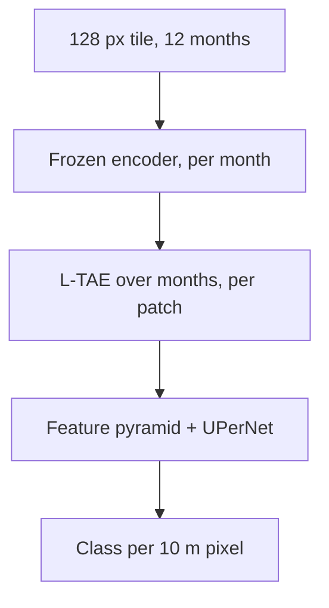

# E04 · Frozen foundation models + decoder (RQ1)

!!! info "Status: planned (Morocco first, Utah later)"
    Same labelled pixels and tiles as [E03](E03_utae.md) (Morocco 2023/24 and 2024/25 pooled, 473,675 pixels in
    2,015 tiles; two classes); six encoders, one GPU job each, 3 seeds per round. Code ready and tested (Prithvi);
    results follow after the runs.

**Question (RQ1).** Do frozen geospatial foundation models with a light decoder classify the pixels better than the
pixel models (E01, E02) and a spatio-temporal network trained from scratch (E03)? (Answered on the [comparison page](comparison.md).)

**What changes from E03.** The image encoder: a pretrained, frozen foundation model instead of a convolutional
encoder trained from scratch. Tiles, labelled pixels, loss, training and metrics are the same.

## Model

The encoders see whole 128 × 128 px tiles; the model predicts every pixel and is scored at the labelled pixels of the [pixel samples](../phase1_data/pixel_samples.md).



| Encoder | Bands | Months per pass | Patch | Feature size |
| --- | --- | --- | --- | --- |
| Prithvi-EO-2.0-300M-TL | B2 B3 B4 B8A B11 B12 | 4, with date and location | 16 px | 1024 |
| Clay v1.5 | 10 bands (no B1, B9) | 1, with week and location | 8 px | 1024 |
| TerraMind 1.0 base | 12 bands (S2L2A) | 1 | 16 px | 768 |
| AgriFM | 10 bands | all 12 (time merged inside the model) | 4 px, pyramid to 32 px | multi-scale |
| Presto | 10 bands + NDVI | all 12 (per pixel, inside the model) | 1 pixel | 128 per pixel |
| TESSERA v2 Medium | 10 bands | the clear months, dated by day of year (per pixel) | 1 pixel | 128 per pixel |

All six encoders are loaded by [`pixelwise_run/encoders.py`](https://github.com/amanchry/irrimapping-geofm/blob/main/pixelwise_run/encoders.py) with the band order,
normalisation and weights of their pretraining (the four image models exactly as in the archived embedding scripts);
AgriFM is normalised with the region's band statistics, Presto and TESSERA with their own input scaling. The two pixel models encode every pixel of the tile, so their output is already a
10 m feature map
([D15](../decisions.md#d15-agrifm-normalised-with-the-statistics-of-the-regions-chips)). Details of the models:
[Foundation models](../foundation_models.md).

| Part | Choice |
| --- | --- |
| **Temporal head** | L-TAE (16 heads, d<sub>k</sub> 8, d<sub>model</sub> 256, output 256) over the 12 months at every patch position; months without a clear pixel in the patch are masked. AgriFM, Presto, TESSERA: none (the encoder handles time) |
| **Decoder** | 4-scale feature pyramid from the single-scale ViT features (×4, ×2, ×1, ×½, as for plain ViTs in PANGAEA; Marsocci et al. 2024) and a UPerNet head (Xiao et al. 2018; pool sizes 1, 2, 4), upsampled to 10 m. AgriFM: its own 4-level pyramid goes straight into the UPerNet head. Presto, TESSERA: the 10 m map average-pooled to 4 scales (×1, ×½, ×¼, ×⅛) |
| **Output** | 2 class scores (irrigated, rainfed) on a 32 × 32 grid, upsampled to every 10 m pixel |
| **Trained** | temporal head and decoder only (about 2.4–3.2 M weights); the encoder stays frozen in evaluation mode |

??? info "What \"frozen encoder\" means"
    A foundation model has been pretrained once, without labels, on millions of images. Its **encoder** turns an
    image into features. **Frozen** means its weights are not changed at all during our training: it is used as a
    fixed feature extractor, in evaluation mode (no dropout, no updates). Only the small head after it (L-TAE,
    feature pyramid, UPerNet) learns from our labels. E04 therefore measures what the pretrained features already
    contain for irrigated / rainfed. Training the encoder as well is RQ2 ([E05](E05_prithvi_strategies.md)).

??? info "The six encoders in one paragraph each"
    - **Prithvi-EO-2.0-300M** (NASA, IBM): a vision transformer (24 blocks) pretrained by masked-autoencoding on
      Landsat-Sentinel-2 (HLS) time series; reads 4 months per pass with their dates and the location, one vector
      per 16 × 16 px patch.
    - **Clay v1.5**: a vision transformer that encodes each band with its wavelength, so one model reads many
      sensors; one month per pass, 8 × 8 px patches.
    - **TerraMind 1.0 base** (IBM, ESA): a multimodal model pretrained to generate any of nine modalities from the
      others; here Sentinel-2 only, one month per pass, 16 × 16 px patches.
    - **AgriFM**: a video-Swin transformer pretrained for agricultural mapping; reads all 12 months at once and
      returns its own four-level feature pyramid.
    - **Presto** (NASA Harvest): a small transformer over the time series of **one pixel** (0.4 M weights); every
      pixel of the tile is encoded on its own into a 128-value vector.
    - **TESSERA v2**: a per-pixel model trained so that its 128-value embedding does not depend on which cloud-free
      dates were available ([summary](../references/tessera.md)).

    Bands, normalisation and weights of each model: [Foundation models](../foundation_models.md).

??? info "How the feature pyramid works"
    A plain vision transformer returns a single map (for Prithvi 8 × 8 per tile), but UPerNet needs four
    resolutions. The pyramid rescales that one map to four sizes: ×4 (32 × 32) with two learnt 2 × 2 transposed
    convolutions, ×2 (16 × 16) with one, ×1 (8 × 8) with a 1 × 1 convolution, ×½ (4 × 4) with max pooling. The
    scales and operations follow the `Feature2Pyramid` neck of PANGAEA and MMSegmentation; building all four from
    the last encoder layer only follows ViTDet (Li et al. 2022). The upsampled maps are learnt, not new detail:
    the true resolution stays the 16 px patch. AgriFM gives its own pyramid; for Presto and TESSERA the 10 m
    feature map is average-pooled to four sizes.

??? info "How L-TAE combines the months"
    For the encoders that read one month (or four months) per pass, the twelve monthly feature vectors of each
    patch are combined by an L-TAE (Garnot & Landrieu 2020): 16 heads each give the months weights that sum to 1
    (months without a clear pixel in the patch get weight 0) and average them; the result is one 256-value vector
    per patch. Details: [E03 · How L-TAE works](E03_utae.md).

??? info "How UPerNet works (the decoder)"
    The encoder describes the tile in coarse blocks: for Prithvi one vector per 16 × 16 px patch, an 8 × 8 grid for a
    128 px tile. UPerNet (Xiao et al. 2018) turns these coarse features into a class for **every pixel**. It does so
    by looking at the tile at several sizes at once: coarse maps carry the context (what kind of landscape is this?),
    finer maps carry the position (where does the field end?).

    ```mermaid
    flowchart LR
        A["encoder features<br/>8 × 8 per tile"] --> B["pyramid: 4 sizes<br/>32², 16², 8², 4²"]
        B --> C["1 · context:<br/>average the coarsest map<br/>over the whole tile, its halves<br/>and quarters"]
        C --> D["2 · coarse to fine:<br/>upsample, add the next<br/>finer map, smooth"]
        D --> E["3 · combine the 4 sizes,<br/>classify"]
        E --> F["class per pixel<br/>(32 × 32, then 128 × 128)"]
    ```

    1. **Pyramid.** A plain vision transformer gives only one map size, so the 8 × 8 map is rescaled to four sizes
       (32 × 32, 16 × 16, 8 × 8, 4 × 4).
    2. **Context.** On the coarsest map, the features are averaged over the whole tile, over 2 × 2 and over 4 × 4
       regions, and added back to every position, so each position also "knows" its surroundings (an irrigation
       scheme or a dry plain).
    3. **From coarse to fine.** Starting from the coarsest map, each step doubles the size and adds the next finer
       map, so the context flows down into the detailed maps.
    4. **Combine and classify.** The four maps are brought to 32 × 32 (40 m), joined, and a final layer gives two
       scores per position (irrigated, rainfed); they are then upsampled to 128 × 128, i.e. to every
       10 m pixel.

    **What it can and cannot do.** UPerNet adds spatial context, which helps where a single pixel is ambiguous. It
    cannot add detail the encoder does not have: all four sizes come from the same 16 px patches, so field edges
    stay soft. UPerNet is the standard decoder of the PANGAEA benchmark (Marsocci et al. 2024) and is the same for
    every encoder, so it does not favour any of them.

## Training

| Item | Choice |
| --- | --- |
| **Labels** | the labelled pixels of the round's training folds only; every other pixel of the tile is ignored in the loss. A tile with pixels of two folds contributes only its training-fold labels |
| **Loss** | class-weighted cross-entropy (weights from the training pixels) |
| **Optimiser** | AdamW, learning rate 10⁻⁴, weight decay 10⁻⁴, batch 8 tiles, mixed precision (bfloat16) |
| **Augmentation** | random flips and 90° rotations |
| **Early stopping** | macro-F1 of the validation pixels, patience 8, at most 50 epochs |
| **Seeds** | 3 per round, mean probability |
| **Scoring** | the test tiles are predicted and read at their labelled pixels: the same out-of-fold pixels as every other experiment |

## How to run

Script: [`experiments/E04_frozen_geofm/run.py`](https://github.com/amanchry/irrimapping-geofm/blob/main/experiments/E04_frozen_geofm/run.py)
(models and training: [`pixelwise_run/tile_common.py`](https://github.com/amanchry/irrimapping-geofm/blob/main/pixelwise_run/tile_common.py)).
One GPU job per encoder and region; needs the tile store `outputs/<region>/dataset/03_tiles_128px/agyear/tiles/`
(on the cluster) and the model weights in `checkpoints/`.

```bash
for enc in prithvi clay terramind agrifm presto tessera; do sbatch --export=ALL,SCRIPT=experiments/E04_frozen_geofm/run.py,EXPERIMENT_REGION=morocco,EXPERIMENT_ENCODER=$enc jobs/step_gpu.sbatch; done
```

Run one encoder with `EXPERIMENT_QUICK_TEST=1` first (60 tiles, 2 epochs; too short to learn the rainfed class, it
only checks the code) and read the epoch time in the log to check the job time limit.

## Outputs

`experiments/E04_frozen_geofm/results/<region>/<encoder>/`: the E01 files plus `training_history.csv`.

## Results

_To be filled after the Morocco runs._ Planned for the six encoders: scores with 95% CI, confusion matrices, scores
per year and zone, training curves and GPU time. The comparison with E01–E03 (paired tests) is on the
[comparison page](comparison.md).

## References

- Garnot, V. S. F. & Landrieu, L. (2020). Lightweight temporal self-attention for classifying satellite images time
  series (L-TAE). *AALTD*.
- Li, Y., Mao, H., Girshick, R. & He, K. (2022). Exploring plain vision transformer backbones for object detection
  (ViTDet). *ECCV*. arXiv:2203.16527.
- Marsocci, V. et al. (2024). PANGAEA: a global and inclusive benchmark for geospatial foundation models.
  arXiv:2412.04204.
- Xiao, T., Liu, Y., Zhou, B., Jiang, Y. & Sun, J. (2018). Unified perceptual parsing for scene understanding.
  *ECCV*.
