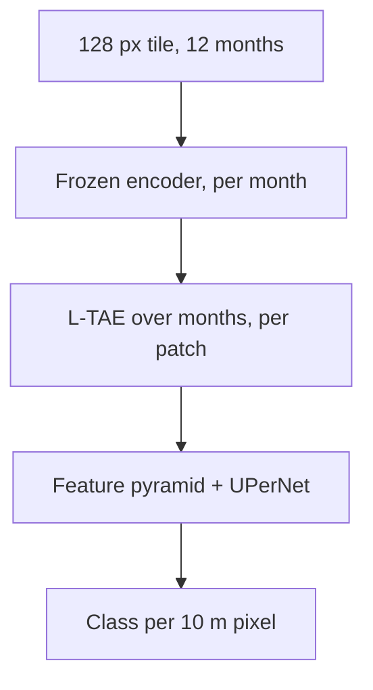
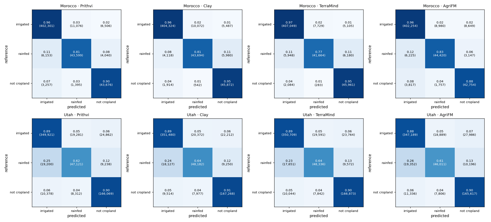

# E04 · Frozen foundation models + decoder (RQ1)

!!! success "Status: done in both regions for Prithvi, Clay, TerraMind and AgriFM"
    Same pixels as [E01](E01_s2_pixel_baseline.md): Morocco 522,003 in 2,230 tiles (2023/24 and 2024/25), Utah
    654,382 in 2,405 tiles (2023/24); 3 seeds per round on one GPU. The Presto and TESSERA jobs were cancelled before
    they finished; their results will be added later.

**Question (RQ1).** Do frozen geospatial foundation models with a light decoder classify the pixels better than the
pixel models (E01, E02) and a spatio-temporal network trained from scratch (E03)? (Answered on the [comparison page](comparison.md).)

**What changes from E03.** The image encoder: a pretrained, frozen foundation model instead of a convolutional
encoder trained from scratch. Tiles, labelled pixels, loss, training and metrics are the same.

## Model

The encoders see whole 128 × 128 px tiles; the model predicts every pixel and is scored at the labelled pixels of the [pixel samples](../phase1_data/pixel_samples.md).



| Encoder | Bands | Months per pass | Patch | Feature size |
| --- | --- | --- | --- | --- |
| Prithvi-EO-2.0-300M-TL | B2 B3 B4 B8A B11 B12 | 4, with date and location | 16 px | 1024 |
| Clay v1.5 | 10 bands (no B1, B9) | 1, with week and location | 8 px | 1024 |
| TerraMind 1.0 base | 12 bands (S2L2A) | 1 | 16 px | 768 |
| AgriFM | 10 bands | all 12 (time merged inside the model) | 4 px, pyramid to 32 px | multi-scale |
| Presto | 10 bands + NDVI | all 12 (per pixel, inside the model) | 1 pixel | 128 per pixel |
| TESSERA v2 Medium | 10 bands | the clear months, dated by day of year (per pixel) | 1 pixel | 128 per pixel |

All six encoders are loaded by [`pixelwise_run/encoders.py`](https://github.com/amanchry/irrimapping-geofm/blob/main/pixelwise_run/encoders.py) with the band order,
normalisation and weights of their pretraining (the four image models exactly as in the archived embedding scripts);
AgriFM is normalised with the region's band statistics, Presto and TESSERA with their own input scaling. The two pixel models encode every pixel of the tile, so their output is already a
10 m feature map
([D15](../decisions.md#d15-agrifm-normalised-with-the-statistics-of-the-regions-chips)). Details of the models:
[Foundation models](../foundation_models.md).

| Part | Choice |
| --- | --- |
| **Temporal head** | L-TAE (16 heads, d<sub>k</sub> 8, d<sub>model</sub> 256, output 256) over the 12 months at every patch position; months without a clear pixel in the patch are masked. AgriFM, Presto, TESSERA: none (the encoder handles time) |
| **Decoder** | 4-scale feature pyramid from the single-scale ViT features (×4, ×2, ×1, ×½, as for plain ViTs in PANGAEA; Marsocci et al. 2024) and a UPerNet head (Xiao et al. 2018; pool sizes 1, 2, 4), upsampled to 10 m. AgriFM: its own 4-level pyramid goes straight into the UPerNet head. Presto, TESSERA: the 10 m map average-pooled to 4 scales (×1, ×½, ×¼, ×⅛) |
| **Trained** | temporal head and decoder only (2.41 M TerraMind, 2.48 M Prithvi and Clay, 3.23 M AgriFM); the encoder stays frozen in evaluation mode |

??? info "How UPerNet works (the decoder)"
    The encoder describes the tile in coarse blocks: for Prithvi one vector per 16 × 16 px patch, an 8 × 8 grid for a
    128 px tile. UPerNet (Xiao et al. 2018) turns these coarse features into a class for **every pixel**. It does so
    by looking at the tile at several sizes at once: coarse maps carry the context (what kind of landscape is this?),
    finer maps carry the position (where does the field end?).

    ```mermaid
    flowchart LR
        A["encoder features<br/>8 × 8 per tile"] --> B["pyramid: 4 sizes<br/>32², 16², 8², 4²"]
        B --> C["1 · context:<br/>average the coarsest map<br/>over the whole tile, its halves<br/>and quarters"]
        C --> D["2 · coarse to fine:<br/>upsample, add the next<br/>finer map, smooth"]
        D --> E["3 · combine the 4 sizes,<br/>classify"]
        E --> F["class per pixel<br/>(32 × 32, then 128 × 128)"]
    ```

    1. **Pyramid.** A plain vision transformer gives only one map size, so the 8 × 8 map is rescaled to four sizes
       (32 × 32, 16 × 16, 8 × 8, 4 × 4).
    2. **Context.** On the coarsest map, the features are averaged over the whole tile, over 2 × 2 and over 4 × 4
       regions, and added back to every position, so each position also "knows" its surroundings (an irrigation
       scheme or a dry plain).
    3. **From coarse to fine.** Starting from the coarsest map, each step doubles the size and adds the next finer
       map, so the context flows down into the detailed maps.
    4. **Combine and classify.** The four maps are brought to 32 × 32 (40 m), joined, and a final layer gives three
       scores per position (irrigated, rainfed, not cropland); they are then upsampled to 128 × 128, i.e. to every
       10 m pixel.

    **What it can and cannot do.** UPerNet adds spatial context, which helps where a single pixel is ambiguous. It
    cannot add detail the encoder does not have: all four sizes come from the same 16 px patches, so field edges
    stay soft. UPerNet is the standard decoder of the PANGAEA benchmark (Marsocci et al. 2024) and is the same for
    every encoder, so it does not favour any of them.

## Training

| Item | Choice |
| --- | --- |
| **Labels** | the labelled pixels of the round's training folds only; every other pixel of the tile is ignored in the loss. A tile with pixels of two folds contributes only its training-fold labels |
| **Loss** | class-weighted cross-entropy (weights from the training pixels) |
| **Optimiser** | AdamW, learning rate 10⁻⁴, weight decay 10⁻⁴, batch 8 tiles, mixed precision (bfloat16) |
| **Augmentation** | random flips and 90° rotations |
| **Early stopping** | 3-class macro-F1 of the validation pixels, patience 8, at most 50 epochs |
| **Seeds** | 3 per round, mean probability |
| **Scoring** | the test tiles are predicted and read at their labelled pixels: the same out-of-fold pixels as every other experiment |

## How to run

Script: [`experiments/E04_frozen_geofm/run.py`](https://github.com/amanchry/irrimapping-geofm/blob/main/experiments/E04_frozen_geofm/run.py)
(models and training: [`pixelwise_run/tile_common.py`](https://github.com/amanchry/irrimapping-geofm/blob/main/pixelwise_run/tile_common.py)).
One GPU job per encoder and region; needs the tile store `outputs/<region>/dataset/03_tiles_128px/agyear/tiles/`
(on the cluster) and the model weights in `checkpoints/`.

```bash
for enc in prithvi clay terramind agrifm presto tessera; do sbatch --export=ALL,SCRIPT=experiments/E04_frozen_geofm/run.py,EXPERIMENT_REGION=morocco,EXPERIMENT_ENCODER=$enc jobs/step_gpu.sbatch; done
```

Run one encoder with `EXPERIMENT_QUICK_TEST=1` first (60 tiles, 2 epochs) and read the epoch time in the log to
check the 12-hour job limit.

## Outputs

`experiments/E04_frozen_geofm/results/<region>/<encoder>/`: the E01 files plus `training_history.csv`.

## Results

This page reports the results of E04 only; the comparison with the other experiments is on the
[comparison page](comparison.md).

### Scores

Out-of-fold scores with 95% block-bootstrap CI (**bold** = best encoder of the region):

| Region | Encoder | Cropland macro-F1 | 3-class macro-F1 | F1 irrigated | F1 rainfed | F1 not cropland |
| --- | --- | --- | --- | --- | --- | --- |
| Morocco | Prithvi | 0.888 [0.822, 0.939] | 0.871 [0.812, 0.918] | 0.968 | 0.794 | 0.852 |
| Morocco | Clay | 0.894 [0.822, 0.949] | 0.884 [0.812, 0.939] | 0.974 | 0.808 | 0.868 |
| Morocco | TerraMind | 0.893 [0.816, 0.950] | **0.884** [0.806, 0.940] | 0.975 | 0.805 | 0.871 |
| Morocco | AgriFM | **0.900** [0.842, 0.946] | 0.871 [0.816, 0.916] | 0.967 | 0.815 | 0.831 |
| Utah | Prithvi | 0.790 [0.748, 0.823] | 0.798 [0.769, 0.822] | 0.905 | 0.627 | 0.863 |
| Utah | Clay | 0.795 [0.751, 0.829] | **0.805** [0.777, 0.831] | 0.909 | 0.634 | 0.872 |
| Utah | TerraMind | **0.797** [0.757, 0.829] | **0.805** [0.777, 0.829] | 0.908 | 0.639 | 0.867 |
| Utah | AgriFM | 0.784 [0.739, 0.816] | 0.791 [0.762, 0.815] | 0.900 | 0.621 | 0.852 |

- **The encoders are close to each other.** In each region the four encoders lie within 0.012 (Morocco) and 0.013
  (Utah) cropland macro-F1, well inside each other's CIs. TerraMind and Clay are first on the 3-class score in both
  regions; AgriFM is first in Morocco and last in Utah on the cropland score. The data do not single out one
  encoder.
- **Utah is harder than Morocco** for every encoder (cropland macro-F1 0.784–0.797 vs 0.888–0.900), mainly through
  the rainfed class (F1 0.62–0.64 vs 0.79–0.82).

### Errors



- **Few cropland pixels are lost to not cropland:** 1.2–2.1% of the irrigated pixels in Morocco and 5.6–7.1% in
  Utah. The not-cropland class has a precision of 0.78–0.81 (Morocco) and 0.81–0.84 (Utah) and a recall of
  0.88–0.95.
- **Rainfed remains the weak class.** In Utah 12–14% of the rainfed pixels are predicted as not cropland and
  23–26% as irrigated, so the rainfed recall is 0.61–0.64. In Morocco the rainfed errors depend on the encoder: Clay
  and TerraMind send 11% of the rainfed pixels to not cropland, Prithvi and AgriFM 6–8%.

Cropland macro-F1 per group:

| Region | Group | Pixels | Prithvi | Clay | TerraMind | AgriFM |
| --- | --- | --- | --- | --- | --- | --- |
| Morocco | 2023/24 | 402,659 | 0.910 | 0.915 | **0.920** | 0.917 |
| Morocco | 2024/25 | 119,344 | 0.843 | 0.853 | 0.839 | **0.866** |
| Morocco | Doukkala | 142,356 | 0.881 | **0.901** | 0.899 | **0.901** |
| Morocco | Souss | 33,687 | **0.714** | 0.568 | 0.535 | 0.711 |
| Morocco | Statte | 10,355 | 0.611 | **0.729** | 0.596 | 0.721 |
| Utah | Bear River | 158,422 | **0.810** | **0.810** | 0.806 | 0.798 |
| Utah | Sevier River | 119,599 | **0.587** | 0.545 | 0.581 | 0.541 |
| Utah | Utah Lake | 25,386 | 0.676 | 0.686 | **0.691** | 0.632 |
| Utah | Weber River | 23,822 | 0.719 | 0.665 | **0.785** | 0.739 |
| Utah | West Desert | 15,906 | 0.675 | 0.694 | **0.755** | 0.703 |

- **Morocco, by year:** all encoders are better in 2023/24 (0.910–0.920) than in 2024/25. The drop is largest for
  the three single-date image encoders (Prithvi, Clay, TerraMind: 0.839–0.853); AgriFM, which merges the 12 months
  inside the encoder, keeps more of its score (0.866). 2024/25 has fewer labelled pixels (23% of the total), so the
  temporal head and decoder are trained mostly on 2023/24.
- **Small zones are unstable.** In Souss and Statte (10,000–34,000 pixels, few rainfed fields) the ranking of the
  encoders changes from zone to zone; these numbers should not be over-read.
- **Utah:** Sevier River is the weakest zone for every encoder (at most 0.587).

### Training

- Early stopping selected the best epoch after on average 9–15 epochs (range 1–31), as expected for a
  small head on fixed features.
- GPU time per region (5 rounds × 3 seeds, one job each): Morocco TerraMind 2.7 h, AgriFM 2.2 h, Clay 4.1 h, Prithvi
  6.7 h; Utah TerraMind 2.7 h, AgriFM 6.2 h, Clay 4.5 h, Prithvi 5.8 h. The jobs ran on different GPU nodes, so the
  times compare the encoders only roughly; per epoch Prithvi (300 M parameters, 4 months per pass) is the slowest
  in both regions (75 and 70 s) and TerraMind among the fastest (29 and 33 s).

### Conclusion

The four frozen encoders with the same L-TAE and UPerNet head reach a cropland macro-F1 of 0.888–0.900 in Morocco
and 0.784–0.797 in Utah and are statistically indistinguishable. They separate cropland from not cropland well;
the rainfed class, especially in Utah, remains the main error. TerraMind (among the fastest; best or joint-best in
Utah and on the 3-class score in Morocco) is a reasonable default for the maps; the choice should be confirmed with
Presto and TESSERA and with the STAC tiles. Comparison with the other experiments: [comparison page](comparison.md).

## References

- Marsocci, V. et al. (2024). PANGAEA: a global and inclusive benchmark for geospatial foundation models.
  arXiv:2412.04204.
- Xiao, T., Liu, Y., Zhou, B., Jiang, Y. & Sun, J. (2018). Unified perceptual parsing for scene understanding.
  *ECCV*.
