<!-- Report page of an experiment: created by make_report.py as docs/experiments/<name>/report.md -->
# E04 · Frozen GeoFMs + L-TAE temporal aggregation + MLP head — report

> **Answer.** No. Learned temporal attention (L-TAE) over the 12 monthly embeddings classifies as well as concat + PCA
> with the same MLP head, but not better: every input is within ±0.01 of its E03 result. The ranking of the inputs stays
> the same. In Morocco, Clay (0.906) ties with the S2 baseline (0.905). In Utah, Clay and Prithvi beat the S2 baseline
> with the same head by about 0.04.

## Key findings
- **L-TAE ≈ PCA + MLP.** Against E03's MLP on the same input, the differences are −0.003 to +0.008, none significant.
  The one exception is TerraMind in Utah (−0.015, not significant after Holm). L-TAE is also level with E02's SVM for
  every input (within ±0.007).
- **Morocco: the GeoFMs equal the S2 baseline.** Clay + L-TAE (0.906) and S2 + L-TAE (0.905) are the two best L-TAE
  results. Prithvi and TerraMind are 0.007–0.009 lower, and every CI includes 0. The same holds inside Doukkala.
- **Utah: Clay and Prithvi are better than the S2 baseline with the same head.** Clay +0.041 and Prithvi +0.039
  (significant); TerraMind +0.027 (CI just touches 0). In Bear River the gap is +0.05–0.07. Against the S2 baseline's
  best head, E02's random forest (0.764), Clay + L-TAE (0.784) leads by 0.02.
- **Souss confirms the E03 correction.** With L-TAE, the S2 features find 84% of Souss's rainfed parcels, as many as
  Clay (84%) and close to Prithvi (87%). The S2 features have no weakness there once the head is non-linear.
- **Label efficiency, same picture as E03.** In Morocco at 10% of the training blocks, S2 (0.819) and Clay (0.811) are
  level, with Prithvi and TerraMind lower. In Utah, all inputs are similar at 10% (0.65–0.68), and the GeoFMs pull
  ahead from 25% (Clay and Prithvi 0.73 vs S2 0.70).
- **Attention is spread over the year.** Month weights range from 0.04 to 0.14 (uniform = 0.083), and irrigated and
  rainfed parcels get almost the same weights. In Utah, Clay and Prithvi put most weight on July–September, the
  irrigated summer.

<!-- AUTO:RESULTS:START -->
<!-- generated by experiments/make_report.py: do not edit between these markers -->

## Setup

| | |
| --- | --- |
| Question | Does a learned temporal aggregation (L-TAE) of the monthly embeddings classify better than concat + PCA, for the GeoFMs and for the monthly Sentinel-2 features? (Sentinel-2 only, D14) |
| Research question | RQ1 |
| Regions | Morocco, Utah 2023/24 |
| Inputs | S2 baseline, Clay v1.5, Prithvi-EO-2.0, TerraMind |
| Temporal aggregation | L-TAE attention over the 12 monthly embeddings, trained with the head (months without data masked) |
| Head | L-TAE + MLP head (16 heads, d_k 8, d_model 256, MLP 256-128), 3 seeds |
| Validation | 5 spatial folds (20 km blocks); per round 3 folds train, the next fold chooses the hyperparameters or stops training, 1 fold tests (PASTIS rotation) |
| Label efficiency | also trained on 10%, 25%, 50% of the training blocks, 3 block draws each (same draws in every experiment) |
| Parcels | 6,011 / 6,013 / 8,781 (inputs scored on the parcels common to all runs) |
| Uncertainty | 95% CI from a block bootstrap (1,000 draws of whole 20 km blocks), the same draws for every run → paired differences; p-values Holm-adjusted |
| Changed from | E03: temporal aggregation concat + PCA 128 -> L-TAE (Garnot & Landrieu 2020), as in PANGAEA; same MLP head |

## Morocco

### Macro-F1 of every input and head

Out-of-fold predictions of all 5 spatial folds; **bold** = best input for that head. Runs marked [E0x] come from an earlier experiment, on the same parcels and bootstrap draws.

??? info "How to read this table"

    **What:** one score per input (row) and classifier (column), between 0 and 1. Higher is better.

    **Macro-F1:** F1 is computed for each class separately (irrigated, rainfed) and the two are averaged. Rainfed
    parcels are the minority, so a model that labels everything "irrigated" still gets a high overall accuracy but a
    low macro-F1. That is why macro-F1 is the main metric.

    **How:** every parcel is predicted once, by the model that did *not* see its 20 km block in training (out-of-fold).
    All inputs are scored on the same parcels, so the numbers can be compared directly.

    **Read it as:** about 0.90 = very good; 0.75 = clear errors on the rainfed class; 0.50 = no better than guessing one class.

| Input | LogReg | RF | SVM | MLP | L-TAE |
| --- | ---: | ---: | ---: | ---: | ---: |
| S2 baseline (L-TAE) | – | – | – | – | 0.905 |
| S2 baseline (MLP) [E03] | – | – | – | **0.908** | – |
| S2 baseline [E02] | 0.869 | 0.873 | 0.900 | – | – |
| Clay v1.5 (L-TAE) | – | – | – | – | **0.906** |
| Clay v1.5 (MLP) [E03] | – | – | – | 0.898 | – |
| Clay v1.5 [E02] | 0.882 | **0.874** | **0.901** | – | – |
| Prithvi-EO-2.0 (L-TAE) | – | – | – | – | 0.898 |
| Prithvi-EO-2.0 (MLP) [E03] | – | – | – | 0.892 | – |
| Prithvi-EO-2.0 [E02] | 0.879 | 0.835 | 0.899 | – | – |
| TerraMind (L-TAE) | – | – | – | – | 0.896 |
| TerraMind (MLP) [E03] | – | – | – | 0.894 | – |
| TerraMind [E02] | **0.887** | 0.855 | 0.899 | – | – |
| AgriFM (MLP) [E03] | – | – | – | 0.857 | – |
| AgriFM [E02] | 0.833 | 0.714 | 0.836 | – | – |

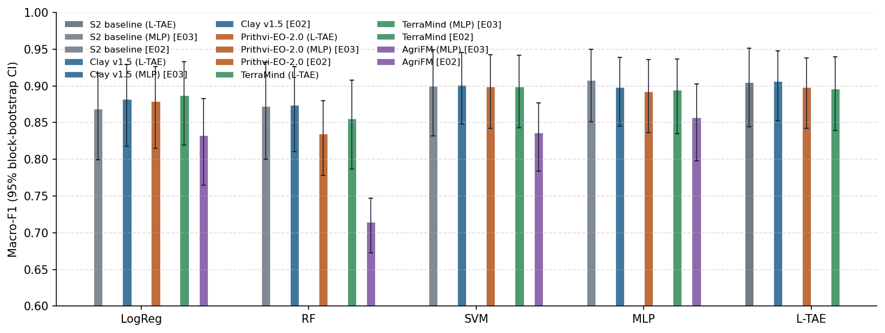

### Difference from the S2 baseline (headline heads)

Δ = input minus baseline with the same head (runs with their own model against the baseline's random forest), on the same parcels and the same bootstrap draws. **Better / worse** = the 95% CI excludes 0 **and** the Holm-adjusted p < 0.05.

??? info "How to read this table"

    **What:** each row compares one input with the S2 baseline, using the same classifier.

    - **Δ macro-F1:** the input's score minus the baseline's. +0.013 means 0.013 higher than the baseline; −0.158
      means 0.158 lower.
    - **95% CI, e.g. [−0.021, +0.025]:** the range in which the true difference probably lies. It comes from
      resampling whole 20 km blocks 1,000 times (block bootstrap) and recomputing Δ each time.
        - The range **includes 0** (one end negative, the other positive): the data cannot tell which input is
          better.
        - The range is **entirely above 0**, e.g. [+0.011, +0.049]: the input is better.
        - The range is **entirely below 0**, e.g. [−0.215, −0.085]: the input is worse.
    - **p (Holm):** how likely a difference this large would be if the two inputs were really equal. Many pairs are
      tested at once, so each p-value is raised (Holm correction) to avoid false "wins" by chance. 1.000 = no evidence
      of a difference.
    - **Verdict:** "better" or "worse" only if the CI excludes 0 **and** p (Holm) < 0.05. "Higher/lower, not
      significant after Holm" = the CI excludes 0, but the evidence does not survive the correction.

    **Why paired:** both inputs are scored on the same parcels and the same bootstrap draws, so a difference reflects
    the inputs, not which parcels happened to be drawn.

| Input | Classifier | Δ macro-F1 | 95% CI | p (Holm) | Verdict |
| --- | --- | ---: | ---: | ---: | --- |
| Clay v1.5 (L-TAE) | L-TAE | +0.002 | [-0.016, +0.023] | 1.000 | no clear difference |
| Prithvi-EO-2.0 (L-TAE) | L-TAE | -0.007 | [-0.028, +0.016] | 1.000 | no clear difference |
| TerraMind (L-TAE) | L-TAE | -0.009 | [-0.035, +0.014] | 1.000 | no clear difference |

### Same input, earlier experiments' heads

Δ = this experiment's head minus the head of an earlier experiment on the same input, same parcels and bootstrap draws (own Holm family). E03: MLP vs the E02 classifiers; E04: L-TAE vs the E03 MLP and the E02 classifiers.

??? info "How to read this table"

    **What:** the same input with two different classifiers, e.g. Clay + MLP (this experiment) minus Clay + SVM (E02).
    It shows whether the classifier, not the input, makes the difference.

    Δ, 95% CI and verdict are read as in the table above: a CI that includes 0 means no clear difference.

| Input | This experiment | Earlier run | Δ macro-F1 | 95% CI | p (Holm) | Verdict |
| --- | --- | --- | ---: | ---: | ---: | --- |
| S2 baseline | L-TAE | E02 LogReg | +0.036 | [+0.015, +0.068] | < 0.001 | **better** |
| S2 baseline | L-TAE | E02 RF | +0.032 | [-0.003, +0.076] | 0.820 | no clear difference |
| S2 baseline | L-TAE | E02 SVM | +0.005 | [-0.012, +0.031] | 1.000 | no clear difference |
| S2 baseline | L-TAE | E03 MLP | -0.003 | [-0.018, +0.009] | 1.000 | no clear difference |
| Clay v1.5 | L-TAE | E02 LogReg | +0.024 | [+0.013, +0.042] | 0.028 | **better** |
| Clay v1.5 | L-TAE | E02 RF | +0.033 | [+0.006, +0.061] | 0.240 | higher, not significant after Holm |
| Clay v1.5 | L-TAE | E02 SVM | +0.005 | [-0.010, +0.020] | 1.000 | no clear difference |
| Clay v1.5 | L-TAE | E03 MLP | +0.008 | [-0.002, +0.021] | 0.882 | no clear difference |
| Prithvi-EO-2.0 | L-TAE | E02 LogReg | +0.019 | [+0.006, +0.036] | 0.028 | **better** |
| Prithvi-EO-2.0 | L-TAE | E02 RF | +0.064 | [+0.035, +0.096] | < 0.001 | **better** |
| Prithvi-EO-2.0 | L-TAE | E02 SVM | -0.001 | [-0.014, +0.011] | 1.000 | no clear difference |
| Prithvi-EO-2.0 | L-TAE | E03 MLP | +0.006 | [-0.006, +0.018] | 1.000 | no clear difference |
| TerraMind | L-TAE | E02 LogReg | +0.009 | [-0.009, +0.028] | 1.000 | no clear difference |
| TerraMind | L-TAE | E02 RF | +0.041 | [+0.004, +0.082] | 0.242 | higher, not significant after Holm |
| TerraMind | L-TAE | E02 SVM | -0.003 | [-0.020, +0.010] | 1.000 | no clear difference |
| TerraMind | L-TAE | E03 MLP | +0.001 | [-0.008, +0.009] | 1.000 | no clear difference |

### Per-class metrics (headline heads, 95% CI)

??? info "How to read this table"

    **What:** the main metric and three others for the headline classifiers, each with its 95% CI in brackets
    (the range the true value probably lies in).

    - **Macro-F1:** mean F1 of the two classes (main metric).
    - **F1 rainfed:** how well the minority class is found. Precision and recall of "rainfed" are combined, so it is
      usually the lowest number and the most informative one.
    - **Balanced accuracy:** mean recall of the two classes. 0.5 = guessing.
    - **Overall accuracy:** share of all parcels labelled correctly. It looks high even for weak models, because most
      parcels are irrigated, so do not compare inputs on it alone.

    **Wide CIs** (e.g. 0.63–0.88) mean the score changes a lot from block to block, so small differences between
    rows are not meaningful.

| Input | Classifier | Macro-F1 | F1 rainfed | Balanced acc. | Overall acc. |
| --- | --- | ---: | ---: | ---: | ---: |
| S2 baseline (L-TAE) | L-TAE | 0.905 [0.84–0.95] | 0.837 [0.72–0.92] | 0.921 [0.87–0.96] | 0.953 [0.92–0.98] |
| S2 baseline [E02] | RF | 0.873 [0.80–0.93] | 0.777 [0.63–0.88] | 0.850 [0.77–0.93] | 0.944 [0.91–0.97] |
| S2 baseline [E02] | LogReg | 0.869 [0.80–0.92] | 0.778 [0.64–0.86] | 0.906 [0.86–0.95] | 0.932 [0.90–0.96] |
| Clay v1.5 (L-TAE) | L-TAE | 0.906 [0.85–0.95] | 0.840 [0.74–0.91] | 0.923 [0.89–0.95] | 0.954 [0.93–0.98] |
| Clay v1.5 [E02] | RF | 0.874 [0.81–0.93] | 0.779 [0.66–0.87] | 0.849 [0.78–0.91] | 0.945 [0.92–0.97] |
| Clay v1.5 [E02] | LogReg | 0.882 [0.82–0.93] | 0.800 [0.68–0.88] | 0.916 [0.88–0.95] | 0.940 [0.91–0.97] |
| Prithvi-EO-2.0 (L-TAE) | L-TAE | 0.898 [0.84–0.94] | 0.826 [0.72–0.90] | 0.917 [0.88–0.95] | 0.950 [0.92–0.97] |
| Prithvi-EO-2.0 [E02] | RF | 0.835 [0.78–0.88] | 0.713 [0.60–0.79] | 0.827 [0.76–0.88] | 0.924 [0.89–0.96] |
| Prithvi-EO-2.0 [E02] | LogReg | 0.879 [0.81–0.93] | 0.795 [0.67–0.88] | 0.923 [0.89–0.95] | 0.937 [0.90–0.96] |
| TerraMind (L-TAE) | L-TAE | 0.896 [0.84–0.94] | 0.821 [0.71–0.90] | 0.906 [0.86–0.94] | 0.950 [0.92–0.97] |
| TerraMind [E02] | RF | 0.855 [0.79–0.91] | 0.747 [0.61–0.84] | 0.837 [0.77–0.90] | 0.935 [0.90–0.96] |
| TerraMind [E02] | LogReg | 0.887 [0.82–0.93] | 0.808 [0.69–0.89] | 0.922 [0.89–0.96] | 0.942 [0.91–0.97] |
| AgriFM [E02] | RF | 0.714 [0.67–0.75] | 0.485 [0.40–0.55] | 0.668 [0.63–0.70] | 0.898 [0.85–0.94] |
| AgriFM [E02] | LogReg | 0.833 [0.77–0.88] | 0.719 [0.59–0.81] | 0.886 [0.84–0.93] | 0.909 [0.88–0.94] |

### Label efficiency

Macro-F1 when trained on a share of the training blocks (validation and test folds complete); mean ± SD over the 3 block draws. Draws are nested (the 10% blocks are part of the 25% and 50% blocks) and identical in every experiment. Neural heads: every point is a single-seed result (the 100% point is the mean over its 3 seeds scored one by one).

??? info "How to read this table"

    **What:** how the score changes when the model is trained with fewer labelled parcels.

    - **Columns:** share of the training blocks used (10%, 25%, 50%; 100% = the main result). The row *training
      parcels per round* gives the actual number of parcels. Validation and test folds are always complete, so every
      column is tested on the same parcels.
    - **0.807 ± 0.091:** the mean over 3 different random draws of blocks ± their standard deviation. A large ± means
      the result depends on *which* blocks were drawn.
    - **Read it as:** an input that stays high at 10% needs fewer labels (it is "label-efficient"). If its curve rises
      steeply, it needs many labels.

    **Why whole blocks:** dropping single parcels would leave neighbours of every parcel in training. Dropping whole
    20 km blocks simulates having field data from fewer places.

| Input | Head | 10% | 25% | 50% | 100% |
| --- | --- | ---: | ---: | ---: | ---: |
| *training parcels per round* | | 590 | 1,266 | 2,530 | all |
| S2 baseline (L-TAE) | L-TAE | 0.819 ± 0.040 | 0.851 ± 0.013 | 0.865 ± 0.011 | 0.898 |
| Clay v1.5 (L-TAE) | L-TAE | 0.811 ± 0.038 | 0.858 ± 0.025 | 0.871 ± 0.007 | 0.899 |
| Prithvi-EO-2.0 (L-TAE) | L-TAE | 0.785 ± 0.041 | 0.831 ± 0.019 | 0.857 ± 0.012 | 0.887 |
| TerraMind (L-TAE) | L-TAE | 0.755 ± 0.046 | 0.840 ± 0.017 | 0.871 ± 0.011 | 0.882 |

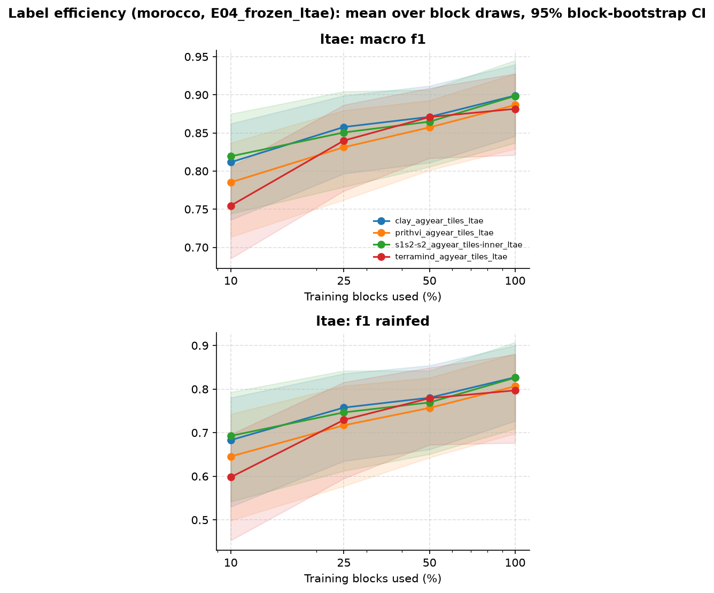

### Spread over seeds (neural heads)

Macro-F1 of each seed on its own; the result above is the mean probability of the seeds.

??? info "How to read this table"

    **What:** neural networks start from random weights, so each run (seed) gives a slightly different result. The
    table shows each seed on its own. Small differences between seeds (≈ 0.01) mean the result is stable, and a
    difference between inputs smaller than this spread is not meaningful.

| Input | Head | Macro-F1 per seed | Mean ± SD |
| --- | --- | --- | ---: |
| S2 baseline | L-TAE | 0.902, 0.905, 0.888 | 0.898 ± 0.009 |
| Clay v1.5 | L-TAE | 0.904, 0.896, 0.897 | 0.899 ± 0.004 |
| Prithvi-EO-2.0 | L-TAE | 0.889, 0.888, 0.882 | 0.887 ± 0.004 |
| TerraMind | L-TAE | 0.885, 0.879, 0.880 | 0.882 ± 0.003 |

### Which months the L-TAE attends to

Attention weight per month (mean over heads and test folds), per class (first seed).

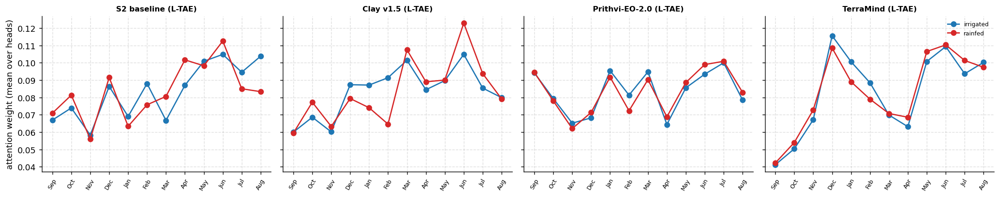

### Training curves

Validation macro-F1 per epoch in each round (first seed); the best epoch is kept (early stopping).

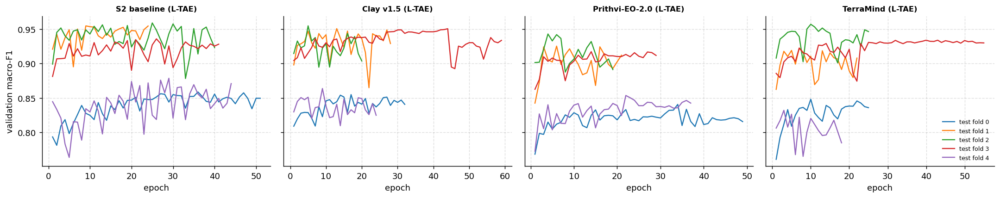

### Results by zone

Only the focus zone, where both classes are common (3,498 parcels, 1122 rainfed, 26 blocks): does the input separate the classes inside one region, or does it recognise the region? Script `05_breakdown_oof.py`.

??? info "How to read this table"

    **What:** the score inside the one zone where both classes are common (the focus zone), not over the whole region.

    **Why:** across a whole region, a model can score well just by learning *where* parcels are (one zone is almost all
    irrigated, another has the rainfed parcels). Inside one zone, location does not help, so this shows whether the
    input separates irrigated from rainfed fields themselves.

    **Δ vs baseline [95% CI]:** as in the difference table. A CI that includes 0 means no clear difference.

| Input | Head | Macro-F1 [95% CI] | Δ vs baseline [95% CI] |
| --- | --- | ---: | ---: |
| S2 baseline (L-TAE) | L-TAE | 0.888 [0.80–0.95] | – |
| Clay v1.5 (L-TAE) | L-TAE | 0.890 [0.82–0.94] | +0.003 [-0.016, +0.029] |
| Prithvi-EO-2.0 (L-TAE) | L-TAE | 0.879 [0.81–0.93] | -0.009 [-0.034, +0.020] |
| TerraMind (L-TAE) | L-TAE | 0.880 [0.81–0.93] | -0.008 [-0.036, +0.022] |

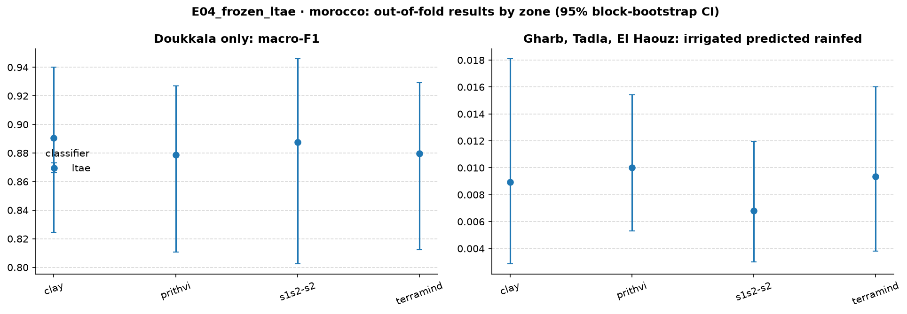

Tables per zone and season, patch purity and parcel area: `experiments/E04_frozen_ltae/results/morocco/breakdown/`.

### Macro-F1 per test fold

Each fold is a set of 20 km blocks, used once as the test fold. Rainfed test parcels per fold: fold 0: Doukkala 180, Souss 59; fold 1: Doukkala 237; fold 2: Doukkala 241; fold 3: Doukkala 234; fold 4: Doukkala 230.

??? info "How to read this table"

    **What:** the score on each test fold separately. Each fold is a different set of 20 km blocks, so the five numbers
    show how much the result changes from one part of the region to another.

    - **Mean ± SD:** average of the five folds and their spread. This can differ slightly from the main table, which
      scores all parcels at once.
    - **Read it as:** a low fold points to a part of the region where the model struggles. The fold description above
      lists where its rainfed parcels are. An input with a smaller SD is more consistent across space.

**L-TAE**

| Input | Fold 0 | Fold 1 | Fold 2 | Fold 3 | Fold 4 | Mean ± SD |
| --- | ---: | ---: | ---: | ---: | ---: | ---: |
| S2 baseline (L-TAE) | 0.823 | 0.857 | 0.945 | 0.967 | 0.932 | 0.905 ± 0.062 |
| Clay v1.5 (L-TAE) | 0.870 | 0.834 | 0.954 | 0.952 | 0.932 | 0.908 ± 0.054 |
| Prithvi-EO-2.0 (L-TAE) | 0.872 | 0.833 | 0.928 | 0.946 | 0.916 | 0.899 ± 0.046 |
| TerraMind (L-TAE) | 0.857 | 0.832 | 0.920 | 0.948 | 0.929 | 0.897 ± 0.050 |

**RF**

| Input | Fold 0 | Fold 1 | Fold 2 | Fold 3 | Fold 4 | Mean ± SD |
| --- | ---: | ---: | ---: | ---: | ---: | ---: |
| S2 baseline [E02] | 0.711 | 0.842 | 0.922 | 0.938 | 0.920 | 0.867 ± 0.095 |
| Clay v1.5 [E02] | 0.793 | 0.812 | 0.913 | 0.937 | 0.909 | 0.873 ± 0.065 |
| Prithvi-EO-2.0 [E02] | 0.799 | 0.753 | 0.899 | 0.843 | 0.884 | 0.835 ± 0.060 |
| TerraMind [E02] | 0.779 | 0.822 | 0.926 | 0.909 | 0.836 | 0.855 ± 0.062 |
| AgriFM [E02] | 0.743 | 0.645 | 0.715 | 0.751 | 0.709 | 0.713 ± 0.042 |

**LogReg**

| Input | Fold 0 | Fold 1 | Fold 2 | Fold 3 | Fold 4 | Mean ± SD |
| --- | ---: | ---: | ---: | ---: | ---: | ---: |
| S2 baseline [E02] | 0.785 | 0.834 | 0.901 | 0.923 | 0.899 | 0.869 ± 0.057 |
| Clay v1.5 [E02] | 0.850 | 0.829 | 0.935 | 0.899 | 0.905 | 0.884 ± 0.043 |
| Prithvi-EO-2.0 [E02] | 0.837 | 0.834 | 0.911 | 0.914 | 0.904 | 0.880 ± 0.041 |
| TerraMind [E02] | 0.854 | 0.823 | 0.929 | 0.925 | 0.916 | 0.889 ± 0.048 |
| AgriFM [E02] | 0.804 | 0.769 | 0.840 | 0.886 | 0.867 | 0.833 ± 0.048 |

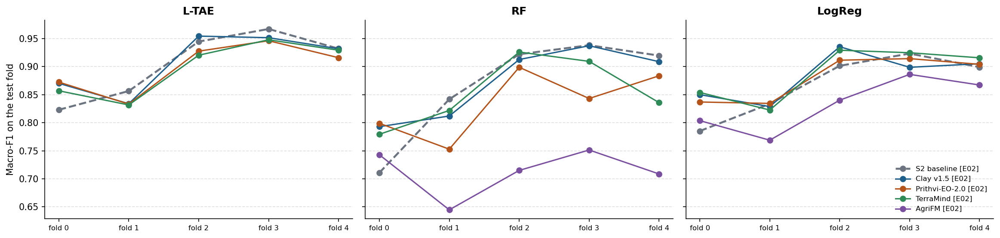

### Files

- Tables: [`experiments/E04_frozen_ltae/results/morocco/comparison/`](https://github.com/amanchry/irrimapping-geofm/tree/main/experiments/E04_frozen_ltae/results/morocco/comparison) (all metrics with CI, differences vs baseline, learning curves)
- Per run ([`experiments/E04_frozen_ltae/results/morocco/<run>/`](https://github.com/amanchry/irrimapping-geofm/tree/main/experiments/E04_frozen_ltae/results/morocco)): out-of-fold predictions, metrics per fold (and per seed), run settings and log
- Confusion matrices: –

## Utah 2023/24

### Macro-F1 of every input and head

Out-of-fold predictions of all 5 spatial folds; **bold** = best input for that head. Runs marked [E0x] come from an earlier experiment, on the same parcels and bootstrap draws.

??? info "How to read this table"

    **What:** one score per input (row) and classifier (column), between 0 and 1. Higher is better.

    **Macro-F1:** F1 is computed for each class separately (irrigated, rainfed) and the two are averaged. Rainfed
    parcels are the minority, so a model that labels everything "irrigated" still gets a high overall accuracy but a
    low macro-F1. That is why macro-F1 is the main metric.

    **How:** every parcel is predicted once, by the model that did *not* see its 20 km block in training (out-of-fold).
    All inputs are scored on the same parcels, so the numbers can be compared directly.

    **Read it as:** about 0.90 = very good; 0.75 = clear errors on the rainfed class; 0.50 = no better than guessing one class.

| Input | LogReg | RF | SVM | MLP | L-TAE |
| --- | ---: | ---: | ---: | ---: | ---: |
| S2 baseline (L-TAE) | – | – | – | – | 0.743 |
| S2 baseline (MLP) [E03] | – | – | – | 0.739 | – |
| S2 baseline [E02] | 0.722 | **0.764** | 0.728 | – | – |
| Clay v1.5 (L-TAE) | – | – | – | – | **0.784** |
| Clay v1.5 (MLP) [E03] | – | – | – | 0.781 | – |
| Clay v1.5 [E02] | **0.753** | 0.763 | **0.791** | – | – |
| Prithvi-EO-2.0 (L-TAE) | – | – | – | – | 0.782 |
| Prithvi-EO-2.0 (MLP) [E03] | – | – | – | 0.780 | – |
| Prithvi-EO-2.0 [E02] | 0.746 | 0.715 | 0.782 | – | – |
| TerraMind (L-TAE) | – | – | – | – | 0.770 |
| TerraMind (MLP) [E03] | – | – | – | **0.785** | – |
| TerraMind [E02] | 0.749 | 0.745 | 0.777 | – | – |
| AgriFM (MLP) [E03] | – | – | – | 0.747 | – |
| AgriFM [E02] | 0.714 | 0.677 | 0.741 | – | – |

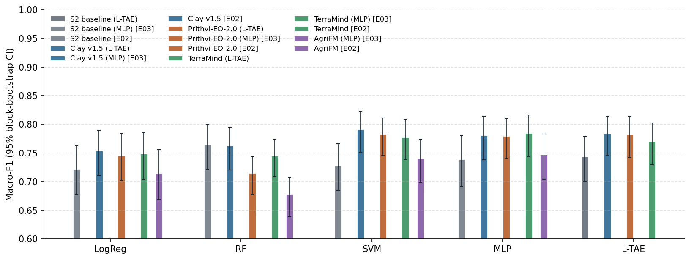

### Difference from the S2 baseline (headline heads)

Δ = input minus baseline with the same head (runs with their own model against the baseline's random forest), on the same parcels and the same bootstrap draws. **Better / worse** = the 95% CI excludes 0 **and** the Holm-adjusted p < 0.05.

??? info "How to read this table"

    **What:** each row compares one input with the S2 baseline, using the same classifier.

    - **Δ macro-F1:** the input's score minus the baseline's. +0.013 means 0.013 higher than the baseline; −0.158
      means 0.158 lower.
    - **95% CI, e.g. [−0.021, +0.025]:** the range in which the true difference probably lies. It comes from
      resampling whole 20 km blocks 1,000 times (block bootstrap) and recomputing Δ each time.
        - The range **includes 0** (one end negative, the other positive): the data cannot tell which input is
          better.
        - The range is **entirely above 0**, e.g. [+0.011, +0.049]: the input is better.
        - The range is **entirely below 0**, e.g. [−0.215, −0.085]: the input is worse.
    - **p (Holm):** how likely a difference this large would be if the two inputs were really equal. Many pairs are
      tested at once, so each p-value is raised (Holm correction) to avoid false "wins" by chance. 1.000 = no evidence
      of a difference.
    - **Verdict:** "better" or "worse" only if the CI excludes 0 **and** p (Holm) < 0.05. "Higher/lower, not
      significant after Holm" = the CI excludes 0, but the evidence does not survive the correction.

    **Why paired:** both inputs are scored on the same parcels and the same bootstrap draws, so a difference reflects
    the inputs, not which parcels happened to be drawn.

| Input | Classifier | Δ macro-F1 | 95% CI | p (Holm) | Verdict |
| --- | --- | ---: | ---: | ---: | --- |
| Clay v1.5 (L-TAE) | L-TAE | +0.041 | [+0.019, +0.061] | < 0.001 | **better** |
| Prithvi-EO-2.0 (L-TAE) | L-TAE | +0.039 | [+0.013, +0.065] | 0.004 | **better** |
| TerraMind (L-TAE) | L-TAE | +0.027 | [-0.000, +0.052] | 0.054 | no clear difference |

### Same input, earlier experiments' heads

Δ = this experiment's head minus the head of an earlier experiment on the same input, same parcels and bootstrap draws (own Holm family). E03: MLP vs the E02 classifiers; E04: L-TAE vs the E03 MLP and the E02 classifiers.

??? info "How to read this table"

    **What:** the same input with two different classifiers, e.g. Clay + MLP (this experiment) minus Clay + SVM (E02).
    It shows whether the classifier, not the input, makes the difference.

    Δ, 95% CI and verdict are read as in the table above: a CI that includes 0 means no clear difference.

| Input | This experiment | Earlier run | Δ macro-F1 | 95% CI | p (Holm) | Verdict |
| --- | --- | --- | ---: | ---: | ---: | --- |
| S2 baseline | L-TAE | E02 LogReg | +0.021 | [+0.001, +0.041] | 0.306 | higher, not significant after Holm |
| S2 baseline | L-TAE | E02 RF | -0.021 | [-0.044, +0.003] | 0.768 | no clear difference |
| S2 baseline | L-TAE | E02 SVM | +0.015 | [-0.003, +0.033] | 0.840 | no clear difference |
| S2 baseline | L-TAE | E03 MLP | +0.004 | [-0.014, +0.022] | 1.000 | no clear difference |
| Clay v1.5 | L-TAE | E02 LogReg | +0.030 | [+0.016, +0.045] | < 0.001 | **better** |
| Clay v1.5 | L-TAE | E02 RF | +0.021 | [+0.004, +0.038] | 0.104 | higher, not significant after Holm |
| Clay v1.5 | L-TAE | E02 SVM | -0.007 | [-0.021, +0.005] | 1.000 | no clear difference |
| Clay v1.5 | L-TAE | E03 MLP | +0.003 | [-0.010, +0.015] | 1.000 | no clear difference |
| Prithvi-EO-2.0 | L-TAE | E02 LogReg | +0.036 | [+0.020, +0.052] | < 0.001 | **better** |
| Prithvi-EO-2.0 | L-TAE | E02 RF | +0.067 | [+0.039, +0.094] | < 0.001 | **better** |
| Prithvi-EO-2.0 | L-TAE | E02 SVM | -0.000 | [-0.015, +0.014] | 1.000 | no clear difference |
| Prithvi-EO-2.0 | L-TAE | E03 MLP | +0.002 | [-0.010, +0.015] | 1.000 | no clear difference |
| TerraMind | L-TAE | E02 LogReg | +0.021 | [+0.003, +0.040] | 0.200 | higher, not significant after Holm |
| TerraMind | L-TAE | E02 RF | +0.025 | [+0.007, +0.043] | 0.176 | higher, not significant after Holm |
| TerraMind | L-TAE | E02 SVM | -0.007 | [-0.022, +0.006] | 1.000 | no clear difference |
| TerraMind | L-TAE | E03 MLP | -0.015 | [-0.028, -0.002] | 0.104 | lower, not significant after Holm |

### Per-class metrics (headline heads, 95% CI)

??? info "How to read this table"

    **What:** the main metric and three others for the headline classifiers, each with its 95% CI in brackets
    (the range the true value probably lies in).

    - **Macro-F1:** mean F1 of the two classes (main metric).
    - **F1 rainfed:** how well the minority class is found. Precision and recall of "rainfed" are combined, so it is
      usually the lowest number and the most informative one.
    - **Balanced accuracy:** mean recall of the two classes. 0.5 = guessing.
    - **Overall accuracy:** share of all parcels labelled correctly. It looks high even for weak models, because most
      parcels are irrigated, so do not compare inputs on it alone.

    **Wide CIs** (e.g. 0.63–0.88) mean the score changes a lot from block to block, so small differences between
    rows are not meaningful.

| Input | Classifier | Macro-F1 | F1 rainfed | Balanced acc. | Overall acc. |
| --- | --- | ---: | ---: | ---: | ---: |
| S2 baseline (L-TAE) | L-TAE | 0.743 [0.70–0.78] | 0.591 [0.51–0.66] | 0.787 [0.76–0.81] | 0.833 [0.81–0.86] |
| S2 baseline [E02] | RF | 0.764 [0.72–0.80] | 0.604 [0.51–0.68] | 0.753 [0.71–0.79] | 0.873 [0.85–0.89] |
| S2 baseline [E02] | LogReg | 0.722 [0.68–0.76] | 0.572 [0.49–0.65] | 0.794 [0.76–0.82] | 0.803 [0.77–0.83] |
| Clay v1.5 (L-TAE) | L-TAE | 0.784 [0.75–0.81] | 0.640 [0.56–0.70] | 0.784 [0.75–0.81] | 0.879 [0.86–0.90] |
| Clay v1.5 [E02] | RF | 0.763 [0.72–0.79] | 0.592 [0.50–0.66] | 0.729 [0.69–0.76] | 0.886 [0.87–0.90] |
| Clay v1.5 [E02] | LogReg | 0.753 [0.71–0.79] | 0.611 [0.53–0.68] | 0.807 [0.77–0.83] | 0.836 [0.81–0.86] |
| Prithvi-EO-2.0 (L-TAE) | L-TAE | 0.782 [0.74–0.81] | 0.637 [0.56–0.70] | 0.779 [0.74–0.81] | 0.879 [0.86–0.90] |
| Prithvi-EO-2.0 [E02] | RF | 0.715 [0.68–0.74] | 0.501 [0.42–0.56] | 0.674 [0.64–0.70] | 0.875 [0.85–0.90] |
| Prithvi-EO-2.0 [E02] | LogReg | 0.746 [0.70–0.78] | 0.602 [0.52–0.68] | 0.805 [0.77–0.83] | 0.828 [0.80–0.85] |
| TerraMind (L-TAE) | L-TAE | 0.770 [0.73–0.80] | 0.618 [0.54–0.69] | 0.773 [0.74–0.80] | 0.869 [0.85–0.89] |
| TerraMind [E02] | RF | 0.745 [0.71–0.77] | 0.561 [0.48–0.62] | 0.712 [0.68–0.74] | 0.878 [0.86–0.90] |
| TerraMind [E02] | LogReg | 0.749 [0.70–0.79] | 0.607 [0.53–0.68] | 0.812 [0.78–0.84] | 0.828 [0.80–0.85] |
| AgriFM [E02] | RF | 0.677 [0.64–0.71] | 0.429 [0.35–0.49] | 0.639 [0.61–0.67] | 0.869 [0.84–0.89] |
| AgriFM [E02] | LogReg | 0.714 [0.67–0.76] | 0.555 [0.47–0.63] | 0.774 [0.74–0.80] | 0.803 [0.77–0.83] |

### Label efficiency

Macro-F1 when trained on a share of the training blocks (validation and test folds complete); mean ± SD over the 3 block draws. Draws are nested (the 10% blocks are part of the 25% and 50% blocks) and identical in every experiment. Neural heads: every point is a single-seed result (the 100% point is the mean over its 3 seeds scored one by one).

??? info "How to read this table"

    **What:** how the score changes when the model is trained with fewer labelled parcels.

    - **Columns:** share of the training blocks used (10%, 25%, 50%; 100% = the main result). The row *training
      parcels per round* gives the actual number of parcels. Validation and test folds are always complete, so every
      column is tested on the same parcels.
    - **0.807 ± 0.091:** the mean over 3 different random draws of blocks ± their standard deviation. A large ± means
      the result depends on *which* blocks were drawn.
    - **Read it as:** an input that stays high at 10% needs fewer labels (it is "label-efficient"). If its curve rises
      steeply, it needs many labels.

    **Why whole blocks:** dropping single parcels would leave neighbours of every parcel in training. Dropping whole
    20 km blocks simulates having field data from fewer places.

| Input | Head | 10% | 25% | 50% | 100% |
| --- | --- | ---: | ---: | ---: | ---: |
| *training parcels per round* | | 399 | 862 | 1,732 | all |
| S2 baseline (L-TAE) | L-TAE | 0.674 ± 0.013 | 0.698 ± 0.027 | 0.718 ± 0.005 | 0.728 |
| Clay v1.5 (L-TAE) | L-TAE | 0.669 ± 0.011 | 0.730 ± 0.003 | 0.751 ± 0.009 | 0.770 |
| Prithvi-EO-2.0 (L-TAE) | L-TAE | 0.679 ± 0.008 | 0.733 ± 0.010 | 0.743 ± 0.006 | 0.767 |
| TerraMind (L-TAE) | L-TAE | 0.650 ± 0.027 | 0.720 ± 0.004 | 0.744 ± 0.007 | 0.751 |

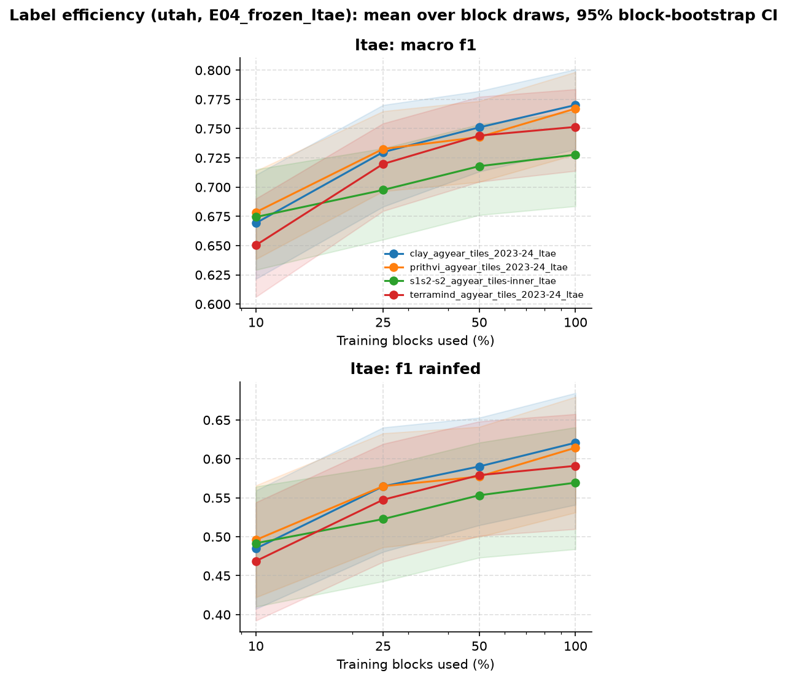

### Spread over seeds (neural heads)

Macro-F1 of each seed on its own; the result above is the mean probability of the seeds.

??? info "How to read this table"

    **What:** neural networks start from random weights, so each run (seed) gives a slightly different result. The
    table shows each seed on its own. Small differences between seeds (≈ 0.01) mean the result is stable, and a
    difference between inputs smaller than this spread is not meaningful.

| Input | Head | Macro-F1 per seed | Mean ± SD |
| --- | --- | --- | ---: |
| S2 baseline | L-TAE | 0.733, 0.724, 0.726 | 0.728 ± 0.005 |
| Clay v1.5 | L-TAE | 0.776, 0.756, 0.779 | 0.770 ± 0.012 |
| Prithvi-EO-2.0 | L-TAE | 0.779, 0.753, 0.769 | 0.767 ± 0.013 |
| TerraMind | L-TAE | 0.754, 0.751, 0.748 | 0.751 ± 0.003 |

### Which months the L-TAE attends to

Attention weight per month (mean over heads and test folds), per class (first seed).

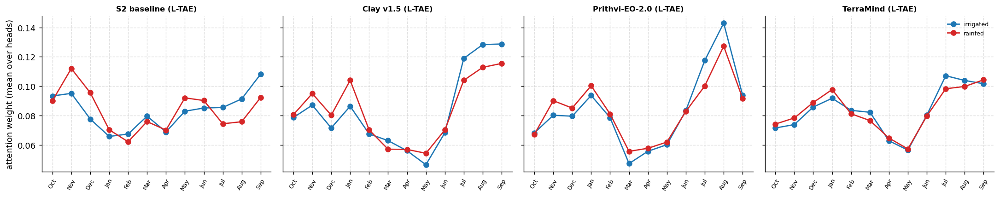

### Training curves

Validation macro-F1 per epoch in each round (first seed); the best epoch is kept (early stopping).

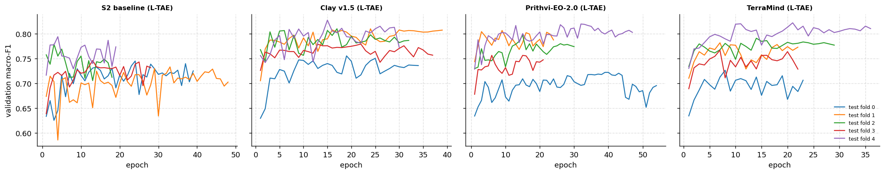

### Results by zone

Only the focus zone, where both classes are common (2,015 parcels, 595 rainfed, 40 blocks): does the input separate the classes inside one region, or does it recognise the region? Script `05_breakdown_oof.py`.

??? info "How to read this table"

    **What:** the score inside the one zone where both classes are common (the focus zone), not over the whole region.

    **Why:** across a whole region, a model can score well just by learning *where* parcels are (one zone is almost all
    irrigated, another has the rainfed parcels). Inside one zone, location does not help, so this shows whether the
    input separates irrigated from rainfed fields themselves.

    **Δ vs baseline [95% CI]:** as in the difference table. A CI that includes 0 means no clear difference.

| Input | Head | Macro-F1 [95% CI] | Δ vs baseline [95% CI] |
| --- | --- | ---: | ---: |
| S2 baseline (L-TAE) | L-TAE | 0.730 [0.67–0.78] | – |
| Clay v1.5 (L-TAE) | L-TAE | 0.801 [0.76–0.84] | +0.070 [+0.035, +0.106] |
| Prithvi-EO-2.0 (L-TAE) | L-TAE | 0.793 [0.75–0.84] | +0.063 [+0.018, +0.106] |
| TerraMind (L-TAE) | L-TAE | 0.783 [0.74–0.82] | +0.052 [+0.010, +0.097] |

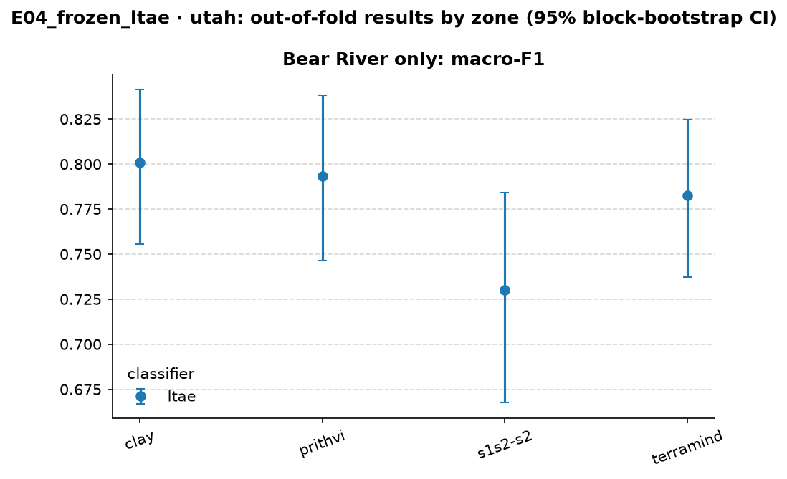

Tables per zone and season, patch purity and parcel area: `experiments/E04_frozen_ltae/results/utah/breakdown/`.

### Macro-F1 per test fold

Each fold is a set of 20 km blocks, used once as the test fold. Rainfed test parcels per fold: fold 0: Bear River 105, Southeast Colorado River 30, Sevier River 29, Weber River 14; fold 1: Bear River 144, Southeast Colorado River 29, Sevier River 12; fold 2: Bear River 118, Sevier River 28, Cedar/Beaver 10; fold 3: Bear River 116, Sevier River 54, Uintah 10, Southeast Colorado River 10; fold 4: Bear River 112, West Desert 26, Southeast Colorado River 22, Sevier River 12, Utah Lake 10.

??? info "How to read this table"

    **What:** the score on each test fold separately. Each fold is a different set of 20 km blocks, so the five numbers
    show how much the result changes from one part of the region to another.

    - **Mean ± SD:** average of the five folds and their spread. This can differ slightly from the main table, which
      scores all parcels at once.
    - **Read it as:** a low fold points to a part of the region where the model struggles. The fold description above
      lists where its rainfed parcels are. An input with a smaller SD is more consistent across space.

**L-TAE**

| Input | Fold 0 | Fold 1 | Fold 2 | Fold 3 | Fold 4 | Mean ± SD |
| --- | ---: | ---: | ---: | ---: | ---: | ---: |
| S2 baseline (L-TAE) | 0.753 | 0.721 | 0.726 | 0.802 | 0.719 | 0.744 ± 0.035 |
| Clay v1.5 (L-TAE) | 0.801 | 0.747 | 0.804 | 0.789 | 0.781 | 0.784 ± 0.023 |
| Prithvi-EO-2.0 (L-TAE) | 0.827 | 0.739 | 0.802 | 0.777 | 0.770 | 0.783 ± 0.033 |
| TerraMind (L-TAE) | 0.814 | 0.721 | 0.760 | 0.790 | 0.768 | 0.771 ± 0.035 |

**RF**

| Input | Fold 0 | Fold 1 | Fold 2 | Fold 3 | Fold 4 | Mean ± SD |
| --- | ---: | ---: | ---: | ---: | ---: | ---: |
| S2 baseline [E02] | 0.825 | 0.745 | 0.748 | 0.741 | 0.759 | 0.764 ± 0.035 |
| Clay v1.5 [E02] | 0.794 | 0.735 | 0.803 | 0.725 | 0.757 | 0.763 ± 0.035 |
| Prithvi-EO-2.0 [E02] | 0.750 | 0.718 | 0.721 | 0.695 | 0.690 | 0.715 ± 0.024 |
| TerraMind [E02] | 0.757 | 0.706 | 0.754 | 0.757 | 0.755 | 0.746 ± 0.022 |
| AgriFM [E02] | 0.649 | 0.688 | 0.676 | 0.706 | 0.663 | 0.676 ± 0.022 |

**LogReg**

| Input | Fold 0 | Fold 1 | Fold 2 | Fold 3 | Fold 4 | Mean ± SD |
| --- | ---: | ---: | ---: | ---: | ---: | ---: |
| S2 baseline [E02] | 0.766 | 0.675 | 0.700 | 0.765 | 0.712 | 0.724 ± 0.040 |
| Clay v1.5 [E02] | 0.767 | 0.692 | 0.771 | 0.798 | 0.745 | 0.755 ± 0.039 |
| Prithvi-EO-2.0 [E02] | 0.767 | 0.658 | 0.789 | 0.798 | 0.733 | 0.749 ± 0.057 |
| TerraMind [E02] | 0.784 | 0.668 | 0.756 | 0.784 | 0.760 | 0.750 ± 0.048 |
| AgriFM [E02] | 0.738 | 0.664 | 0.733 | 0.734 | 0.708 | 0.715 ± 0.031 |

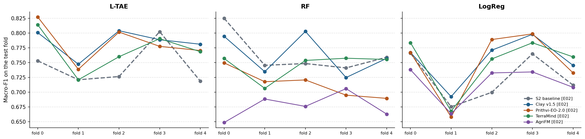

### Files

- Tables: [`experiments/E04_frozen_ltae/results/utah/comparison/`](https://github.com/amanchry/irrimapping-geofm/tree/main/experiments/E04_frozen_ltae/results/utah/comparison) (all metrics with CI, differences vs baseline, learning curves)
- Per run ([`experiments/E04_frozen_ltae/results/utah/<run>/`](https://github.com/amanchry/irrimapping-geofm/tree/main/experiments/E04_frozen_ltae/results/utah)): out-of-fold predictions, metrics per fold (and per seed), run settings and log
- Confusion matrices: –

## Code and settings

- Settings: [`experiments/E04_frozen_ltae/config.yaml`](https://github.com/amanchry/irrimapping-geofm/blob/main/experiments/E04_frozen_ltae/config.yaml)
- Code version: `cc89ede (with uncommitted changes)`, run 2026-11-13 13:17 – 2026-11-13 13:17

<!-- AUTO:RESULTS:END -->

## Interpretation

**The temporal aggregation does not matter here.** Concatenating the 12 months and reducing them by PCA keeps the
information the classifier needs. Learning which months to attend to (L-TAE, the temporal module of PANGAEA's
multi-temporal evaluation) gives the same result. Two reasons are likely. First, at parcel level, 12 monthly embeddings
are a short sequence: concat + PCA can still represent the whole seasonal profile, so there is little for attention to
add. Second, the L-TAE has to learn its attention from a few thousand parcels, while PCA needs no labels. The L-TAE's
larger spread between seeds in Utah (SD up to 0.013, vs ≤ 0.005 for the MLP) fits this: it has more to learn from the
same data.

**RQ1 after E02–E04.** Once the head is non-linear (SVM, MLP or L-TAE + MLP), neither the head nor the temporal
aggregation changes the conclusion. Each region's result is stable across all three experiments:

| | Best S2 baseline | Best GeoFM | Difference |
| --- | --- | --- | --- |
| Morocco | 0.908 (MLP, E03) | 0.906 (Clay, L-TAE, E04) | none |
| Utah | 0.764 (RF, E02) | 0.791 (Clay, SVM, E02) | ≈ +0.03; +0.04 with the same head |

The frozen GeoFM embeddings do not beat a well-built Sentinel-2 feature set in Morocco. In Utah they give a small but
consistent gain, which is largest inside the main rainfed zone (Bear River, +0.05 to +0.09 in E02–E04). Clay is the
best GeoFM in both regions with every non-linear head. Prithvi is close behind, and TerraMind gains least from the
L-TAE.

**What the attention shows.** The attention weights are close to uniform and nearly the same for both classes, so the
L-TAE does not single out one decisive month. In Utah, Clay and Prithvi weight July–September most, the months when
irrigated fields stay green and rainfed ones have dried out. In E02, the same months mattered most for the S2 random
forest. In Morocco, the weights are spread over the winter and spring growing season and the early summer, with no
clear peak. This fits the result that a simple concatenation already works well.

**AgriFM** is not part of E04. It returns one embedding per year, so there is no sequence to attend to. Its best result
remains E03's MLP (Morocco 0.857, Utah 0.747).

## Caveats
- The L-TAE settings follow PANGAEA and the original L-TAE (16 heads, d_k 8, d_model 256) and are not tuned. The
  validation fold only stops training.
- Attention weights show where the model looks, not why. They come from the first seed and are averaged over heads and
  test folds.
- The main L-TAE result averages 3 seeds; the label-efficiency points are single seeds.
- The Holm correction covers this experiment's own runs: 3 differences from the baseline, and 16 L-TAE vs E02/E03
  comparisons.
- Per-zone results for zones with fewer than 50 rainfed parcels are indicative only.

## Next steps
- **E05:** PSE-TAE trained from scratch on the S2 pixels, with its own temporal attention. This is the neural baseline
  that learns from pixels rather than from monthly features or frozen embeddings. Utah is the region to watch: can a
  supervised temporal model close the gap to the GeoFMs there?
- **RQ1 summary:** after E05, write the RQ1 answer from each input's best configuration, and test the "best vs best"
  differences explicitly.
