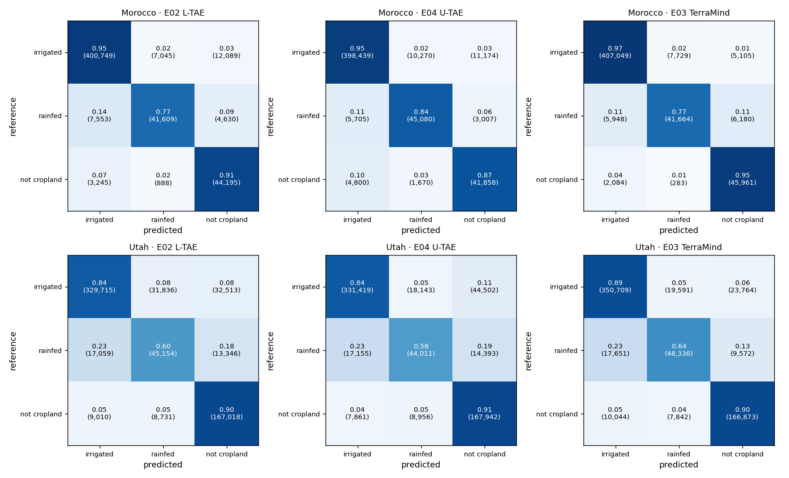

# E04 · U-TAE from scratch

!!! success "Status: done in both regions"
    Same pixels as [E01](E01_s2_pixel_baseline.md): Morocco 522,003 in 2,230 tiles (2023/24 and 2024/25), Utah
    654,382 in 2,405 tiles (2023/24); 3 seeds per round on one GPU.

**Question.** Does a spatio-temporal network of the same input, trained from scratch, match the frozen foundation
models (E03)? It shows how much the pretrained encoders add beyond spatial context.

**What changes from E02.** The model sees the whole 128 px tile (spatial context) instead of one pixel. The
labelled pixels, folds and metrics are the same.

## Model

U-TAE (Garnot & Landrieu 2021), the PASTIS semantic-segmentation baseline: a convolutional encoder shared by all
months, a lightweight temporal attention encoder (L-TAE) at the coarsest resolution that produces one attention
mask per head and pixel, these masks aggregate the skip features of every resolution over time, and a
convolutional decoder brings the result back to 10 m.

| Item | Choice |
| --- | --- |
| **Input** | 12 Sentinel-2 bands × 12 months, standardised per band with the training pixels of the round; missing values 0, months without any clear pixel masked in the attention |
| **Widths** | encoder 64–64–64–128, decoder 32–32–64–128 (the PASTIS configuration) |
| **Temporal attention** | L-TAE at 1/8 resolution: 16 heads, d<sub>k</sub> 4, d<sub>model</sub> 256 |
| **Parameters** | 1.15 M, all trained |
| **Training** | as E03 (masked class-weighted cross-entropy at the training-fold pixels, flips and rotations, early stopping on the validation pixels), but learning rate 10⁻³, batch 4 tiles, patience 10, at most 100 epochs; 3 seeds |

## How to run

Script: [`experiments/E04_utae/run.py`](https://github.com/amanchry/irrimapping-geofm/blob/main/experiments/E04_utae/run.py).

```bash
sbatch --export=ALL,SCRIPT=experiments/E04_utae/run.py,EXPERIMENT_REGION=morocco jobs/step_gpu.sbatch
```

## Outputs

`experiments/E04_utae/results/<region>/utae/`: the E01 files plus `training_history.csv`.

## Results

### Scores

Out-of-fold scores with 95% block-bootstrap CI. The E01 random forest and the E02 L-TAE (the best pixel model) are
repeated for comparison.

| Region | Model | Cropland macro-F1 | 3-class macro-F1 | F1 irrigated | F1 rainfed | F1 not cropland |
| --- | --- | --- | --- | --- | --- | --- |
| Morocco | E01 random forest | 0.876 [0.801, 0.929] | 0.838 [0.773, 0.887] | 0.959 | 0.784 | 0.770 |
| Morocco | E02 L-TAE | 0.890 [0.811, 0.945] | 0.859 [0.791, 0.911] | 0.964 | 0.805 | 0.809 |
| Morocco | U-TAE | **0.897** [0.843, 0.936] | **0.859** [0.815, 0.896] | 0.961 | 0.814 | 0.802 |
| Utah | E01 random forest | 0.729 [0.682, 0.765] | 0.746 [0.714, 0.772] | 0.870 | 0.559 | 0.809 |
| Utah | E02 L-TAE | 0.741 [0.697, 0.776] | 0.760 [0.730, 0.785] | 0.879 | 0.560 | 0.840 |
| Utah | U-TAE | **0.766** [0.725, 0.797] | **0.766** [0.739, 0.791] | 0.883 | 0.600 | 0.816 |

Paired difference on the same pixels (block bootstrap, 95% CI; Holm correction over the eight runs of E01–E04
compared with the same reference; **bold** = CI excludes 0 and p<sub>Holm</sub> < 0.05):

| Region | Comparison | Δ cropland macro-F1 | Δ 3-class macro-F1 |
| --- | --- | --- | --- |
| Morocco | U-TAE − E01 random forest | +0.021 [−0.012, 0.063], p<sub>Holm</sub> 0.95 | +0.021 [−0.003, 0.048], p<sub>Holm</sub> 0.22 |
| Morocco | U-TAE − E02 L-TAE | +0.007 [−0.028, 0.052], p<sub>Holm</sub> 1.00 | 0.000 [−0.025, 0.030], p<sub>Holm</sub> 1.00 |
| Utah | U-TAE − E01 random forest | **+0.037** [0.019, 0.053], p<sub>Holm</sub> < 0.001 | **+0.020** [0.008, 0.032], p<sub>Holm</sub> < 0.001 |
| Utah | U-TAE − E02 L-TAE | +0.025 [0.002, 0.044], p<sub>Holm</sub> 0.056 | +0.007 [−0.009, 0.021], p<sub>Holm</sub> 0.35 |


- **Utah:** spatial context helps. U-TAE is the first model that beats the random forest significantly on the
  cropland metric (+0.037), and it is 0.025 above the pixel L-TAE (CI excludes 0, but not significant after the
  Holm correction). The gain comes from the rainfed class (F1 0.600 vs 0.559 and 0.560).
- **Morocco:** U-TAE has the highest cropland macro-F1 of the models trained from scratch (0.897) and the narrowest
  CI, but the difference to the random forest and to L-TAE is within the uncertainty of the spatial folds.

### Errors



Compared with the pixel L-TAE (left and middle columns):

- **Morocco:** U-TAE recovers more rainfed pixels (recall 0.84 vs 0.77) but predicts more not-cropland pixels as
  irrigated (10% vs 7%) and more of them as rainfed; rainfed precision drops (0.79 vs 0.84), so the rainfed F1
  changes little (0.814 vs 0.805).
- **Utah:** the rainfed recall is similar (0.58 vs 0.60), but fewer irrigated pixels are predicted as rainfed (5% vs
  8%) and more as not cropland (11% vs 8%). A rainfed pixel is still predicted as irrigated in 23% of the cases.

Cropland macro-F1 and rainfed F1 per group (zones with rainfed labels and at least about 10,000 labelled pixels):

| Region | Group | Pixels | Cropland macro-F1 (RF / L-TAE / U-TAE) | F1 rainfed (RF / L-TAE / U-TAE) |
| --- | --- | --- | --- | --- |
| Morocco | 2023/24 | 402,659 | 0.893 / 0.899 / 0.906 | 0.822 / 0.827 / 0.838 |
| Morocco | 2024/25 | 119,344 | 0.844 / 0.874 / 0.879 | 0.718 / 0.769 / 0.772 |
| Morocco | Doukkala | 142,356 | 0.891 / 0.902 / 0.887 | 0.849 / 0.868 / 0.851 |
| Morocco | Souss | 33,687 | 0.583 / 0.621 / **0.813** | 0.205 / 0.291 / **0.664** |
| Morocco | Statte | 10,355 | 0.748 / 0.716 / 0.655 | 0.520 / 0.458 / 0.333 |
| Utah | Bear River | 158,422 | 0.736 / 0.735 / 0.781 | 0.641 / 0.647 / 0.710 |
| Utah | Sevier River | 119,599 | 0.484 / 0.575 / 0.562 | 0.048 / 0.215 / 0.201 |
| Utah | Utah Lake | 25,386 | 0.465 / 0.481 / **0.648** | 0.015 / 0.036 / **0.375** |
| Utah | Weber River | 23,822 | 0.577 / 0.628 / 0.665 | 0.237 / 0.343 / 0.389 |
| Utah | West Desert | 15,906 | 0.677 / 0.707 / 0.721 | 0.687 / 0.662 / 0.695 |

The tile model helps most where the pixel models barely find the rainfed class: Souss (rainfed F1 0.29 → 0.66) and
Utah Lake (0.04 → 0.38), presumably because the field and its surroundings resolve what the time series of a single
pixel leaves ambiguous. It does not help in Sevier River, the largest difficult zone in
Utah (rainfed F1 0.20), and it is worse in the small Statte zone. The Morocco zones Gharb, Tadla and El Haouz have no
rainfed labels and are left out of the table.

### Training

- Early stopping selected the best epoch after on average 19 epochs in Morocco and 17 in Utah, with a wide range
  (1–57 and 6–55): in some rounds the validation score keeps rising for 50 epochs, in others it peaks almost at
  once.
- 1.15 M trained parameters. GPU time per region (5 rounds × 3 seeds, one job): 4.9 h in Morocco and 6.1 h in Utah
  (about 40 and 54 s per epoch).

### Conclusion

A spatio-temporal network trained from scratch on the 128 px tiles **improves the Utah map significantly** over
the pixel models (cropland macro-F1 0.766 vs 0.729 random forest), mainly through the rainfed class, and is **on par
in Morocco** (0.897, not significantly different from 0.876 and 0.890). Spatial context therefore matters most where
the pixel signal of rainfed fields is weak. U-TAE is the reference for [E03](E03_frozen_geofm.md): the frozen
foundation models are compared with it to see what pretraining adds beyond spatial context.

## References

- Garnot, V. S. F. & Landrieu, L. (2021). Panoptic segmentation of satellite image time series with convolutional
  temporal attention networks. *ICCV*.
