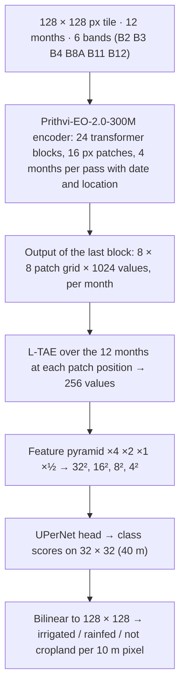
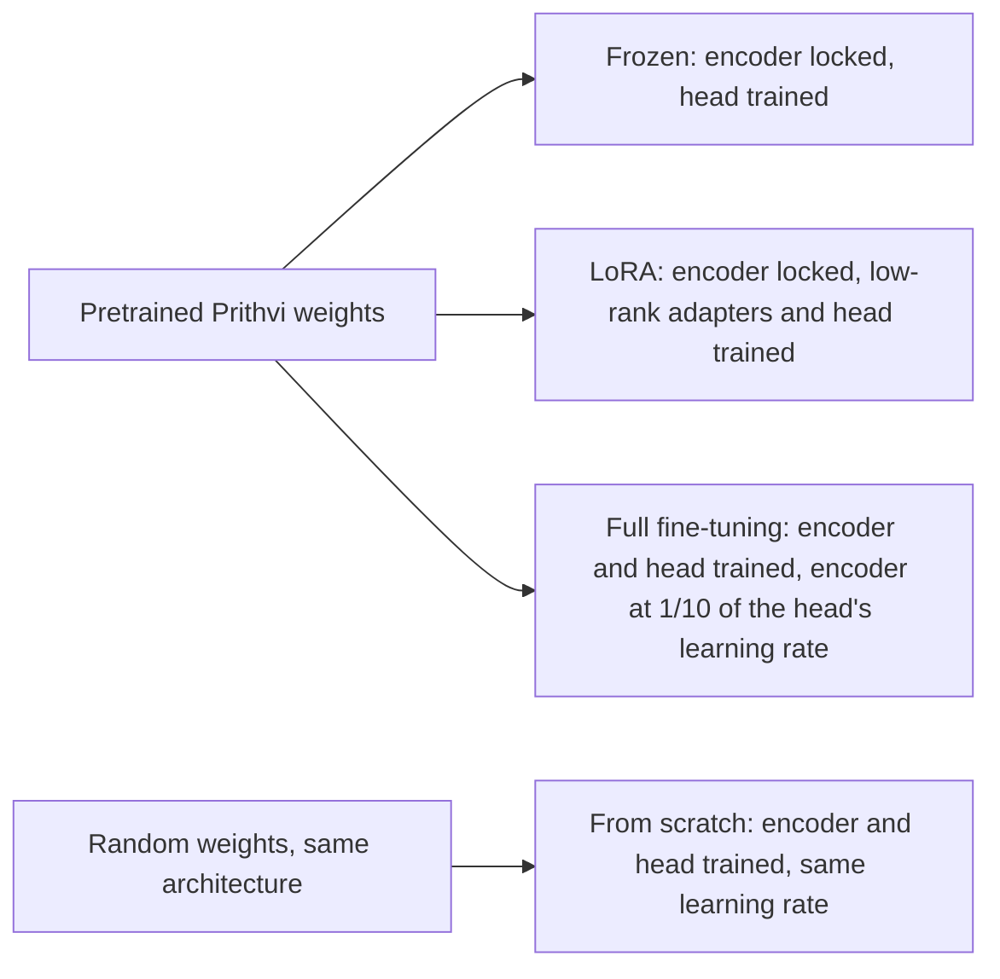
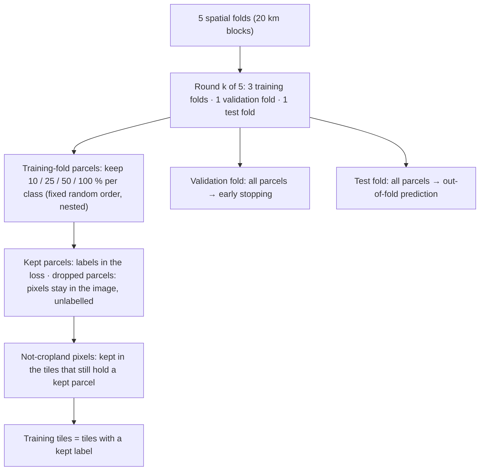
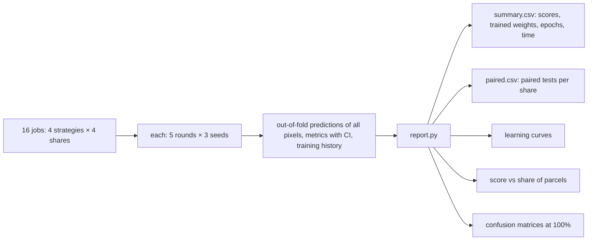

# E05 · Prithvi: frozen, LoRA, fine-tuned or from scratch (RQ2)

!!! info "Status (20 Nov): frozen, fine-tuned and from scratch running on the cluster (Utah), 2 of 12 runs finished; LoRA to be run later"
    Code: [`experiments/E05_prithvi_strategies/`](https://github.com/amanchry/irrimapping-geofm/tree/main/experiments/E05_prithvi_strategies)
    and [`pixelwise_run/tile_common.py`](https://github.com/amanchry/irrimapping-geofm/blob/main/pixelwise_run/tile_common.py).
    Same pixels as [E01](E01_s2_pixel_baseline.md)–[E04](E04_frozen_geofm.md): Utah 2023/24, 654,382 labelled pixels in
    2,405 tiles (4,998 irrigated and 1,013 rainfed parcels). 16 GPU jobs: 4 strategies × 4 label shares (the 4
    LoRA jobs later).

**Questions.**

1. How do the four ways of training the same network behave: speed of learning, overfitting, stability?
2. What does training the encoder (a few adapter weights or every weight) cost (trained weights, GPU time) and what
   does it change compared with the frozen encoder of [E04](E04_frozen_geofm.md)?
3. Does full fine-tuning beat the frozen encoder and the same network trained from scratch, does parameter-efficient
   fine-tuning (LoRA) keep the gain at a fraction of the trained weights, and do the answers depend on the number of
   labelled parcels?

**What changes from E04.** Only the encoder: whether it starts from the pretrained weights and whether its weights
are trained (none, low-rank adapters, or all). Network, tiles, labelled pixels, folds, loss and metrics are those
of E04, so the four strategies differ in nothing else. A fourth factor, the share of training parcels (10, 25, 50, 100%), shows where pretraining
pays off. Prithvi is the only encoder: it is the model of the study that motivated E05 (below), a plain ViT whose
architecture TerraTorch builds with random weights as easily as with pretrained ones, and in Utah close to the best
frozen encoder of E04 (cropland macro-F1 0.790 against 0.797 for TerraMind), and the GeoFM for which LoRA has been
compared with full fine-tuning (Marti-Escofet et al. 2025). One encoder keeps the cost at 16 jobs.

The question follows a recent study that fine-tuned Prithvi-EO-2.0 for crop-type mapping of smallholder farms
([Tomotaki-Dawoud et al. 2025](../references/tomotaki-dawoud-2025-prithvi-finetuning.md)): full fine-tuning gave a macro-F1 of 0.79 against 0.56 for the frozen encoder and 0.63
from scratch. That study used one validation split, no confidence intervals, three dates of 30 m HLS imagery
resampled to 0.5 m, and 601 parcels. E05 repeats the comparison with spatial cross-validation, block-bootstrap
confidence intervals and paired tests, 12 monthly composites of 10 m Sentinel-2, and a label-share curve. LoRA is
added because, for Prithvi-EO-2.0 on five segmentation tasks, it matched full fine-tuning with 1.8% of the encoder's
weights trained and generalised better to held-out regions ([Marti-Escofet et al. 2025](../phase2_models/fine_tuning.md#2--marti-escofet-et-al-2025--peft-for-geofms)).

## Model

The same network in every run (`GeoFMSegmenter` in `tile_common.py`, as in E04):



| Part | Choice | Source |
| --- | --- | --- |
| **Encoder** | Prithvi-EO-2.0-300M-TL: ViT-Large, 24 blocks, 1024-d tokens, 16 px patches; 4 months per pass with temporal and location encodings; the 12 months in three passes. Bands and normalisation of the model card | Szwarcman et al. (2024) |
| **Encoder output** | tokens of the last block, without the class token: an 8 × 8 grid per month | single-scale design of ViTDet (Li et al. 2022) |
| **Temporal head** | L-TAE over the 12 months at each of the 64 patch positions (16 heads, d<sub>k</sub> 8, d<sub>model</sub> 256, output 256); months without a clear pixel in the patch are masked | Garnot & Landrieu (2020); multi-temporal set-up of PANGAEA (Marsocci et al. 2024) |
| **Feature pyramid** | ×4: two 2 × 2 transposed convolutions (GroupNorm, GELU between); ×2: one transposed convolution; ×1: 1 × 1 convolution; ×½: 2 × 2 max-pooling + 1 × 1 convolution; 128 channels | the `Feature2Pyramid` neck that PANGAEA uses for ViT encoders (from MMSegmentation, used with BEiT and MAE); ViTDet |
| **Decoder** | UPerNet: pyramid pooling (1, 2, 4) on the coarsest map, top-down feature pyramid, fusion of the four levels, dropout 0.1, 1 × 1 classifier; then bilinear upsampling to 10 m | Xiao et al. (2018); PANGAEA |
| **Head size** | 2.48 M weights (L-TAE + pyramid + UPerNet), newly initialised in every run | E04 |

**Why the pyramid from one layer.** A plain ViT returns one map at one resolution (one vector per 16 px patch), but
UPerNet combines several resolutions. PANGAEA (`Feature2Pyramid`, with the scales 4, 2, 1, ½) and the
MMSegmentation configurations for BEiT and MAE rescale four *different* encoder layers (for a 12-block ViT, blocks
4, 6, 8 and 12). ViTDet showed that a pyramid rescaled from the *last* layer alone is sufficient (Li et al. 2022);
E04 and E05 use this simpler form, which needs one L-TAE instead of four. All four maps have the same true
resolution (16 px): the ×4 and ×2 maps are learnt upsamplings, so the decision grid is 40 m and field edges are soft.
The head is identical in the four strategies, so this choice does not favour any of them.

## The four strategies



| | **Frozen** | **LoRA** | **Full fine-tuning** | **From scratch** |
| --- | --- | --- | --- | --- |
| Encoder starts from | pretrained weights | pretrained weights | pretrained weights | random weights (TerraTorch initialisation, seeded per run) |
| Encoder trained | no (evaluation mode, no gradients) | no; adapters added to the attention (`qkv`) and MLP (`fc1`, `fc2`) layers of all 24 blocks are trained (training mode) | yes (training mode) | yes (training mode) |
| Head trained | yes | yes | yes | yes |
| Trained weights | ≈ 2.5 M | ≈ 8.0 M (5.5 M adapters + 2.5 M head) | ≈ 306 M | ≈ 306 M |
| Learning rate | head 10⁻⁴ | head and adapters 10⁻⁴ | head 10⁻⁴, encoder **10⁻⁵** | head and encoder 10⁻⁴ |
| Best model kept | head | head + adapters | head + encoder | head + encoder |
| What it measures | what the pretrained features hold for the task | how much a small, low-rank change of the encoder adds | what adapting every feature adds | what the network learns without pretraining |

**Frozen** is E04 for Prithvi. The encoder describes each patch as it learnt in pretraining; the head learns to read
these descriptions. It cannot add a distinction the pretrained features do not contain.

**Full fine-tuning** starts from the same weights but lets the error of the labels flow back into all 24 blocks, so
the features themselves move towards irrigated / rainfed / not cropland. The encoder gets a ten times smaller
learning rate than the new head: the head starts from random weights and must learn fast, the encoder should only
shift. Different learning rates for different parts of a pretrained network are the "discriminative fine-tuning" of
Howard & Ruder (2018), here in its simplest two-group form. A large step on a pretrained encoder can distort the
pretrained features and generalise worse to data unlike the training data (Kumar et al. 2022), which matters for
the year-transfer test (RQ3).

**LoRA** (low-rank adaptation; Hu et al. 2021) keeps every pretrained weight fixed and adds, next to each adapted
linear layer W, a trainable update B·A of rank 16 (A: 16 × input size, B: output size × 16; output W x + (α/r) B A x
with α = 32). B starts at zero, so training starts exactly from the pretrained network, as in full fine-tuning; but the
change of each layer is limited to 16 directions. The adapted layers and the rank follow Marti-Escofet et al. (2025),
who used rank 16 on the attention and feed-forward layers of Prithvi-EO-2.0-300M (about 5.5 M weights, 1.8% of the
encoder; Prithvi's query, key and value share one `qkv` layer, which is adapted as a whole). Memory stays close to
the frozen run: no gradients or optimiser states for the 304 M encoder weights. See
[RQ2 · Fine-tuning](../phase2_models/fine_tuning.md#lora-in-detail) for a diagram.

**From scratch** is the same 300 M network with random weights, trained like the fine-tuned one (encoder and head at
10⁻⁴). The difference to full fine-tuning is the starting point only, so it isolates the value of pretraining. A
ViT-Large has far more weights than a few thousand parcels can determine; it is expected to be the weakest at small
label shares. It is a reference for this network, not the best model trained from scratch: that is U-TAE
([E03](E03_utae.md), 1.15 M weights).

## Fewer labels

Only the **training folds** are thinned; the validation and test folds are always complete.



| Item | Rule |
| --- | --- |
| **Unit** | the parcel (all its sampled pixels together), the unit a field survey delivers |
| **Draw** | every parcel gets one fixed random number (seed 7); per class the training parcels with the smallest numbers are kept, so the class shares stay as in the full set and the 10% set lies inside the 25% set, and so on |
| **Same for all strategies** | the four strategies see the same parcels at each share |
| **Validation, test** | unchanged; every run predicts all 654,382 pixels once (out of fold), so all 16 runs are scored on the same pixels and can be compared pairwise |
| **Validation stays complete** | early stopping uses the full validation fold at every share. With only 10% of the labels a real project would also have less validation data, so the low-share scores are slightly optimistic for all four strategies alike |

Labelled data per round (mean of the five rounds; `label_subset.csv` of each run):

| Share | Irrigated parcels | Rainfed parcels | Not-cropland pixels | Training tiles |
| --- | --- | --- | --- | --- |
| 10% | 300 | 61 | 17,229 | 266 |
| 25% | 750 | 152 | 30,459 | 477 |
| 50% | 1,499 | 304 | 43,176 | 676 |
| 100% | 2,999 | 608 | 110,855 | 1,488 |

Not-cropland pixels and tiles shrink less evenly than the parcels: a kept parcel keeps its whole tile, with the
not-cropland pixels of that tile.

## Training

Identical for the four strategies except the learning rates above:

| Item | Choice |
| --- | --- |
| **Labels** | labelled pixels of the round's training folds (of the kept parcels); all other pixels ignored in the loss |
| **Loss** | class-weighted cross-entropy (weights from the kept training pixels) |
| **Optimiser** | AdamW, weight decay 10⁻⁴, batch 8 tiles, bfloat16 mixed precision |
| **Warm-up** | learning rate rises linearly over the first epoch, then constant (Goyal et al. 2017); avoids large first steps on the randomly initialised head and encoder |
| **Gradient clipping** | total gradient norm ≤ 1 |
| **Augmentation** | random flips and 90° rotations |
| **Early stopping** | 3-class macro-F1 of the validation pixels; patience 15, at most 60 epochs (E04: 8 and 50; longer here so that the curves show the overfitting phase) |
| **Seeds** | 3 per round (42, 1042, 2042), mean probability; the seed also sets the initial weights of the head, of the LoRA adapters and, from scratch, of the encoder |
| **Logged per epoch** | training loss, validation loss (the same weighted cross-entropy), validation 3-class and cropland macro-F1, seconds |

The frozen run at 100% repeats E04 Prithvi with a longer patience, warm-up and gradient clipping; its score should
lie close to E04's (cropland macro-F1 0.790 [0.748, 0.823], 3-class 0.798) and is a check of the code.

Settings not tuned: the learning rates (10⁻⁴ is E04's; 10⁻⁵ for the encoder is the tenfold reduction; the LoRA
adapters use the head's 10⁻⁴, since they start at zero and are small), the LoRA rank, weight decay and the head.
They are the same for every share.

## Analysis



| Question | Evidence |
| --- | --- |
| 1. How the strategies behave | training and validation loss and validation macro-F1 per epoch (100% of the labels; mean over the 15 runs, band = range): speed of learning, gap between training and validation loss, epoch of the best model |
| 2. What fine-tuning costs and changes | trained weights, seconds per epoch, GPU hours; fine-tuned − frozen and LoRA − frozen at each share; confusion matrices (does it reduce the rainfed → irrigated confusion of 19–26% in Utah?) |
| 3. Whether fine-tuning wins | paired block-bootstrap differences on the same pixels at each share: **fine-tuned − frozen** (effect of training the encoder), **fine-tuned − scratch** (effect of the pretrained weights), frozen − scratch, **LoRA − frozen** (effect of the adapters), **fine-tuned − LoRA** (full against parameter-efficient fine-tuning), LoRA − scratch. Holm correction per metric over the 24 comparisons (6 pairs × 4 shares); a difference counts when its 95% CI excludes 0 and p<sub>Holm</sub> < 0.05 (as in E01–E04). Score against share of parcels with E03 U-TAE and E01 random forest at 100% as reference lines |

Headline metric: cropland macro-F1 (irrigated, rainfed); 3-class macro-F1 and per-class F1 also reported. E05 is
compared within itself; `05_compare_experiments.py` keeps comparing E01–E04 only, so their Holm-corrected
p-values do not change.

## How to run

Script: [`experiments/E05_prithvi_strategies/run.py`](https://github.com/amanchry/irrimapping-geofm/blob/main/experiments/E05_prithvi_strategies/run.py)
(settings at the top; strategy and share from `EXPERIMENT_STRATEGY` and `EXPERIMENT_FRACTION`). One GPU job per
strategy and share; needs the Utah tile store `outputs/utah/dataset/03_tiles_128px/agyear/tiles/` and the Prithvi
weights in `checkpoints/prithvi/`.

Quick test first, one per strategy (60 tiles, 2 epochs, 1 seed), to read the epoch time and GPU memory:

```bash
for s in frozen finetune scratch lora; do sbatch --export=ALL,SCRIPT=experiments/E05_prithvi_strategies/run.py,EXPERIMENT_REGION=utah,EXPERIMENT_STRATEGY=$s,EXPERIMENT_FRACTION=0.5,EXPERIMENT_QUICK_TEST=1 jobs/step_gpu.sbatch; done
```

Then the runs: frozen, fine-tuned and from scratch (12 jobs, submitted first), and the 4 LoRA jobs later:

```bash
for s in frozen finetune scratch; do for f in 0.1 0.25 0.5 1.0; do sbatch --time=72:00:00 --export=ALL,SCRIPT=experiments/E05_prithvi_strategies/run.py,EXPERIMENT_REGION=utah,EXPERIMENT_STRATEGY=$s,EXPERIMENT_FRACTION=$f jobs/step_gpu.sbatch; done; done
for f in 0.1 0.25 0.5 1.0; do sbatch --time=72:00:00 --export=ALL,SCRIPT=experiments/E05_prithvi_strategies/run.py,EXPERIMENT_REGION=utah,EXPERIMENT_STRATEGY=lora,EXPERIMENT_FRACTION=$f jobs/step_gpu.sbatch; done
```

`report.py` uses whatever runs are finished, so it can be run before the LoRA jobs and again after them.

After copying `results/` to the Mac:

```bash
python experiments/E05_prithvi_strategies/report.py
```

**Compute (estimate, to be replaced by the quick-test times).** Frozen Prithvi in E04 took about 70 s per epoch on
Utah's ~1,500 training tiles and 5.8 GPU hours for 15 runs. Fine-tuning and training from scratch also run the
backward pass through the 300 M encoder; roughly 2–3 times longer per epoch. With the longer patience, about
60 GPU hours for the three strategies at 100% and about as much again for the three smaller shares, whose
training epochs are shorter (fewer tiles) but whose validation is not. LoRA also runs the backward pass through the
encoder (to reach the adapters) but updates only 5.5 M weights; in a local test it took about 1.3 times as long per
epoch as the frozen run (fine-tuning: 1.8, from scratch: 2.4), so the four LoRA jobs need roughly 20–25 GPU hours.

## Outputs

`experiments/E05_prithvi_strategies/results/utah/<strategy>_p<share>/` (e.g. `finetune_p025/`, `lora_p100/`): the E01 files plus
`training_history.csv` (per epoch: training loss, validation loss, validation 3-class and cropland macro-F1,
seconds) and `label_subset.csv` (parcels, pixels and tiles kept per round, for shares below 100%).
`report.py` writes `results/utah/summary.csv`, `results/utah/paired.csv` and the figures `e05_curves.png`,
`e05_label_fraction.png` and `e05_confusion.png` in `docs/experiments/figures/`.

## Limitations

- One encoder and one region. Prithvi is pretrained on 30 m HLS and here receives 10 m Sentinel-2, so its frozen
  features meet a different pixel size than in pretraining; fine-tuning may gain more for Prithvi than for an encoder
  pretrained on Sentinel-2 at 10 m.
- No search over learning rates per strategy, nor over the LoRA rank and adapted layers: a strategy may be favoured
  by settings that suit it better (Marti-Escofet et al. 2025 chose the learning rate of each method by a search).
- The validation fold is complete at every share (see above).
- Other parameter-efficient methods (adapters, prompt tuning) and two-stage linear probing then fine-tuning (LP-FT)
  are not compared ([RQ2 · Fine-tuning](../phase2_models/fine_tuning.md)).

## References

- Garnot, V. S. F. & Landrieu, L. (2020). Lightweight temporal self-attention for classifying satellite image time
  series (L-TAE). *AALTD*.
- Goyal, P. et al. (2017). Accurate, large minibatch SGD: training ImageNet in 1 hour. arXiv:1706.02677.
- Hu, E. J. et al. (2021). LoRA: low-rank adaptation of large language models. arXiv:2106.09685.
- Howard, J. & Ruder, S. (2018). Universal language model fine-tuning for text classification. *Proceedings of the
  56th Annual Meeting of the ACL*, 328–339.
- Kumar, A. et al. (2022). Fine-tuning can distort pretrained features and underperform out-of-distribution.
  *ICLR*. arXiv:2202.10054.
- Li, Y., Mao, H., Girshick, R. & He, K. (2022). Exploring plain vision transformer backbones for object detection
  (ViTDet). arXiv:2203.16527.
- Marti-Escofet, F., Blumenstiel, B., Scheibenreif, L., Fraccaro, P. & Schindler, K. (2025). Fine-tune smarter, not
  harder: parameter-efficient fine-tuning for geospatial foundation models. arXiv:2504.17397.
- Marsocci, V. et al. (2024). PANGAEA: a global and inclusive benchmark for geospatial foundation models.
  arXiv:2412.04204. Decoder code: [`pangaea/decoders/upernet.py`](https://github.com/VMarsocci/pangaea-bench/blob/main/pangaea/decoders/upernet.py).
- MMSegmentation: `Feature2Pyramid` neck ([`featurepyramid.py`](https://github.com/open-mmlab/mmsegmentation/blob/main/mmseg/models/necks/featurepyramid.py))
  and the UPerNet configurations for BEiT and MAE.
- Szwarcman, D. et al. (2024). Prithvi-EO-2.0: a versatile multi-temporal foundation model for Earth observation
  applications. arXiv:2412.02732.
- Tomotaki-Dawoud, K. et al. (2025). Fine-tuning the Prithvi foundation model for crop-type and health mapping in
  smallholder farms. *Procedia Computer Science* 270, 5055–5064. doi:10.1016/j.procs.2025.09.632.
- Xiao, T., Liu, Y., Zhou, B., Jiang, Y. & Sun, J. (2018). Unified perceptual parsing for scene understanding
  (UPerNet). *ECCV*.
