# E05 · Prithvi: frozen, LoRA, fine-tuned or from scratch (RQ2)

!!! success "Status: Morocco done, all 16 runs (22 November 2026); Utah later"
    **Pretraining matters, training the encoder does not:** frozen, LoRA and full fine-tuning all reach macro-F1
    0.90–0.92 at every share of the labels, about 0.09 above the same network trained from scratch (0.80–0.83;
    significant at every share, except frozen at 50%). Frozen vs LoRA vs full fine-tuning: no difference counts. [Results](#results)

!!! info "Set-up"
    Code: [`experiments/E05_prithvi_strategies/`](https://github.com/amanchry/irrimapping-geofm/tree/main/experiments/E05_prithvi_strategies)
    and [`pixelwise_run/tile_common.py`](https://github.com/amanchry/irrimapping-geofm/blob/main/pixelwise_run/tile_common.py),
    ready and tested. Same labelled pixels as [E01](E01_s2_pixel_baseline.md)–[E04](E04_frozen_geofm.md): Morocco
    2023/24 and 2024/25 pooled, 473,675 pixels in 2,015 tiles (7,579 irrigated and 1,196 rainfed parcels), two
    classes. 16 GPU jobs: 4 strategies × 4 label shares.

**Questions.**

1. How do the four ways of training the same network behave: speed of learning, overfitting, stability?
2. What does training the encoder (a few adapter weights or every weight) cost (trained weights, GPU time) and what
   does it change compared with the frozen encoder of [E04](E04_frozen_geofm.md)?
3. Does full fine-tuning beat the frozen encoder and the same network trained from scratch, does parameter-efficient
   fine-tuning (LoRA) keep the gain at a fraction of the trained weights, and do the answers depend on the number of
   labelled parcels?

**What changes from E04.** Only the encoder: whether it starts from the pretrained weights and whether its weights
are trained (none, low-rank adapters, or all). Network, tiles, labelled pixels, folds, loss and metrics are those
of E04, so the four strategies differ in nothing else. A fourth factor, the share of training parcels (10, 25, 50,
100%), shows where pretraining pays off. Prithvi is the only encoder: it is the model of the study that motivated
E05 (below), a plain ViT whose architecture TerraTorch builds with random weights as easily as with pretrained ones,
and the GeoFM for which LoRA has been compared with full fine-tuning (Marti-Escofet et al. 2025). One encoder keeps
the cost at 16 jobs.

The question follows a recent study that fine-tuned Prithvi-EO-2.0 for crop-type mapping of smallholder farms
([Tomotaki-Dawoud et al. 2025](../references/tomotaki-dawoud-2025-prithvi-finetuning.md)): full fine-tuning gave a
macro-F1 of 0.79 against 0.56 for the frozen encoder and 0.63 from scratch. That study used one validation split, no
confidence intervals, three dates of 30 m HLS imagery resampled to 0.5 m, and 601 parcels. E05 repeats the
comparison with spatial cross-validation, block-bootstrap confidence intervals and paired tests, 12 monthly
composites of 10 m Sentinel-2, and a label-share curve. LoRA is added because, for Prithvi-EO-2.0 on five
segmentation tasks, it matched full fine-tuning with 1.8% of the encoder's weights trained and generalised better to
held-out regions ([Marti-Escofet et al. 2025](../phase2_models/fine_tuning.md#2--marti-escofet-et-al-2025--peft-for-geofms)).

## How E05 works, step by step

E05 trains the same Prithvi network in four ways, and each strategy treats the encoder differently (locked, locked
with adapters, fully trained from the pretrained weights, or fully trained from random weights). Each strategy
therefore has its own figure, from the labelled pixels to the paired tests it enters (schematic: the pictures
illustrate the steps and show no results, so the figures hold for any region and year;
`tools/a9_experiment_explainers.py`). Grey parts are locked, orange parts are trained. The results of each region
are under [Results](#results).

=== "Frozen"

    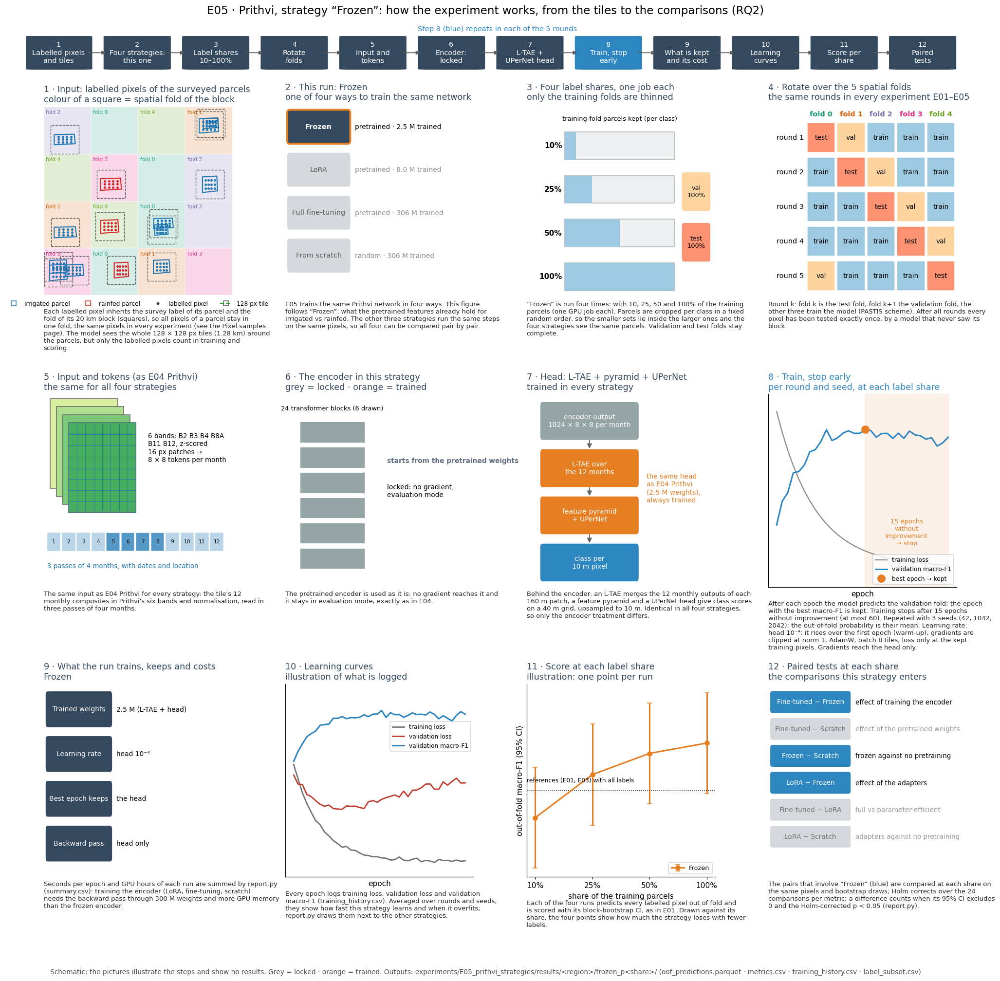

    The pretrained encoder stays locked, as in E04; only the L-TAE and the head learn (2.5 M weights). The reference
    the other strategies are measured against.

=== "LoRA"

    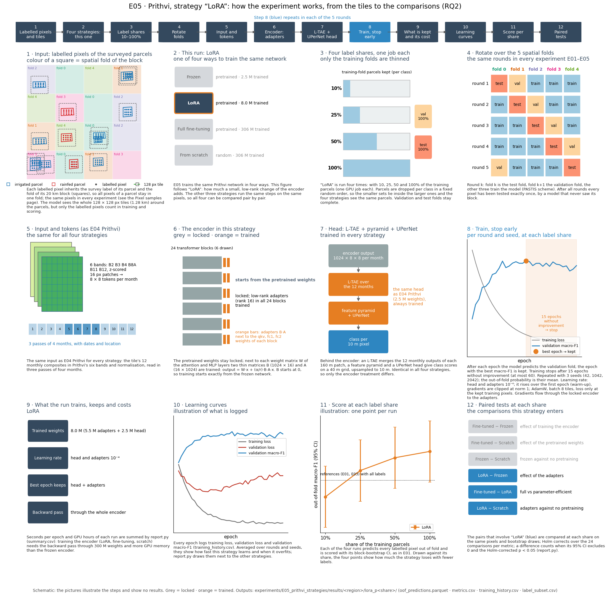

    The pretrained encoder stays locked, but thin low-rank adapters (rank 16) next to its attention and MLP weights
    are trained with the head (8.0 M weights); gradients pass through the whole encoder.

=== "Full fine-tuning"

    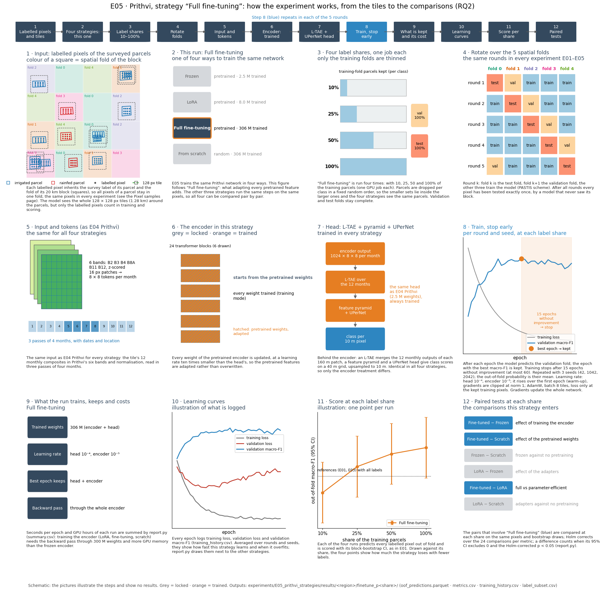

    Every weight is trained, starting from the pretrained ones, with the encoder at a ten times smaller learning rate
    than the head (306 M weights).

=== "From scratch"

    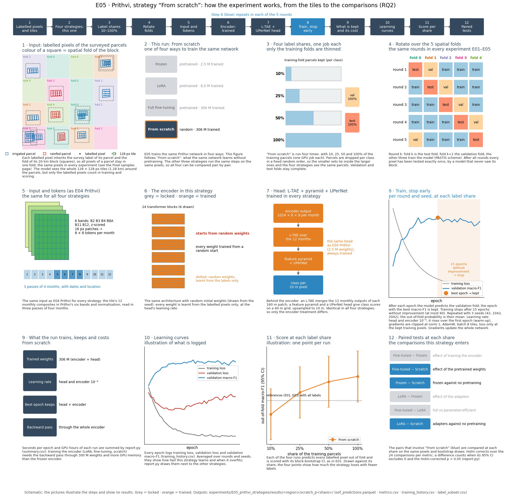

    The same network starts from random weights and learns everything from the labelled pixels at the head's
    learning rate (306 M weights): what the network achieves without pretraining.

The twelve steps, the same for every strategy except step 6:

1. **Labelled pixels and tiles.** As in E03 and E04: whole 128 px tiles, scored at the same labelled pixels as
   every experiment.
2. **The strategy.** One of four ways to train the same network; the figure highlights it among the four.
3. **Label shares.** Each strategy is run with 10, 25, 50 and 100% of the training parcels (one job each); parcels
   are dropped per class in a fixed nested order, and the validation and test folds stay complete.
4. **Rotation over the folds.** The same five rounds as every experiment.
5. **Input and tokens.** As E04 Prithvi: six bands, three passes of four months with dates and location, 16 px
   patches.
6. **The encoder.** Locked (frozen), locked with trained adapters (LoRA), fully trained from the pretrained weights
   at a tenfold smaller learning rate (full fine-tuning), or fully trained from random weights (from scratch).
7. **Head.** The L-TAE, feature pyramid and UPerNet head of E04, trained in every strategy.
8. **Training.** Early stopping on the validation pixels (patience 15, at most 60 epochs), one epoch of warm-up,
   gradient clipping, three seeds per round.
9. **What is kept and its cost.** Trained weights, learning rates, the parts saved at the best epoch, and whether
   the backward pass runs through the encoder; GPU time per run in `summary.csv`.
10. **Learning curves.** Training loss, validation loss and validation macro-F1 per epoch.
11. **Score per share.** Each run scored on all out-of-fold pixels with its 95% interval, against its label share.
12. **Paired tests.** At each share, the pairs the strategy enters (e.g. fine-tuned − frozen, LoRA − frozen,
    fine-tuned − scratch), on the same pixels and bootstrap draws, Holm-corrected over the 24 comparisons.

## Model

The same network in every run (`GeoFMSegmenter` in `tile_common.py`, as in E04):

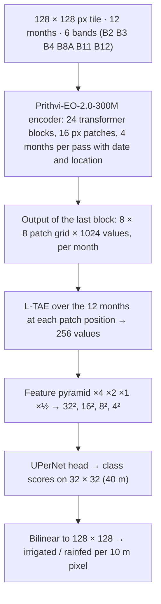

| Part | Choice | Source |
| --- | --- | --- |
| **Encoder** | Prithvi-EO-2.0-300M-TL: ViT-Large, 24 blocks, 1024-d tokens, 16 px patches; 4 months per pass with temporal and location encodings; the 12 months in three passes. Bands and normalisation of the model card | Szwarcman et al. (2024) |
| **Encoder output** | tokens of the last block, without the class token: an 8 × 8 grid per month | single-scale design of ViTDet (Li et al. 2022) |
| **Temporal head** | L-TAE over the 12 months at each of the 64 patch positions (16 heads, d<sub>k</sub> 8, d<sub>model</sub> 256, output 256); months without a clear pixel in the patch are masked | Garnot & Landrieu (2020); multi-temporal set-up of PANGAEA (Marsocci et al. 2024) |
| **Feature pyramid** | ×4: two 2 × 2 transposed convolutions (GroupNorm, GELU between); ×2: one transposed convolution; ×1: 1 × 1 convolution; ×½: 2 × 2 max-pooling + 1 × 1 convolution; 128 channels | the `Feature2Pyramid` neck that PANGAEA uses for ViT encoders (from MMSegmentation, used with BEiT and MAE); ViTDet |
| **Decoder** | UPerNet: pyramid pooling (1, 2, 4) on the coarsest map, top-down feature pyramid, fusion of the four levels, dropout 0.1, 1 × 1 classifier (2 classes); then bilinear upsampling to 10 m | Xiao et al. (2018); PANGAEA |
| **Head size** | 2.48 M weights (L-TAE + pyramid + UPerNet), newly initialised in every run | E04 |

??? info "Why the pyramid is built from one layer"
    A plain ViT returns one map at one resolution (one vector per 16 px patch), but UPerNet combines several
    resolutions. PANGAEA (`Feature2Pyramid`, with the scales 4, 2, 1, ½) and the MMSegmentation configurations for
    BEiT and MAE rescale four *different* encoder layers (for a 12-block ViT, blocks 4, 6, 8 and 12). ViTDet showed
    that a pyramid rescaled from the *last* layer alone is sufficient (Li et al. 2022); E04 and E05 use this simpler
    form, which needs one L-TAE instead of four. All four maps have the same true resolution (16 px): the ×4 and ×2
    maps are learnt upsamplings, so the decision grid is 40 m and field edges are soft. The head is identical in the
    four strategies, so this choice does not favour any of them. How UPerNet works:
    [E04](E04_frozen_geofm.md).

## The four strategies

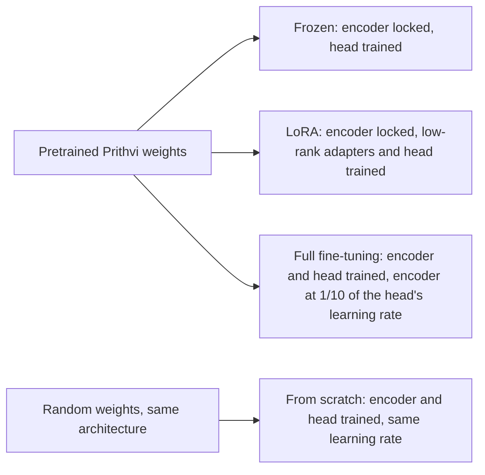

| | **Frozen** | **LoRA** | **Full fine-tuning** | **From scratch** |
| --- | --- | --- | --- | --- |
| Encoder starts from | pretrained weights | pretrained weights | pretrained weights | random weights (TerraTorch initialisation, seeded per run) |
| Encoder trained | no (evaluation mode, no gradients) | no; adapters added to the attention (`qkv`) and MLP (`fc1`, `fc2`) layers of all 24 blocks are trained (training mode) | yes (training mode) | yes (training mode) |
| Head trained | yes | yes | yes | yes |
| Trained weights | ≈ 2.5 M | ≈ 8.0 M (5.5 M adapters + 2.5 M head) | ≈ 306 M | ≈ 306 M |
| Learning rate | head 10⁻⁴ | head and adapters 10⁻⁴ | head 10⁻⁴, encoder **10⁻⁵** | head and encoder 10⁻⁴ |
| Best model kept | head | head + adapters | head + encoder | head + encoder |
| What it measures | what the pretrained features hold for the task | how much a small, low-rank change of the encoder adds | what adapting every feature adds | what the network learns without pretraining |

??? info "Frozen"
    Frozen is E04 for Prithvi. The encoder describes each patch as it learnt in pretraining; the head learns to read
    these descriptions. It cannot add a distinction the pretrained features do not contain.

??? info "Full fine-tuning"
    Full fine-tuning starts from the same weights but lets the error of the labels flow back into all 24 blocks, so
    the features themselves move towards irrigated / rainfed. The encoder gets a ten times smaller learning rate than
    the new head: the head starts from random weights and must learn fast, the encoder should only shift. Different
    learning rates for different parts of a pretrained network are the "discriminative fine-tuning" of Howard &
    Ruder (2018), here in its simplest two-group form. A large step on a pretrained encoder can distort the
    pretrained features and generalise worse to data unlike the training data (Kumar et al. 2022), which matters
    for the year-transfer test (RQ3).

??? info "LoRA (low-rank adaptation)"
    How LoRA works (a trainable low-rank update B·A next to each frozen weight matrix, B starting at zero) is
    explained with a diagram on [RQ2 · Fine-tuning](../phase2_models/fine_tuning.md#lora-in-detail). In E05: rank 16,
    α = 32, on the `qkv` attention layer and the two MLP layers (`fc1`, `fc2`) of all 24 Prithvi blocks, following
    Marti-Escofet et al. (2025); about 5.5 M trainable weights, 1.8% of the encoder. Memory stays close to the frozen
    run: no gradients or optimiser states for the 304 M encoder weights.

??? info "From scratch"
    The same 300 M network with random weights, trained like the fine-tuned one (encoder and head at 10⁻⁴). The
    difference to full fine-tuning is the starting point only, so it isolates the value of pretraining. A ViT-Large
    has far more weights than a few thousand parcels can determine; it is expected to be the weakest at small label
    shares. It is a reference for this network, not the best model trained from scratch: that is U-TAE
    ([E03](E03_utae.md), 1.15 M weights).

## Fewer labels

Only the **training folds** are thinned; the validation and test folds are always complete.

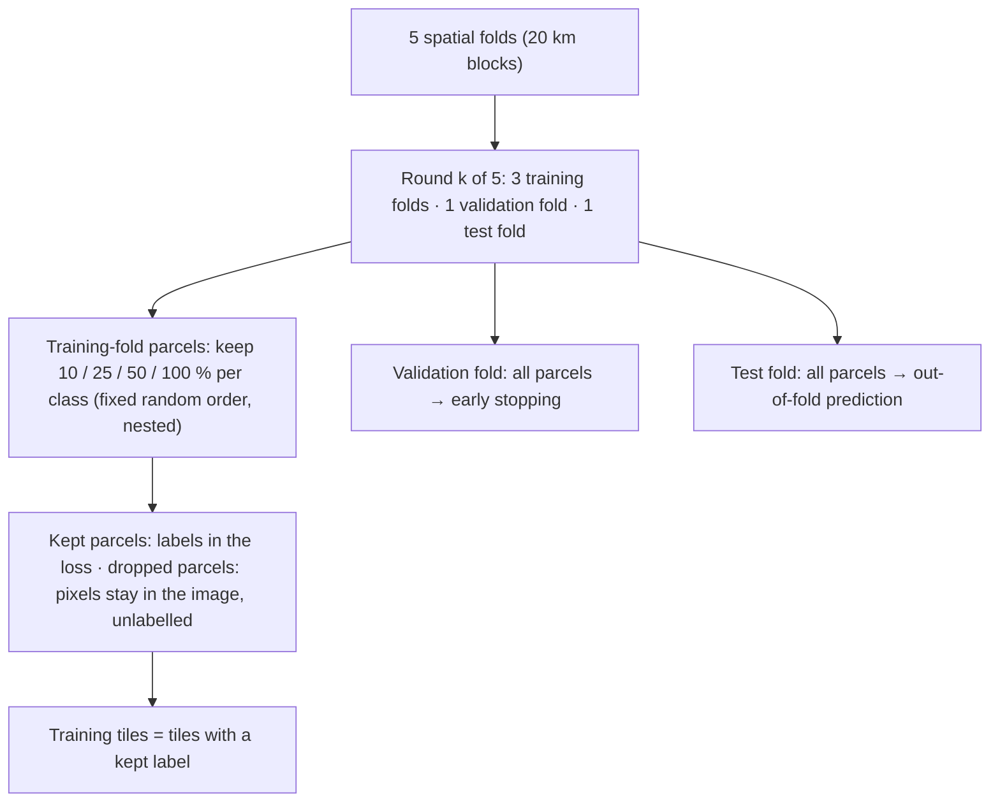

| Item | Rule |
| --- | --- |
| **Unit** | the parcel (all its sampled pixels together), the unit a field survey delivers |
| **Draw** | every parcel gets one fixed random number (seed 7); per class the training parcels with the smallest numbers are kept, so the class shares stay as in the full set and the 10% set lies inside the 25% set, and so on |
| **Same for all strategies** | the four strategies see the same parcels at each share |
| **Validation, test** | unchanged; every run predicts all 473,675 pixels once (out of fold), so all 16 runs are scored on the same pixels and can be compared pairwise |
| **Validation stays complete** | early stopping uses the full validation fold at every share. With only 10% of the labels a real project would also have less validation data, so the low-share scores are slightly optimistic for all four strategies alike |

Labelled training data per round (Morocco, mean of the five rounds; `label_subset.csv` of each run):

| Share | Irrigated parcels | Rainfed parcels | Irrigated pixels | Rainfed pixels | Training tiles |
| --- | --- | --- | --- | --- | --- |
| 10% | 455 | 72 | 25,307 | 3,530 | 436 |
| 25% | 1,137 | 180 | 62,117 | 8,212 | 740 |
| 50% | 2,274 | 359 | 126,876 | 16,195 | 987 |
| 100% | 4,547 | 718 | 251,930 | 32,275 | 1,232 |

At 10% only about 72 rainfed parcels per round remain: the low end of the curve shows how the strategies cope with a
few dozen examples of the minority class.

## Training

Identical for the four strategies except the learning rates above:

| Item | Choice |
| --- | --- |
| **Labels** | labelled pixels of the round's training folds (of the kept parcels); all other pixels ignored in the loss |
| **Loss** | class-weighted cross-entropy (weights from the kept training pixels) |
| **Optimiser** | AdamW, weight decay 10⁻⁴, batch 8 tiles, bfloat16 mixed precision |
| **Warm-up** | learning rate rises linearly over the first epoch, then constant (Goyal et al. 2017); avoids large first steps on the randomly initialised head and encoder |
| **Gradient clipping** | total gradient norm ≤ 1 |
| **Augmentation** | random flips and 90° rotations |
| **Early stopping** | macro-F1 of the validation pixels; patience 15, at most 60 epochs (E04: 8 and 50; longer here so that the curves show the overfitting phase) |
| **Seeds** | 3 per round (42, 1042, 2042), mean probability; the seed also sets the initial weights of the head, of the LoRA adapters and, from scratch, of the encoder |
| **Logged per epoch** | training loss, validation loss (the same weighted cross-entropy), validation macro-F1 and rainfed F1, seconds |

The frozen run at 100% repeats E04 Prithvi with a longer patience, warm-up and gradient clipping; its score should
lie close to E04's and is a check of the code.

Settings not tuned: the learning rates (10⁻⁴ is E04's; 10⁻⁵ for the encoder is the tenfold reduction; the LoRA
adapters use the head's 10⁻⁴, since they start at zero and are small), the LoRA rank, weight decay and the head.
They are the same for every share.

## Analysis

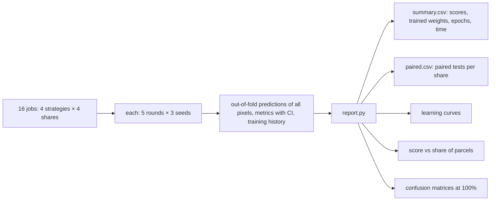

| Question | Evidence |
| --- | --- |
| 1. How the strategies behave | training and validation loss and validation macro-F1 per epoch (100% of the labels; mean over the 15 runs, band = range): speed of learning, gap between training and validation loss, epoch of the best model |
| 2. What fine-tuning costs and changes | trained weights, seconds per epoch, GPU hours; fine-tuned − frozen and LoRA − frozen at each share; confusion matrices (does it reduce the rainfed → irrigated confusion?) |
| 3. Whether fine-tuning wins | paired block-bootstrap differences on the same pixels at each share: **fine-tuned − frozen** (effect of training the encoder), **fine-tuned − scratch** (effect of the pretrained weights), frozen − scratch, **LoRA − frozen** (effect of the adapters), **fine-tuned − LoRA** (full against parameter-efficient fine-tuning), LoRA − scratch. Holm correction per metric over the 24 comparisons (6 pairs × 4 shares); a difference counts when its 95% CI excludes 0 and p<sub>Holm</sub> < 0.05 (as in E01–E04). Score against share of parcels with E03 U-TAE and E01 random forest at 100% as reference lines |

Headline metric: macro-F1 of irrigated and rainfed; rainfed F1, precision and recall also reported. E05 is compared
within itself; `05_compare_experiments.py` compares E01–E04 only.

## How to run

Script: [`experiments/E05_prithvi_strategies/run.py`](https://github.com/amanchry/irrimapping-geofm/blob/main/experiments/E05_prithvi_strategies/run.py)
(settings at the top; strategy and share from `EXPERIMENT_STRATEGY` and `EXPERIMENT_FRACTION`). One GPU job per
strategy and share; needs the Morocco tile store `outputs/morocco/data_training_prep/03_tiles_128px/agyear/tiles/`, the pixel
samples `outputs/morocco/data_training_prep/04_pixel_samples/` and the Prithvi weights in `checkpoints/prithvi/`.

Quick test first, one per strategy (60 tiles, 2 epochs, 1 seed; too short to learn the rainfed class, it reads the
epoch time and GPU memory):

```bash
for s in frozen lora finetune scratch; do sbatch --export=ALL,SCRIPT=experiments/E05_prithvi_strategies/run.py,EXPERIMENT_REGION=morocco,EXPERIMENT_STRATEGY=$s,EXPERIMENT_FRACTION=0.5,EXPERIMENT_QUICK_TEST=1 jobs/step_gpu.sbatch; done
```

Then the 16 runs:

```bash
for s in frozen lora finetune scratch; do for f in 0.1 0.25 0.5 1.0; do sbatch --time=72:00:00 --export=ALL,SCRIPT=experiments/E05_prithvi_strategies/run.py,EXPERIMENT_REGION=morocco,EXPERIMENT_STRATEGY=$s,EXPERIMENT_FRACTION=$f jobs/step_gpu.sbatch; done; done
```

After copying `results/` to the Mac (`report.py` uses whatever runs are finished):

```bash
python experiments/E05_prithvi_strategies/report.py
```

**Compute (estimate, to be replaced by the quick-test times).** Frozen Prithvi took about 75 s per epoch on the
Morocco tiles in the earlier runs. Fine-tuning and training from scratch also run the backward pass through the
300 M encoder: in local tests about 1.8 (fine-tuning) and 2.4 (from scratch) times the frozen time per epoch; LoRA
about 1.3 times. With the longer patience, roughly 140 GPU hours for the 16 jobs.

## Outputs

`experiments/E05_prithvi_strategies/results/morocco/<strategy>_p<share>/` (e.g. `finetune_p025/`, `lora_p100/`): the
E01 files plus `training_history.csv` (per epoch: training loss, validation loss, validation macro-F1 and rainfed F1,
seconds) and `label_subset.csv` (parcels, pixels and tiles kept per round, for shares below 100%). `report.py` writes
`results/morocco/summary.csv`, `results/morocco/paired.csv` and the figures `e05_curves.png`,
`e05_label_fraction.png` and `e05_confusion.png` in `docs/experiments/figures/`.

## Results

Morocco, 2023/24 and 2024/25 pooled: the same 473,675 out-of-fold pixels as E01–E04 at every share (the share only
reduces the training parcels; validation and test folds are complete). Tables from `report.py`
(`results/morocco/summary.csv`, `paired.csv`).

### Scores

Macro-F1 [95% CI] (rainfed F1 in brackets below):

| Strategy | Trained weights | 10% | 25% | 50% | 100% |
| --- | --- | --- | --- | --- | --- |
| From scratch | 306.4 M | 0.804 [0.684, 0.885]<br>(0.648) | 0.811 [0.679, 0.894]<br>(0.659) | 0.828 [0.729, 0.898]<br>(0.693) | 0.825 [0.712, 0.900]<br>(0.685) |
| Frozen | 2.5 M | 0.907 [0.846, 0.952]<br>(0.836) | **0.912** [0.854, 0.958]<br>(0.845) | 0.903 [0.836, 0.955]<br>(0.829) | **0.920** [0.867, 0.960]<br>(0.858) |
| LoRA | 8.0 M | 0.909 [0.850, 0.955]<br>(0.838) | 0.908 [0.854, 0.952]<br>(0.837) | **0.910** [0.855, 0.953]<br>(0.840) | 0.916 [0.864, 0.959]<br>(0.851) |
| Full fine-tuning | 306.4 M | **0.912** [0.855, 0.957]<br>(0.843) | 0.904 [0.847, 0.953]<br>(0.829) | 0.908 [0.855, 0.955]<br>(0.837) | 0.911 [0.852, 0.965]<br>(0.842) |
| Training parcels per round (irrigated + rainfed) | | 527 (455 + 72) | 1,316 | 2,632 | about 5,265 |

References at 100%: E01 random forest 0.894, E03 U-TAE 0.900, E04 Prithvi (frozen) 0.917. The frozen run at 100%
(0.920) matches E04 Prithvi (0.917), as expected for the same network with a longer patience: a check of the code.

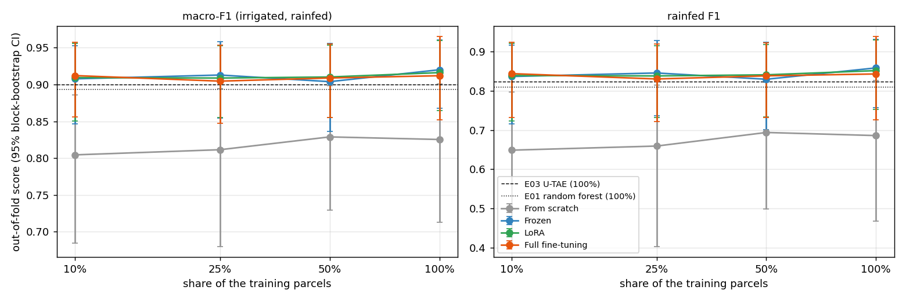

*Out-of-fold scores against the share of training parcels, with the E03 U-TAE and E01 random forest (100%) as
reference lines.*

### Paired tests

Paired differences at every share (same pixels and bootstrap draws), Holm correction per metric over the 24
comparisons (6 pairs × 4 shares):

| Comparison | 10% | 25% | 50% | 100% |
| --- | --- | --- | --- | --- |
| **Fine-tuned − scratch** (pretrained weights) | **+0.108** [+0.051, +0.197] | **+0.093** [+0.036, +0.197] | **+0.080** [+0.027, +0.151] | **+0.087** [+0.035, +0.171] |
| **Frozen − scratch** | **+0.103** [+0.043, +0.200] | **+0.102** [+0.034, +0.207] | +0.075 [+0.020, +0.151] (p<sub>Holm</sub> 0.16) | **+0.095** [+0.034, +0.188] |
| **LoRA − scratch** | **+0.105** [+0.049, +0.198] | **+0.097** [+0.033, +0.204] | **+0.081** [+0.030, +0.155] | **+0.091** [+0.032, +0.183] |
| Fine-tuned − frozen (training the encoder) | +0.004 [−0.012, +0.019] | −0.008 [−0.031, +0.015] | +0.005 [−0.027, +0.043] | −0.008 [−0.047, +0.016] |
| LoRA − frozen (adapters) | +0.002 [−0.006, +0.012] | −0.004 [−0.016, +0.008] | +0.006 [−0.012, +0.030] | −0.004 [−0.015, +0.006] |
| Fine-tuned − LoRA (full vs parameter-efficient) | +0.003 [−0.010, +0.017] | −0.004 [−0.024, +0.014] | −0.001 [−0.020, +0.017] | −0.004 [−0.041, +0.022] |

Bold: counts (CI excludes 0 and p<sub>Holm</sub> < 0.05). Rainfed F1 gives the same picture, with differences to
scratch of +0.14 to +0.20 and no difference among frozen, LoRA and fine-tuned (all |Δ| ≤ 0.015, p<sub>Holm</sub> = 1).

### Learning curves

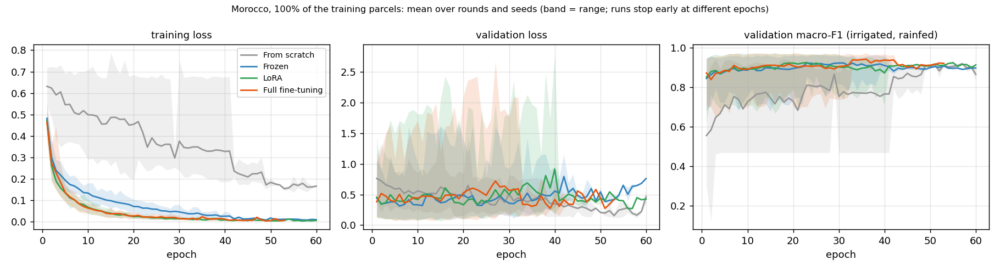

*100% of the labels; mean over the 5 rounds × 3 seeds, band = range.*

- **Pretrained (frozen, LoRA, fine-tuned):** validation macro-F1 is about 0.85 after the first epoch and close to
  its final value within 5–10 epochs. The training loss falls towards 0 while the validation loss stays flat and
  noisy (0.3–0.8): the head (and the adapters or encoder) fit the training pixels almost perfectly without further
  gain on new blocks. Fine-tuning and LoRA drive the training loss down faster than the frozen encoder, but do not
  reach a better validation score.
- **From scratch:** the training loss falls slowly (0.6 to 0.2 in 60 epochs), and the validation macro-F1 climbs from
  about 0.55 with a wide spread between runs; some runs stay near the all-irrigated solution (about 0.47) for many
  epochs. The pretrained weights give the network a useful starting point that 300 M weights trained on these labels
  do not find.

### Cost

| Strategy (100%) | Trained weights | Seconds per epoch | Mean epochs (best epoch) | GPU hours |
| --- | --- | --- | --- | --- |
| Frozen | 2.5 M | 54 | 36 (22) | 8.2 |
| LoRA | 8.0 M | 98 | 31 (17) | 12.9 |
| Full fine-tuning | 306.4 M | 81 | 30 (15) | 10.4 |
| From scratch | 306.4 M | 80 | 29 (16) | 9.6 |

All 16 runs: 112 GPU hours (frozen 24, LoRA 33, fine-tuning 28, scratch 27). LoRA trains 3% of the weights of full
fine-tuning but is slower per epoch here: the adapters add computation in every block and the backward pass still
runs through the whole encoder.

### Errors

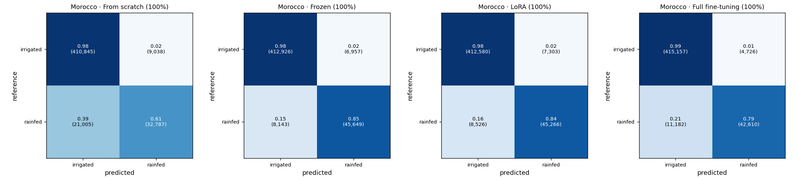

| Strategy (100%) | Rainfed precision | Rainfed recall | Rainfed recall 2024/25 | Rainfed recall Souss | Fold 0 macro-F1 |
| --- | --- | --- | --- | --- | --- |
| From scratch | 0.784 | 0.610 | 0.271 | 0.214 | 0.684 |
| Frozen | 0.868 | 0.849 | 0.794 | 0.782 | 0.861 |
| LoRA | 0.861 | 0.841 | 0.774 | 0.755 | 0.856 |
| Full fine-tuning | **0.900** | 0.792 | 0.700 | 0.392 | 0.761 |

- Fully fine-tuned Prithvi is the most conservative about rainfed: the highest rainfed precision (0.90) but a lower
  recall, and it loses most of the frozen encoder's gain in Souss (39% vs 78% of the rainfed pixels found) and in
  fold 0 (0.761 vs 0.861). Training all 300 M weights on rainfed parcels that come almost only from Doukkala seems to
  move the encoder towards Doukkala's rainfed fields; the frozen encoder keeps more general features.
- From scratch, 39% of the rainfed pixels are taken for irrigated, and only 27% of the rainfed pixels of 2024/25 are
  found.

### Interpretation

1. **How the strategies behave.** The three pretrained strategies learn within a few epochs and then overfit the
   training pixels without losing validation score; training from scratch is slow and unstable between seeds.
2. **Cost and effect of training the encoder.** LoRA (8 M weights) and full fine-tuning (306 M) cost 1.3–1.6 times
   the GPU time of the frozen encoder and change the score by less than 0.01 in either direction. Full fine-tuning
   shifts the errors (more precise, less complete for rainfed) and is weaker in the zone with few rainfed parcels.
3. **Whether fine-tuning wins: no, but pretraining does.** At every share, the pretrained network beats the same
   network trained from scratch by 0.08–0.11 macro-F1 (0.14–0.20 rainfed F1). Frozen, LoRA and full fine-tuning
   cannot be told apart. This differs from Tomotaki-Dawoud et al. (2025), where full fine-tuning clearly beat the
   frozen encoder; possible reasons are the 10 m Sentinel-2 input close to Prithvi's pretraining data (they upsampled
   30 m HLS to 0.5 m), the simpler two-class task, and the separate test fold and block bootstrap here.
4. **Fewer labels.** The pretrained strategies hardly change from 100% down to 10% of the training parcels (527
   parcels per round, of which 72 rainfed): 0.907–0.912 at 10% against 0.911–0.920 at 100%. With 10% of the
   parcels, the frozen encoder (0.907) still scores above the E01 random forest (0.894) and E03 U-TAE (0.900)
   trained on all parcels, though within their confidence intervals. From scratch, the network gains little from more parcels either (0.804 → 0.825): with at most 718
   rainfed parcels per round, 300 M weights cannot be trained from random initialisation.
5. **For the maps:** a frozen encoder with a light head is the cheapest strategy and as good as any; fine-tuning
   does not justify its cost on these labels.

## Limitations

- One encoder, and Morocco first (Utah follows). Prithvi is pretrained on 30 m HLS and here receives 10 m
  Sentinel-2, so its frozen features meet a different pixel size than in pretraining; fine-tuning may gain more for
  Prithvi than for an encoder pretrained on Sentinel-2 at 10 m.
- No search over learning rates per strategy, nor over the LoRA rank and adapted layers: a strategy may be favoured
  by settings that suit it better (Marti-Escofet et al. 2025 chose the learning rate of each method by a search).
- The validation fold is complete at every share (see above).
- Other parameter-efficient methods (adapters, prompt tuning) and two-stage linear probing then fine-tuning (LP-FT)
  are not compared ([RQ2 · Fine-tuning](../phase2_models/fine_tuning.md)).

## References

- Garnot, V. S. F. & Landrieu, L. (2020). Lightweight temporal self-attention for classifying satellite image time
  series (L-TAE). *AALTD*.
- Goyal, P. et al. (2017). Accurate, large minibatch SGD: training ImageNet in 1 hour. arXiv:1706.02677.
- Hu, E. J. et al. (2021). LoRA: low-rank adaptation of large language models. arXiv:2106.09685.
- Howard, J. & Ruder, S. (2018). Universal language model fine-tuning for text classification. *Proceedings of the
  56th Annual Meeting of the ACL*, 328–339.
- Kumar, A. et al. (2022). Fine-tuning can distort pretrained features and underperform out-of-distribution.
  *ICLR*. arXiv:2202.10054.
- Li, Y., Mao, H., Girshick, R. & He, K. (2022). Exploring plain vision transformer backbones for object detection
  (ViTDet). arXiv:2203.16527.
- Marti-Escofet, F., Blumenstiel, B., Scheibenreif, L., Fraccaro, P. & Schindler, K. (2025). Fine-tune smarter, not
  harder: parameter-efficient fine-tuning for geospatial foundation models. arXiv:2504.17397.
- Marsocci, V. et al. (2024). PANGAEA: a global and inclusive benchmark for geospatial foundation models.
  arXiv:2412.04204. Decoder code: [`pangaea/decoders/upernet.py`](https://github.com/VMarsocci/pangaea-bench/blob/main/pangaea/decoders/upernet.py).
- MMSegmentation: `Feature2Pyramid` neck ([`featurepyramid.py`](https://github.com/open-mmlab/mmsegmentation/blob/main/mmseg/models/necks/featurepyramid.py))
  and the UPerNet configurations for BEiT and MAE.
- Szwarcman, D. et al. (2024). Prithvi-EO-2.0: a versatile multi-temporal foundation model for Earth observation
  applications. arXiv:2412.02732.
- Tomotaki-Dawoud, K. et al. (2025). Fine-tuning the Prithvi foundation model for crop-type and health mapping in
  smallholder farms. *Procedia Computer Science* 270, 5055–5064. doi:10.1016/j.procs.2025.09.632.
- Xiao, T., Liu, Y., Zhou, B., Jiang, Y. & Sun, J. (2018). Unified perceptual parsing for scene understanding
  (UPerNet). *ECCV*.
