<!-- Report page of an experiment: created by make_report.py as docs/experiments/<name>/report.md -->
# E05 · PSE-TAE trained from scratch on Sentinel-2 pixel sets (neural baseline) — report

> **Answer.** In Morocco, yes. PSE-TAE trained from scratch on Sentinel-2 pixels scores 0.911, the highest macro-F1 of
> all RQ1 experiments, but it ties with the best S2 and GeoFM runs (all differences within ±0.01). In Utah, no.
> PSE-TAE (0.755) equals the S2 random forest, but it is significantly below Clay (−0.028 to −0.036). Utah is the only
> region where a frozen GeoFM beats every model built only on our labels.

## Key findings
- **Morocco: PSE-TAE 0.911, a tie at the top.** It is +0.003 above S2 + MLP (E03), +0.004 above Clay + L-TAE (E04)
  and +0.009 above Clay + SVM (E02), and every CI includes 0. Only against the S2 random forest is it clearly
  higher (+0.038, p = 0.07 in the experiment's own test).
- **Utah: PSE-TAE equals the S2 baseline, and the GeoFMs stay ahead.** PSE-TAE (0.755) vs S2 + RF 0.764: −0.009, not
  significant. Against the best GeoFMs on the same parcels: Clay + SVM −0.036 [−0.056, −0.015], Clay + L-TAE −0.028
  [−0.048, −0.009]. Both are significant, also after a Holm correction over the five comparisons.
- **PSE-TAE finds the most rainfed parcels.** It has the highest balanced accuracy in both regions (Morocco 0.942, Utah
  0.810). In Souss, it finds 90% of the rainfed parcels (best of all models), and in Utah's Sevier River 49% (others
  ≤ 37%). In Utah this comes at the cost of precision: in Bear River, rainfed recall is 0.84 but precision 0.58.
- **Label efficiency: no advantage from pixels.** At 10% of the training blocks, PSE-TAE reaches 0.812 in Morocco, level
  with the best inputs of E03/E04 (0.81–0.83). In Utah it reaches 0.664, below Clay and Prithvi with an MLP (0.69–0.70).
- **Seeds:** SD 0.010 (Morocco) and 0.008 (Utah), similar to the other neural heads.

<!-- AUTO:RESULTS:START -->
<!-- generated by experiments/make_report.py: do not edit between these markers -->

## Setup

| | |
| --- | --- |
| Question | Does a temporal deep model trained only on our labelled parcels match the frozen foundation models? |
| Research question | RQ1 |
| Regions | Morocco, Utah 2023/24 |
| Inputs | pixel sets (Sentinel-2) |
| Temporal aggregation | PSE-TAE temporal attention on the pixel sets (no foundation model) |
| Head | PSE-TAE trained from scratch, 3 seeds |
| Validation | 5 spatial folds (20 km blocks); per round 3 folds train, the next fold chooses the hyperparameters or stops training, 1 fold tests (PASTIS rotation) |
| Label efficiency | also trained on 10%, 25%, 50% of the training blocks, 3 block draws each (same draws in every experiment) |
| Parcels | 6,011 / 6,013 / 8,775 / 8,781 (inputs scored on the parcels common to all runs) |
| Uncertainty | 95% confidence interval (CI) from a block bootstrap (1,000 draws of whole 20 km blocks), the same draws for every run → paired differences; p-values Holm-adjusted |
| Changed from | E02: no pretrained encoder; PSE-TAE (Garnot et al. 2020) on 64 random pixels per parcel, Sentinel-2 only, 3 seeds |

## Morocco

### Macro-F1 of every input and head

Out-of-fold predictions of all 5 spatial folds; **bold** = best input for that head. Runs marked [E0x] come from an earlier experiment, on the same parcels and bootstrap draws.

??? info "How to read this table"

    **What:** one score per input (row) and classifier (column), between 0 and 1. Higher is better.

    **Macro-F1:** F1 is computed for each class separately (irrigated, rainfed) and the two are averaged. Rainfed
    parcels are the minority, so a model that labels everything "irrigated" still gets a high overall accuracy but a
    low macro-F1. That is why macro-F1 is the main metric.

    **How:** every parcel is predicted once, by the model that did *not* see its 20 km block in training (out-of-fold).
    All inputs are scored on the same parcels, so the numbers can be compared directly.

    **Read it as:** about 0.90 = very good; 0.75 = clear errors on the rainfed class; 0.50 = no better than guessing one class.

| Input | Logistic regression (LogReg) | Random forest (RF) | Support vector machine (SVM) | PSE-TAE (pixel-set encoder + temporal attention) |
| --- | ---: | ---: | ---: | ---: |
| S2 baseline [E02] | 0.869 | 0.873 | 0.900 | – |
| Clay v1.5 [E02] | 0.882 | **0.874** | **0.901** | – |
| Prithvi-EO-2.0 [E02] | 0.879 | 0.835 | 0.899 | – |
| TerraMind [E02] | **0.887** | 0.855 | 0.899 | – |
| AgriFM [E02] | 0.833 | 0.714 | 0.836 | – |
| PSE-TAE | – | – | – | **0.911** |

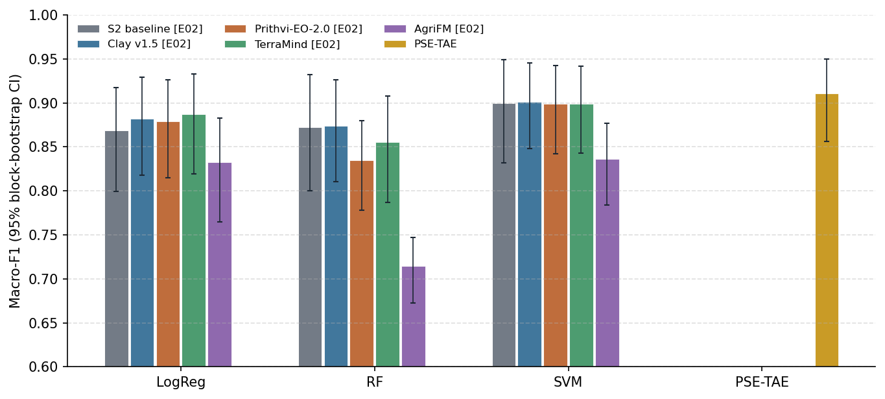

### Difference from the S2 baseline (headline heads)

Δ = input minus baseline with the same head (runs with their own model against the baseline's random forest), on the same parcels and the same bootstrap draws. **Better / worse** = the 95% confidence interval (CI) excludes 0 **and** the Holm-corrected p-value < 0.05.

??? info "How to read this table"

    **What:** each row compares one input with the baseline (the Sentinel feature classifier), using the same classifier.

    - **Difference in macro-F1 (Δ):** the input's score minus the baseline's. +0.013 means 0.013 higher than the baseline; −0.158
      means 0.158 lower.
    - **95% confidence interval (CI), e.g. [−0.021, +0.025]:** the range in which the true difference probably lies. It comes from
      resampling whole 20 km blocks 1,000 times (block bootstrap) and recomputing Δ each time.
        - The range **includes 0** (one end negative, the other positive): the data cannot tell which input is
          better.
        - The range is **entirely above 0**, e.g. [+0.011, +0.049]: the input is better.
        - The range is **entirely below 0**, e.g. [−0.215, −0.085]: the input is worse.
    - **p-value (Holm-corrected):** how likely a difference this large would be if the two inputs were really equal. Many pairs are
      tested at once, so each p-value is raised (Holm correction) to avoid false "wins" by chance. 1.000 = no evidence
      of a difference.
    - **Verdict:** "better" or "worse" only if the CI excludes 0 **and** the Holm-corrected p-value < 0.05. "Higher/lower, not
      significant after Holm" = the CI excludes 0, but the evidence does not survive the correction.

    **Why paired:** both inputs are scored on the same parcels and the same bootstrap draws, so a difference reflects
    the inputs, not which parcels happened to be drawn.

| Input | Classifier | Difference in macro-F1 (Δ) | 95% confidence interval (CI) | p-value (Holm-corrected) | Verdict |
| --- | --- | ---: | ---: | ---: | --- |
| PSE-TAE | PSE-TAE (pixel-set encoder + temporal attention) (vs baseline RF) | +0.038 | [-0.004, +0.082] | 0.074 | no clear difference |

### Per-class metrics (headline heads, 95% confidence interval)

??? info "How to read this table"

    **What:** the main metric and three others for the headline classifiers, each with its 95% confidence interval in brackets
    (the range the true value probably lies in).

    - **Macro-F1:** mean F1 of the two classes (main metric).
    - **F1 of the rainfed class:** how well the minority class is found. Precision and recall of "rainfed" are combined, so it is
      usually the lowest number and the most informative one.
    - **Balanced accuracy:** mean recall of the two classes. 0.5 = guessing.
    - **Overall accuracy:** share of all parcels labelled correctly. It looks high even for weak models, because most
      parcels are irrigated, so do not compare inputs on it alone.

    **Wide CIs** (e.g. 0.63–0.88) mean the score changes a lot from block to block, so small differences between
    rows are not meaningful.

| Input | Classifier | Macro-F1 | F1 of the rainfed class | Balanced accuracy | Overall accuracy |
| --- | --- | ---: | ---: | ---: | ---: |
| PSE-TAE | PSE-TAE (pixel-set encoder + temporal attention) | 0.911 [0.86–0.95] | 0.848 [0.74–0.92] | 0.942 [0.91–0.97] | 0.955 [0.93–0.98] |

### Label efficiency

Macro-F1 when trained on a share of the training blocks (validation and test folds complete); mean ± SD over the 3 block draws. Draws are nested (the 10% blocks are part of the 25% and 50% blocks) and identical in every experiment. Neural heads: every point is a single-seed result (the 100% point is the mean over its 3 seeds scored one by one).

??? info "How to read this table"

    **What:** how the score changes when the model is trained with fewer labelled parcels.

    - **Columns:** share of the training blocks used (10%, 25%, 50%; 100% = the main result). The row *training
      parcels per round* gives the actual number of parcels. Validation and test folds are always complete, so every
      column is tested on the same parcels.
    - **0.807 ± 0.091:** the mean over 3 different random draws of blocks ± their standard deviation. A large ± means
      the result depends on *which* blocks were drawn.
    - **Read it as:** an input that stays high at 10% needs fewer labels (it is "label-efficient"). If its curve rises
      steeply, it needs many labels.

    **Why whole blocks:** dropping single parcels would leave neighbours of every parcel in training. Dropping whole
    20 km blocks simulates having field data from fewer places.

| Input | Head | 10% | 25% | 50% | 100% |
| --- | --- | ---: | ---: | ---: | ---: |
| *training parcels per round* | | 590 | 1,266 | 2,530 | all |
| PSE-TAE | PSE-TAE (pixel-set encoder + temporal attention) | 0.812 ± 0.036 | 0.834 ± 0.009 | 0.859 ± 0.025 | 0.898 |

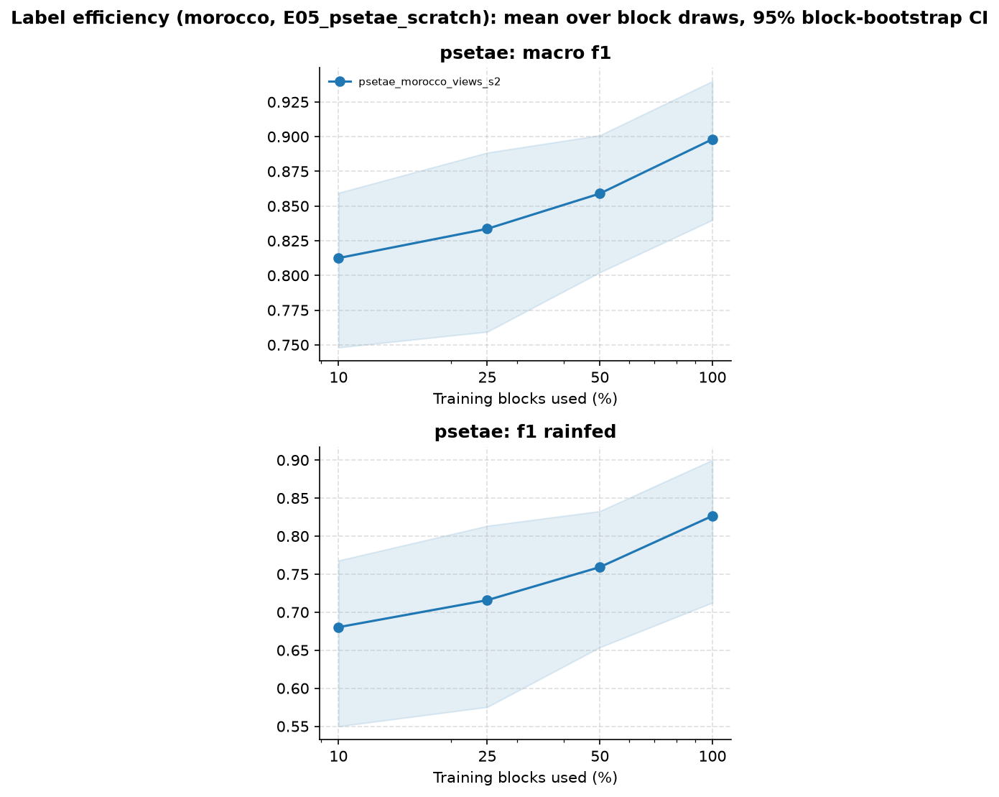

### Spread over seeds (neural heads)

Macro-F1 of each seed on its own; the result above is the mean probability of the seeds.

??? info "How to read this table"

    **What:** neural networks start from random weights, so each run (seed) gives a slightly different result. The
    table shows each seed on its own. Small differences between seeds (≈ 0.01) mean the result is stable, and a
    difference between inputs smaller than this spread is not meaningful.

| Input | Head | Macro-F1 per seed | Mean ± standard deviation (SD) |
| --- | --- | --- | ---: |
| PSE-TAE | PSE-TAE (pixel-set encoder + temporal attention) | 0.888, 0.907, 0.900 | 0.898 ± 0.010 |

### Training curves

Validation macro-F1 per epoch in each round (first seed); the best epoch is kept (early stopping).

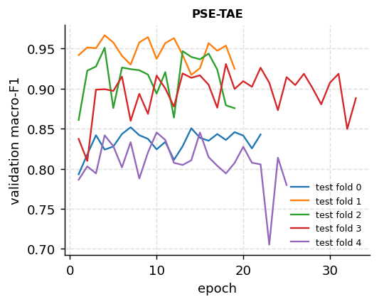

### Results by zone

Only the focus zone, where both classes are common (3,498 parcels, 1122 rainfed, 26 blocks): does the input separate the classes inside one region, or does it recognise the region? Script `05_breakdown_oof.py`.

??? info "How to read this table"

    **What:** the score inside the one zone where both classes are common (the focus zone), not over the whole region.

    **Why:** across a whole region, a model can score well just by learning *where* parcels are (one zone is almost all
    irrigated, another has the rainfed parcels). Inside one zone, location does not help, so this shows whether the
    input separates irrigated from rainfed fields themselves.

    **Difference from the baseline [95% confidence interval]:** as in the difference table. A CI that includes 0 means no clear difference.

| Input | Head | Macro-F1 [95% confidence interval] | Difference from the baseline [95% confidence interval] |
| --- | --- | ---: | ---: |
| PSE-TAE | PSE-TAE (pixel-set encoder + temporal attention) | 0.895 [0.83–0.94] | – |

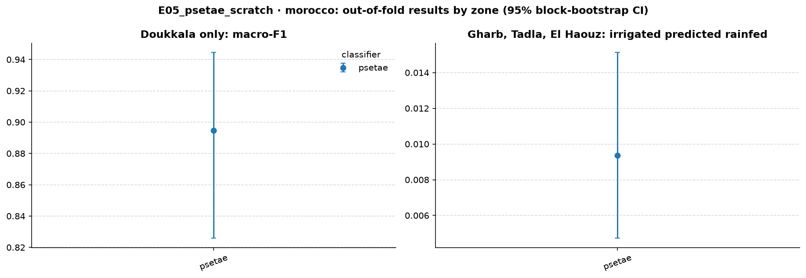

Tables per zone and season, patch purity and parcel area: `experiments/E05_psetae_scratch/results/morocco/breakdown/`.

### Macro-F1 per test fold

Each fold is a set of 20 km blocks, used once as the test fold. Rainfed test parcels per fold: fold 0: Doukkala 180, Souss 59; fold 1: Doukkala 237; fold 2: Doukkala 241; fold 3: Doukkala 234; fold 4: Doukkala 230.

??? info "How to read this table"

    **What:** the score on each test fold separately. Each fold is a different set of 20 km blocks, so the five numbers
    show how much the result changes from one part of the region to another.

    - **Mean ± standard deviation (SD):** average of the five folds and their spread. This can differ slightly from the main table, which
      scores all parcels at once.
    - **Read it as:** a low fold points to a part of the region where the model struggles. The fold description above
      lists where its rainfed parcels are. An input with a smaller SD is more consistent across space.

**PSE-TAE**

| Input | Fold 0 | Fold 1 | Fold 2 | Fold 3 | Fold 4 | Mean ± standard deviation (SD) |
| --- | ---: | ---: | ---: | ---: | ---: | ---: |
| PSE-TAE | 0.864 | 0.860 | 0.953 | 0.968 | 0.917 | 0.912 ± 0.050 |

**SVM**

| Input | Fold 0 | Fold 1 | Fold 2 | Fold 3 | Fold 4 | Mean ± standard deviation (SD) |
| --- | ---: | ---: | ---: | ---: | ---: | ---: |
| S2 baseline [E02] | 0.766 | 0.874 | 0.959 | 0.958 | 0.931 | 0.898 ± 0.081 |
| Clay v1.5 [E02] | 0.840 | 0.854 | 0.928 | 0.946 | 0.938 | 0.901 ± 0.050 |
| Prithvi-EO-2.0 [E02] | 0.869 | 0.832 | 0.940 | 0.940 | 0.920 | 0.900 ± 0.048 |
| TerraMind [E02] | 0.857 | 0.843 | 0.919 | 0.949 | 0.930 | 0.899 ± 0.047 |
| AgriFM [E02] | 0.806 | 0.766 | 0.861 | 0.880 | 0.868 | 0.836 ± 0.048 |

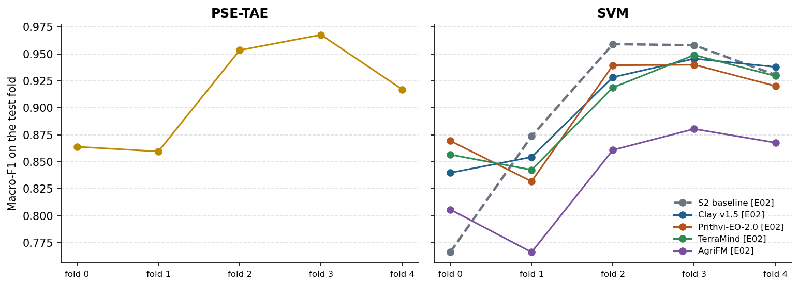

### Files

- Tables: [`experiments/E05_psetae_scratch/results/morocco/comparison/`](https://github.com/amanchry/irrimapping-geofm/tree/main/experiments/E05_psetae_scratch/results/morocco/comparison) (all metrics with CI, differences vs baseline, learning curves)
- Per run ([`experiments/E05_psetae_scratch/results/morocco/<run>/`](https://github.com/amanchry/irrimapping-geofm/tree/main/experiments/E05_psetae_scratch/results/morocco)): out-of-fold predictions, metrics per fold (and per seed), run settings and log
- Confusion matrices: –

## Utah 2023/24

### Macro-F1 of every input and head

Out-of-fold predictions of all 5 spatial folds; **bold** = best input for that head. Runs marked [E0x] come from an earlier experiment, on the same parcels and bootstrap draws.

??? info "How to read this table"

    **What:** one score per input (row) and classifier (column), between 0 and 1. Higher is better.

    **Macro-F1:** F1 is computed for each class separately (irrigated, rainfed) and the two are averaged. Rainfed
    parcels are the minority, so a model that labels everything "irrigated" still gets a high overall accuracy but a
    low macro-F1. That is why macro-F1 is the main metric.

    **How:** every parcel is predicted once, by the model that did *not* see its 20 km block in training (out-of-fold).
    All inputs are scored on the same parcels, so the numbers can be compared directly.

    **Read it as:** about 0.90 = very good; 0.75 = clear errors on the rainfed class; 0.50 = no better than guessing one class.

| Input | Logistic regression (LogReg) | Random forest (RF) | Support vector machine (SVM) | PSE-TAE (pixel-set encoder + temporal attention) |
| --- | ---: | ---: | ---: | ---: |
| S2 baseline [E02] | 0.722 | **0.764** | 0.728 | – |
| Clay v1.5 [E02] | **0.753** | 0.763 | **0.791** | – |
| Prithvi-EO-2.0 [E02] | 0.746 | 0.715 | 0.782 | – |
| TerraMind [E02] | 0.749 | 0.745 | 0.777 | – |
| AgriFM [E02] | 0.714 | 0.677 | 0.741 | – |
| PSE-TAE | – | – | – | **0.755** |

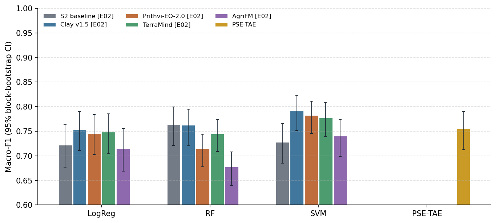

### Difference from the S2 baseline (headline heads)

Δ = input minus baseline with the same head (runs with their own model against the baseline's random forest), on the same parcels and the same bootstrap draws. **Better / worse** = the 95% confidence interval (CI) excludes 0 **and** the Holm-corrected p-value < 0.05.

??? info "How to read this table"

    **What:** each row compares one input with the baseline (the Sentinel feature classifier), using the same classifier.

    - **Difference in macro-F1 (Δ):** the input's score minus the baseline's. +0.013 means 0.013 higher than the baseline; −0.158
      means 0.158 lower.
    - **95% confidence interval (CI), e.g. [−0.021, +0.025]:** the range in which the true difference probably lies. It comes from
      resampling whole 20 km blocks 1,000 times (block bootstrap) and recomputing Δ each time.
        - The range **includes 0** (one end negative, the other positive): the data cannot tell which input is
          better.
        - The range is **entirely above 0**, e.g. [+0.011, +0.049]: the input is better.
        - The range is **entirely below 0**, e.g. [−0.215, −0.085]: the input is worse.
    - **p-value (Holm-corrected):** how likely a difference this large would be if the two inputs were really equal. Many pairs are
      tested at once, so each p-value is raised (Holm correction) to avoid false "wins" by chance. 1.000 = no evidence
      of a difference.
    - **Verdict:** "better" or "worse" only if the CI excludes 0 **and** the Holm-corrected p-value < 0.05. "Higher/lower, not
      significant after Holm" = the CI excludes 0, but the evidence does not survive the correction.

    **Why paired:** both inputs are scored on the same parcels and the same bootstrap draws, so a difference reflects
    the inputs, not which parcels happened to be drawn.

| Input | Classifier | Difference in macro-F1 (Δ) | 95% confidence interval (CI) | p-value (Holm-corrected) | Verdict |
| --- | --- | ---: | ---: | ---: | --- |
| PSE-TAE | PSE-TAE (pixel-set encoder + temporal attention) (vs baseline RF) | -0.009 | [-0.028, +0.013] | 0.372 | no clear difference |

### Per-class metrics (headline heads, 95% confidence interval)

??? info "How to read this table"

    **What:** the main metric and three others for the headline classifiers, each with its 95% confidence interval in brackets
    (the range the true value probably lies in).

    - **Macro-F1:** mean F1 of the two classes (main metric).
    - **F1 of the rainfed class:** how well the minority class is found. Precision and recall of "rainfed" are combined, so it is
      usually the lowest number and the most informative one.
    - **Balanced accuracy:** mean recall of the two classes. 0.5 = guessing.
    - **Overall accuracy:** share of all parcels labelled correctly. It looks high even for weak models, because most
      parcels are irrigated, so do not compare inputs on it alone.

    **Wide CIs** (e.g. 0.63–0.88) mean the score changes a lot from block to block, so small differences between
    rows are not meaningful.

| Input | Classifier | Macro-F1 | F1 of the rainfed class | Balanced accuracy | Overall accuracy |
| --- | --- | ---: | ---: | ---: | ---: |
| PSE-TAE | PSE-TAE (pixel-set encoder + temporal attention) | 0.755 [0.71–0.79] | 0.614 [0.53–0.68] | 0.810 [0.78–0.83] | 0.837 [0.81–0.86] |

### Label efficiency

Macro-F1 when trained on a share of the training blocks (validation and test folds complete); mean ± SD over the 3 block draws. Draws are nested (the 10% blocks are part of the 25% and 50% blocks) and identical in every experiment. Neural heads: every point is a single-seed result (the 100% point is the mean over its 3 seeds scored one by one).

??? info "How to read this table"

    **What:** how the score changes when the model is trained with fewer labelled parcels.

    - **Columns:** share of the training blocks used (10%, 25%, 50%; 100% = the main result). The row *training
      parcels per round* gives the actual number of parcels. Validation and test folds are always complete, so every
      column is tested on the same parcels.
    - **0.807 ± 0.091:** the mean over 3 different random draws of blocks ± their standard deviation. A large ± means
      the result depends on *which* blocks were drawn.
    - **Read it as:** an input that stays high at 10% needs fewer labels (it is "label-efficient"). If its curve rises
      steeply, it needs many labels.

    **Why whole blocks:** dropping single parcels would leave neighbours of every parcel in training. Dropping whole
    20 km blocks simulates having field data from fewer places.

| Input | Head | 10% | 25% | 50% | 100% |
| --- | --- | ---: | ---: | ---: | ---: |
| *training parcels per round* | | 399 | 862 | 1,732 | all |
| PSE-TAE | PSE-TAE (pixel-set encoder + temporal attention) | 0.664 ± 0.022 | 0.709 ± 0.007 | 0.714 ± 0.002 | 0.736 |

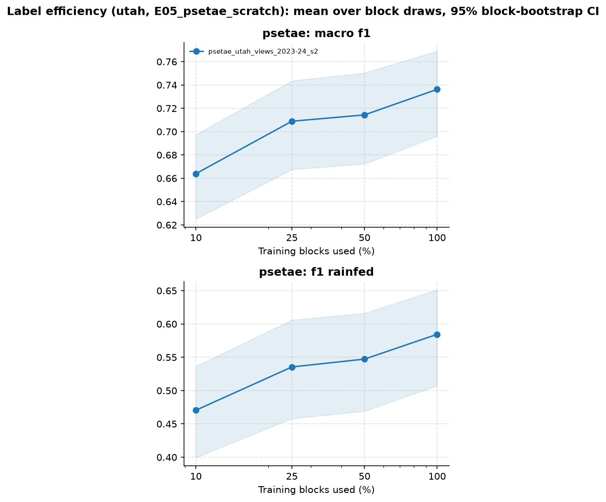

### Spread over seeds (neural heads)

Macro-F1 of each seed on its own; the result above is the mean probability of the seeds.

??? info "How to read this table"

    **What:** neural networks start from random weights, so each run (seed) gives a slightly different result. The
    table shows each seed on its own. Small differences between seeds (≈ 0.01) mean the result is stable, and a
    difference between inputs smaller than this spread is not meaningful.

| Input | Head | Macro-F1 per seed | Mean ± standard deviation (SD) |
| --- | --- | --- | ---: |
| PSE-TAE | PSE-TAE (pixel-set encoder + temporal attention) | 0.743, 0.737, 0.728 | 0.736 ± 0.008 |

### Training curves

Validation macro-F1 per epoch in each round (first seed); the best epoch is kept (early stopping).

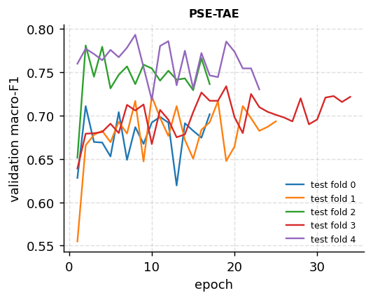

### Results by zone

Only the focus zone, where both classes are common (2,015 parcels, 595 rainfed, 40 blocks): does the input separate the classes inside one region, or does it recognise the region? Script `05_breakdown_oof.py`.

??? info "How to read this table"

    **What:** the score inside the one zone where both classes are common (the focus zone), not over the whole region.

    **Why:** across a whole region, a model can score well just by learning *where* parcels are (one zone is almost all
    irrigated, another has the rainfed parcels). Inside one zone, location does not help, so this shows whether the
    input separates irrigated from rainfed fields themselves.

    **Difference from the baseline [95% confidence interval]:** as in the difference table. A CI that includes 0 means no clear difference.

| Input | Head | Macro-F1 [95% confidence interval] | Difference from the baseline [95% confidence interval] |
| --- | --- | ---: | ---: |
| PSE-TAE | PSE-TAE (pixel-set encoder + temporal attention) | 0.752 [0.69–0.80] | – |

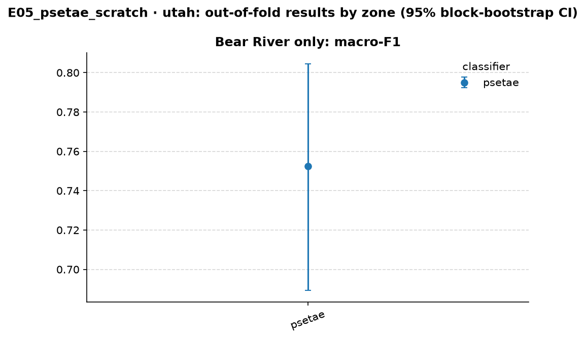

Tables per zone and season, patch purity and parcel area: `experiments/E05_psetae_scratch/results/utah/breakdown/`.

### Macro-F1 per test fold

Each fold is a set of 20 km blocks, used once as the test fold. Rainfed test parcels per fold: fold 0: Bear River 105, Southeast Colorado River 30, Sevier River 29, Weber River 14; fold 1: Bear River 144, Southeast Colorado River 29, Sevier River 12; fold 2: Bear River 118, Sevier River 28, Cedar/Beaver 10; fold 3: Bear River 116, Sevier River 54, Uintah 10, Southeast Colorado River 10; fold 4: Bear River 112, West Desert 26, Southeast Colorado River 22, Sevier River 12, Utah Lake 10.

??? info "How to read this table"

    **What:** the score on each test fold separately. Each fold is a different set of 20 km blocks, so the five numbers
    show how much the result changes from one part of the region to another.

    - **Mean ± standard deviation (SD):** average of the five folds and their spread. This can differ slightly from the main table, which
      scores all parcels at once.
    - **Read it as:** a low fold points to a part of the region where the model struggles. The fold description above
      lists where its rainfed parcels are. An input with a smaller SD is more consistent across space.

**PSE-TAE**

| Input | Fold 0 | Fold 1 | Fold 2 | Fold 3 | Fold 4 | Mean ± standard deviation (SD) |
| --- | ---: | ---: | ---: | ---: | ---: | ---: |
| PSE-TAE | 0.793 | 0.727 | 0.733 | 0.812 | 0.721 | 0.757 ± 0.042 |

**SVM**

| Input | Fold 0 | Fold 1 | Fold 2 | Fold 3 | Fold 4 | Mean ± standard deviation (SD) |
| --- | ---: | ---: | ---: | ---: | ---: | ---: |
| S2 baseline [E02] | 0.761 | 0.701 | 0.727 | 0.747 | 0.705 | 0.728 ± 0.026 |
| Clay v1.5 [E02] | 0.822 | 0.742 | 0.805 | 0.820 | 0.773 | 0.792 ± 0.034 |
| Prithvi-EO-2.0 [E02] | 0.811 | 0.736 | 0.811 | 0.791 | 0.773 | 0.784 ± 0.031 |
| TerraMind [E02] | 0.805 | 0.715 | 0.787 | 0.814 | 0.775 | 0.779 ± 0.039 |
| AgriFM [E02] | 0.765 | 0.701 | 0.768 | 0.765 | 0.710 | 0.742 ± 0.033 |

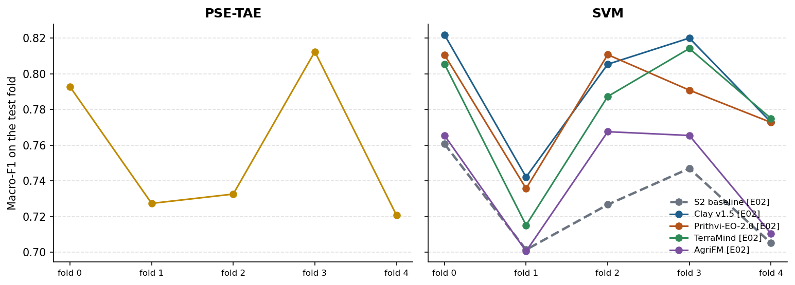

### Files

- Tables: [`experiments/E05_psetae_scratch/results/utah/comparison/`](https://github.com/amanchry/irrimapping-geofm/tree/main/experiments/E05_psetae_scratch/results/utah/comparison) (all metrics with CI, differences vs baseline, learning curves)
- Per run ([`experiments/E05_psetae_scratch/results/utah/<run>/`](https://github.com/amanchry/irrimapping-geofm/tree/main/experiments/E05_psetae_scratch/results/utah)): out-of-fold predictions, metrics per fold (and per seed), run settings and log
- Confusion matrices: –

## Code and settings

- Settings: [`experiments/E05_psetae_scratch/config.yaml`](https://github.com/amanchry/irrimapping-geofm/blob/main/experiments/E05_psetae_scratch/config.yaml)
- Code version: `da70acb (with uncommitted changes)`, run 2026-11-13 13:57 – 2026-11-13 13:57

<!-- AUTO:RESULTS:END -->

## Interpretation

**PSE-TAE vs the best of E02–E04.** The tables above test PSE-TAE only against the S2 random forest, the baseline
classifier of the comparison script. For RQ1, the relevant question is how it compares with the best model of each
earlier experiment. The paired differences below are computed in the same way: out-of-fold predictions on the parcels
common to all runs, and 1,000 block-bootstrap draws of whole 20 km blocks.

| Region | PSE-TAE minus … | Difference in macro-F1 (Δ) | 95% confidence interval (CI) | p-value |
| --- | --- | ---: | ---: | ---: |
| Morocco | S2 + MLP (E03) | +0.003 | [−0.006, +0.011] | 0.56 |
| Morocco | S2 + SVM (E02) | +0.011 | [−0.011, +0.044] | 0.44 |
| Morocco | Clay + L-TAE (E04) | +0.004 | [−0.007, +0.015] | 0.43 |
| Morocco | Clay + SVM (E02) | +0.009 | [−0.010, +0.026] | 0.34 |
| Utah | S2 + RF (E02) | −0.009 | [−0.028, +0.012] | 0.39 |
| Utah | S2 + L-TAE (E04) | +0.012 | [−0.002, +0.026] | 0.09 |
| Utah | Clay + SVM (E02) | **−0.036** | [−0.056, −0.015] | < 0.001 |
| Utah | Clay + L-TAE (E04) | **−0.028** | [−0.048, −0.009] | 0.008 |
| Utah | Prithvi + SVM (E02) | −0.027 | [−0.051, −0.003] | 0.028 (0.08 after Holm) |

**Morocco: everything good ends at about 0.90–0.91.** A temporal model trained from scratch on 64 pixels per parcel, a
flexible head on 180 hand-crafted S2 features, and the frozen GeoFMs with SVM, MLP or L-TAE all reach the same level.
The task in Morocco is limited by the labels and the region rather than by the model. The rainfed parcels are
concentrated in Doukkala, and their seasonal signal (winter crop, no summer crop) is clear in plain Sentinel-2
reflectance. Pretraining has nothing left to add.

**Utah: the only place where pretraining helps.** PSE-TAE does as well as the S2 random forest, so a stronger
supervised model on raw pixels does not close the gap. Clay is still 0.03–0.04 ahead, with CIs that exclude 0. In
Utah, rainfed and irrigated fields share crops, are spread over many zones and have less training data (≈ 6,000
parcels). There, the GeoFM embeddings seem to carry information about the field and its surroundings that 400–1,700
training parcels per round cannot teach a model from scratch. The label-efficiency curves point the same way: at 10%
of the training blocks, Clay and Prithvi with an MLP are 0.03 above PSE-TAE.

**What PSE-TAE does differently.** It looks at individual pixels (a random set of 64 per parcel), not at the parcel
mean or an 80–160 m patch. It is the most sensitive model for the rainfed class: highest balanced accuracy in both
regions, best rainfed recall in Souss (0.90) and Sevier River (0.49). In Utah it overpredicts rainfed (Bear River:
precision 0.58), which lowers its macro-F1. A threshold other than 0.5, or the class weights, could trade some of
this recall for precision. That is not tuned here, to keep every model on the same rule.

**RQ1 after E02–E05.**

| | Best model built only on our labels | Best frozen GeoFM | Difference |
| --- | --- | --- | --- |
| Morocco | 0.911 (PSE-TAE, E05) | 0.906 (Clay + L-TAE, E04) | none (+0.004, CI includes 0) |
| Utah | 0.764 (S2 + RF, E02) | 0.791 (Clay + SVM, E02) | GeoFM ahead by ≈ 0.03 (vs PSE-TAE: +0.036, significant) |

Frozen GeoFM embeddings are not better than well-built supervised models in a region with clear class signals and a
concentrated rainfed area (Morocco). They are better, by a small but significant margin, in a region with mixed
crops and spread-out rainfed fields (Utah). Clay is the best GeoFM in both regions.

**Training behaviour: would other settings change the result?** The figure shows the training loss and the
validation macro-F1 of every epoch, for all 5 rounds × 3 seeds of the main runs (from each run's
`training_history.csv`).

<figure markdown="span">
  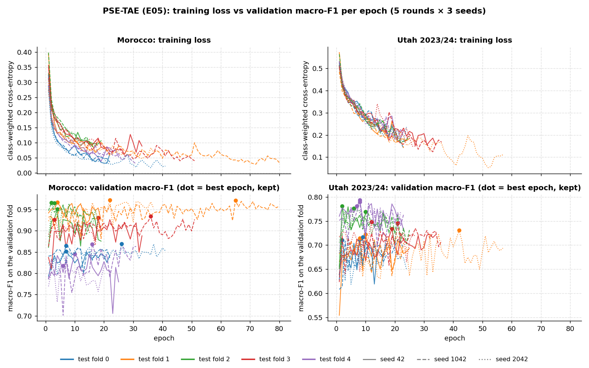
  <figcaption>Training loss (top) and validation macro-F1 (bottom) per epoch; colour = round (test fold), line style =
  seed, dot = best epoch (kept by early stopping).</figcaption>
</figure>

| Median over the 15 trainings | Morocco | Utah |
| --- | ---: | ---: |
| Training loss: epoch 1 → best epoch → last epoch | 0.32 → 0.09 → 0.06 | 0.51 → 0.29 → 0.18 |
| Best epoch / last epoch (limit 100) | 7 / 22 | 8 / 23 |
| Typical change per epoch: loss / validation F1 | 0.009 / 0.014 | 0.020 / 0.018 |

- **The training loss falls smoothly** in every round and seed, so the learning rate is not too high. A too-high rate
  would make the loss itself jump or stall.
- **Validation F1 stops improving after about 7–8 epochs while the loss keeps falling** (by another third). This is
  overfitting to the training blocks, and early stopping already keeps the best epoch. More epochs cannot help: no
  run came close to the limit of 100.
- **The epoch-to-epoch zigzag in validation F1 is evaluation noise:** small validation folds and the random draw of 64
  pixels per parcel. It does not come from unstable training.
- **The test fold matters more than the epoch.** Each round stays in its own band (Morocco: fold 1 ≈ 0.95, fold 4 ≈
  0.80–0.85; Utah: fold 4 ≈ 0.78, fold 0 ≈ 0.68) for every seed. Some 20 km blocks are harder, whatever the
  training.
- **In Utah, generalisation is the limit, not optimisation:** the loss is still 0.29 when validation F1 peaks.

A lower learning rate or more epochs would therefore not change the result. More regularisation targets the
overfitting after epoch 8, and a different class weight or decision threshold targets the rainfed over-prediction in
Utah. Each would probably gain about 0.01–0.02, less than the 0.03–0.04 gap to Clay. Testing them is a sensitivity
check of the baseline, not part of E05.

## Caveats
- The best-vs-best table is an extra check for this report, computed with the same block-bootstrap method but outside
  the comparison script. It uses its own bootstrap draws, and Holm applies only where stated. The experiment's own
  Holm family has one comparison per region (PSE-TAE vs the S2 random forest).
- PSE-TAE uses the settings of the original paper (64 pixels, PSE and TAE dimensions), Sentinel-2 bands only (D14), and
  no tuning. The validation fold only stops training.
- It sees pixels inside the parcel (no edge pixels), while the GeoFMs see 80–160 m patches that can include
  neighbouring land. The models therefore do not see exactly the same area.
- The main result averages 3 seeds; the label-efficiency points are single seeds.
- `results/psetae_agyear_s2s1/` is an older Sentinel-1/2 run from before D14 and is not part of this experiment.

## Next steps
- **RQ1 answer:** write the RQ1 summary from the best-vs-best comparison above, and add that comparison to the report
  generator so it is reproducible.
- **Ablations (A1, A2, A4 of the experiment plan):** check the Utah GeoFM advantage under other settings, e.g. chip and
  patch size, and Sentinel-1 for TerraMind.
- **RQ2:** fine-tuning (LoRA) of Clay, the best frozen GeoFM in both regions.
