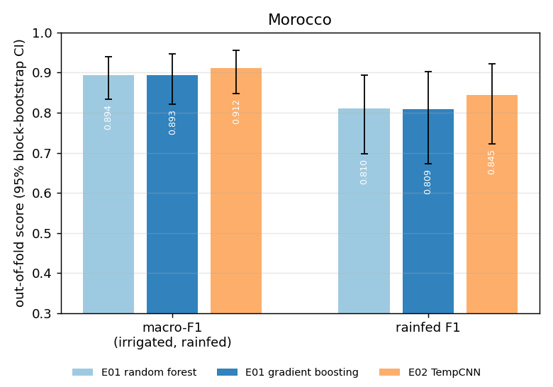
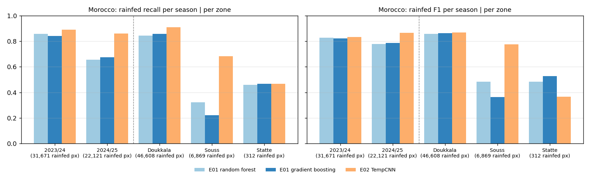

# Comparison of the experiments

!!! info "Status: Morocco E01 and E02 done; E03 and E04 running (Utah later)"
    This page holds all runs of E01–E04 side by side as they finish. Each experiment page reports only
    its own runs; E05 (Prithvi frozen / LoRA / fine-tuned / from scratch) is compared within itself on its
    [own page](E05_prithvi_strategies.md).

## What will be compared

All runs of a region are scored on the **same out-of-fold pixels**: Morocco 2023/24 and 2024/25 pooled, 473,675
labelled pixels of 8,775 surveyed parcels, two classes (irrigated, rainfed).

| Run | Experiment | Model |
| --- | --- | --- |
| E01 random forest | [E01](E01_s2_pixel_baseline.md) | pixel time series, random forest (**reference**) |
| E01 gradient boosting | [E01](E01_s2_pixel_baseline.md) | pixel time series, histogram gradient boosting |
| E02 TempCNN | [E02](E02_temporal_nn.md) | pixel time series, temporal CNN |
| E03 U-TAE | [E03](E03_utae.md) | whole tiles, trained from scratch (**reference** for E04) |
| E04 Prithvi, Clay, TerraMind, AgriFM, Presto, TESSERA | [E04](E04_frozen_geofm.md) | whole tiles, frozen foundation model + L-TAE + UPerNet |

## Planned tables and figures

| Content | How |
| --- | --- |
| **Scores** | macro-F1 (irrigated, rainfed; headline), rainfed F1, precision and recall, with 95% block-bootstrap CI |
| **Paired tests against the E01 random forest** | does a model beat the pixel baseline? Difference on the same pixels, 95% CI, Holm-corrected p |
| **Paired tests against E03 U-TAE** | does pretraining add anything beyond the spatial context of the tile? |
| **Figures** | scores of all runs with CIs; confusion matrices of the random forest, U-TAE and the best foundation model |

A difference counts when its 95% CI excludes 0 and the Holm-corrected p < 0.05 ([evaluation protocol](../phase2_models/evaluation.md)).
Tables and tests: `pixelwise_run/05_compare_experiments.py` (`experiments/comparison/<region>/`); figures:
`experiments/report_figures.py` (`docs/experiments/figures/`).

## Results

### Morocco (finished runs so far)

| Run | Macro-F1 [95% CI] | Rainfed F1 [95% CI] | Δ macro-F1 vs E01 random forest [95% CI] | Holm-adjusted p |
| --- | --- | --- | --- | --- |
| E01 random forest (reference) | 0.894 [0.834, 0.940] | 0.810 [0.697, 0.894] | – | – |
| E01 gradient boosting | 0.893 [0.822, 0.946] | 0.809 [0.673, 0.903] | −0.000 [−0.017, +0.014] | 0.98 |
| E02 TempCNN | **0.912** [0.848, 0.955] | **0.845** [0.722, 0.922] | +0.018 [−0.017, +0.053] | 0.65 |
| E03 U-TAE | running | | | |
| E04 frozen GeoFMs (6 encoders) | running | | | |

No difference counts so far: every CI of the paired differences includes 0. The Holm-adjusted p-values are
provisional and will be recomputed when E03 and E04 join the family.

**So far.** The pixel classifiers reach macro-F1 0.89–0.91. The errors are mostly rainfed pixels taken for
irrigated, in the wetter year 2024/25 and in Souss; TempCNN finds more of them than the tree ensembles. Rainfed
parcels lie in three of the six zones, mostly in Doukkala, so the rainfed scores, and their wide confidence
intervals, depend on few spatial blocks. Details: [E01](E01_s2_pixel_baseline.md#results),
[E02](E02_temporal_nn.md#results).
