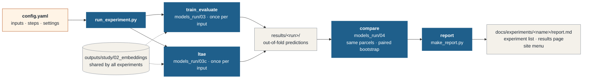
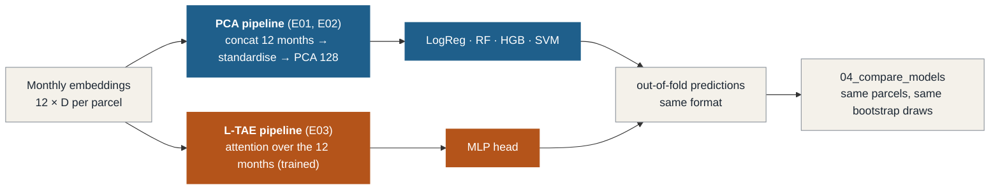

# Experiments

Every result in the thesis comes from an **experiment**: one folder that says what was asked, which settings were
used, and what came out. An experiment can be run again at any time from its config file and gives the same
result.

## Experiment list

<!-- AUTO:INDEX:START -->
<!-- generated by experiments/make_report.py: do not edit between these markers -->

| ID | Experiment | RQ | Status | Headline result (macro-F1) | Report |
| --- | --- | --- | --- | --- | --- |
| **E01** | [Frozen GeoFMs + PCA vs the S1/S2 baseline (nested spatial CV)](E01_frozen_pca_nested/index.md) | RQ1 | ✅ done | best Clay v1.5 + SVM 0.910; best baseline SVM 0.906; 0 of 16 input-classifier pairs better, 2 worse than the baseline (Holm) | [report](E01_frozen_pca_nested/report.md) |
| **E02** | [Frozen GeoFMs + PCA vs the S1/S2 baseline (PASTIS validation)](E02_frozen_pca_pastis/index.md) | RQ1 | 🟦 ready to run | – | – |
| **E03** | [Frozen GeoFMs + L-TAE temporal aggregation (PASTIS validation)](E03_frozen_ltae_pastis/index.md) | RQ1 | 📝 planned | – | – |

<!-- AUTO:INDEX:END -->

The table is refreshed by `make_report.py`. Status: 📝 planned → 🟦 ready to run → ⏳ running → ✅ done
(⏸ parked = kept for a later phase).

---

## Where the files of an experiment live

An experiment has two halves: what is **run** lives in `experiments/`, what is **read** lives here in the
documentation.

```
experiments/E02_frozen_pca_pastis/          (run)
├── config.yaml        ALL settings of the experiment (the only file you edit to change a run)
└── results/           written by the scripts
    ├── run_info.json      config, code version (git commit), start and end time of every run
    ├── <run>/             one folder per input: out-of-fold predictions, metrics, log
    └── comparison/        all inputs on the same parcels, differences vs the baseline

docs/experiments/E02_frozen_pca_pastis/     (read: this website)
├── index.md           setup: question, why, what changes vs the previous experiment, how to run
├── report.md          answer first, then tables and figures (generated) and interpretation (by hand)
└── figures/           figures of the report (written by make_report.py)

experiments/run_experiment.py   runs one experiment from its config: training, comparison, report
experiments/make_report.py      writes tables + figures into report.md, this page, the results page and the menu
experiments/_template/          config.yaml, index.md and report.md to start a new experiment
```

## How an experiment runs



- The **scripts in `models_run/` are not edited for an experiment.** Each has its settings at the top; in
  experiment mode the values in `config.yaml` replace them (same names). A misspelt setting stops the run with an
  error, so a config can never be silently ignored.
- **Embeddings are shared.** They depend only on the dataset and the model, so `models_run/02a–02d` are run once
  and every experiment reads `outputs/study/02_embeddings/`.
- **Runs that are finished are skipped**, so an interrupted experiment continues where it stopped.
  `RERUN = True` (or deleting `results/`) repeats it.
- `results/run_info.json` keeps the config, the git commit and the dates of every run, so a result can always be
  traced back to the code that produced it.

## Two pipelines for the monthly embeddings

The foundation models give one embedding per month (Clay, Prithvi, TerraMind) or one per year (AgriFM). How the
months are combined is the one step that differs between the two pipelines; everything before and after is shared.



Because both pipelines write the same `oof_predictions.csv`, the comparison and the report need no change. E03 also
lists the E02 runs under `compare: EXTRA_RUNS`, so PCA and L-TAE are compared on the same parcels and the same
bootstrap draws. Details: [evaluation protocol §5](../research/protocol.md#5-temporal-aggregation-two-pipelines).

## Start a new experiment

1. Copy `experiments/_template/config.yaml` to `experiments/E<NN>_<short_name>/config.yaml` (next free number; the
   name says what varies) and `experiments/_template/README.md` to `docs/experiments/E<NN>_<short_name>/index.md`.
2. Edit `config.yaml`: title, short title (menu), question, `changes_from`, inputs, steps and only the settings that
   differ from the script defaults.
3. Write the setup page `index.md`: question, why, what changes (a small table against the experiment it builds on).
4. Set `EXPERIMENT = "E<NN>_<short_name>"` in `run_experiment.py` and run it. Use `QUICK_TEST: true` first to check
   that everything runs, then set it back to `false` and delete `results/`. The report page and the menu entry are
   created automatically.
5. When it has finished: write the **Answer**, **Key findings**, **Interpretation**, **Caveats** and **Next steps**
   in `report.md` (the tables and figures are already there), set `status: done` and a one-line `answer:` in the
   config, run `make_report.py` once more, and add an entry to the [progress log](../progress.md).

A new **pipeline variant** (another model or aggregation) gets its own script in `models_run/` with settings at the
top, the experiment-mode block, and the output format of `03_train_evaluate.py`; then add it to `SCRIPTS` in
`run_experiment.py`.
