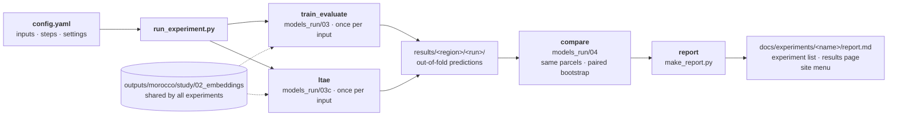
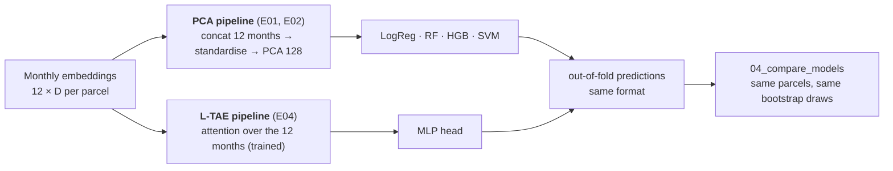

# Experiments

Every reported result is produced by an **experiment**: a self-contained folder that records the research question,
the complete configuration and the outputs. Each experiment can be re-run from its configuration file and
reproduces the reported result.

## Experiment list

<!-- AUTO:INDEX:START -->
<!-- generated by experiments/make_report.py: do not edit between these markers -->

| ID | Experiment | RQ | Status | Headline result (macro-F1) | Report |
| --- | --- | --- | --- | --- | --- |
| **E01** | [Frozen GeoFMs + PCA + classical classifiers (nested spatial CV)](E01_frozen_pca_nested/index.md) | RQ1 | ✅ done | best Clay v1.5 + SVM 0.910; best baseline SVM 0.906; 0 of 16 pairs better, 2 worse than the baseline (Holm) | [report](E01_frozen_pca_nested/report.md) |
| **E02** | [Frozen GeoFMs + PCA + classical classifiers](E02_frozen_pca/index.md) | RQ1 | ✅ done | Morocco: best Clay v1.5 + SVM 0.901; best baseline SVM 0.900; 0 of 12 pairs better, 2 worse than the baseline (Holm) · Utah 2023/24: best Clay v1.5 + SVM 0.791; best baseline RF 0.764; 4 of 12 pairs better, 2 worse than the baseline (Holm) | [report](E02_frozen_pca/report.md) |
| **E03** | [Frozen GeoFMs + PCA + MLP head](E03_frozen_pca_mlp/index.md) | RQ1 | ✅ done | Morocco: best S2 baseline (MLP) + MLP 0.908; best baseline MLP 0.908; 0 of 4 pairs better, 1 worse than the baseline (Holm) · Utah 2023/24: best TerraMind (MLP) + MLP 0.785; best baseline MLP 0.739; 3 of 4 pairs better, 0 worse than the baseline (Holm) | [report](E03_frozen_pca_mlp/report.md) |
| **E04** | [Frozen GeoFMs + L-TAE temporal aggregation + MLP head](E04_frozen_ltae/index.md) | RQ1 | ✅ done | Morocco: best Clay v1.5 (L-TAE) + L-TAE 0.906; best baseline L-TAE 0.905; 0 of 3 pairs better, 0 worse than the baseline (Holm) · Utah 2023/24: best Clay v1.5 (L-TAE) + L-TAE 0.784; best baseline L-TAE 0.743; 2 of 3 pairs better, 0 worse than the baseline (Holm) | [report](E04_frozen_ltae/report.md) |
| **E05** | [PSE-TAE trained from scratch on Sentinel-2 pixel sets (neural baseline)](E05_psetae_scratch/index.md) | RQ1 | ✅ done | Morocco: best PSE-TAE + PSE-TAE 0.911; 0 of 1 pairs better, 0 worse than the baseline (Holm) · Utah 2023/24: best PSE-TAE + PSE-TAE 0.755; 0 of 1 pairs better, 0 worse than the baseline (Holm) | [report](E05_psetae_scratch/report.md) |

<!-- AUTO:INDEX:END -->

The experiments of RQ1 follow the [RQ1 experiment plan](../phase2_models/experiment_plan.md): E02 (PCA + LogReg / RF /
SVM), E03 (PCA + MLP), E04 (L-TAE + MLP) and E05 (PSE-TAE from scratch), each in Morocco and
Utah. Every experiment E02–E05 also includes the **label-efficiency** runs (10, 25 and 50% of the training blocks),
so its report shows a learning curve next to the main result. Ablations A1–A5 are short runs that change one setting of these experiments; their results appear in the report
of the experiment they belong to.

The table is refreshed by `make_report.py`. Status: 📝 planned → 🟦 ready to run → ⏳ running → ✅ done
(⏸ parked = kept for a later phase).

---

## Where the files of an experiment live

An experiment has two halves: what is **run** lives in `experiments/`, what is **read** lives here in the
documentation.

```
experiments/E02_frozen_pca/          (run)
├── config.yaml        ALL settings of the experiment (the only file you edit to change a run)
└── results/           written by the scripts
    ├── run_info.json      config, code version (git commit), start and end time of every run
    ├── morocco/           one folder per region
    │   ├── <run>/             one folder per input (and per label-efficiency fraction and draw: <run>_f010_d1)
    │   ├── comparison/        all inputs on the same parcels, differences vs the baseline, learning curves
    │   └── breakdown/         results by zone, season and purity (E02)
    └── utah/
experiments/E02_frozen_pca/results_quick/   quick checks (QUICK_TEST), same layout, never used for reports

docs/experiments/E02_frozen_pca/     (read: this website)
├── index.md           setup: question, why, what changes vs the previous experiment, how to run
├── report.md          answer first, then tables and figures (generated) and interpretation (by hand)
└── figures/           figures of the report (written by make_report.py)

experiments/run_experiment.py   runs one experiment from its config: training, comparison, report
experiments/make_report.py      writes tables + figures into report.md, this page, the results page and the menu
experiments/_template/          config.yaml, index.md and report.md to start a new experiment
```

## How an experiment runs



- The **scripts in `models_run/` are not edited for an experiment.** Each has its settings at the top; in
  experiment mode the values in `config.yaml` replace them (same names). A misspelt setting stops the run with an
  error, so a config can never be silently ignored.
- **Embeddings are shared.** They depend only on the dataset and the model, so `models_run/02a–02d` are run once
  and every experiment reads `outputs/morocco/study/02_embeddings/`.
- **Runs that are finished are skipped**, so an interrupted experiment continues where it stopped.
  `RERUN = True` (or deleting `results/`) repeats it.
- `results/run_info.json` keeps the config, the git commit and the dates of every run, so a result can always be
  traced back to the code that produced it.

## Two pipelines for the monthly embeddings

The foundation models produce one embedding per month (Clay, Prithvi-EO-2.0, TerraMind) or one per agricultural year
(AgriFM). The two pipelines differ only in how the monthly embeddings are aggregated; all preceding and subsequent
steps are shared.



Because both pipelines write the same `oof_predictions.csv`, the comparison and the report need no change. E04 also
lists the E02 runs under `compare: EXTRA_RUNS`, so PCA and L-TAE are compared on the same parcels and the same
bootstrap draws. Details: [evaluation protocol §5](../phase2_models/evaluation.md#5-temporal-aggregation-two-pipelines).

## Start a new experiment

1. Copy `experiments/_template/config.yaml` to `experiments/E<NN>_<short_name>/config.yaml` (next free number; the
   name says what varies) and `experiments/_template/README.md` to `docs/experiments/E<NN>_<short_name>/index.md`.
2. Edit `config.yaml`: title, short title (menu), question, `changes_from`, inputs, steps and only the settings that
   differ from the script defaults.
3. Write the setup page `index.md`: question, why, what changes (a small table against the experiment it builds on).
4. Set `EXPERIMENT = "E<NN>_<short_name>"` in `run_experiment.py` and run it. Use `QUICK_TEST: true` first to check
   that everything runs, then set it back to `false` and delete `results/`. The report page and the menu entry are
   created automatically.
5. When it has finished: write the **Answer**, **Key findings**, **Interpretation**, **Caveats** and **Next steps**
   in `report.md` (the tables and figures are already there), set `status: done` and a one-line `answer:` in the
   config, run `make_report.py` once more, and add an entry to the [progress log](../progress.md).

A new **pipeline variant** (another model or aggregation) gets its own script in `models_run/` with settings at the
top, the experiment-mode block, and the output format of `03_train_evaluate.py`; then add it to `SCRIPTS` in
`run_experiment.py`.
