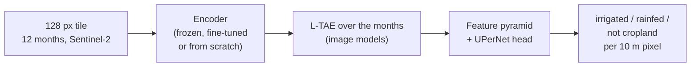

# Foundation models

Six geospatial foundation models (GeoFMs) are evaluated in this study: four image models and two pixel time-series
models. This page summarises their design and pretraining, specifies how each model is applied in the pixel-wise
experiments in Morocco and Utah, and lists the primary sources. Other pages refer to this page rather than repeating
its content.

## Selection

The models were selected according to three criteria: (i) pretrained weights are openly available and can be
fine-tuned; (ii) the models accept multi-temporal Sentinel-1 and/or Sentinel-2 input; and (iii) together they
represent the principal GeoFM families, namely masked-autoencoder Vision Transformers (Prithvi-EO-2.0, Clay), a
multimodal generative model (TerraMind), an agriculture-specific spatio-temporal model (AgriFM) and two models that
encode the time series of a single pixel (Presto, TESSERA). The four image models encode patches of 80–320 m; the
two pixel models work at the 10 m resolution of the maps, which matches the pixel-wise classification of the study
([D16](decisions.md#d16-pixel-wise-classification-for-continuous-maps)).

## Overview

| Model | Developer | Architecture | Pretraining data | Paper | Weights / code |
| --- | --- | --- | --- | --- | --- |
| **Clay v1.5** | Clay Foundation | Vision Transformer, masked autoencoder with DINO distillation; sensor-agnostic band encoding | ~70 million chips from several sensors (Sentinel-2, Landsat, Sentinel-1, NAIP, among others) | [Clay Foundation (2024)](https://clay-foundation.github.io/model/) | [Hugging Face](https://huggingface.co/made-with-clay/Clay) · [code](https://github.com/Clay-foundation/model) |
| **Prithvi-EO-2.0-300M-TL** | NASA, IBM | multi-temporal Vision Transformer (masked autoencoder) with temporal and location embeddings | 4.2 million Harmonised Landsat-Sentinel-2 (HLS) time series, 30 m | [Szwarcman et al. (2024)](https://arxiv.org/abs/2412.02732) | [Hugging Face](https://huggingface.co/ibm-nasa-geospatial/Prithvi-EO-2.0-300M-TL) |
| **TerraMind-1.0-base** | IBM, ESA | any-to-any generative multimodal transformer | 9 million spatio-temporally aligned samples of nine modalities, including Sentinel-1, Sentinel-2 and a DEM | [Jakubik et al. (2025)](https://arxiv.org/abs/2504.11171) | [Hugging Face](https://huggingface.co/ibm-esa-geospatial/TerraMind-1.0-base) |
| **Presto** | NASA Harvest, Mila, McGill | lightweight transformer over the tokens of one pixel's time series (channel groups × months), 0.4 M encoder parameters | globally sampled pixel time series of Sentinel-1, Sentinel-2, ERA5, SRTM and Dynamic World | [Tseng et al. (2023)](https://arxiv.org/abs/2304.14065) | [code and weights](https://github.com/nasaharvest/presto) (MIT) |
| **TESSERA v2 (Medium)** | University of Cambridge | per-pixel transformers for Sentinel-2 and Sentinel-1 observation sequences with day-of-year encoding, attention pooling; 21 M-parameter student distilled from a 2 B teacher | Sentinel-1 and Sentinel-2 acquisitions, global | [Feng et al. (2025)](https://arxiv.org/abs/2506.20380); v2: [Feng et al. (2026)](https://arxiv.org/abs/2607.03949) | [Hugging Face](https://huggingface.co/geotessera/TESSERA-V-2.0-2B-M) (weights CC0) · [code](https://github.com/ucam-eo/tessera) (MIT) |
| **AgriFM** | Li et al. (2025) | modified Video Swin Transformer for agricultural mapping | ~25 million samples of MODIS, Landsat and Sentinel-2 time series | [Li et al. (2025)](https://arxiv.org/abs/2505.21357) | [code](https://github.com/flyakon/AgriFM) · [weights](https://glass.hku.hk/casual/AgriFM/AgriFM.pth) |

## Configuration in this study

Every model classifies **every 10 m pixel** ([D16](decisions.md#d16-pixel-wise-classification-for-continuous-maps)).
The encoders see whole **128 × 128 px tiles** (1.28 km) of **12 monthly Sentinel-2 composites** of the agricultural
year, with the bands, band order, normalisation and weights of their own pretraining. **Every input uses Sentinel-2
only** ([D14](decisions.md#d14-sentinel-2-only-for-every-input)): every model sees the same optical data, and
Sentinel-1 coverage of Utah changed between the years. All six encoders are loaded by `pixelwise_run/encoders.py`.

### Inputs and outputs per model

| Model | Bands | Unit encoded | Temporal handling | Encoder output | Into the head |
| --- | --- | --- | --- | --- | --- |
| Prithvi-EO-2.0 | 6 (HLS set: B2 B3 B4 B8A B11 B12) | 16 px patch (160 m) | 4 months per pass with date and location, 3 passes; L-TAE | 1024 per patch and month (8 × 8 grid) | L-TAE → 4-scale pyramid → UPerNet |
| Clay v1.5 | 10 (no B1, B9) | 8 px patch (80 m) | 1 month per pass with week and location; L-TAE | 1024 per patch and month (16 × 16 grid) | L-TAE → 4-scale pyramid → UPerNet |
| TerraMind | 12 (S2L2A) | 16 px patch (160 m) | 1 month per pass; L-TAE | 768 per patch and month (8 × 8 grid) | L-TAE → 4-scale pyramid → UPerNet |
| AgriFM | 10 | 4 px patch, pyramid to 32 px | all 12 months in the encoder | 4-level multi-scale maps | straight into UPerNet |
| Presto | 10 + NDVI | 1 pixel | all 12 months in the encoder | 128 per pixel (10 m map) | average-pooled to 4 scales → UPerNet |
| TESSERA v2 Medium | 10 | 1 pixel | the clear months, dated by day of year | 128 per pixel (10 m map) | average-pooled to 4 scales → UPerNet |

The head (L-TAE where used, feature pyramid and UPerNet; 2.4–3.2 M weights with the image models) is the same for every model; its
design and the training settings are on the [E04](experiments/E04_frozen_geofm.md) page.

### Frozen, fine-tuned or trained from scratch

How much of the encoder is trained differs between the experiments ([RQ2 · Fine-tuning](phase2_models/fine_tuning.md)
explains the strategies):

| Experiment | Models | Encoder | Trained |
| --- | --- | --- | --- |
| [E04](experiments/E04_frozen_geofm.md) (RQ1) | all six | **frozen**: pretrained weights, no gradient updates, evaluation mode | head only (2.4–3.2 M weights with the image models) |
| [E05](experiments/E05_prithvi_strategies.md) (RQ2) | Prithvi-EO-2.0, Utah | **frozen**, **LoRA** (low-rank adapters, rank 16, on the attention and MLP layers), **fully fine-tuned** (every weight, encoder learning rate 10⁻⁵, head 10⁻⁴) or **from scratch** (same network from random weights) | head only (frozen), 5.5 M adapters + head (LoRA), or all ≈ 306 M weights |

### Earlier parcel-wise benchmark (archived)

The first benchmark ([archive](archive/parcel_wise_classification/index.md)) classified whole parcels in Morocco
with the four image models, all frozen. Each model received a 64 × 64 px chip (640 m) centred on the parcel, and the
parcel embedding was the mean of the patch tokens covering the parcel, weighted by the fraction of each patch inside
the parcel ([Models pipeline §5](archive/parcel_wise_classification/models_pipeline.md#5-scripts-06a06d--foundation-model-embeddings)).
These embeddings cannot give wall-to-wall maps, which is why the study moved to the pixel-wise set-up
([D16](decisions.md#d16-pixel-wise-classification-for-continuous-maps)).

| Input | Chips | Bands | Patch | Temporal handling | Output per parcel | Script |
| --- | --- | --- | --- | --- | --- | --- |
| S2 baseline | parcel features (inner pixels) | 12 S2 bands, NDVI, NDWI, EVI | parcel median | 12 months concatenated | 180 features | `03` |
| Clay v1.5 | p8 | 10 S2 bands | 8 px (80 m) | one month per forward pass | 12 × 1024 | `02a` |
| Prithvi-EO-2.0 | p16 | 6 S2 bands (HLS set) | 16 px (160 m) | four months per pass, three passes | 12 × 1024 | `02b` |
| TerraMind | p16 | 12 S2 bands | 16 px (160 m) | one month per forward pass | 12 × 768 | `02c` |
| AgriFM | p16 | 10 S2 bands | 4 px pretrained patch embedding; output stride 32 px (320 m) | full 12-month stack in one pass | 1 × 1024 | `02d` |

An optional ablation of that benchmark (Morocco only) added Sentinel-1 where a model was pretrained on it: TerraMind
with Sentinel-1 (`MODALITIES = ["S2L2A", "S1GRD"]` in script 02c, written as `terramind-s1s2_agyear_tiles.npz`) and
the baseline with radar features (`S1S2_VARIABLES = "all"` in script 03).

## Model notes

### Clay v1.5

Clay encodes each band together with its central wavelength, which allows a single model to process imagery from
different sensors. Ten Sentinel-2 bands (B2–B8A, B11, B12) are standardised with the statistics of Clay's
`metadata.yaml`. Additional inputs are the pixel size (10 m), the acquisition date (week of year, sine/cosine
encoded; monthly composites are dated mid-month) and the location (latitude and longitude, sine/cosine encoded).
The model processes one date per forward pass, so the twelve months are embedded independently. With 8 px patches,
a 128 px tile yields a 16 × 16 token grid (8 × 8 for the 64 px chips of the archived parcel benchmark).

### Prithvi-EO-2.0-300M-TL

Prithvi-EO-2.0 is pretrained on HLS time series and encodes acquisition date and location explicitly. The six HLS
bands (Blue, Green, Red, Narrow NIR, SWIR 1, SWIR 2; Sentinel-2 B2, B3, B4, B8A, B11, B12) are standardised with the
model's pretraining statistics. Following the pretraining configuration, four frames are processed per pass
(September–December, January–April, May–August); each frame retains its own tokens, giving one vector per month.
The model is loaded through TerraTorch (`prithvi_eo_v2_300_tl`). **Limitation:** pretraining used 30 m HLS data,
whereas 10 m Sentinel-2 is used here; the resulting 160 m patch is closer to typical parcel size than the 480 m patch
at native resolution.

### TerraMind-1.0-base

TerraMind is trained to generate any of nine modalities from any other and therefore learns a joint representation
of optical, radar and auxiliary data. The pixel-wise experiments supply only `S2L2A` (B1–B12), standardised with
TerraMind's pretraining statistics ([D14](decisions.md#d14-sentinel-2-only-for-every-input)). The Sentinel-1
ablation of the archived parcel benchmark also supplied `S1GRD` (VV, VH in dB) and averaged the tokens of the two
modalities (`merge_method = "mean"`). One date is processed per pass; 16 px patches give an 8 × 8 token grid on a
128 px tile (4 × 4 on a 64 px chip).

### AgriFM

AgriFM is designed for crop mapping and models the temporal dimension within the network. The full 12-month stack
of ten Sentinel-2 bands is processed in a single pass. Input tokens span four time steps and 4 × 4 px (the
pretrained patch embedding); the final feature map has a stride of 32 px
([D12](decisions.md#d12-agrifm-with-its-pretrained-4-px-patch-embedding)). Because time is compressed inside the
network, there is one set of features per season: in the pixel-wise experiments its four-level feature pyramid goes
directly to the UPerNet head; the archived parcel benchmark pooled it to one vector per parcel. Only the encoder is
used, through the mmengine registries of the cloned repository.

**Normalisation** ([D15](decisions.md#d15-agrifm-normalised-with-the-statistics-of-the-regions-chips)). Neither
the AgriFM paper nor the repository documents the normalisation of the pretraining data; the only published
statistics belong to the repository's fine-tuning example (`configs/cropland_mapping.py`, blue 4,179 ± 4,042). The
cloud-masked composites of this study are on a different scale (Morocco blue 714 ± 344), so with the config
statistics the visible and NIR bands would use only 8–30% of the expected spread. AgriFM is therefore normalised per
band with the mean and standard deviation of the region's own chips (`NORM = "data"`; statistics saved to
`agrifm_norm_stats_<tag>.json`), the usual choice when the pretraining statistics are unknown. The config
statistics are kept as a sensitivity run (`NORM = "config"`, file `agrifm-cfgnorm_*.npz`).

### Presto

Presto tokenises a pixel's time series by channel group and month (Sentinel-1, three Sentinel-2 groups, NIR, SWIR,
ERA5, SRTM, NDVI, Dynamic World) and adds the month and the location. Sentinel-2 only
([D14](decisions.md#d14-sentinel-2-only-for-every-input)): the Sentinel-1, ERA5, SRTM and Dynamic World tokens are
masked, which the model supports (masked tokens are removed). Sentinel-2 is divided by 10,000 as in pretraining.
Presto requires the same tokens to be masked for all pixels of a batch, so months without a clear observation are
filled by linear interpolation in time. The embedding is the normalised mean of the encoder tokens (128-d).

### TESSERA v2

TESSERA encodes the Sentinel-2 and Sentinel-1 observations of a pixel as unordered sets dated by their day of year
and pools them with attention into a 128-d embedding (Matryoshka-ordered: the first 16, 32 or 64 dimensions are
usable on their own). The Medium student is used, as recommended by the authors. TESSERA was trained on single
acquisitions; here each observation is a monthly composite dated the 15th of its month, and only clear months are
used, padded or subsampled to the observation-count bin of the reference code (8 or 16). Sentinel-2 only: the
Sentinel-1 branch receives one empty observation, as the reference code does without Sentinel-1.

## Weights

All weights are stored in `checkpoints/<model>/` (excluded from version control) and are downloaded automatically on
the first use (`pixelwise_run/encoders.py`).

| Model | Folder | Downloaded by |
| --- | --- | --- |
| Clay v1.5 | `checkpoints/clay/` (`clay-v1.5.ckpt`, `metadata.yaml`) | `pixelwise_run/encoders.py` (archive: `parcelwise_run/06a_embed_clay.py`) |
| Prithvi-EO-2.0-300M-TL | `checkpoints/prithvi/` (Hugging Face cache) | `pixelwise_run/encoders.py` (archive: `parcelwise_run/06b_embed_prithvi.py`) |
| TerraMind-1.0-base | `checkpoints/terramind/` (Hugging Face cache) | `pixelwise_run/encoders.py` (archive: `parcelwise_run/06c_embed_terramind.py`) |
| AgriFM | `checkpoints/agrifm/` (`AgriFM.pth`); code in `external/AgriFM` | `pixelwise_run/encoders.py` (archive: `parcelwise_run/06d_embed_agrifm.py`) |
| Presto | `checkpoints/presto/` (`default_model.pt`, from the repository); code in `external/presto` | `pixelwise_run/encoders.py` |
| TESSERA v2 Medium | `checkpoints/tessera/ckpt/` (`student_medium.pt`, Hugging Face); code in `external/tessera` | `pixelwise_run/encoders.py` |

Installation of the required packages is described in [Environment setup](setup.md).

## References

- Feng, Z., Atzberger, C., Jaffer, S., et al. (2025). TESSERA: Temporal Embeddings of Surface Spectra for Earth
  Representation and Analysis. arXiv:2506.20380.
- Feng, Z., Jaffer, S., Shokar, I., Knezevic, J., et al. (2026). TESSERA v2: scaling pixel-wise Earth foundation
  models. arXiv:2607.03949.
- Clay Foundation (2024). *Clay Foundation Model v1.5*. https://huggingface.co/made-with-clay/Clay, doi:10.57967/hf/1537.
- Jakubik, J., et al. (2025). TerraMind: large-scale generative multimodality for Earth observation. arXiv:2504.11171.
- Li, W., et al. (2025). AgriFM: a multi-source temporal remote sensing foundation model for crop mapping. arXiv:2505.21357.
- Tseng, G., Cartuyvels, R., Zvonkov, I., Purohit, M., Rolnick, D. & Kerner, H. (2023). Lightweight, pre-trained
  transformers for remote sensing timeseries. arXiv:2304.14065.
- Szwarcman, D., et al. (2024). Prithvi-EO-2.0: a versatile multi-temporal foundation model for Earth observation applications. arXiv:2412.02732.
