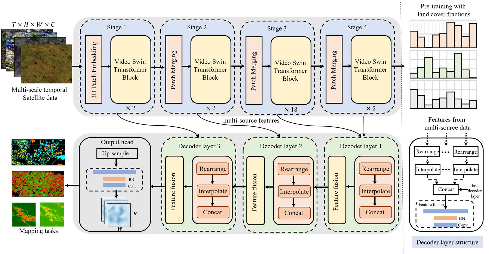
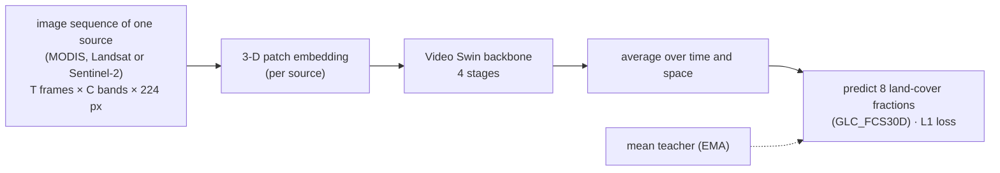
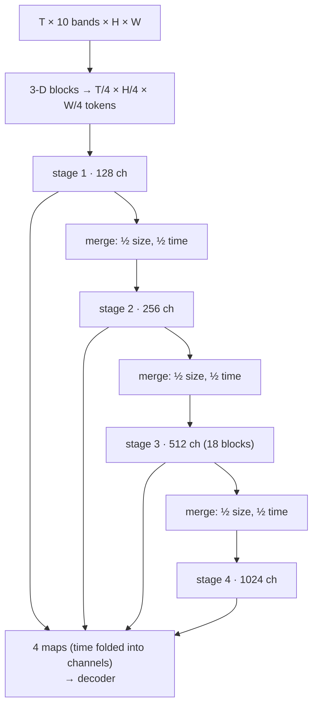

# AgriFM

**In short.** A foundation model built for crop mapping. It treats a satellite image time series like a **video**
and cuts it into small blocks of space and time. Its backbone is a Video Swin Transformer, modified so that every
stage shrinks the map *and* the number of time steps together; it returns feature maps at four scales. Unlike the
other models it is pretrained with **supervision**: it learns to predict the land-cover fractions of each image
sequence.

How it is used in this study: [Foundation models in this study](in_this_study.md#agrifm).

## Architecture in the source

*AgriFM: four Video Swin stages with 3-D patch embedding and patch merging, pretraining on land-cover fractions, and
the decoder for mapping tasks. Figure: Li et al. (2025), from [github.com/flyakon/AgriFM](https://github.com/flyakon/AgriFM);
Apache-2.0, reproduced at reduced size.*

## Pretraining

| Item | Original model |
| --- | --- |
| **Data** | 25.2 M images cropped to 224 × 224 px from three sources, not co-registered: MODIS (7 bands, 500 m resampled to 250 m, 8-day, 2020–2022; 51,964 sequences), Landsat 8/9 HLS L30 (6 bands, 30 m, 2022; 335,985 sequences) and Sentinel-2 (10 bands, 10 m, 5-day, 2021–2022; 345,843 sequences) |
| **Frames** | sampled per sequence (the paper reports 3–32 frames in one place and 16 random frames in another) |
| **Objective** | supervised: from each sequence the model predicts the fractions of 8 land-cover classes of GLC_FCS30D (plus background) with a sigmoid head and an L1 loss; a mean-teacher (exponential moving average) set-up reduces the effect of label noise; features are averaged over time and space before the head |

*Pretraining of AgriFM: supervised regression of land-cover fractions.*

## Architecture

| Part | Original model |
| --- | --- |
| **Input** | per source a [time, band, height, width] stack; Sentinel-2: 10 bands (B2–B8A, B11, B12), per-band z-score |
| **Tokens** | a separate 3-D convolution per source cuts the stack into blocks of time × space, 128-dimensional; the paper gives 4 × 4 px (time 2 for short and 4 for long sequences); the released fine-tuning config uses 4 frames × 2 × 2 px, the released checkpoint's Sentinel-2 embedding 4 frames × 4 × 4 px |
| **Attention** | windowed 3-D self-attention (window 8 frames × 7 × 7 tokens), shifted between blocks (Swin) |
| **Stages** | 4 stages of 2, 2, 18 and 2 blocks, 128, 256, 512 and 1024 channels, 4–32 heads |
| **Modification** | every patch-merging step halves height and width **and** averages pairs of time steps, so space and time shrink together |
| **Output** | feature maps at four scales; time is folded into the channels (time × channels), not averaged |
| **Downstream** | the authors' decoder upsamples the deepest features with skip connections from the earlier stages, followed by a small convolutional head; separate encoders per source can be fused for multi-source mapping |

*Hierarchical encoder of AgriFM: space and time shrink together from stage to stage.*

## Points to note

- **Supervised pretraining** on a land-cover product: the features are tuned to land cover, including cropland,
  but carry the errors of that product.
- **Normalisation statistics of the pretraining data are not published**; only those of the fine-tuning example are
  ([D15](../decisions.md#d15-agrifm-normalised-with-the-statistics-of-the-regions-chips)).
- Paper and released configuration differ in the spatial patch size; the checkpoint fixes it at 4 × 4 px
  ([D12](../decisions.md#d12-agrifm-with-its-pretrained-4-px-patch-embedding)).
- No weight count is published; the Sentinel-2 encoder loaded in this study has about 88 M weights.

## Sources

- Li, W., et al. (2025). AgriFM: a multi-source temporal remote sensing foundation model for crop mapping.
  arXiv:2505.21357, §2; published in *Remote Sensing of Environment* 334, 115234 (2026), as cited by the repository.
- Code and weights: [github.com/flyakon/AgriFM](https://github.com/flyakon/AgriFM) (`AgriFM/models/video_swin_transformer.py`,
  `configs/cropland_mapping.py`, `neck.py`, `heads.py`).
