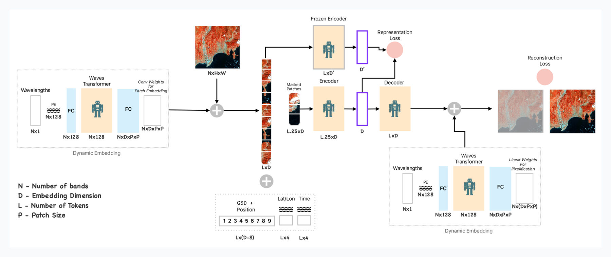
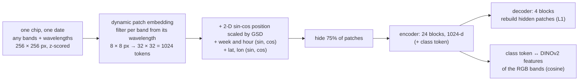
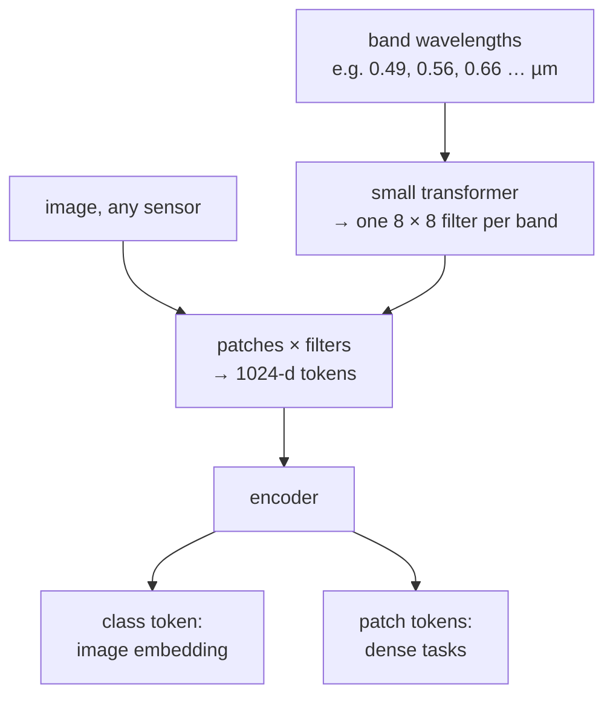

# Clay v1.5

**In short.** A large Vision Transformer from the Clay Foundation, pretrained on single images of many sensors. It
has no fixed list of bands: it builds the patch filter of every band from the band's **central wavelength**, so the
same model reads Sentinel-2, Landsat, Sentinel-1, aerial images or MODIS. It is also told the pixel size, the date
and the location of each image.

How it is used in this study: [Foundation models in this study](in_this_study.md#clay-v15).

## Architecture in the source

*Clay architecture: wavelength-based dynamic embedding, position, location and time encodings, masked-autoencoder
encoder and decoder, and the frozen teacher of the representation loss. Figure: Clay Foundation,
[Clay model specification](https://clay-foundation.github.io/model/release-notes/specification.html); licensed CC BY
4.0, reproduced at reduced size. The diagram may predate v1.5 (where the teacher is DINOv2).*

## Pretraining

| Item | Original model |
| --- | --- |
| **Data** | about 70 M chips of 256 × 256 px selected by land-cover statistics, from Landsat 8/9, Sentinel-2 L2A, Sentinel-1 RTC, NAIP, LINZ aerial imagery and MODIS; resolution 0.5–500 m; at most 6 dates per location, one date per sample |
| **Objective** | masked autoencoder: 75% of the patches are hidden and rebuilt (L1 loss per pixel), plus a representation loss that pulls the class token towards the features of a frozen DINOv2 model of the RGB bands |
| **Augmentation** | some samples lose all or half of their bands; date and location are removed for 20% of the chips |
| **Training** | about 100 epochs |

*Pretraining of Clay v1.5: reconstruction of hidden patches plus a representation loss towards a DINOv2 teacher.*

## Architecture

| Part | Original model |
| --- | --- |
| **Input** | any number of bands in any order, each with its central wavelength (µm), z-scored with the sensor's statistics (`metadata.yaml`); one date; 256 × 256 px |
| **Dynamic band embedding** | each wavelength is sine–cosine encoded and passed through a small network; a one-layer transformer turns the band encodings into an 8 × 8 convolution filter per band and a bias; the image is then cut into 8 × 8 px patches with these filters |
| **Position and metadata** | a 2-D sine–cosine position encoding whose frequencies are scaled by the ground sampling distance, concatenated with the date (week of year and hour, sine–cosine) and location (latitude and longitude, sine–cosine), added to every patch token |
| **Encoder** | ViT-Large: 24 blocks, 1024-dimensional, 16 heads, MLP ratio 4; 311 M weights (632 M with the pretraining teacher) |
| **Output** | class token + one 1024-dimensional token per patch (32 × 32 for a 256 px chip) |
| **Downstream** | the class token as image embedding; the patch tokens, without the class token, for segmentation (Clay's segmentor upsamples them with convolutions) |

*How the wavelength-based band embedding lets one model read any sensor.*

## Versions

| | v1.0 | v1.5 |
| --- | --- | --- |
| Encoder | ViT-Base (12 blocks, 768-d) | ViT-Large (24 blocks, 1024-d) |
| Input size | 224 px | 256 px |
| Teacher | DINO | DINOv2 |
| Sensors | without MODIS | with MODIS |
| Weights | 201 M (total) | 632 M (total), encoder 311 M |
| Licence of the weights | OpenRAIL-M | Apache-2.0 |

## Points to note

- Pretrained on **single dates**: it has no notion of a season; a time series has to be encoded date by date and
  combined afterwards.
- The **class token** summarises a whole chip; for maps the patch tokens (80 m at 10 m resolution) are used.
- There is no Clay paper; the facts come from the model specification and the code.

## Sources

- Clay Foundation (2024). *Clay Foundation Model v1.5*: [model specification](https://clay-foundation.github.io/model/release-notes/specification.html)
  and documentation; [github.com/Clay-foundation/model](https://github.com/Clay-foundation/model) (`claymodel/model.py`,
  `claymodel/factory.py`, `configs/metadata.yaml`); weights on [Hugging Face](https://huggingface.co/made-with-clay/Clay),
  doi:10.57967/hf/1537.
