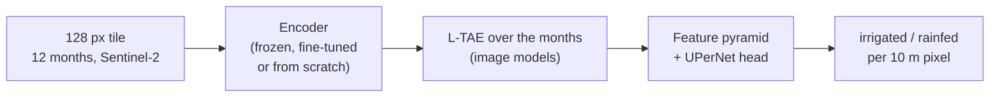

# Foundation models in this study

This page describes how the six foundation models are **adapted to this study**: the bands and months they receive,
how a 128 × 128 px tile is cut into tokens, what is merged where, and which parts are frozen or trained. The original
design of each model, as its authors built and pretrained it, is on the model pages
([overview](index.md), [Prithvi-EO-2.0](prithvi.md), [Clay v1.5](clay.md), [TerraMind](terramind.md),
[AgriFM](agrifm.md), [Presto](presto.md), [TESSERA](tessera.md)). How they are trained and scored is on the
experiment pages ([E04](../experiments/E04_frozen_geofm.md), [E05](../experiments/E05_prithvi_strategies.md)).

## Configuration in this study

Every model classifies **every 10 m pixel** ([D16](../decisions.md#d16-pixel-wise-classification-for-continuous-maps)).
The encoders see whole **128 × 128 px tiles** (1.28 km) of **12 monthly Sentinel-2 composites** of the agricultural
year, with the bands, band order, normalisation and weights of their own pretraining. **Every input uses Sentinel-2
only** ([D14](../decisions.md#d14-sentinel-2-only-for-every-input)): every model sees the same optical data, and
Sentinel-1 coverage of Utah changed between the years. All six encoders are loaded by `pixelwise_run/encoders.py`.

What each encoder receives, model by model, is in the table under the [tile figure](#what-each-encoder-sees-of-a-tile).

### Frozen, fine-tuned or trained from scratch

How much of the encoder is trained differs between the experiments ([RQ2 · Fine-tuning](../phase2_models/fine_tuning.md)
explains the strategies):

| Experiment | Models | Encoder | Trained |
| --- | --- | --- | --- |
| [E04](../experiments/E04_frozen_geofm.md) (RQ1) | all six | **frozen**: pretrained weights, no gradient updates, evaluation mode | head only (1.7–3.2 M weights, depending on the encoder) |
| [E05](../experiments/E05_prithvi_strategies.md) (RQ2) | Prithvi-EO-2.0, Morocco first | **frozen**, **LoRA** (low-rank adapters, rank 16, on the attention and MLP layers), **fully fine-tuned** (every weight, encoder learning rate 10⁻⁵, head 10⁻⁴) or **from scratch** (same network from random weights); 10, 25, 50 or 100% of the training parcels | head only (frozen), 5.5 M adapters + head (LoRA), or all ≈ 306 M weights |

## What each encoder sees of a tile

*What each encoder receives in this study: the bands, how one 128 × 128 px tile (1.28 km) of 12 monthly composites
is cut into tokens (one cell = one token, the labelled cell shaded), and how the 12 months are grouped per encoder pass
(one box = one pass). Drawn by `tools/a8_geofm_tokens_figure.py`.*

| | Prithvi-EO-2.0 | Clay v1.5 | TerraMind | AgriFM | Presto | TESSERA v2 |
| --- | --- | --- | --- | --- | --- | --- |
| **Family** | image ViT | image ViT | image ViT, multimodal | image video-Swin | pixel transformer | pixel transformer |
| **Bands** | 6: B2 B3 B4 B8A B11 B12 | 10: B2–B8A, B11, B12 | 12: B1–B12 without B10 | 10: B2–B8A, B11, B12 | 10 + NDVI | 10 (TESSERA order) |
| **Normalisation** | Prithvi's pretraining statistics | Clay's Sentinel-2 statistics | TerraMind's pretraining statistics | the region's band statistics (D15) | reflectance / 10,000 | TESSERA's statistics |
| **One token** | 16 × 16 px, 1 month | 8 × 8 px, 1 month | 16 × 16 px, 1 month | 4 × 4 px × 4 months | 1 band group, 1 month, 1 pixel | 1 month of 1 pixel |
| **Months per pass** | 4, with date and location; 3 passes | 1, with week and location; 12 passes | 1, no date; 12 passes | all 12 in one pass | all 12 (cloudy months interpolated) | the clear months, dated (15th) |
| **Encoder weights** | 304 M | 311 M | 87 M | 88 M | 0.4 M | 21 M |
| **Output on a tile** | 1024 × 8 × 8 per month | 1024 × 16 × 16 per month | 768 × 8 × 8 per month | maps of 32², 16², 8², 4² | 128 per pixel | 128 per pixel |
| **Into the head** | L-TAE → 4-scale pyramid → UPerNet | L-TAE → 4-scale pyramid → UPerNet | L-TAE → 4-scale pyramid → UPerNet | its 4 maps → UPerNet | pooled to 4 scales → UPerNet | pooled to 4 scales → UPerNet |

Encoder weights counted on the loaded encoders of this study (`pixelwise_run/encoders.py`); TerraMind and AgriFM
publish no count.

Encoder weights counted on the loaded encoders of this study (`pixelwise_run/encoders.py`); TerraMind and AgriFM
publish no count. Step-by-step figures of each encoder's set-up: [E04](../experiments/E04_frozen_geofm.md#how-e04-works-step-by-step).

## What this means for the comparison

- **Spatial unit.** The image ViTs (Prithvi, TerraMind 160 m; Clay 80 m) decide on a coarse grid that the head
  upsamples to 10 m, so field edges are soft; AgriFM starts at 40 m; Presto and TESSERA decide per 10 m pixel but see
  no neighbours, which the UPerNet head adds afterwards.
- **Time.** Prithvi, Clay and TerraMind encode months separately; the L-TAE combines them. AgriFM, Presto and
  TESSERA combine the months inside the encoder.
- **Pretraining gap.** Prithvi was pretrained on 30 m HLS, AgriFM partly on 30 m and 250 m data, the others at 10 m;
  Presto, TESSERA and Prithvi saw time series, Clay and TerraMind single dates.
- **Inputs left out.** TerraMind, Presto and TESSERA were pretrained with Sentinel-1 (and Presto with weather and
  terrain); here they receive Sentinel-2 only.

## Settings used in this study (details)

One subsection per model: what is taken from the original design and what is changed for the tiles of this study. The original design is on the model's own page.

### Prithvi-EO-2.0

Prithvi-EO-2.0 is pretrained on HLS time series and encodes acquisition date and location explicitly. The six HLS
bands (Blue, Green, Red, Narrow NIR, SWIR 1, SWIR 2; Sentinel-2 B2, B3, B4, B8A, B11, B12) are standardised with the
model's pretraining statistics. Following the pretraining configuration, four frames are processed per pass
(September–December, January–April, May–August); each frame retains its own tokens, giving one vector per month.
The model is loaded through TerraTorch (`prithvi_eo_v2_300_tl`). **Limitation:** pretraining used 30 m HLS data,
whereas 10 m Sentinel-2 is used here; the resulting 160 m patch is closer to typical parcel size than the 480 m patch
at native resolution.

Original design: [Prithvi-EO-2.0](prithvi.md).

### Clay v1.5

Clay encodes each band together with its central wavelength, which allows a single model to process imagery from
different sensors. Ten Sentinel-2 bands (B2–B8A, B11, B12) are standardised with the statistics of Clay's
`metadata.yaml`. Additional inputs are the pixel size (10 m), the acquisition date (week of year, sine/cosine
encoded; monthly composites are dated mid-month) and the location (latitude and longitude, sine/cosine encoded).
The model processes one date per forward pass, so the twelve months are embedded independently. With 8 px patches,
a 128 px tile yields a 16 × 16 token grid (8 × 8 for the 64 px chips of the archived parcel benchmark).

Original design: [Clay v1.5](clay.md).

### TerraMind-1.0-base

TerraMind is trained to generate any of nine modalities from any other and therefore learns a joint representation
of optical, radar and auxiliary data. The pixel-wise experiments supply only `S2L2A` (B1–B12), standardised with
TerraMind's pretraining statistics ([D14](../decisions.md#d14-sentinel-2-only-for-every-input)). The Sentinel-1
ablation of the archived parcel benchmark also supplied `S1GRD` (VV, VH in dB) and averaged the tokens of the two
modalities (`merge_method = "mean"`). One date is processed per pass; 16 px patches give an 8 × 8 token grid on a
128 px tile (4 × 4 on a 64 px chip).

Original design: [TerraMind-1.0-base](terramind.md).

### AgriFM

AgriFM is designed for crop mapping and models the temporal dimension within the network. The full 12-month stack
of ten Sentinel-2 bands is processed in a single pass. Input tokens span four time steps and 4 × 4 px (the
pretrained patch embedding); the final feature map has a stride of 32 px
([D12](../decisions.md#d12-agrifm-with-its-pretrained-4-px-patch-embedding)). Because time is compressed inside the
network, there is one set of features per season: in the pixel-wise experiments its four-level feature pyramid goes
directly to the UPerNet head; the archived parcel benchmark pooled it to one vector per parcel. Only the encoder is
used, through the mmengine registries of the cloned repository.

**Normalisation** ([D15](../decisions.md#d15-agrifm-normalised-with-the-statistics-of-the-regions-chips)). Neither
the AgriFM paper nor the repository documents the normalisation of the pretraining data; the only published
statistics belong to the repository's fine-tuning example (`configs/cropland_mapping.py`, blue 4,179 ± 4,042). The
cloud-masked composites of this study are on a different scale (Morocco blue 714 ± 344), so with the config
statistics the visible and NIR bands would use only 8–30% of the expected spread. AgriFM is therefore normalised per
band with the mean and standard deviation of the region's own chips (`NORM = "data"`; statistics saved to
`agrifm_norm_stats_<tag>.json`), the usual choice when the pretraining statistics are unknown. The config
statistics are kept as a sensitivity run (`NORM = "config"`, file `agrifm-cfgnorm_*.npz`).

Original design: [AgriFM](agrifm.md).

### Presto

Presto tokenises a pixel's time series by channel group and month (Sentinel-1, three Sentinel-2 groups, NIR, SWIR,
ERA5, SRTM, NDVI, Dynamic World) and adds the month and the location. Sentinel-2 only
([D14](../decisions.md#d14-sentinel-2-only-for-every-input)): the Sentinel-1, ERA5, SRTM and Dynamic World tokens are
masked, which the model supports (masked tokens are removed). Sentinel-2 is divided by 10,000 as in pretraining.
Presto requires the same tokens to be masked for all pixels of a batch, so months without a clear observation are
filled by linear interpolation in time. The embedding is the normalised mean of the encoder tokens (128-d).

Original design: [Presto](presto.md).

### TESSERA v2

TESSERA encodes the Sentinel-2 and Sentinel-1 observations of a pixel as unordered sets dated by their day of year
and pools them with attention into a 128-d embedding (Matryoshka-ordered: the first 16, 32 or 64 dimensions are
usable on their own). The Medium student is used, as recommended by the authors. TESSERA was trained on single
acquisitions; here each observation is a monthly composite dated the 15th of its month, and only clear months are
used, padded or subsampled to the observation-count bin of the reference code (8 or 16). Sentinel-2 only: the
Sentinel-1 branch receives one empty observation, as the reference code does without Sentinel-1.

Original design: [TESSERA v2](tessera.md).

## Earlier parcel-wise benchmark (archived)

The first benchmark ([archive](../archive/parcel_wise_classification/index.md)) classified whole parcels in Morocco
with the four image models, all frozen. Each model received a 64 × 64 px chip (640 m) centred on the parcel, and the
parcel embedding was the mean of the patch tokens covering the parcel, weighted by the fraction of each patch inside
the parcel ([Models pipeline §5](../archive/parcel_wise_classification/models_pipeline.md#5-scripts-06a06d--foundation-model-embeddings)).
These embeddings cannot give wall-to-wall maps, which is why the study moved to the pixel-wise set-up
([D16](../decisions.md#d16-pixel-wise-classification-for-continuous-maps)).

| Input | Chips | Bands | Patch | Temporal handling | Output per parcel | Script |
| --- | --- | --- | --- | --- | --- | --- |
| S2 baseline | parcel features (inner pixels) | 12 S2 bands, NDVI, NDWI, EVI | parcel median | 12 months concatenated | 180 features | `03` |
| Clay v1.5 | p8 | 10 S2 bands | 8 px (80 m) | one month per forward pass | 12 × 1024 | `02a` |
| Prithvi-EO-2.0 | p16 | 6 S2 bands (HLS set) | 16 px (160 m) | four months per pass, three passes | 12 × 1024 | `02b` |
| TerraMind | p16 | 12 S2 bands | 16 px (160 m) | one month per forward pass | 12 × 768 | `02c` |
| AgriFM | p16 | 10 S2 bands | 4 px pretrained patch embedding; output stride 32 px (320 m) | full 12-month stack in one pass | 1 × 1024 | `02d` |

An optional ablation of that benchmark (Morocco only) added Sentinel-1 where a model was pretrained on it: TerraMind
with Sentinel-1 (`MODALITIES = ["S2L2A", "S1GRD"]` in script 02c, written as `terramind-s1s2_agyear_tiles.npz`) and
the baseline with radar features (`S1S2_VARIABLES = "all"` in script 03).

## Weights

All weights are stored in `checkpoints/<model>/` (excluded from version control) and are downloaded automatically on
the first use (`pixelwise_run/encoders.py`).

| Model | Folder | Downloaded by |
| --- | --- | --- |
| Clay v1.5 | `checkpoints/clay/` (`clay-v1.5.ckpt`, `metadata.yaml`) | `pixelwise_run/encoders.py` (archive: `parcelwise_run/06a_embed_clay.py`) |
| Prithvi-EO-2.0-300M-TL | `checkpoints/prithvi/` (Hugging Face cache) | `pixelwise_run/encoders.py` (archive: `parcelwise_run/06b_embed_prithvi.py`) |
| TerraMind-1.0-base | `checkpoints/terramind/` (Hugging Face cache) | `pixelwise_run/encoders.py` (archive: `parcelwise_run/06c_embed_terramind.py`) |
| AgriFM | `checkpoints/agrifm/` (`AgriFM.pth`); code in `external/AgriFM` | `pixelwise_run/encoders.py` (archive: `parcelwise_run/06d_embed_agrifm.py`) |
| Presto | `checkpoints/presto/` (`default_model.pt`, from the repository); code in `external/presto` | `pixelwise_run/encoders.py` |
| TESSERA v2 Medium | `checkpoints/tessera/ckpt/` (`student_medium.pt`, Hugging Face); code in `external/tessera` | `pixelwise_run/encoders.py` |

Installation of the required packages is described in [Environment setup](../setup.md).

