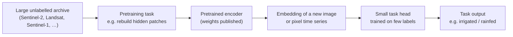
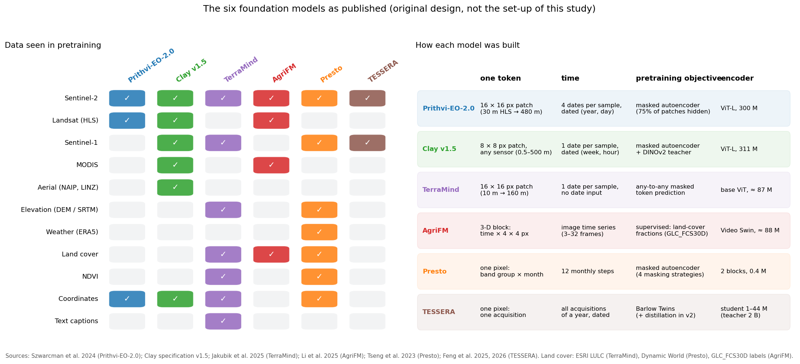

# Foundation models: overview

Six geospatial foundation models (GeoFMs) are compared in this study. This section describes each model **as its
authors designed and pretrained it**, from the paper, model card and code. How the models are adapted to the tiles,
bands and labels of this study is a separate page: [Foundation models in this study](in_this_study.md).

## What a geospatial foundation model is

A foundation model is a large network trained once, without task labels or with cheap labels, on a very large and
diverse set of satellite data, so that its internal representation (the *embedding*) is useful for many later tasks.
A task such as irrigated / rainfed classification then needs only a small model on top of the embedding (a *head*),
trained on few labels, or a light adaptation of the network (fine-tuning).

## Why these six

The models were selected because (i) their pretrained weights are openly available and can be fine-tuned, (ii)
they accept multi-temporal Sentinel-2 (and in part Sentinel-1) input, and (iii) together they cover the main GeoFM
families:

| Family | Models | Idea |
| --- | --- | --- |
| Masked-autoencoder Vision Transformers | [Prithvi-EO-2.0](prithvi.md), [Clay v1.5](clay.md) | cut images into patches, hide most of them, learn to rebuild them |
| Multimodal generative transformer | [TerraMind](terramind.md) | learn to translate between many data types (optical, radar, elevation, land cover, text) |
| Agriculture-specific spatio-temporal model | [AgriFM](agrifm.md) | a video transformer over image time series, pretrained to predict land-cover fractions |
| Pixel time-series models | [Presto](presto.md), [TESSERA](tessera.md) | encode the time series of a single pixel, not image patches |

## The six models side by side

*Original design of each model: the data seen in pretraining (left) and the token, time handling, pretraining
objective and encoder size (right). Drawn by `tools/a10_geofm_pretraining_figure.py` from the sources on the model
pages.*

| | [Prithvi-EO-2.0](prithvi.md) | [Clay v1.5](clay.md) | [TerraMind](terramind.md) | [AgriFM](agrifm.md) | [Presto](presto.md) | [TESSERA](tessera.md) |
| --- | --- | --- | --- | --- | --- | --- |
| **Developer** | NASA, IBM | Clay Foundation | IBM, ESA | Li et al. | NASA Harvest, Mila, McGill | University of Cambridge |
| **Architecture** | ViT-Large, masked autoencoder | ViT-Large, masked autoencoder | ViT encoder–decoder, any-to-any | Video Swin Transformer | small transformer | per-sensor transformers, attention pooling |
| **Pretraining data** | 4.2 M HLS samples, 4 dates, 30 m | 70 M chips of 6 sensors, 0.5–500 m | 9 M aligned samples of 9 modalities, 10 m | 25 M images of MODIS, Landsat, Sentinel-2 | 21.5 M pixels, 2020–2021 | ≈ 14 B pixel samples (v2 teacher); v1: 2017–2024 |
| **Objective** | rebuild hidden patches (MSE) | rebuild hidden patches (L1) + match DINOv2 | predict hidden tokens of other modalities | predict land-cover fractions (supervised) | rebuild hidden tokens | two random subsets of a pixel's year give the same embedding (Barlow Twins) |
| **One token** | 16 × 16 px of one date | 8 × 8 px of one date | 16 × 16 px of one date and modality | time × 4 × 4 px block | one band group in one month of a pixel | one acquisition of a pixel |
| **Time** | 4 dates per sample, dated | single date, dated | single date | 3–32 frames | 12 months | every acquisition of a year |
| **Output** | token per patch and date (1024) | token per patch (1024) + class token | token per patch (768) | 4-scale feature maps | 128 per pixel | 128 per pixel (Matryoshka) |
| **Weights** | Apache-2.0 | Apache-2.0 | Apache-2.0 | public checkpoint | MIT | CC0 |

## How they differ in principle

- **Image vs pixel.** Prithvi, Clay, TerraMind and AgriFM look at image patches and see the neighbourhood of a
  location; Presto and TESSERA look at one pixel at a time and see only its spectral time series.
- **Time.** Prithvi was pretrained on short image time series, AgriFM on longer ones, Presto and TESSERA on full
  years of a pixel; Clay and TerraMind on single dates, so they have no built-in notion of a season.
- **Sensors.** Clay accepts any sensor through wavelength-aware band embeddings; TerraMind combines nine modalities;
  Prithvi is tied to the six HLS bands; Presto and TESSERA combine Sentinel-1 and Sentinel-2 (Presto also weather,
  terrain and land cover).
- **Objective.** Four models learn by reconstructing or predicting hidden parts of the input, TESSERA by making two
  views of the same pixel agree, and AgriFM by supervised prediction of land-cover fractions.
- **Size.** From 0.4 M weights (Presto) to about 300 M (Prithvi, Clay); TESSERA distils a 2 B teacher into small
  students.

## References

- Clay Foundation (2024). *Clay Foundation Model v1.5*. https://clay-foundation.github.io/model/, doi:10.57967/hf/1537.
- Feng, Z., Atzberger, C., Jaffer, S., et al. (2025). TESSERA: Temporal Embeddings of Surface Spectra for Earth
  Representation and Analysis. arXiv:2506.20380.
- Feng, Z., Jaffer, S., Shokar, I., Knezevic, J., et al. (2026). TESSERA v2: scaling pixel-wise Earth foundation
  models. arXiv:2607.03949.
- Jakubik, J., et al. (2025). TerraMind: large-scale generative multimodality for Earth observation. arXiv:2504.11171.
- Li, W., et al. (2025). AgriFM: a multi-source temporal remote sensing foundation model for crop mapping.
  arXiv:2505.21357.
- Szwarcman, D., et al. (2024). Prithvi-EO-2.0: a versatile multi-temporal foundation model for Earth observation
  applications. arXiv:2412.02732.
- Tseng, G., Cartuyvels, R., Zvonkov, I., Purohit, M., Rolnick, D. & Kerner, H. (2023). Lightweight, pre-trained
  transformers for remote sensing timeseries. arXiv:2304.14065.
