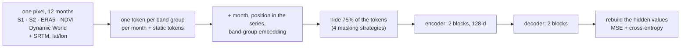
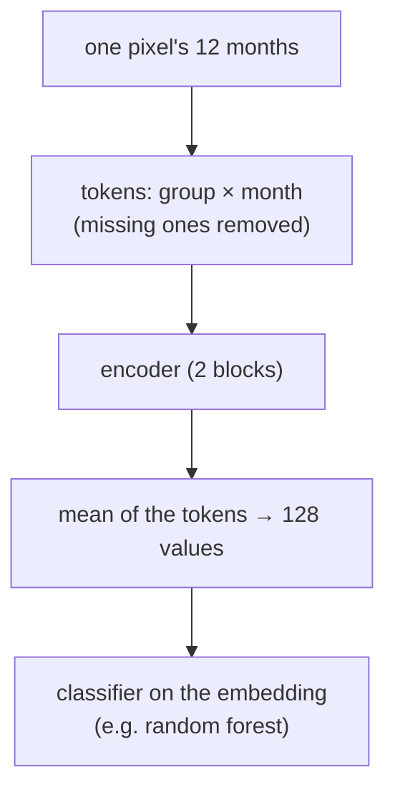

# Presto

**In short.** A very small transformer (about 0.4 M weights) from NASA Harvest, Mila and McGill for the time series
of **one pixel**. Every group of related bands in every month becomes one token, so the model can leave out whatever
is missing (a cloudy month, an absent sensor) by simply dropping those tokens. It was pretrained on radar, optical,
weather, terrain and land-cover data together.

How it is used in this study: [Foundation models in this study](in_this_study.md#presto).

## Architecture in the source

!!! note "Figure of the source paper"
    The overview figure of Presto (structurally masked pixel time series and the four masking strategies) is
    Fig. 1 of [Tseng et al. (2023), arXiv:2304.14065](https://arxiv.org/abs/2304.14065). It is not reproduced here
    because the paper is distributed under arXiv's non-exclusive licence; the diagrams below are drawn for this
    documentation.

## Pretraining

| Item | Original model |
| --- | --- |
| **Data** | 21.5 M pixel samples at 10 m, grid-sampled from 510 × 510 px tiles chosen as for Dynamic World; 2020–2021; 24 monthly steps per sample, of which windows of 12 months are used |
| **Objective** | masked autoencoder: 75% of the tokens are hidden with one of four structured strategies (random tokens, whole band groups, a contiguous block of months, random months), and a decoder rebuilds them; mean squared error for continuous values plus cross-entropy for the Dynamic World class; coordinates are never hidden |
| **Training** | 20 epochs, batch 4,096, one V100 GPU, about 43 hours |

*Pretraining of Presto (masked autoencoder on a pixel time series).*

## Input: 17 channels per month and their groups

| Group | Channels | Source | Normalisation |
| --- | --- | --- | --- |
| Sentinel-1 | VV, VH | Sentinel-1 | (x + 25) / 25 |
| S2 RGB | B2, B3, B4 | Sentinel-2 | x / 10,000 |
| S2 red edge | B5, B6, B7 | Sentinel-2 | x / 10,000 |
| S2 NIR 10 m | B8 | Sentinel-2 | x / 10,000 |
| S2 NIR 20 m | B8A | Sentinel-2 | x / 10,000 |
| S2 SWIR | B11, B12 | Sentinel-2 | x / 10,000 |
| ERA5 | 2 m temperature, total precipitation | ERA5 monthly | (x − 272.15) / 35; x / 0.03 |
| SRTM (static) | elevation, slope | SRTM | / 2000; / 50 |
| NDVI | NDVI | from B4, B8 | – |
| Dynamic World (categorical) | land-cover class of the month | Dynamic World | embedding table |
| Location (static) | latitude, longitude | – | as a point on the sphere |

The 17 continuous channels (2 + 10 + 2 + 2 + 1) form a fixed layout: every input must use it, even when most of it
is empty; missing parts are marked in a mask.

## Architecture

| Part | Original model |
| --- | --- |
| **Tokens** | one token per band group and month, each from its own linear projection; one static SRTM token; one location token (latitude and longitude as a 3-D point on the sphere, through a linear layer) |
| **Encodings** | concatenated and added to each token: sine–cosine position in the series (50%), sine–cosine month (25%), learnt band-group embedding (25%) |
| **Missing data** | a mask (1 = ignore) per channel; a token is dropped when any of its channels is masked; dropped tokens are removed from the sequence, not replaced; a missing Dynamic World class is set to 9 and ignored |
| **Encoder** | 2 transformer blocks, 128-dimensional, 8 heads, MLP ratio 4; about 0.4 M weights |
| **Output** | the mean of all unmasked output tokens, layer-normalised: **one 128-value vector per pixel** |
| **Downstream** | linear or logistic regression, a random forest on the embeddings, or full fine-tuning with a linear head; for images, the per-pixel mean and standard deviation of the embeddings are used |

*Use of Presto: one embedding per pixel, then a light classifier.*

## Points to note

- **One pixel at a time**: no spatial context; a map is made pixel by pixel.
- **Very small and fast per pixel**, but a 1.28 km tile has 16,384 pixels to encode.
- The **mask must be the same for all pixels of a batch** in the reference code, which matters when some pixels of a
  month are cloudy and others are not.
- Pretrained with many inputs; giving it Sentinel-2 alone masks the radar, weather, terrain and land-cover tokens.

## Sources

- Tseng, G., Cartuyvels, R., Zvonkov, I., Purohit, M., Rolnick, D. & Kerner, H. (2023). Lightweight, pre-trained
  transformers for remote sensing timeseries. arXiv:2304.14065, §3–4 and Appendix A.
- Code and weights: [github.com/nasaharvest/presto](https://github.com/nasaharvest/presto) (`presto/presto.py`,
  `presto/dataops/pipelines/s1_s2_era5_srtm.py`, `presto/dataops/masking.py`; MIT licence).
