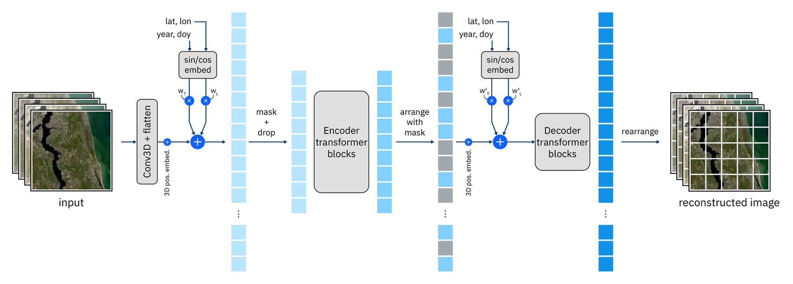
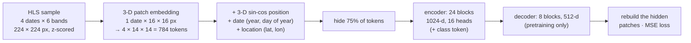
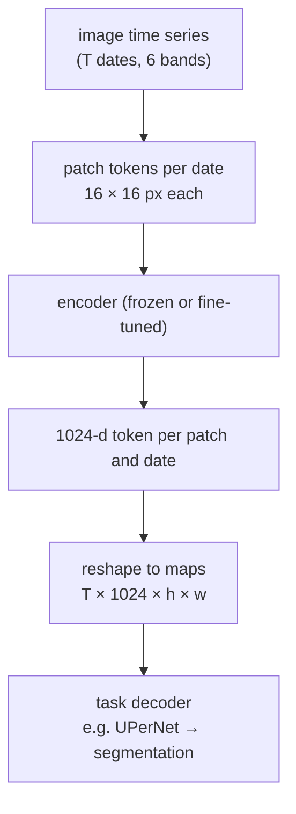

# Prithvi-EO-2.0

**In short.** A large Vision Transformer from NASA and IBM, pretrained to rebuild hidden parts of short
Harmonized Landsat–Sentinel-2 (HLS) image time series. It cuts each image into 16 × 16 px patches, keeps the dates
apart, and is told *when* (year, day of year) and *where* (latitude, longitude) each image was taken. The variant
compared here is **Prithvi-EO-2.0-300M-TL** (300 M weights, with time and location embeddings).

How it is used in this study: [Foundation models in this study](in_this_study.md#prithvi-eo-20).

## Architecture in the source

*Prithvi-EO-2.0 architecture and general pretraining framework. Figure: Szwarcman et al. (2024),
[arXiv:2412.02732](https://arxiv.org/abs/2412.02732), Fig. 3; licensed CC BY 4.0, reproduced at reduced size.*

## Pretraining

| Item | Original model |
| --- | --- |
| **Data** | NASA HLS V2 (Landsat 8/9 and Sentinel-2 harmonised to 30 m): 4.2 M training and 46 k validation samples, 2014–2023, sampled by land cover and ecoregion |
| **Sample** | 4 dates × 256 × 256 px, dates 1–6 months apart, randomly cropped to 4 × 224 × 224 px; chips with > 20% cloud or > 1% missing pixels removed |
| **Objective** | masked autoencoder: 75% of the patch tokens are hidden, the encoder sees only the visible ones, and a decoder rebuilds the hidden patches in pixel space (mean squared error on the hidden patches) |
| **Robustness** | time and/or location are dropped with probability 0.1 during pretraining, so the model also works without them |
| **Training** | 400 epochs, batch 3,840, 80 A100 GPUs |

*Pretraining of Prithvi-EO-2.0 (masked autoencoder). After pretraining the decoder is dropped and the encoder sees
all tokens.*

## Architecture

| Part | Original model |
| --- | --- |
| **Input** | 6 bands in this order: Blue, Green, Red, Narrow NIR, SWIR 1, SWIR 2 (HLS B02–B07; Sentinel-2 B2, B3, B4, B8A, B11, B12); z-score with the pretraining mean and standard deviation; 4 frames in time order, 224 × 224 px |
| **Tokens** | a 3-D convolution cuts the input into non-overlapping blocks of 1 frame × 16 × 16 px (tubelet of one frame because satellite revisits are irregular): 4 × 14 × 14 = 784 tokens + 1 class token for a 224 px, 4-date input |
| **Position, time, location** | fixed 3-D sine–cosine position encoding (width, height, time); year and day of year, and latitude and longitude, each sine–cosine encoded and added to every token with a learnt scale (the "TL" of the name) |
| **Encoder** | ViT-Large: 24 transformer blocks, 1024-dimensional tokens, 16 attention heads, MLP ratio 4; about 300 M weights |
| **Output** | the tokens of every block, shape (1 + T·h·w) × 1024; for dense tasks the class token is dropped and the tokens are reshaped to a map per date |
| **Downstream** | fine-tuned through TerraTorch; the paper uses UPerNet decoders for segmentation and LoRA for some tasks |

*Use of the pretrained encoder for a dense task.*

## Versions

- **TL vs non-TL.** The TL models add only the time and location embeddings; they scored higher overall on the
  GEO-Bench evaluation of the paper.
- **600 M.** A ViT-Huge (32 blocks, 1280-dimensional, 14 px patches), with the same bands, statistics and frames.

## Points to note

- Pretrained at **30 m**; at 10 m Sentinel-2 a 16 px patch covers 160 m instead of 480 m.
- Only **six bands**; the red-edge bands and B8 of Sentinel-2 are not part of the input.
- Built for **short** time series (4 dates in pretraining); a full year needs several passes or a longer input.

## Sources

- Szwarcman, D., et al. (2024). Prithvi-EO-2.0: a versatile multi-temporal foundation model for Earth observation
  applications. arXiv:2412.02732, §III.
- Model card and code: [Hugging Face, Prithvi-EO-2.0-300M-TL](https://huggingface.co/ibm-nasa-geospatial/Prithvi-EO-2.0-300M-TL)
  (`config.json`, `prithvi_mae.py`); [github.com/NASA-IMPACT/Prithvi-EO-2.0](https://github.com/NASA-IMPACT/Prithvi-EO-2.0).
