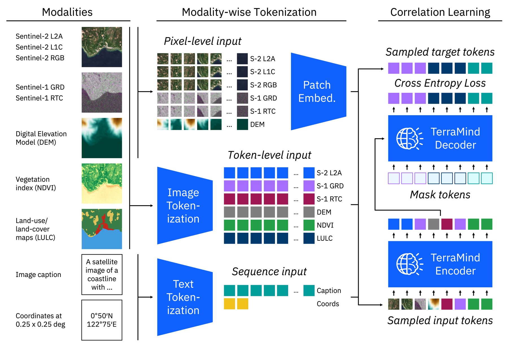
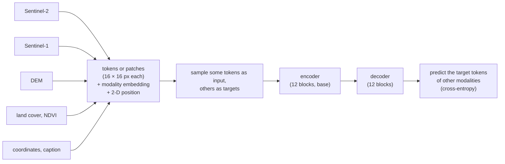
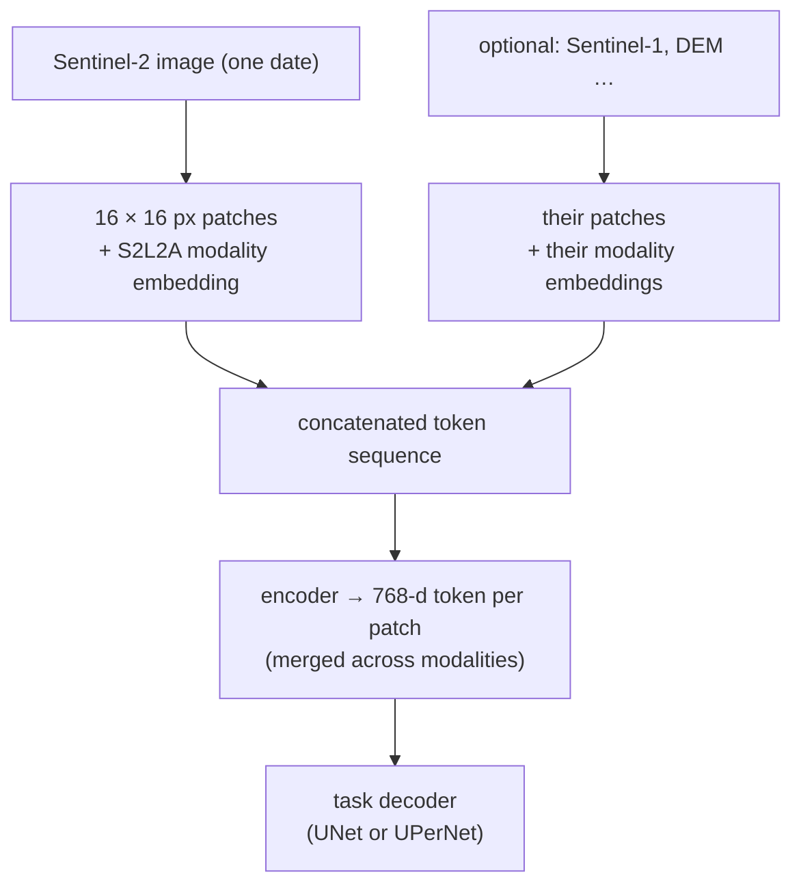

# TerraMind

**In short.** A multimodal transformer from IBM and ESA that learnt to translate between nine kinds of Earth data:
Sentinel-1, Sentinel-2, RGB, a digital elevation model, land use / land cover, NDVI, geographic coordinates and text
captions. From any subset of these inputs it predicts the others ("any-to-any"), which forces it to learn a joint
representation of optical, radar and terrain information. The model compared here is **TerraMind-1.0-base**.

How it is used in this study: [Foundation models in this study](in_this_study.md#terramind-10-base).

## Architecture in the source

*TerraMind: modalities, modality-wise tokenisation (pixel-level patches, image tokens, sequence tokens) and
correlation learning with an encoder–decoder. Figure: Jakubik et al. (2025), IBM and ESA, from the
[TerraMind-1.0-base model card](https://huggingface.co/ibm-esa-geospatial/TerraMind-1.0-base); Apache-2.0, reproduced
at reduced size.*

## Pretraining

| Item | Original model |
| --- | --- |
| **Data** | TerraMesh: about 9 M globally distributed, spatially and temporally aligned samples of 264 × 264 px at 10 m on the Sentinel-2 grid (built from SSL4EO-S12 v1.1 and MajorTOM-Core); one date per sample |
| **Modalities** | Sentinel-1 GRD and RTC, Sentinel-2 L1C and L2A, Sentinel-2 RGB, ESRI land use / land cover, NDVI, Copernicus DEM, geolocation, captions |
| **Objective** | encoder–decoder in the style of 4M: a random set of input tokens and target tokens is drawn from the modalities; the decoder predicts the target tokens (cross-entropy, "cross-modal patch-level classification") |
| **Dual scale** | image modalities enter either as **pixel patches** (linear embedding of 16 × 16 px) or as **discrete tokens** from a tokenizer; both cover the same 16 × 16 px area |
| **Tokenizers** | image-like modalities: finite-scalar-quantisation autoencoders (vocabulary 16 k, 4 k for land cover) with a diffusion decoder; text and coordinates: a WordPiece tokenizer |
| **Scale** | 500 B tokens |

*Pretraining of TerraMind: any-to-any masked token prediction across modalities.*

## Architecture

| Part | Original model |
| --- | --- |
| **Input** | per modality; Sentinel-2 L2A = 12 bands (B1–B12 without B10), z-scored with the pretraining statistics; 224 × 224 px in the fine-tuning set-up; one date |
| **Tokens** | linear patch embedding of 16 × 16 px for pixel modalities (196 tokens for a 224 px image); a learnt modality embedding and 2-D sine–cosine positions are added; the token sequences of all given modalities are concatenated |
| **Encoder (base)** | 12 transformer blocks, 768-dimensional, 12 heads, gated (SwiGLU-type) MLP; no class token |
| **Output** | the tokens of every block, each [tokens × 768]; tokens of several image modalities can be merged per patch (`mean`, `max`, `concat`) |
| **Multiple dates** | not part of pretraining; TerraTorch's temporal wrapper runs each date separately and pools the results |
| **Downstream** | the official fine-tuning configurations use a UNet decoder; the paper's PANGAEA benchmark uses a frozen encoder with a UPerNet head |
| **Thinking in modalities** | an optional mode that first generates intermediate modalities (e.g. land cover) from the input and adds them to the sequence before the task head |

*Use of the encoder for a dense task with one or several modalities.*

## Points to note

- **Single date** in pretraining and no date input: a time series is encoded date by date and must be combined by
  another module.
- Strongest when several modalities are supplied; with Sentinel-2 alone only part of what it learnt is used.
- The weight count is not published; the base encoder loaded in this study has about 87 M weights.

## Sources

- Jakubik, J., et al. (2025). TerraMind: large-scale generative multimodality for Earth observation.
  arXiv:2504.11171, §3–4.
- Model card: [Hugging Face, TerraMind-1.0-base](https://huggingface.co/ibm-esa-geospatial/TerraMind-1.0-base);
  code: [github.com/IBM/terramind](https://github.com/IBM/terramind) (`configs/`) and TerraTorch
  (`terratorch/models/backbones/terramind/`, TerraMind guide).
