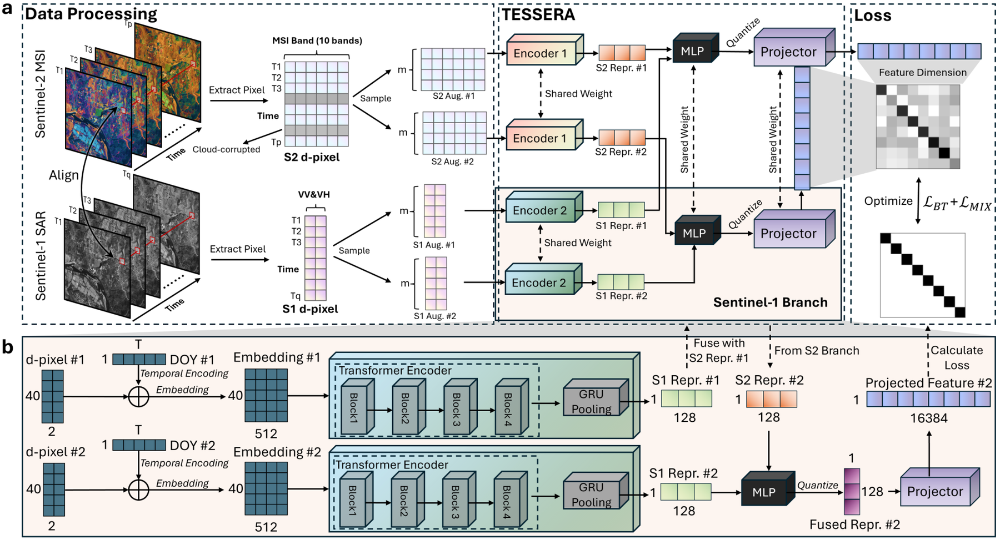
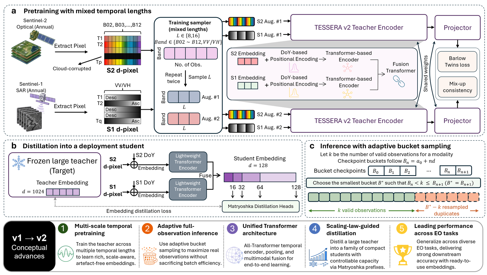
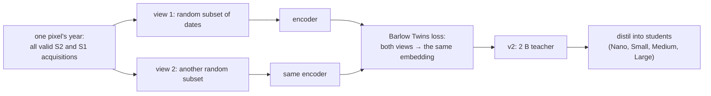
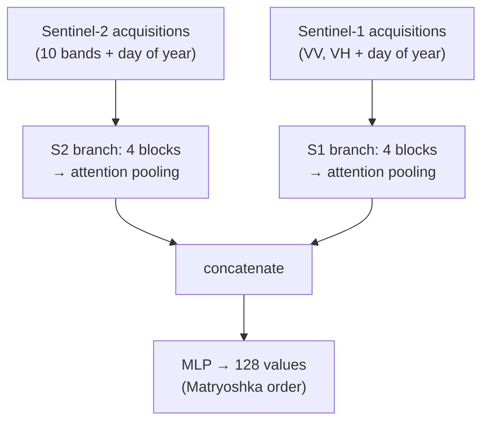

# TESSERA

**In short.** A pixel model from the University of Cambridge that treats the year of one pixel as a **set of dated
observations**: every valid Sentinel-2 or Sentinel-1 acquisition is one token, tagged with its day of year, and
attention pooling condenses the set into one 128-value vector. Cloudy dates are simply absent. It learns by making
two random subsets of the same pixel's year give the same embedding. Version 2 trains a 2 B-weight teacher and
distils it into small students; the **Medium student** is compared here.

How it is used in this study: [Foundation models in this study](in_this_study.md#tessera-v2).

## Architecture in the source

*TESSERA (v1) processing pipeline: Sentinel-1 and Sentinel-2 pixel time series, two augmented views and the dual
encoder branches. Figure: Feng et al. (2025), [arXiv:2506.20380](https://arxiv.org/abs/2506.20380), Fig. 3; licensed
CC BY 4.0, reproduced at reduced size.*

*TESSERA v2 architecture: per-modality transformers, cross-modal fusion and Barlow Twins pretraining of the teacher.
Figure: Feng et al. (2026), [arXiv:2607.03949](https://arxiv.org/abs/2607.03949), Fig. 3; licensed CC BY 4.0,
reproduced at reduced size.*

## Pretraining

| Item | Original model |
| --- | --- |
| **v1 data and objective** | about 800 M pixel samples from 3,012 MGRS tiles, 2017–2024; Barlow Twins: two views of a pixel are built by drawing 40 valid dates per sensor independently, and the network must give both views the same embedding (with a mix-up regulariser); projector discarded after pretraining |
| **v2 teacher** | the same objective with view lengths of 8 or 16 observations, whole sensors dropped now and then; about 14 B pixel samples from 3.4 M patches of 64 × 64 px; 2.06 B weights, 1024-dimensional output |
| **v2 students** | distilled, not self-supervised: a student's embedding prefixes of 16, 32, 64 and 128 values are pulled towards the frozen teacher embedding (cosine loss); 1.2 B pixel samples |

*Pretraining of TESSERA: self-supervised teacher (Barlow Twins), then distillation into small students (v2).*

## Architecture

| Part | Original model (v2 Medium student) |
| --- | --- |
| **Input** | Sentinel-2 L2A, 10 bands in the order B4, B2, B3, B8, B8A, B5, B6, B7, B11, B12, raw reflectance with a validity mask, per-band z-score; Sentinel-1 VV and VH (ascending and descending merged into one stream) |
| **Observations** | every valid acquisition of the year, packed into buckets of 8, 16, 24 … observations |
| **Tokens** | one token per observation: a small MLP of its bands plus a sine–cosine encoding of its day of year (1–365); separate sequences for Sentinel-2 and Sentinel-1 |
| **Encoder** | per sensor a branch of 4 transformer blocks, 440-dimensional, 4 heads, ending in single-head attention pooling over time; the two pooled vectors are concatenated and reduced by an MLP; 21.0 M weights |
| **Output** | **one 128-value vector per pixel**, mean 0 and standard deviation 1; Matryoshka-ordered: the first 16, 32 or 64 values work on their own (16 values keep about 92% of the full performance) |
| **Downstream** | nearest-neighbour or linear classifiers on the embeddings, or a small CNN over a map of embeddings; pre-computed global embedding maps are distributed |

*The Medium student: two sensor branches, attention pooling over time, one 128-value embedding per pixel.*

| Student | Width | Blocks | Heads | Weights |
| --- | --- | --- | --- | --- |
| Nano | 144 | 2 | 4 | 1.07 M |
| Small | 256 | 4 | 4 | 7.11 M |
| **Medium** | **440** | **4** | **4** | **21.0 M** |
| Large | 640 | 4 | 4 | 43.8 M |

## Points to note

- **One pixel at a time**, no spatial context, like [Presto](presto.md).
- Built for **single acquisitions** with exact dates; any number of observations per year is accepted.
- **Sentinel-1 and Sentinel-2** together; with one sensor missing, its branch receives an empty observation.
- The authors also publish ready-made annual embedding maps, which avoid running the model at all.

## Sources

- Feng, Z., Atzberger, C., Jaffer, S., et al. (2025). TESSERA: Temporal Embeddings of Surface Spectra for Earth
  Representation and Analysis. arXiv:2506.20380, §3 and Appendix A.
- Feng, Z., Jaffer, S., Shokar, I., Knezevic, J., et al. (2026). TESSERA v2: scaling pixel-wise Earth foundation
  models. arXiv:2607.03949, §4–5, Tables 6–7.
- Model card and code: [Hugging Face, TESSERA-V-2.0-2B-M](https://huggingface.co/geotessera/TESSERA-V-2.0-2B-M)
  (`model.py`; weights CC0); [github.com/ucam-eo/tessera](https://github.com/ucam-eo/tessera) (MIT).
- Reference summary: [TESSERA](../references/tessera.md).
