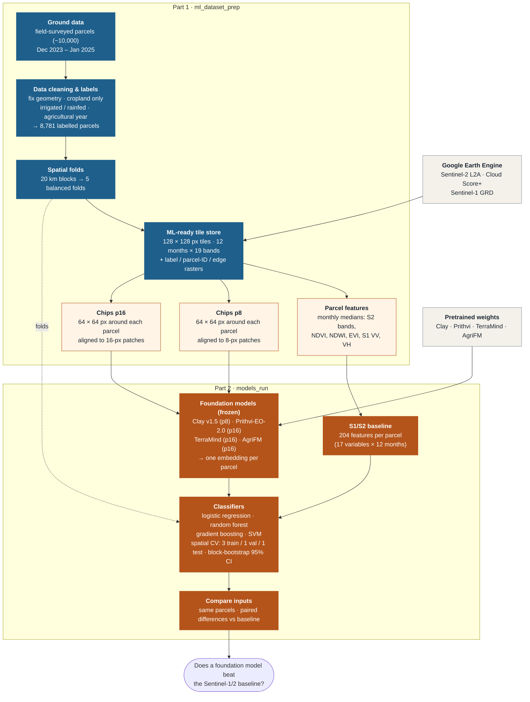

# Irrigated Cropland Mapping with Geospatial Foundation Models

**Evaluating geospatial foundation models (GeoFMs) for irrigated cropland mapping in North Africa and their
transferability to data-scarce regions** · MSc thesis, Aman Chaudhary · ITC, University of Twente ·
supervisors Dr. Mahdi Farnaghi and Prof. Dr. Raúl Zurita Milla

The project maps **irrigated** and **rainfed** cropland in Morocco from Sentinel-1 and Sentinel-2 time series. It
compares hand-built satellite features with the embeddings of four foundation models (**Clay v1.5,
Prithvi-EO-2.0, TerraMind, AgriFM**) on the same imagery and the same 8,781 field-surveyed parcels, always tested
on areas the model has never seen.

-   :material-school:{ .lg .middle } **Research**

    ---

    What the thesis asks, the method in brief, and where each research question stands.

    [:octicons-arrow-right-24: Thesis design](research/thesis_design.md) ·
    [Method in brief](research/overview.md)

-   :material-cog-outline:{ .lg .middle } **Methodology**

    ---

    The dataset and model pipelines step by step, the evaluation protocol and every decision.

    [:octicons-arrow-right-24: Dataset](dataset/index.md) · [Models](models/index.md) ·
    [Protocol](research/protocol.md) · [Decisions](research/decisions.md)

-   :material-flask-outline:{ .lg .middle } **Experiments**

    ---

    One setup page and one report per experiment, each reproducible from its config file.

    [:octicons-arrow-right-24: All experiments](experiments/index.md)

-   :material-chart-bar:{ .lg .middle } **Results and meetings**

    ---

    The answers so far, and one page per supervisor meeting.

    [:octicons-arrow-right-24: Results](results.md) · [Weekly notes](weekly/index.md)

## Where the thesis stands

| | |
| --- | --- |
| **Dataset** | ✅ 8,781 parcels (7,585 irrigated, 1,196 rainfed), 5 spatial folds, 2,987 tiles of 12 months × 19 bands |
| **RQ1 · frozen GeoFMs vs S1/S2 baseline** | ⏳ first result ([E01](experiments/E01_frozen_pca_nested/report.md)): no GeoFM beats the baseline (best Clay + SVM 0.910 vs 0.906); main run [E02](experiments/E02_frozen_pca_pastis/index.md) ready |
| **RQ2 – RQ4 · fine-tuning, annual maps, transfer** | 📝 planned ([design](research/thesis_design.md), [decision D11](research/decisions.md#d11-two-kinds-of-head-parcel-benchmark-and-mapping-model)) |
| **Latest changes** | [Progress log](progress.md) |

## Workflow

Setup, run order and the project folders: [Getting started](setup.md).
