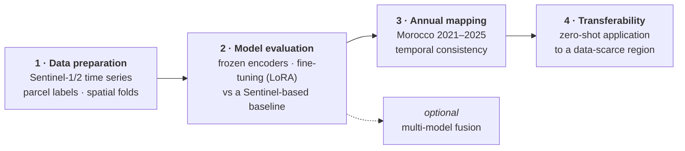

# Introduction

!!! abstract "Research proposal"
    **[:material-file-pdf-box: Thesis proposal (PDF)](assets/research_proposal.pdf)**

## Why irrigated cropland matters

Irrigated agriculture covers only about **20%** of the world's cultivated land, yet it produces around **40%** of
global food and accounts for about **70%** of all freshwater withdrawals (Wu et al., 2023). With population growth,
climate change and increasing water scarcity, reliable information on where irrigation takes place, and how it
changes from year to year, is essential for water management, agricultural planning and the Sustainable Development
Goals on food (SDG 2) and water (SDG 6).

**Morocco** is a demanding and relevant case. Agriculture provides about 14% of its GDP, 39% of national employment
and 74% of rural employment, and the country has developed more than two million hectares of irrigated land across
seven large schemes. At the same time it is among the most water-stressed countries in the world: agriculture uses
over 80% of the available water, while rainfall has fallen by about 30% over three decades. National programmes
(the Green Morocco Plan 2008–2020 and the Green Generation strategy 2020–2030) expanded drip irrigation from
160,000 ha in 2008 to 585,000 ha in 2019 (Guemouria et al., 2023). Tracking whether this expansion meets its goals,
and where water use is most intensive, requires precise and up-to-date irrigated cropland maps.

Much of the rest of North Africa lacks the dense, field-verified irrigation data that exists for Morocco. Methods that
can be trained where labels are rich and transferred to agro-climatically similar, data-scarce regions would be a
significant step for agricultural monitoring across the region.

## State of the art

| Approach | Examples | Limitation |
| --- | --- | --- |
| Global irrigation products | GMIA (Siebert et al., 2005; ~9 km), GIAM (Thenkabail et al., 2009) | far too coarse for fields of a few hectares |
| 30 m global maps | LGRIP30 (Teluguntla et al., 2023; 86.5% overall accuracy), GMIE (Wu et al., 2023) | static snapshots or decade-maximum extents, no annual series; locally calibrated thresholds |
| Machine learning on Sentinel-1/2 time series | current state of the art for field-scale irrigation mapping | depends on hand-built spectral and temporal features; degrades when applied to new regions; hard to combine sensors (Yang et al., 2026) |

**Geospatial foundation models (GeoFMs)** offer a different route. They are large neural networks pretrained with
self-supervised learning on vast unlabelled satellite archives. They learn rich spatio-temporal representations
directly from the imagery, without hand-built features, can be adapted to a task with few labels, and may transfer
across regions and sensors (Tseng et al., 2023; Szwarcman et al., 2024). Adaptation ranges from a **frozen encoder**
with a light classification head, through **parameter-efficient fine-tuning** such as LoRA, to full fine-tuning.

## Research gap

1. **No annual irrigated cropland maps exist** for Morocco or other North African countries. Global products give
   static extents, not the year-by-year maps needed to monitor irrigation expansion and evaluate policy. This needs a
   model that is accurate *and* consistent from one year to the next.
2. **No geospatial foundation model has been evaluated for irrigated cropland mapping**, and none in Africa's diverse
   agro-hydrological landscapes, from semi-arid to sub-humid climates and from flood to drip and pivot irrigation.
3. **It is unknown which foundation model suits the task best**, how much fine-tuning adds to a frozen encoder, and
   whether a model trained in one region still works in a data-scarce region nearby.

## Objectives and research questions

**Main objective:** to compare the performance and transferability of geospatial foundation models for irrigated
cropland mapping.

| Objective | Research question |
| --- | --- |
| **1 · Compare models and adaptation strategies** in Morocco | **RQ1** What classification accuracy does each foundation model achieve for irrigated cropland mapping across Morocco's agricultural regions, and how does it compare with a conventional Sentinel-based classifier? |
| | **RQ2** To what extent does parameter-efficient fine-tuning improve on a frozen encoder? |
| **2 · Evaluate temporal and spatial transferability** of the best model | **RQ3** How temporally consistent is the best model across years, and does the annual map series for Morocco (2021–2025) reflect the irrigation trends in national statistics? |
| | **RQ4** When the Morocco-trained model is applied without retraining to another region, how much does accuracy degrade, and do its annual maps stay consistent? |
| **3 · Optional extension:** multi-model fusion | **RQ5** Does fusing the embeddings of several foundation models improve on the best single model? |

## Study area and data

**Morocco.** Five major agricultural regions that together span the country's diversity (Ouassanouan et al., 2026):

| Region | Climate | Irrigation and crops |
| --- | --- | --- |
| El Gharb | humid | surface-water irrigation; rice, vegetables |
| Tadla | semi-arid to sub-humid | large-scale irrigation; sugar beet, cereals |
| Doukkala | Mediterranean | mixed irrigated and rainfed systems |
| El Haouz | semi-arid | groundwater irrigation; olives, citrus |
| Souss | arid | advanced drip systems; high-value export crops |

**Transfer region.** The proposal applies the best Morocco-trained model, without retraining, to **Tunisia**, which
shares Morocco's Mediterranean to semi-arid climate, crops and irrigation types but lacks parcel-level ground truth;
it would be validated with the GMIA-NEXT reference points (Kebede et al., 2026). The choice of transfer region is
under review ([decision D10](decisions.md#d10-transfer-region-under-review)).

| Data | Use |
| --- | --- |
| **Field survey**, Ouassanouan et al. (2026): 8,826 georeferenced parcels with crop type, irrigation status and irrigation system (8,781 after cleaning: 7,585 irrigated, 1,196 rainfed) | training and validation in Morocco |
| **Sentinel-2** multispectral (10 m) and **Sentinel-1** SAR (VV, VH) time series | model input |
| GMIE, LGRIP30, FAO WaPOR, FAO AQUASTAT | comparison of the maps with existing products and national statistics |

## Models compared

Four openly available GeoFMs are evaluated: **Prithvi-EO-2.0** (NASA, IBM), **Clay v1.5** (Clay Foundation),
**TerraMind** (IBM, ESA) and **AgriFM** (Li et al., 2025). They accept multi-temporal Sentinel-1/2 input and together
represent the principal GeoFM families: masked-autoencoder Vision Transformers, a multimodal generative model and an
agriculture-specific spatio-temporal model. Architecture, pretraining, configuration and sources are given in
[Foundation models](foundation_models.md).

## Approach

How each step is carried out: [Method](phase2_models/overview.md).

## Expected outcomes

1. A comprehensive evaluation of four geospatial foundation models for irrigated cropland mapping in North Africa,
   against a strong Sentinel-based baseline under spatial validation.
2. A comparison of frozen-encoder and parameter-efficient fine-tuning strategies for this task.
3. Annual irrigated cropland maps for Morocco at 10 m resolution for 2021–2025, checked against national statistics.
4. An assessment of the temporal consistency of foundation-model predictions across years.
5. An assessment of how far the best model transfers to a data-scarce region.
6. A reusable, ML-ready dataset of irrigated and rainfed parcels with spatial folds.

!!! info "Full proposal"
    Background, literature, methods, risks and the work plan in detail:
    **[Research proposal (PDF)](assets/research_proposal.pdf)**
