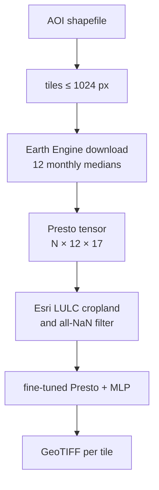

# Review of `presto_pipeline` against this study (working note)

Working note, 24 Nov 2026. Not part of the site navigation.

**Repository reviewed:** [zlab-foss/presto_pipeline](https://github.com/zlab-foss/presto_pipeline), commit
`e46418c` (31 May 2026; last push 18 Aug 2026), 22 commits, description "Presto — Irrigation + LandCover
Integration". A shallow clone is kept outside this repository at `../presto_pipeline` (next to
`irrigated_area_mapping_code/`). File references below (`file:line`) point into that clone. The code was read, not
run; the checkpoints were inspected with `pickletools` (no unpickling).

## 1. Summary

`presto_pipeline` is an inference pipeline that applies an already fine-tuned Presto classifier (irrigated vs
rainfed) to the pixels of an area of interest. Imagery is downloaded per tile from Google Earth Engine, either
Sentinel-2 RGB+NIR with Sentinel-1 VV/VH, or Landsat with ERA5-Land; pixels outside the Esri 10 m LULC cropland class
are skipped; predictions are written as `uint8` GeoTIFFs per tile. A second script applies a small MLP to Google's
AlphaEarth annual embeddings. The repository contains no training script, no training labels and no accuracy
figures, and it has no licence.

For this study it is **not a replacement for any component**: its data access (Earth Engine, QA60 cloud mask,
EPSG:4326 grid, Sentinel-1) contradicts decisions D9, D14 and D18, and its Presto inputs deviate from the
pretraining format in four respects (Section 4). Two ideas are worth adopting for the mapping phase: skipping
non-cropland pixels before the encoder, and writing never-observed pixels as nodata.

## 2. What the repository does

### 2.1 Purpose and outputs

| Item | Content | Source |
| --- | --- | --- |
| Purpose | pixel-level irrigation maps (irrigated vs rainfed), optional land-use masking | `README.md:1-14` |
| Output | per tile `predictions/<year>_pNNN_tYYY_XXX.tif`, `uint8`, 0 = nodata or not cropland, 1 = rainfed, 2 = irrigated, aligned to the optical raster | `main.py:345`, `main.py:496-520`; `README.md:170-182` |
| Intermediate files | per tile optical stack (`s2/` or `landsat/`), auxiliary stack (`s1/` or `era5/`), raw and aligned Esri LULC (`esri_lulc/`) | `main.py:352-358`, `main.py:207-211` |
| Mosaicking | separate script `merge_tiffs.py` (rasterio merge of a folder of tiles) | `merge_tiffs.py:51` |
| Regions in the code | areas of interest `ROI/karkheh.shp`, `ROI/sample.shp`; batch runs listed for `oroumieh`, `anzali`, `karkheh` | `ROI/`, `loop_run.py:33-58` |
| Licence | none: no `LICENSE` file, GitHub reports no licence; the model code (`model/models.py`, `model/layers.py`) reproduces the encoder of nasaharvest/presto (MIT) without its copyright notice | `gh api repos/zlab-foss/presto_pipeline` (`license: null`); `grep` for "licen", "nasaharvest" returns nothing |

### 2.2 Input data

| Item | Sentinel mode | Landsat mode | Source |
| --- | --- | --- | --- |
| Access | Google Earth Engine through `geedim`, one download per tile (service-account credentials) | same | `data_sources/pysentinel.py:280-292` |
| Optical collection | `COPERNICUS/S2_SR_HARMONIZED`, scenes with `CLOUDY_PIXEL_PERCENTAGE` ≤ 10, QA60 cloud and cirrus bits masked | `LANDSAT/LC08`+`LC09` (or LE07, LT05) C2 L2, `QA_PIXEL` mask, scale 0.0000275, offset −0.2 | `pysentinel.py:197-209`; `pylandsat.py:145-178` |
| Bands | default `red, green, blue, nir` (B4, B3, B2, B8); `"all"` selects the 12 L2A bands | blue, green, red, nir, swir1, swir2 | `pysentinel.py:51-62`, `main.py:67` |
| Auxiliary | `COPERNICUS/S1_GRD`, IW, VV+VH, converted from dB to linear power before the median; optional orbit filter (default both) | `ECMWF/ERA5_LAND/HOURLY`: monthly mean 2 m temperature, monthly summed precipitation | `pysentinel.py:420-470`, `pysentinel.py:335`; `pysatellite.py:41`, `pysatellite.py:156-160` |
| Compositing | 12 monthly **medians** of a season starting in **September** (`start_month = 9`); a month without scenes is fully masked | same | `pysentinel.py:71`, `pysentinel.py:165-188`, `pysentinel.py:211-228` |
| Grid | `EPSG:4326`, scale 10 m (Sentinel), 30 m (Landsat, ERA5) | | `pysentinel.py:286-287`; `pylandsat.py:49`, `pylandsat.py:323-324` |
| Tiling | each polygon of the shapefile is split into tiles of at most `tile_size` px (default 1024 px, i.e. 10.24 km at 10 m; the README calls this "~1 km") | | `shap_tiler.py:11-35`, `README.md:89` |
| Cropland mask | Esri Global LULC 10 m (`projects/sat-io/open-datasets/landcover/ESRI_Global-LULC_10m_TS`) of the same calendar year, class 4 = cropland, 2017–2024 only; if the download fails, the tile is processed **without** a mask | | `pysatellite.py:237`, `main.py:184-271` |

STAC is not used anywhere in the repository.

### 2.3 How Presto is used

Presto is used as a **fully fine-tuned encoder with an MLP head**, not as a frozen feature extractor.

| Item | Content | Source |
| --- | --- | --- |
| Classifier | `PrestoClassifier`: Presto `Encoder` (2 blocks, 128-d) + MLP head; prediction = argmax of the logits | `model/presto.py:28-146`, `model/presto.py:507-521` |
| Pretrained start | `weights/default_model.pt`, identical (SHA-1 `231fc7f…`) to the official file used in this study (`checkpoints/presto/default_model.pt`) | `model/presto.py:53`, `model/presto.py:602-644` |
| Released checkpoints | `Presto_S2RGBNIR_S1.pt` (run of 2 Feb 2026) and `Presto_L8_ERA5.pt` (10 May 2026): `num_classes = 2`, `freeze_encoder = False`, head (128, 64), lr 1e-3, 30 epochs; `Presto_S2Full_S1.pt`, selected when other Sentinel-2 bands are requested, is **missing** from the repository | `weights/irrigation/`; checkpoint metadata; `main.py:163-170` |
| Embedding | normalised mean of all output tokens, including the location token (`eval_task=True`) | `model/models.py:218-222` |
| Training | a `fit` method exists, but no training script, training data, label source, validation design or accuracy is provided | `model/presto.py:275-476` |
| Second path | `alpha_main.py`: annual AlphaEarth embeddings (`GOOGLE/SATELLITE_EMBEDDING/V1/ANNUAL`, 2017–2024) classified by a PyTorch MLP (`Alpha.pth`, head (64, 32), classes "Irrigated", "Rainfed") | `alpha_main.py:75`, `alpha_main.py:258-262`, `alpha_main.py:297`; `pysatellite.py:442-451` |

### 2.4 Pipeline steps

| Step | Detail | Source |
| --- | --- | --- |
| Tensor | 17 Presto channels; channels without data are masked by a constant "structural" mask (same for every pixel); missing months filled by linear interpolation in time, ends by nearest valid month; NDVI computed from red and NIR; remaining non-finite values set to 0 | `preprocess.py:144-256`; `utils/preprocess_utils.py:9-126` |
| Dynamic World | every month set to class 9 (= missing, masked) | `preprocess.py:182` |
| Filter | pixels with no valid value in any month are excluded; pixels outside Esri class 4 are excluded; a tile with no remaining pixel is written as zeros without inference | `main.py:403-485` |
| Inference | `TensorDataset` of the remaining pixels, batch 2,048 | `main.py:274-321`, `preprocess.py:84` |

## 3. Relevance to the research questions and the mapping phase

| Part of this study | Relevance | Reason |
| --- | --- | --- |
| **RQ1** frozen GeoFMs vs baseline | low | presto_pipeline fine-tunes Presto with Sentinel-1 or Landsat+ERA5 on undisclosed labels with no reported accuracy; there is nothing to compare against E04 (frozen Presto, Sentinel-2 only, macro-F1 0.903 [0.848, 0.942], [E04](../experiments/E04_frozen_geofm.md)) |
| **RQ2** frozen vs fine-tuned | low to moderate | it is a working example of full fine-tuning of Presto with an MLP head, i.e. the strategy that E05 tests for Prithvi; it gives no evidence, since no evaluation is published |
| **RQ3** temporal consistency, map series | low | one model per year is applied; there is no multi-year assessment |
| **RQ4** second region | none directly | its regions (Karkheh, Lake Urmia/Oroumieh, Anzali) are not study areas here; the released weights could in principle be applied to Morocco as an external model, but they need Sentinel-1 (contradicts D14) and their training data are unknown |
| **RQ5** fusion | marginal | the AlphaEarth path shows a ready-made annual embedding (64-d) that could be a further input to a fusion test; it is outside the six encoders selected in [Foundation models](../foundation_models/index.md) |
| **Phase 5** wall-to-wall maps | moderate (ideas, not code) | the per-tile structure "download → tensor → mask → infer → GeoTIFF with nodata" mirrors the planned workflow ([Phase 5](../phase5_maps/index.md)); the mask-before-inference step is directly useful (Section 5) |

### 3.1 Could it replace or simplify a part of this pipeline?

| Component here | presto_pipeline equivalent | Verdict |
| --- | --- | --- |
| Sentinel-2 monthly composites from STAC per 10.24 km block (`s2_download/`, [D18](../decisions.md#d18-wall-to-wall-composites-from-stac-for-the-maps)) | Earth Engine + `geedim`, per tile, QA60, scenes ≤ 10% cloud, EPSG:4326 | **No.** D18 moved away from Earth Engine because of the 48 MB request limit and about 40 h per year on one stream; QA60 is the mask that [D9](../decisions.md#d9-cloud-score-instead-of-qa60) replaced by Cloud Score+ (here SCL in the STAC path); the 10%-cloud scene filter discards many partly clear scenes; a geographic grid does not match the projected 128 px tiles |
| Per-pixel Presto embeddings (`pixelwise_run/encoders.py`, `PrestoEncoder`) | `PrestoTensorBuilder` + `Encoder` | **No.** The design is the same (17-channel tensor, constant mask, temporal interpolation, NDVI, Dynamic World = 9), but this study's implementation already follows the pretraining format more closely (Section 4) |
| Mapping at scale (tiling, inference, GeoTIFF output) | `main.py`, `shap_tiler.py`, `merge_tiffs.py` | **Partly, as a pattern.** Per-tile skip-if-exists and resume (`skip_download`, `tile_idx_resume`, `main.py:361-387`, `main.py:582-585`) and nodata handling are simple and robust; the code itself assumes Earth Engine inputs and a pixel-only classifier without a spatial head, so it cannot drive the UPerNet models of E04 |

## 4. How it feeds Presto, compared with this study and with pretraining

| Aspect | Presto pretraining (nasaharvest/presto) | This study (`encoders.py`, `PrestoEncoder`) | presto_pipeline |
| --- | --- | --- | --- |
| Sensors | S1, S2 (10 bands), ERA5, SRTM, Dynamic World, NDVI | Sentinel-2 (10 bands) + NDVI; other groups masked ([D14](../decisions.md#d14-sentinel-2-only-for-every-input)) | Sentinel-2 RGB + NIR + NDVI with S1 VV/VH; red-edge, NIR 20 m, SWIR, SRTM and Dynamic World masked (`preprocess.py:42-43`, `preprocess.py:144-159`); Landsat mode puts Landsat bands into the S2 slots and ERA5 into the ERA5 slots |
| S2 channel order in group `S2_RGB` (channels 2–4) | B2, B3, B4 (blue, green, red) (`external/presto/presto/dataops/pipelines/s1_s2_era5_srtm.py:96-99`) | B2, B3, B4 (`encoders.py`, `S2_IN`) | **red, green, blue** (`preprocess.py:124-126`, `preprocess.py:208-210`): blue and red are swapped relative to pretraining |
| S2 scaling | reflectance / 10,000, range ≈ [0, 1] (`s1_s2_era5_srtm.py`, `S2_DIV_VALUES`) | / 10,000 | (x − 5,000) / 5,000, range ≈ [−1, 1] (`preprocess.py:17-25`, `preprocess.py:92-97`) |
| S1 scaling | dB, (x + 25) / 25 (`s1_s2_era5_srtm.py:28-31`) | not used | linear power, (x − 0.05) / 0.05 (`pysentinel.py:420-426`, `preprocess.py:23-24`) |
| Location token | (latitude, longitude) (`external/presto/single_file_presto.py:316`) | (lat, lon) (`pixelwise_run/tile_common.py:123`) | **(longitude, latitude)** (`preprocess.py:165`, `preprocess.py:249-252`), read by `cartesian` as (lat, lon) (`model/models.py:95-104`): the pixel is placed at the wrong point on the sphere |
| Month of the first time step | calendar month of the first composite | `start_month − 1` (September → 8) (`encoders.py`, `PrestoEncoder.forward`) | **0 (January)** for every tile (`model/presto.py:217`, `model/presto.py:247-252`, no month passed in `main.py:489`), although the series starts in September (`pysentinel.py:71`) |
| Missing months | masked tokens in pretraining | linear interpolation in time; never-observed pixels → 0 | linear interpolation, ends filled from the nearest valid month (`preprocess_utils.py:9-126`); never-observed pixels → nodata in the map (`main.py:403-431`) |
| Encoder weights | — | frozen (E04) | fine-tuned (`freeze_encoder = False` in both checkpoints) |

Because the encoder was fine-tuned, a consistent deviation at training and inference time is partly absorbed by the
fine-tuning. The deviations nevertheless reduce how much of the pretrained representation is reused: the
`S2_RGB` projection, the S1 projection, the location token and the month encoding all receive inputs with a
different meaning from pretraining. A frozen use of these settings, as in E04, would not be valid. None of these
points contradicts the description of Presto in [Foundation models](../foundation_models/presto.md); the pretraining
format stated there (Sentinel-2 / 10,000, location as latitude and longitude, month and band-group encodings) agrees
with the upstream code and with `PrestoEncoder`.

## 5. Worth borrowing

1. **Mask before the encoder in the mapping phase.** Pixels outside the chosen cropland mask are removed before
   inference, and a tile without cropland skips the model (`main.py:433-485`). For Presto and TESSERA, which cost
   14.1 and 24.7 GPU hours in E04 because every pixel is encoded, encoding only mask pixels (and giving the others a
   zero embedding before the UPerNet head) could reduce mapping time roughly in proportion to the non-cropland
   share. The effect of zero embeddings on the spatial head at mask edges would have to be checked on the labelled
   tiles first. This fits the open choice of mask in [D19](../decisions.md#d19-two-class-experiments-cropland-extent-in-the-mapping-phase).
2. **Explicit nodata for never-observed pixels.** Pixels without any clear month are written as nodata instead of
   being classified from a zero vector (`main.py:403-431`); this study's `fill_time_torch` sets them to 0 and still
   classifies them. For the maps, a separate nodata value (and a per-pixel count of clear months) would make such
   pixels visible in the accuracy assessment.
3. **Resume and skip-if-exists per tile** (`main.py:361-387`, `main.py:582-585`), already partly present in
   `s2_download/`; a check that the same logic exists for the inference step of Phase 5.
4. **Esri LULC as one more mask candidate**, aligned to the image grid with nearest-neighbour resampling
   (`main.py:184-271`, `utils/utils.py`). Esri LULC was one of the four products of the union mask
   ([D17](../decisions.md#d17-cropland-mask-from-four-products-and-a-not-cropland-class)), which is now archived;
   the maps use the annual Dynamic World cropland only, so this point no longer applies.

## 6. Risks and mismatches

- **No licence.** Without a licence the code cannot be reused or redistributed; ideas can be reimplemented. Its
  model code also omits the MIT notice of the upstream Presto code.
- **No evaluation.** No training data, labels, validation design or accuracy are published; the released irrigation
  weights cannot serve as a reference product or a baseline.
- **Input deviations** (Section 4): red/blue swap, non-standard scaling, swapped latitude and longitude, fixed month
  index 0. Copying `preprocess.py` into this study would introduce these errors.
- **Silent fallbacks.** A failed LULC download leads to inference on all pixels (`main.py:267-271`); a failed
  downloader initialisation is reported as "VPN not connected" and continues (`main.py:545-549`).
- **Incomplete release.** `Presto_S2Full_S1.pt` is referenced (`main.py:168`) but absent; the README describes a
  `group_flags` option of `PrestoTensorBuilder` that the code does not have (`README.md:145-156` vs
  `preprocess.py:84`); `get_data.py` uses command-line arguments.
- **Sensor and access.** Sentinel-1 input contradicts D14; Earth Engine per-tile download contradicts D18.

## 7. Recommendation

Do not adopt the repository or its weights. Record it as related work only if it becomes citable (it has no paper or
licence). In Phase 5, reimplement two ideas in this study's own code: (1) restrict per-pixel encoding to the chosen
cropland mask, after a test on the labelled tiles, and (2) write never-observed pixels as nodata. No change to E04
or to `PrestoEncoder` is indicated; the comparison confirms that this study's Presto input follows the pretraining
format.
