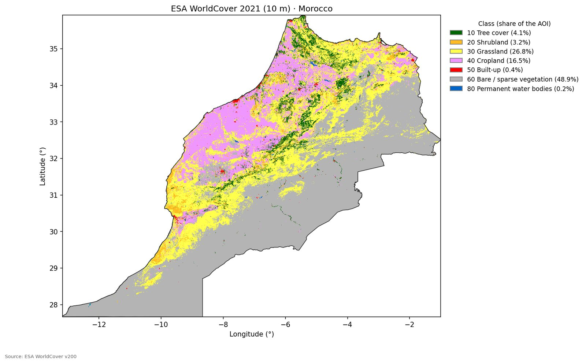
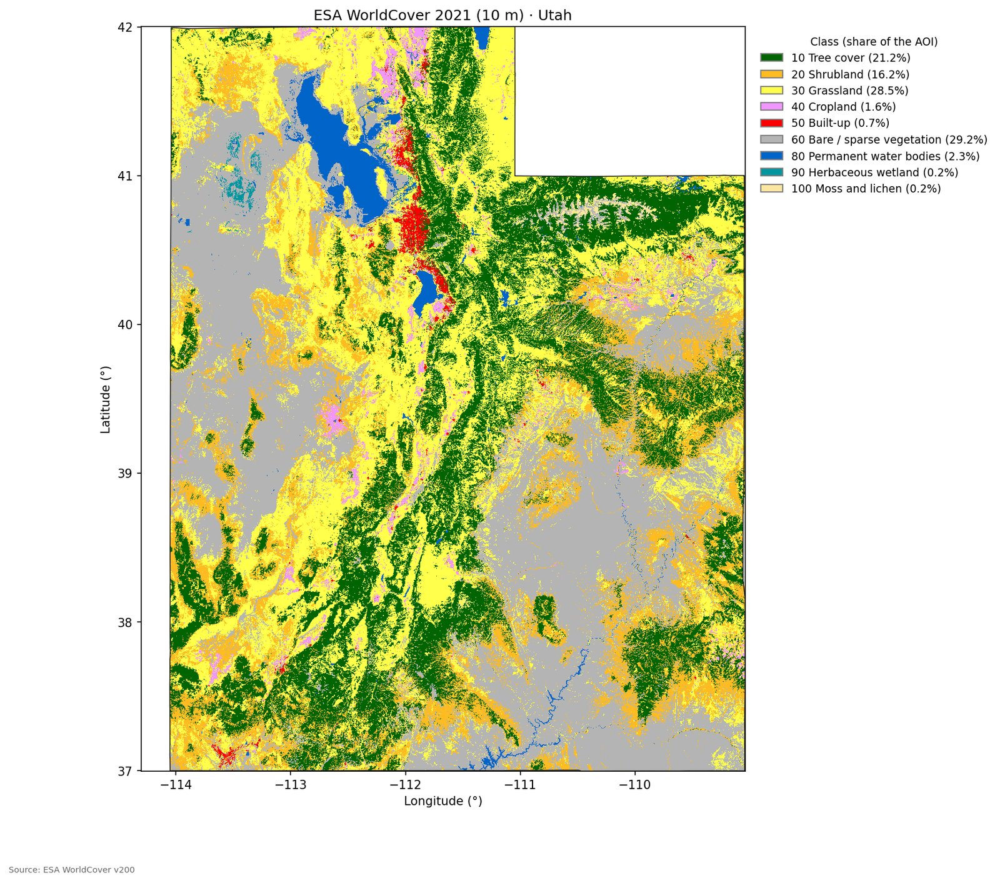
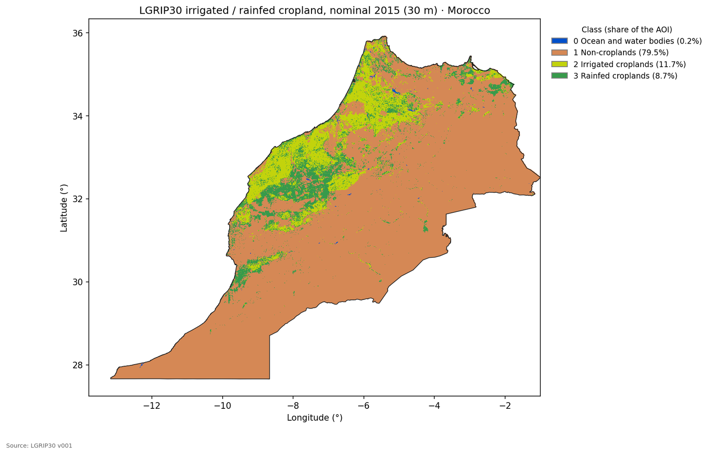
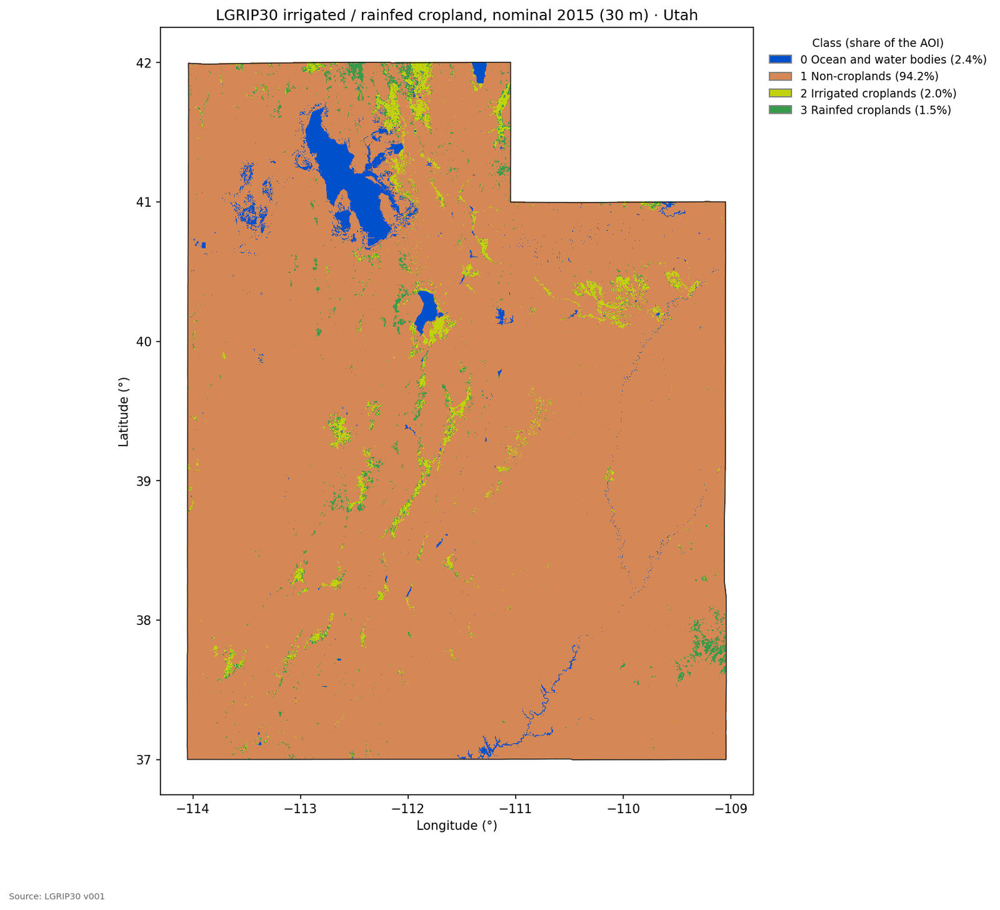

# Cropland extent (Dynamic World)

The annual irrigated / rainfed maps are **continuous (wall-to-wall)**: every 10 m cropland pixel of a region gets a
class, not only the surveyed parcels. The cropland that the maps cover, and that selects the blocks whose imagery is
downloaded, is one layer: the **annual Dynamic World cropland** of each agricultural year
(`data_download/02a_dynamic_world.py`). The reference maps drawn for comparison are described in §5.

!!! note "Experiments and maps"
    The labels, the pixel samples and the experiments E01–E05 do not use the cropland layer: they classify the
    labelled pixels of the surveyed parcels, which are all cropland, as irrigated or rainfed
    ([pixel samples](pixel_samples.md)). The layer selects the downloaded blocks and, in the mapping phase
    ([Phase 5](../phase5_maps/index.md)), the pixels that are classified
    ([D19](../decisions.md#d19-two-class-experiments-cropland-extent-in-the-mapping-phase)).

| Script | What it does | Output (in `outputs/<region>/data_download/`) |
| --- | --- | --- |
| `02a_dynamic_world.py` | binary Dynamic World cropland of every planned block, one 10 m GeoTIFF per block and agricultural year, and a VRT mosaic per year; maps of the cropland share and of the blocks with cropland | `dynamic_world/<season>/<bx>_<by>.tif`, `dynamic_world/<season>/mosaic.vrt`, `cropland_map_<season>.png`, `cropland_blocks_<season>.png` |
| `04a_ref_esa_worldcover.py` | reference map: ESA WorldCover 2021, 10 m GeoTIFF + PNG | `reference/esa_worldcover/` |
| `04b_ref_lgrip30.py` | reference map: LGRIP30 irrigated / rainfed cropland, 30 m GeoTIFF + PNG | `reference/lgrip30/` |
| `04c_ref_dynamic_world_annual.py` | reference map: annual Dynamic World land cover (all 9 classes) per calendar year, 10 m GeoTIFF + PNG maps | `reference/dynamic_world/` |

All use the region's **mapping area** in `data_download/regions.py`: Morocco without Western Sahara (FAO GAUL 2015,
414,906 km²) and the state of Utah (FAO GAUL 2024, 219,809 km²).

## 1. Annual Dynamic World cropland

Dynamic World (Brown et al., 2022) classifies **every Sentinel-2 image** into nine land-cover classes; it has no
annual product. `02a_dynamic_world.py` therefore builds one binary layer per agricultural year in Earth Engine:

- **Window:** the 12 months of the agricultural year (Morocco September – August, Utah October – September), the same
  months as the Sentinel-2 and Sentinel-1 composites and the labels.
- **Rule:** `CROPLAND` = 1 where "crops" is the most frequent Dynamic World class in **at least two of the 12
  months** (`MIN_CROP_MONTHS`), 0 elsewhere, 255 outside the mapping area and where the pixel has no Dynamic World
  image in the year (uint8).
- **Download:** block by block, for every block of `01_plan_blocks.py`: one Earth Engine request
  (`ee.data.computePixels`, about 1 MB) per 10.24 km block on the block's own 10 m grid, written as
  `dynamic_world/<season>/<bx>_<by>.tif`, so every training tile is an exact window of its block. Blocks run in
  parallel, blocks with training tiles first; a failed request is retried, finished blocks are kept, and the run
  stops by itself after 20 failed blocks in a row (for example when the Earth Engine quota is used up), so a rerun
  continues where it stopped. At the end a VRT mosaic (`<season>/mosaic.vrt`) joins the blocks of the year into
  one layer of the whole region.

**Why months, not the class of the whole year.** A rainfed cereal field is green for a few months (in Morocco about
December to April) and bare or dry grass for the rest of the year, so its most frequent class over the whole year is
often "bare" or "grass". Counting the months in which "crops" dominates keeps short rainfed seasons, and requiring two
months keeps a single misclassified scene from making a pixel cropland.

**Check (Morocco, 2023/24).** Six blocks were computed with both rules: the most frequent class of the calendar year
2024, and "crops" dominant in at least two months of September 2023 – August 2024.

| Blocks | Whole calendar year | Two months of the agricultural year |
| --- | --- | --- |
| three blocks with the most rainfed parcels: rainfed parcel pixels flagged | 98–100% | 100% |
| irrigated parcel pixels in the same blocks and the block with most irrigated parcels | 94–100% | 99–100% |
| cropland share of these four blocks | 90–93% | 94–96% |
| two desert blocks in the southwest | 0% | 0% |

## 2. Blocks and downloads

All imagery is downloaded once per region and agricultural year on one grid of **10.24 km blocks** (1024 × 1024 px at
10 m: the 128 px tile grid grouped 8 × 8)
([D20](../decisions.md#d20-download-once-on-1024-km-blocks-from-earth-engine-training-tiles-cut-from-them)):
Dynamic World from Earth Engine with a service account, Sentinel-2 and Sentinel-1 from open STAC catalogues
without an account ([D21](../decisions.md#d21-sentinel-2-and-sentinel-1-from-open-stac-catalogues-earth-engine-only-for-dynamic-world)).
`01_plan_blocks.py` plans **every** block that touches the mapping area, without a mask: 4,199 blocks in Morocco and
2,213 in Utah, the same blocks every year (`outputs/<region>/data_download/grid/blocks.parquet`, `.geojson`, map
`blocks.png`). It uses no training data: the training tiles in each block are counted from the current tile plan
when the Sentinel downloads load the grid (`download_common.load_blocks`), which also reports any training tile
outside it.

The cropland layer then selects the further downloads: `02b_s2.py` (Sentinel-2 monthly composites from Earth Search,
collection `sentinel-2-c1-l2a`, cloud mask from the scene classification SCL) and `02c_s1.py` (Sentinel-1 RTC,
gamma0, from Microsoft Planetary Computer, ascending and descending) fetch only the blocks with cropland (at least 164 cropland pixels,
1% of a 128 px tile, `MIN_CROP_PIXELS`) and every block with training tiles, so every training tile can be cut out
even where Dynamic World finds no cropland. Later sources (ERA5) follow the same rule. Each download writes one file
per block to `outputs/<region>/data_download/<source>/<season>/<bx>_<by>.tif`; `03_build_vrt.py` joins the blocks of
each source and year into one VRT mosaic. The STAC downloads read only the block's window of each scene's
cloud-optimised GeoTIFFs (`stac_common.py`); unreadable scenes are retried and then read one by one, and a block
with more than 2% unreadable scenes is not written, so a rerun fetches it.

| Source | Size | Download time |
| --- | --- | --- |
| Sentinel-2 (Earth Search STAC) | not yet measured (159 MB per block from Earth Engine) | 958 s per block on a laptop (164 s from Earth Engine) |
| Sentinel-1 (Planetary Computer STAC) | not yet measured (82 MB per block from Earth Engine) | not yet measured (92 s per block from Earth Engine) |
| Dynamic World cropland | 1 MB per block before compression (uint8; a binary band compresses strongly) | 13 s per block with two blocks in parallel, on a laptop, with the Earth Engine project in restricted mode |

The training tiles are cut from the blocks (`data_training_prep/04_cut_tiles.py`; the tile's window of the cropland
layer is written as `<tile_id>_dw.tif`). For the maps, each block is classified on its own, on its cropland pixels
only (tile models read 128 px windows from the block, pixel models read each pixel's series), and the block maps are
merged at the end, so no further tile files are written.

## 3. Maps of the cropland

For each year `02a_dynamic_world.py` draws two maps in `outputs/<region>/data_download/dynamic_world/`: the cropland
share of every 320 m cell over the mapping area (`cropland_map_<season>.png`) and the block grid with the blocks that
hold cropland highlighted and the blocks with training tiles outlined (`cropland_blocks_<season>.png`).
`DOWNLOAD = False` redraws them from the GeoTIFFs without Earth Engine.

## 4. Check against the labelled parcels

The label scripts (`data_training_prep/01_prepare_labels_*.py`) do not read the cropland layer, and the pixel samples
contain the surveyed parcels whether or not they lie inside it. Before the maps, the layer is checked against all
surveyed parcels: the **omission** of surveyed irrigated and rainfed parcels (cropland the layer misses) and, against
the reference maps, the **commission** (land in the layer that is not cropland) ([Phase 5](../phase5_maps/index.md)).

## 5. Reference layers

ESA WorldCover and LGRIP30 are drawn as reference maps for the documentation and for comparing the final maps.
`04c_ref_dynamic_world_annual.py` builds the annual Dynamic World land cover per calendar year (Morocco 2024 and 2025,
Utah 2021 and 2024), downloaded for the whole region as one GeoTIFF with `geemap.download_ee_image` on the 10 m grid
of the blocks: by default one band, the most frequent of the nine classes (`label`); the share of images labelled
crops (`crop_freq`) can be added. It draws a land-cover map with all classes and legend and a cropland map. No model
or dataset script uses the reference layers. Colours: WorldCover's official palette; LGRIP30 water `#0050cb`,
non-cropland `#d58855`, irrigated `#c2d30c`, rainfed `#379a4b`. The PNG maps are reduced to 2,500 px for display
(mode resampling) from the original 10 m and 30 m GeoTIFFs.

| | Morocco | Utah |
| --- | --- | --- |
| ESA WorldCover 2021 |  |  |
| LGRIP30 (nominal 2015) |  |  |

LGRIP30 calls 11.7% of Morocco irrigated and 8.7% rainfed, including large parts of the rainfed Gharb and Chaouia
plains; it is a reference layer, not ground truth.

!!! note "Archived and retired"
    - **Union cropland mask.** A mask from the union of four cropland products (ESA WorldCover, Esri LULC, GCEP30,
      GLAD) was built first ([D17](../decisions.md#d17-cropland-mask-from-four-products-and-a-not-cropland-class)).
      It is not used; its page and script are archived ([Union cropland mask](../archive/cropland_union_mask.md),
      `data_download/archive/00_union_cropland_mask.py`).
    - **STAC and per-tile routes.** The wall-to-wall Sentinel-2 tiles were at first downloaded from the Earth Search
      STAC catalogue (`s2_download/`, [D18](../decisions.md#d18-wall-to-wall-composites-from-stac-for-the-maps)) and,
      earlier, per tile from Earth Engine (`pixelwise_run/06_build_cropland_tiles.py`). Both are retired; the maps
      use the `data_download/` blocks.

## References

- Brown, C. F. et al. (2022). Dynamic World, near real-time global 10 m land use land cover mapping. *Scientific Data* 9, 251. [doi:10.1038/s41597-022-01307-4](https://doi.org/10.1038/s41597-022-01307-4)
- Teluguntla, P. et al. (2023). LGRIP30 v001. NASA LP DAAC. [doi:10.5067/Community/LGRIP/LGRIP30.001](https://doi.org/10.5067/COMMUNITY/LGRIP/LGRIP30.001)
- Zanaga, D. et al. (2022). ESA WorldCover 10 m 2021 v200. [doi:10.5281/zenodo.7254221](https://doi.org/10.5281/zenodo.7254221)
