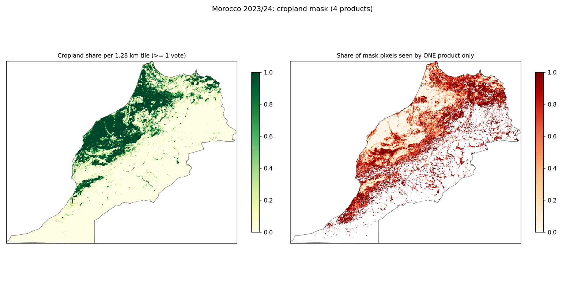
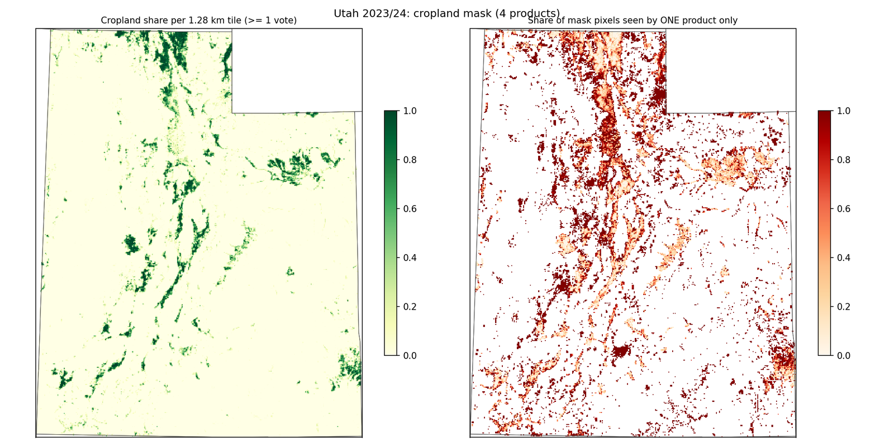
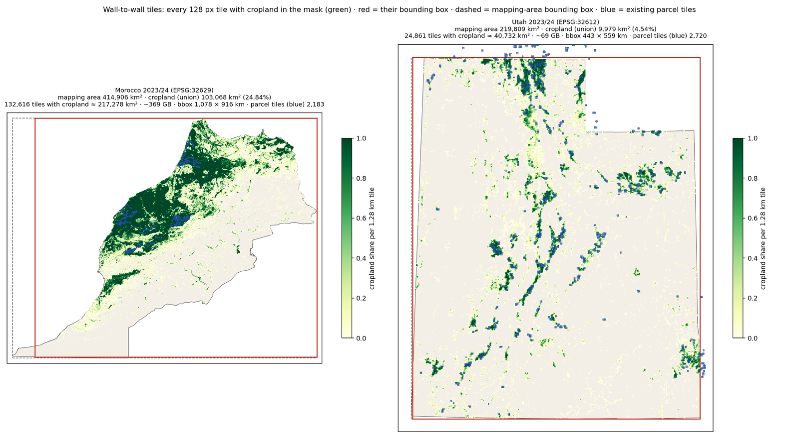
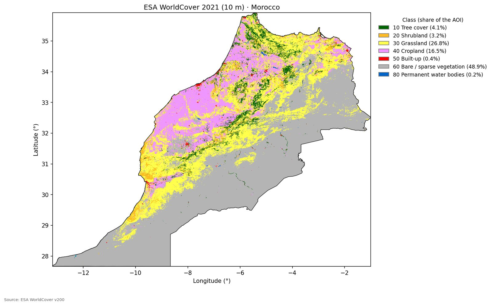
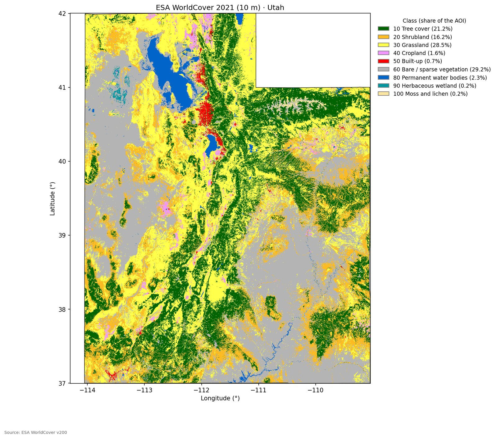
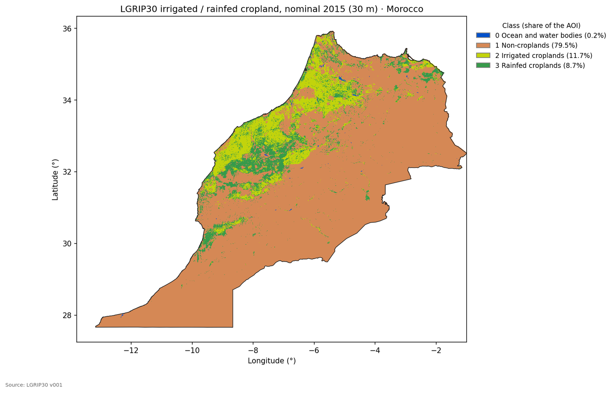
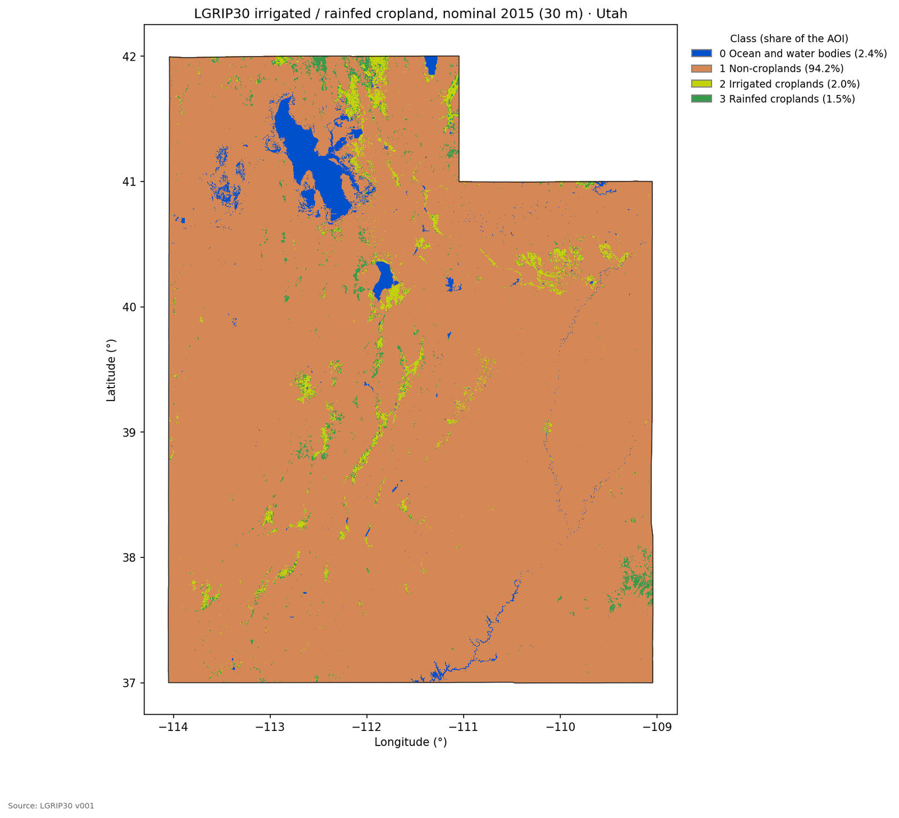

# Cropland extent and mask

The annual irrigated / rainfed maps are **continuous (wall-to-wall)**: every 10 m pixel of a region's cropland gets a
class, not only the surveyed parcels. This page describes the area those maps cover, the cropland mask, and the
reference layers drawn for comparison. The code is in `cropland_extent/`; all outputs are in
`outputs/<region>/cropland_extent/`.

| Script | What it does | Output (in `outputs/<region>/cropland_extent/`) |
| --- | --- | --- |
| `make_cropland_mask.py` | cropland mask per region and agricultural year from 4 cropland products (Earth Engine) | `cropland_mask/<season>/` |
| `download_esa_worldcover.py` | ESA WorldCover 2021, 10 m GeoTIFF + PNG map | `esa_worldcover/` |
| `download_lgrip30.py` | LGRIP30 irrigated / rainfed cropland, 30 m GeoTIFF + PNG map | `lgrip30/` |

All three use the same area: the region's **mapping area** in `ml_dataset_prep/regions.py`, i.e. Morocco without
Western Sahara (FAO GAUL 2015, 414,905 km²) and the state of Utah (FAO GAUL 2024, 219,809 km²).

## 1. Why a mask from several products

A single cropland product misses cropland: small fields, fallow land, orchards, recent expansion. On the parcels of
the first test (3,498 surveyed irrigated parcels in Morocco), single products covered 78% (WorldCover) to 99%
(GCEP30) of them; their **union covered 100%**. A pixel is therefore cropland if **at least one** of the products
calls it cropland. Combining products to reduce omission is established practice: Meier et al. (2018) restricted
irrigation mapping to cropland of two land-cover products combined, LANID (Xie et al. 2021) took the cultivated
area of any year, and LGRIP30 added cropland that its own extent map missed (Teluguntla et al. 2023).

The price of the union is extra non-cropland inside the mask. The classifier handles it with a third class,
**not cropland**, next to irrigated and rainfed (IrrMapper used such extra classes instead of an external mask;
Ketchum et al. 2020). The mask is applied to the map output; the model never sees masked inputs.

The mask uses **no field labels** (neither the Moroccan survey nor WRLU), so its quality is the same in labelled and
unlabelled areas. Labelled parcels outside the mask are kept in training and only flagged (`in_mask`), so the
training set does not depend on the mask.

## 2. Products

The year of a product is the calendar year in which the agricultural year ends, clipped to the years the product has
(2023/24 → 2024).

| Product | Earth Engine asset | Resolution · year(s) | Cropland = | Source |
| --- | --- | --- | --- | --- |
| **ESA WorldCover v200** | `ESA/WorldCover/v200` | 10 m · 2021 | class 40 | Zanaga et al. 2022, [doi:10.5281/zenodo.7254221](https://doi.org/10.5281/zenodo.7254221) · [GEE catalogue](https://developers.google.com/earth-engine/datasets/catalog/ESA_WorldCover_v200) |
| **Esri / Impact Observatory LULC** | `projects/sat-io/open-datasets/landcover/ESRI_Global-LULC_10m_TS` | 10 m · annual 2017–2025 | class 5 (crops) | Karra et al. 2021 (IGARSS) · [community catalogue](https://gee-community-catalog.org/projects/S2TSLULC/) |
| **GCEP30** (GFSAD) | `projects/sat-io/open-datasets/GFSAD/GCEP30` | 30 m · 2015 | value 2 | Thenkabail et al. 2021, [USGS PP 1868](https://doi.org/10.3133/pp1868) · [community catalogue](https://gee-community-catalog.org/projects/gcep30/) |
| **GLAD global cropland** | `users/potapovpeter/Global_cropland_2019` | 30 m · 2003, 2007, 2011, 2015, 2019 | value 1 | Potapov et al. 2022, [doi:10.1038/s43016-021-00429-z](https://doi.org/10.1038/s43016-021-00429-z) · [GLAD](https://glad.umd.edu/dataset/croplands) |

- **GCEP30** is stored as continental tiles that overlap and disagree in Morocco (the Europe / Middle East tile has
  almost no cropland there). The flags are combined with the maximum over the tiles, not with a mosaic.
- **Tree crops:** WorldCover maps orchards as tree cover and GLAD excludes perennial woody crops, so orchards depend
  on the Esri and GCEP30 layers.
- **Not used** (kept in the script as options with fixed bit numbers): Dynamic World (too slow per block and Earth
  Engine memory errors), ESA WorldCereal 2021 temporary crops, LGRIP30 (same extent as GCEP30 in the test),
  GLC_FCS30D, and the USDA Cropland Data Layer for Utah.
- **Always removed:** WorldCover 2021 built-up (50), snow and ice (70) and permanent water (80); these pixels are
  never mapped.

## 3. How the mask is made

1. **Blocks on the tile grid.** Earth Engine returns at most 48 MB per request, and Morocco at 10 m has about
   10 billion pixels. The mapping area is cut into blocks of 1024 × 1024 px (10.24 km) on the same grid as the
   tiles of `03_build_tiles.py` (x = ix × 1280 m), so every block holds whole 128 px tiles. Morocco has 4,199 blocks,
   Utah 2,213; 8 blocks are downloaded in parallel at about 0.5 s per block; finished blocks are skipped on a re-run.
2. **One request per block** returns one bit per product and the exclusion flag; votes and the mask are computed
   locally.
3. **One raster per agricultural year.** `cropland_mask.vrt` joins all blocks into one seamless layer.
4. **Tile table.** `tiles_cropland.parquet` lists every 128 px tile with its number of cropland pixels: the input
   of the wall-to-wall tiles (`ml_dataset_prep/03c_build_cropland_tiles.py`).

**Bands of the mask** (uint16, NODATA 65535 outside the mapping area):

| Band | Content |
| --- | --- |
| `cropland` | the mask: 1 if ≥ `MIN_VOTES` products (1 = union) call the pixel cropland and it is not excluded |
| `votes` | number of products that call the pixel cropland (0–4) |
| `products` | bit flags, one bit per product (WorldCover 0, Esri 1, GCEP30 4, GLAD 6) |
| `excluded` | 1 = WorldCover built-up, snow / ice or water |

The vote count and the flags allow a stricter mask (for example ≥ 2 votes) or another product set later without a
new download.

## 4. Results, 2023/24

| | Morocco | Utah |
| --- | --- | --- |
| Mapping area | 414,906 km² | 219,809 km² |
| **Cropland (union, ≥ 1 vote)** | **103,068 km²** (24.8%) | **9,979 km²** (4.5%) |
| Cropland with ≥ 2 votes | 73,886 km² | 6,000 km² |
| Removed as built-up / snow / water | 3,087 km² | 6,382 km² |
| 128 px tiles with cropland | 132,616 | 24,861 |

Cropland of each product, and the area that **only** this product calls cropland (what it adds to the union):

| Product | Morocco: cropland | Morocco: only this product | Utah: cropland | Utah: only this product |
| --- | --- | --- | --- | --- |
| WorldCover 2021 | 64,122 km² (62% of the union) | 6,474 km² | 3,427 km² (34%) | 110 km² |
| Esri LULC 2024 | 50,876 km² (49%) | 2,950 km² | 5,977 km² (60%) | 1,251 km² |
| GCEP30 2015 | 83,937 km² (81%) | 16,233 km² | 7,742 km² (78%) | 2,121 km² |
| GLAD 2019 | 62,998 km² (61%) | 3,526 km² | 5,650 km² (57%) | 498 km² |

GCEP30 is the most generous product and adds most of the area seen by one product only, mostly at the margins of
the cropland belts (right-hand panels below). Most of the union's false cropland is expected there; the "not
cropland" class of the classifier and the map accuracy assessment address it.

*Left: share of cropland per 1.28 km tile. Right: share of the mask's pixels that only one product calls cropland.*

## 5. Extent of the wall-to-wall tiles

Mapping the whole cropland means imagery for every tile that contains cropland: 132,616 tiles in Morocco (about
370 GB of monthly Sentinel-2 composites per year) and 24,861 in Utah (about 69 GB), against 2,183 and 2,720 tiles
around the labelled parcels. Morocco's cropland forms one continuous belt from Tangier to Agadir (a quarter of the
country), and scattered fields pull in whole 1.64 km² tiles. These tiles are downloaded only for the mapping stage
(`03c_build_cropland_tiles.py`); model training and testing use the tiles around the labelled parcels.

## 6. Check against the labelled parcels

`ml_dataset_prep/01_prepare_labels_*.py` reads the mask of each parcel's agricultural year and adds `mask_frac`
(share of the parcel's pixels in the mask), `mask_votes`, `in_mask` (≥ 50% of the parcel) and the share per product;
`mask_check.csv` reports the share of irrigated and rainfed parcels inside the mask (the mask's omission on surveyed
cropland). In the Moroccan pixel samples of 2023/24, 0.2% of the sampled parcel pixels lie outside the mask.

## 7. Reference layers

ESA WorldCover and LGRIP30 are drawn as reference maps for the documentation and for comparing the final maps;
the mask reads its products directly in Earth Engine. Colours: WorldCover's official palette; LGRIP30 water
`#0050cb`, non-cropland `#d58855`, irrigated `#c2d30c`, rainfed `#379a4b`. The PNG maps are reduced to 2,500 px
for display (mode resampling) from the original 10 m and 30 m GeoTIFFs.

| | Morocco | Utah |
| --- | --- | --- |
| ESA WorldCover 2021 |  |  |
| LGRIP30 (nominal 2015) |  |  |

LGRIP30 calls 11.7% of Morocco irrigated and 8.7% rainfed, including large parts of the rainfed Gharb and Chaouia
plains; it is a reference layer, not ground truth.

## References

- Karra, K. et al. (2021). Global land use / land cover with Sentinel-2 and deep learning. *IGARSS 2021*.
- Ketchum, D. et al. (2020). IrrMapper. *Remote Sensing* 12, 2328. [doi:10.3390/rs12142328](https://doi.org/10.3390/rs12142328)
- Meier, J., Zabel, F. & Mauser, W. (2018). A global approach to estimate irrigated areas. *HESS* 22, 1119–1133. [doi:10.5194/hess-22-1119-2018](https://hess.copernicus.org/articles/22/1119/2018/)
- Potapov, P. et al. (2022). Global maps of cropland extent and change show accelerated cropland expansion in the twenty-first century. *Nature Food* 3, 19–28. [doi:10.1038/s43016-021-00429-z](https://doi.org/10.1038/s43016-021-00429-z)
- Teluguntla, P. et al. (2023). LGRIP30 v001. NASA LP DAAC. [doi:10.5067/Community/LGRIP/LGRIP30.001](https://doi.org/10.5067/COMMUNITY/LGRIP/LGRIP30.001)
- Thenkabail, P. S. et al. (2021). Global Cropland-Extent Product at 30-m Resolution (GCEP30). *USGS Professional Paper 1868*. [doi:10.3133/pp1868](https://doi.org/10.3133/pp1868)
- Xie, Y., Gibbs, H. K. & Lark, T. J. (2021). Landsat-based Irrigation Dataset (LANID). *ESSD* 13, 5689–5710. [doi:10.5194/essd-13-5689-2021](https://essd.copernicus.org/articles/13/5689/2021/)
- Zanaga, D. et al. (2022). ESA WorldCover 10 m 2021 v200. [doi:10.5281/zenodo.7254221](https://doi.org/10.5281/zenodo.7254221)
