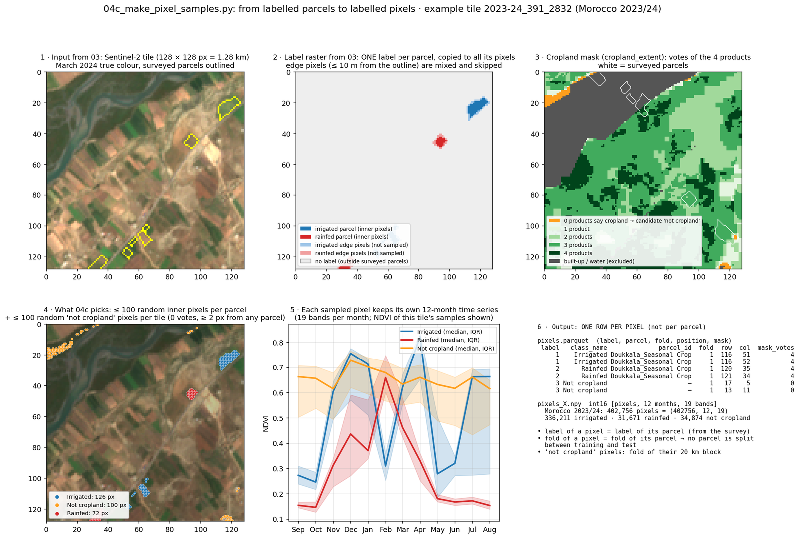

# Pixel samples for pixel-wise classification

The continuous maps classify every 10 m pixel on its own, so the models are trained and tested on **pixels**, not
on parcels ([D16](../decisions.md#d16-pixel-wise-classification-for-continuous-maps)).
`ml_dataset_prep/04c_make_pixel_samples.py` turns the labelled parcels into labelled pixels. It creates no new
labels: the label of a pixel is the survey label of its parcel, which `03_build_tiles.py` already wrote into the
label raster of each tile. The script picks pixels and writes **one row per pixel**: its 12-month time series, its
label, parcel, fold and position. Every pixel-wise experiment starts from this table, so all models see the same
pixels.

*One tile in Doukkala (2023/24): (1) Sentinel-2 tile with the surveyed parcels; (2) label raster of 03: one label per
parcel on all its pixels, edge pixels marked; (3) votes of the cropland mask; (4) the sampled pixels; (5) NDVI of the
sampled pixels per class; (6) the output table.*

## Classes

| Code | Class | Pixels taken from |
| --- | --- | --- |
| 1 | Irrigated | inner pixels of irrigated parcels |
| 2 | Rainfed | inner pixels of rainfed parcels |
| 3 | Not cropland | pixels in the same tiles that lie outside every parcel, that none of the 4 cropland products calls cropland (0 votes in the [cropland mask](cropland_mask.md)), that are not built-up, water or snow, and that are at least 2 pixels from any parcel pixel |

Cropland pixels outside the surveyed parcels are not used: their class is unknown.

## Sampling rules

- **Inner pixels only.** Pixels within 10 m of a parcel outline (`edge` band of the label raster) mix the field
  with its neighbours and are skipped; a parcel without any inner pixel falls back to all its pixels
  (`edge_fallback`).
- **At most 100 pixels per parcel**, drawn at random (seed 42), so a few large irrigated fields do not dominate and
  the pixels of one parcel stay a small group.
- **At most 100 not-cropland pixels per tile**, drawn at random from every tile of the year.
- **Folds.** A parcel pixel takes its parcel's fold of the [spatial folds](morocco.md) (20 km blocks), so a parcel is
  never split between training and test. A not-cropland pixel takes the fold of its 20 km block; pixels in a block
  without labelled parcels get fold −1 and are left out of cross-validation.

## Output

`outputs/<region>/dataset/04c_pixel_samples/<season>/`

| File | Content |
| --- | --- |
| `pixels_X.npy` | int16 [pixels, 12 months, 19 bands]: the bands of the tile store (12 Sentinel-2 bands, clear-observation count, Sentinel-1 VV / VH and scene counts per orbit), NODATA −32768 |
| `pixels.parquet` | one row per pixel, same order: `label`, `class_name`, `parcel_idx`, `parcel_id`, `fold`, `block_id`, `zone`, `tile_id`, `row`, `col`, `x`, `y` (UTM pixel centre), `lon`, `lat`, `edge`, `edge_fallback`, `mask_cropland`, `mask_votes` |
| `summary.csv` | pixels and parcels per class and fold |
| `samples_info.json` | settings, band order, class codes, CRS |

The coordinates allow other inputs, such as AlphaEarth or TESSERA embeddings, to be sampled at exactly the same
pixels.

## Morocco 2023/24

402,756 pixels (184 MB): 336,211 irrigated from 6,183 parcels, 31,671 rainfed from 698 parcels and 34,874 not
cropland from 455 tiles.

| Fold | Irrigated | Rainfed | Not cropland |
| --- | --- | --- | --- |
| 0 | 69,104 | 4,130 | 8,009 |
| 1 | 62,922 | 6,154 | 11,004 |
| 2 | 72,720 | 10,134 | 8,338 |
| 3 | 65,290 | 8,444 | 2,445 |
| 4 | 66,175 | 2,809 | 4,981 |
| −1 (no fold) | – | – | 97 |

Checks: all 2,000 tested parcel pixels lie inside their own parcel; no Sentinel-2 value is missing; 0.2% of the
parcel pixels lie outside the cropland mask. Median NDVI: irrigated peaks at 0.71 in February–March, rainfed at
0.36 in April (2023/24 was a dry year), not cropland stays near 0.15.

**Limitations.**

- Rainfed is the minority class (about 1 rainfed pixel per 11 irrigated); the models need class weights.
- The not-cropland pixels come from 455 of 2,183 tiles: in the cropland belt nearly every pixel has at least one
  cropland vote. They are mostly bare land and rangeland, but also evergreen riverside vegetation (example tile
  above). False cropland inside the union mask, the hard case, has no label yet.
- The tiles lie around the surveyed parcels, so accuracy measured on these pixels holds for similar areas; the
  accuracy of the final map needs an independent sample over the map.

## Status

| Region | Year | Status |
| --- | --- | --- |
| Morocco | 2023/24 | ✅ done (local) |
| Morocco | 2024/25 | on the cluster |
| Utah | 2023/24, 2020/21 | on the cluster (the Utah tile images are on the cluster) |
