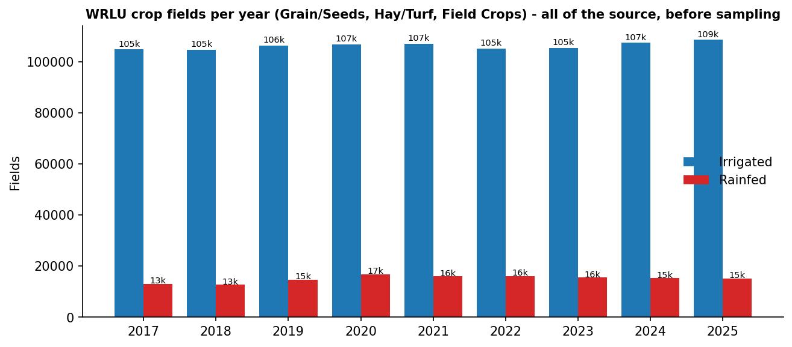
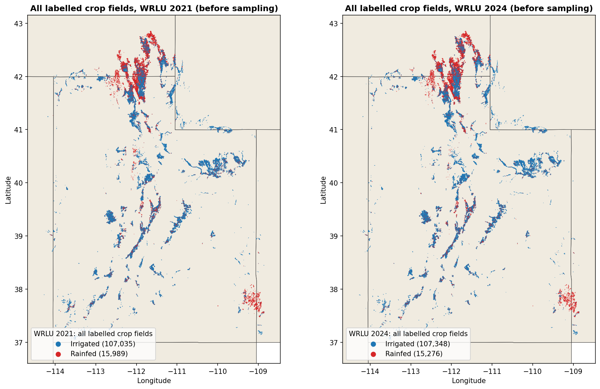
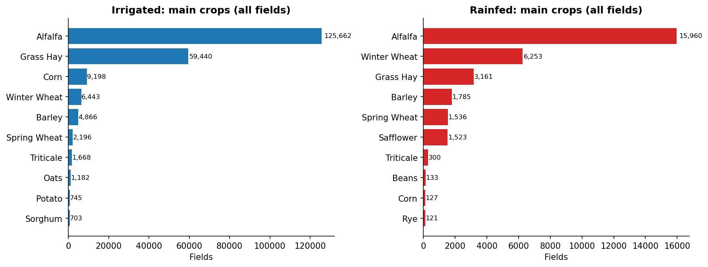
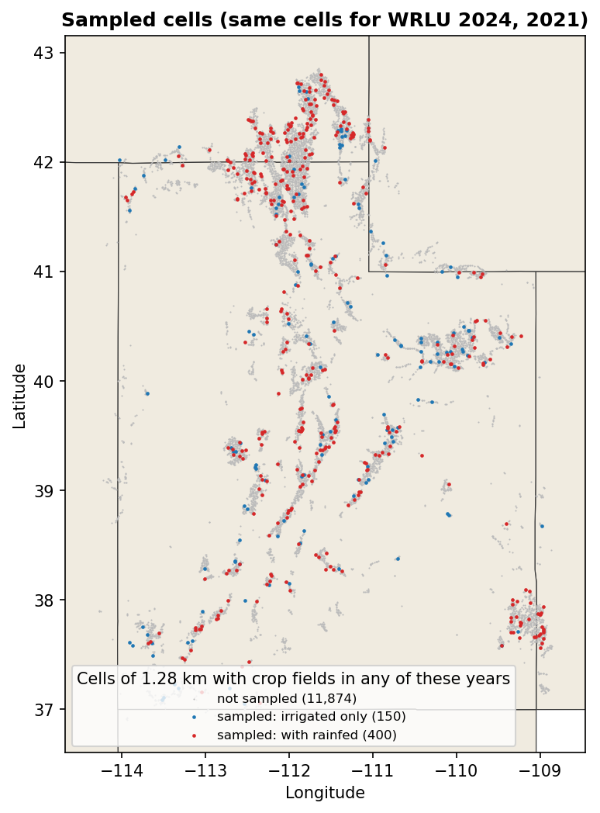
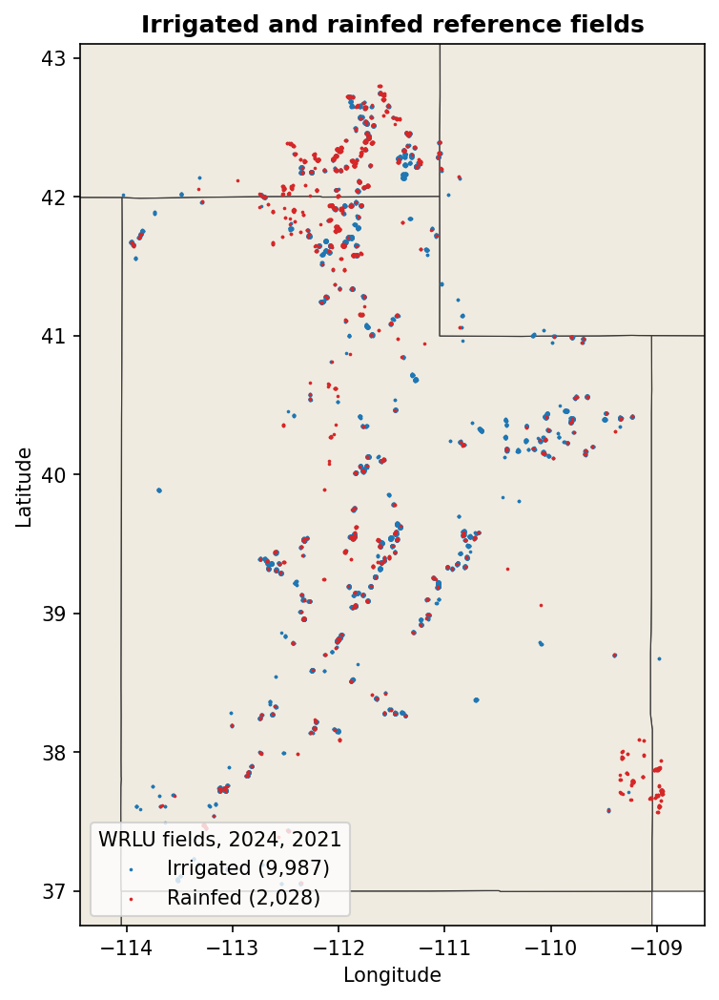
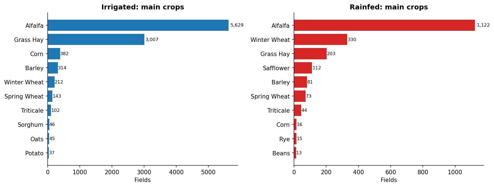
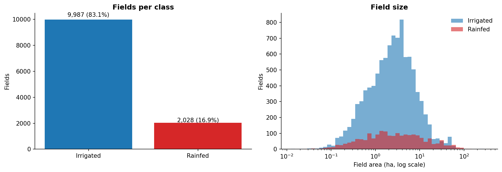
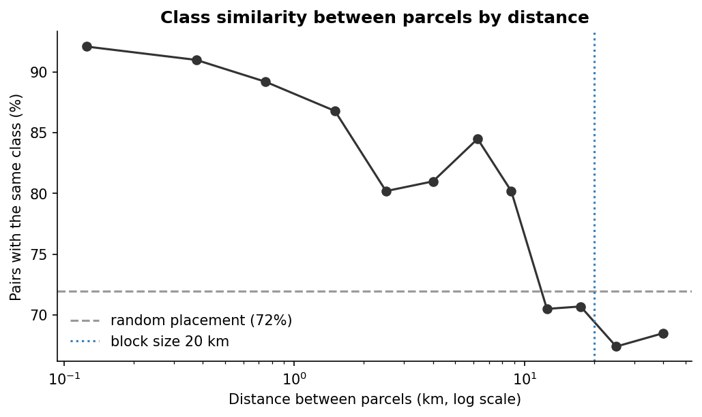
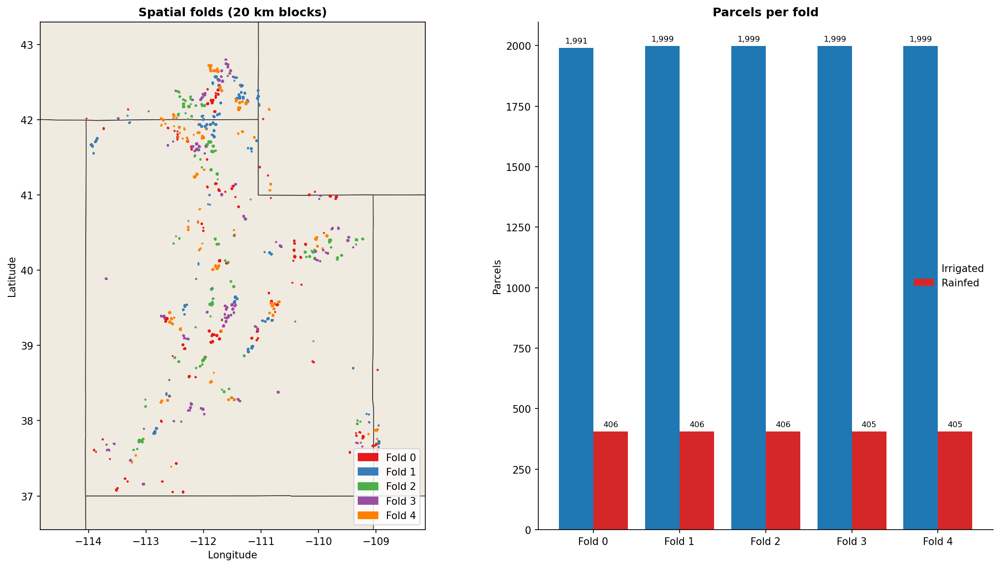
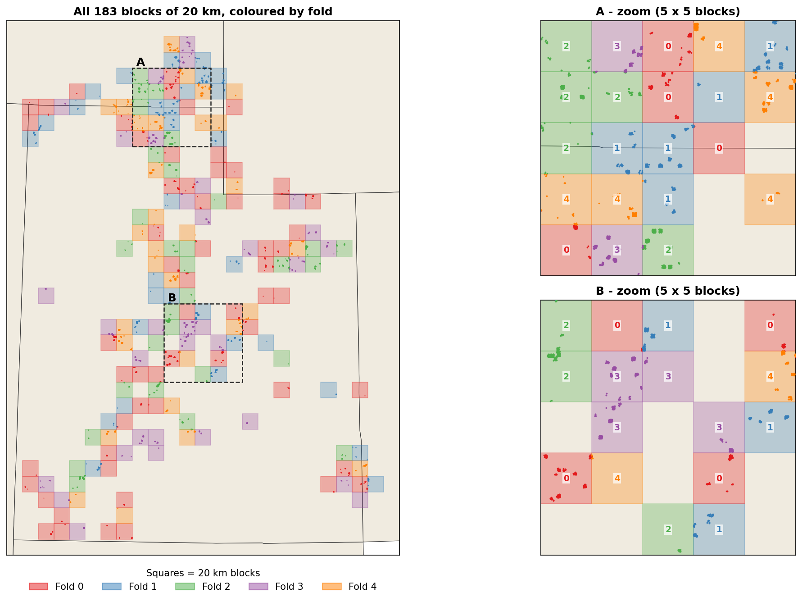

# Utah training data

This page describes the **Utah dataset**, the second, independent study area
([D13](../decisions.md#d13-utah-as-a-second-independent-study-area)). It is built with the same pipeline as the
[Morocco training data](morocco.md): only the label script (`01_prepare_labels_Utah.py`) is region-specific;
scripts 02–04 are the same files, run with `REGION = "utah"`.

!!! info "Status"
    Labels (01), spatial folds (02) and the tile plan with label rasters (03, `DOWNLOAD = False`) are complete for
    WRLU 2024 (training year) and WRLU 2021 (temporal test year). The Sentinel-1/2 download (03) and the model
    views (04) have not been run yet; they run one year at a time, 2024 first.

**Contents**

1. [Overview](#1-overview)
2. [Study design](#2-study-design)
3. [Why Utah](#3-why-utah)
4. [Source data](#4-source-data)
5. [Which years, and how the labels change between years](#5-which-years-and-how-the-labels-change-between-years)
6. [Script 01 — labels](#6-script-01--labels)
7. [Script 01 — sampling of cells](#7-script-01--sampling-of-cells)
8. [Script 02 — spatial folds](#8-script-02--spatial-folds)
9. [Script 03 — tile store](#9-script-03--tile-store)
10. [Temporal test design](#10-temporal-test-design)
11. [Differences from Morocco](#11-differences-from-morocco)
12. [Running, one year at a time](#12-running-one-year-at-a-time)
13. [Known limitations](#13-known-limitations)

---

## 1. Overview

| Step | Script | What comes out |
| --- | --- | --- |
| 1 | `01_prepare_labels_Utah.py` | 12,015 labelled crop fields in 550 sampled cells: WRLU 2024 (5,000 irrigated, 1,013 rainfed) and WRLU 2021 (4,987 irrigated, 1,015 rainfed); plus all 245,648 labelled crop fields of both years before sampling |
| 2 | `02_make_spatial_folds.py` (`REGION = "utah"`) | a fold (0–4) per field, from 183 spatial blocks of 20 km |
| 3 | `03_build_tiles.py` (`REGION = "utah"`) | tile plan: 5,436 tiles (2,720 for 2023/24, 2,716 for 2020/21); label rasters written |
| 4 | `04_make_views.py` (`REGION = "utah"`) | model inputs A–C as for Morocco, one folder per year (`views_2023-24/`, `views_2020-21/`) |

All outputs are in `outputs/utah/dataset/` (`01_labels/`, `02_folds/`, `03_tiles_128px/agyear/`), with the same
file names and columns as `outputs/morocco/dataset/`.

---

## 2. Study design

- **Utah is an independent second study area.** There is no Morocco → Utah transfer: each region is trained and
  tested on its own data, with the same pipeline, foundation models, classifiers and evaluation, and the results
  are reported side by side. This tests whether the conclusions from Morocco hold in a second region with other
  crops, climate and labels.
- **Two questions in Utah:**
    1. how well the models separate irrigated from rainfed fields (spatial cross-validation, as in Morocco);
    2. **temporal transferability:** whether a model trained on one year still works in another year
       ([section 10](#10-temporal-test-design)).
- **Training year:** WRLU 2024 (agricultural year `2023/24`). **Temporal test year:** WRLU 2021 (`2020/21`).

---

## 3. Why Utah

The candidates were compared in [D10](../decisions.md#d10-transfer-region-under-review) (Tunisia, eastern
Washington, Utah, the IrrMap states):

- **An explicit rainfed class.** The WRLU metadata defines `IRR_Method = "Dry Crop"` as a field with no irrigation,
  watered by natural processes (rain). IrrMap labels only the irrigation method (no rainfed class), and Colorado
  (CRDSS) and most layers of the USGS verified irrigated lands are irrigated-only.
- **Enough rainfed fields:** 13,000–17,000 rainfed crop fields every year (figure below). Tunisia has 10 rainfed
  GMIA-NEXT points.
- **Every year from 2017 to 2025**, mapped by one agency with one method, so the same pipeline also gives a
  temporal test.
- **One UTM zone (12N).** In eastern Washington most dryland-wheat fields come from the NASS Cropland Data Layer
  rather than the WSDA field survey (irrigation not observed), which leaves only about 1,800 surveyed rainfed
  cereal fields.

<figure markdown>
  { width="760" }
  <figcaption>WRLU crop fields (grain/seeds, hay/turf, field crops) per year and class, before sampling.</figcaption>
</figure>

---

## 4. Source data

| Data | Use | Details |
| --- | --- | --- |
| Water-Related Land Use (WRLU), Utah Division of Water Resources | labels | one polygon layer per year, 2017–2025; all agricultural fields of Utah and of the parts of its river basins in Idaho, Wyoming, Colorado, Nevada and Arizona; crop (`Descriptio`, `CropGroup`), irrigation method (`IRR_Method`), basin, county, state. In `data/Utah_field_data/` |
| FAO GAUL 2024 (level 1) | maps | state outlines (`data/admin_boundaries/`) |
| ESA WorldCover 2021 (10 m) | label check | optional: needs a raster covering Utah (`ESA_WorldCover_10m_2021_Utah.tif`); not yet available, so the check was skipped |
| Sentinel-2 L2A, Cloud Score+, Sentinel-1 GRD | imagery | as for Morocco (Google Earth Engine) |

---

## 5. Which years, and how the labels change between years

**Agricultural year.** WRLU year *Y* describes the crops of the growing season *Y*. The dataset uses the US water
year, 1 October (*Y*−1) to 30 September (*Y*), written as for Morocco: WRLU 2024 → `2023/24`, WRLU 2021 → `2020/21`.
It covers winter wheat from its autumn sowing to the July harvest, the whole irrigation season (mid-April to
mid-October) and June–September, when irrigated and dry crops differ most. A calendar year would start in snow and
cut off the autumn sowing. As in Morocco, every field gets the 12 monthly composites of its own year.

**How much changes between years.** All labelled crop fields of each year (the whole of WRLU, not only the sample)
were compared with WRLU 2024. A field counts as the same field when its outline overlaps a 2024 outline with an
intersection over union above 0.8 (`outputs/utah/dataset/01_labels/year_change_vs_2024.csv`):

| WRLU year | Labelled crop fields | Same outline as in 2024 | Crop changed | Irrigation method changed | Class changed (irrigated ↔ rainfed) |
| --- | --- | --- | --- | --- | --- |
| 2024 | 122,624 (15,276 rainfed) | – | – | – | – |
| 2025 | 123,722 | 121,811 (98.5%) | 6.3% | 17.4%¹ | 28 (0.02%) |
| 2023 | 121,029 | 116,492 (96.3%) | 27.1% | 0.1% | 17 (0.01%) |
| **2021** | 123,024 | 110,821 (90.1%) | **35.7%** | 0.7% | **83 (0.07%)** |
| 2019 | 121,063 | 100,491 (83.0%) | 38.0% | 2.7% | 1,352 (1.35%) |
| 2017 | 117,901 | 92,054 (78.1%) | 40.6% | 3.0% | 1,307 (1.42%) |

¹ Mostly a change of coding: in 2025 WRLU split *Sprinkler* into *Sprinkler*, *Pivot* and *Wheel* (wheel line).

- **Field outlines** change slowly (78–98% unchanged).
- **Crops** change a lot through rotation (27–41% after 1–7 years).
- **Irrigated vs rainfed** hardly ever changes (0.01–0.07% since 2021). In Utah, irrigation depends on a water right
  and on canals, pivots and wells tied to the land; part of the stability may also come from labels carried over
  between map updates, which the data cannot separate.

**Choice of years:**

- **WRLU 2024 = training year:** recent, actively updated (27% of the crops changed from 2023), and it overlaps the
  Moroccan survey years.
- **WRLU 2021 = temporal test year:** three years earlier; 36% of the crops differ from 2024 while the labels stay
  consistent (83 class changes in 123,024 fields), so the test isolates the change of year (crops, weather,
  timing). 2021 was a drought year in Utah (drought emergency declared in March 2021), a realistic year-to-year
  shift that is reported as context. It still has both Sentinel-1 satellites (Sentinel-1B failed in December 2021).
- **Not 2025:** 94% of its crops repeat 2024, so it looks largely carried over and is no independent test.
- **Not 2019** (for now): the jump from 83 class changes (2021) to 1,352 (2019) is sudden and may come from a
  revision of the mapping rather than from real change; it would need checking first.
- **Not all years:** the labels are near-copies, so more years add volume but little information, at about 10 GB
  of tiles per year.

---

## 6. Script 01 — labels

1. **Source inspection** for every year in `FILES`: fields and area per crop group and irrigation method
   (`source_counts.csv`, `source_years.png`).
2. **Read** the years in `YEARS` (agricultural fields only) and clean the geometry as for Morocco: repair invalid
   polygons, drop empty and duplicate geometries.
3. **Label:**

    | `IRR_Method` | Label |
    | --- | --- |
    | Flood, Sprinkler, Drip; from 2025 also Pivot and Wheel | 1 · irrigated |
    | Dry Crop | 2 · rainfed |
    | Sub-irrigated (natural high water table) | dropped: neither class |

4. **Crop fields only** (`CROP_GROUPS`): grain/seeds, hay/turf and field crops. Fallow/idle land and pasture are
   dropped (no crop to observe, or grazing land rather than cropland). Garden, orchard and small fruit are dropped
   too: they are small groups, and orchards are almost all irrigated in Utah (19 "Dry Crop" orchards in 2023), so
   they would only add an easy irrigated class.
5. **All labelled crop fields before sampling** (`EXPORT_ALL_FIELDS = True`): every labelled crop field of `YEARS`
   goes to `all_crop_fields.gpkg` (for QGIS) with a column `sampled` that marks the fields of the sampled cells,
   plus summary tables and figures, so the sample can be compared with the whole population:

    | WRLU year | Irrigated | Rainfed | In the sample |
    | --- | --- | --- | --- |
    | 2024 | 107,348 | 15,276 | 5,000 irrigated (4.7%), 1,013 rainfed (6.6%) |
    | 2021 | 107,035 | 15,989 | 4,987 irrigated (4.7%), 1,015 rainfed (6.3%) |

6. **Attributes** with the Morocco names: `parcel_id` (`UT<year>_<feature id>`), `ag_season`, `label`,
   `class_name`, `crop`, `zone` (= river basin), `area_ha`, `nn_dist_m` (nearest field of the same year). Utah
   extras: `year`, `state`, `county`, `crop_group`, `irr_method`, `cell_id`. WRLU has no survey date, so `date` is
   empty.

**How many fields are dropped on the way** (WRLU 2024): 283,781 polygons in the file → 190,269 agricultural (urban,
water, wetland and other land removed) → 122,624 labelled crop fields (fallow, pasture, sub-irrigated, orchard,
garden and small fruit removed) → 6,013 in the sampled cells.

<figure markdown>
  { width="820" }
  <figcaption>All labelled crop fields of WRLU 2024 and 2021 before sampling.</figcaption>
</figure>

<figure markdown>
  { width="760" }
  <figcaption>Main crops per class, all labelled crop fields of both years. Alfalfa is the main crop of both classes.</figcaption>
</figure>

---

## 7. Script 01 — sampling of cells

**Why a sample and not all fields.** All labelled crop fields would be about 122,000 fields per year: roughly
20,000 tiles (~75 GB) and ~170 GB of model views per year, and 15–20 times the embedding time of Morocco, for
little extra *independent* information. The statistics are limited by the rainfed class and by the number of
spatial blocks, not by the number of fields: fields in the same block are strongly alike (89% of field pairs
closer than 1 km share their class), and the block bootstrap counts blocks. The sample also keeps the Utah dataset
close to the size of the Moroccan one (8,781 parcels), so model differences are not a matter of data volume.

**Three nested units:**

| Unit | Size | Role |
| --- | --- | --- |
| Field | median 2.5 ha | one sample with its label |
| **Cell** | 1.28 × 1.28 km = one 128-px tile of script 03 | the sampling unit: a cell is sampled with all its fields, or not at all |
| **Block** | 20 × 20 km (~240 cells) | the fold unit of script 02; also used to spread the sample |

Both grids start at the origin of UTM 12N: cell = (⌊x / 1,280 m⌋, ⌊y / 1,280 m⌋), block = (⌊x / 20,000 m⌋,
⌊y / 20,000 m⌋). A field belongs to the cell and to the block that contain its centroid.

**Algorithm** (`sample_cells`: stratified random sampling with a cap per block):

1. **Cells** with at least one labelled crop field in any of `YEARS` (both years pooled): 12,424 cells.
2. **Two strata:** "with rainfed" = at least one rainfed field in either year; "irrigated only" = the rest.
3. **Random order** within each stratum (fixed seed `SEED = 42`, so every run gives the same cells).
4. **Cap:** going down the shuffled list, a cell is skipped once its 20 km block already has `MAX_CELLS_PER_BLOCK`
   (6) cells of that stratum. Without the cap the densest valleys (Cache Valley, Bear River) would take most of the
   sample.
5. **The first `N_RAINFED_CELLS` (400) and `N_IRRIGATED_CELLS` (150)** cells are kept: 550 cells in 176 blocks.
6. **The same cells are used for every year** in `YEARS`; every labelled crop field inside a sampled cell is kept.

**What is labelled inside a sampled tile:**

| In the tile | Label raster |
| --- | --- |
| crop fields (grain, hay, field crops), irrigated or Dry Crop, whose centroid lies in the cell | 1 irrigated / 2 rainfed |
| fallow, pasture, orchards, sub-irrigated fields | 0 = ignore |
| roads, towns, natural land | 0 = ignore |
| a field centred in a neighbouring, not sampled cell that reaches into the tile | 0 = ignore |

A labelled field is always complete: when its outline crosses into the next tile, that tile is built as well
("outline" tile). Within a 20 km block at most 12 cells (6 + 6) are sampled, i.e. at most ~5% of its area is
labelled. Labels are therefore dense within a sampled cell and sparse within a block, as in Morocco, where the
survey did not label every field either.

**Result:**

| Agricultural year | Irrigated | Rainfed | Rainfed share |
| --- | --- | --- | --- |
| 2020/21 (WRLU 2021, test year) | 4,987 | 1,015 | 16.9% |
| 2023/24 (WRLU 2024, training year) | 5,000 | 1,013 | 16.8% |
| **Total** | **9,987** | **2,028** | **16.9%** |

Rainfed fields are over-represented on purpose (16.9% of the sample against 12.5–13% of all fields), which makes
the rainfed F1 more reliable. Median field size is 2.5 ha in both classes, three times the Moroccan median
(0.83 ha). By state: 8,234 + 1,057 fields in Utah, 1,707 + 849 in Idaho (Bear River basin), the rest in Colorado
and Wyoming (irrigated + rainfed). 1,171 of the 2,028 rainfed fields (58%) are in the Bear River basin.

<figure markdown>
  { width="520" }
  <figcaption>Cells of 1.28 km with crop fields in WRLU 2024 or 2021 (grey) and the sampled cells: with a rainfed field in either year (red), irrigated only (blue). The same cells are used for both years.</figcaption>
</figure>

<figure markdown>
  { width="520" }
  <figcaption>Sampled reference fields, WRLU 2024 and 2021.</figcaption>
</figure>

<figure markdown>
  { width="760" }
  <figcaption>Main crops per class in the sample. Rainfed fields are mostly dryland alfalfa, winter wheat and grass hay.</figcaption>
</figure>

<figure markdown>
  { width="760" }
</figure>

**Larger samples** are a change of `N_RAINFED_CELLS` / `N_IRRIGATED_CELLS` and a re-run of 01–03:

| Option | Cells | Fields per year (approx.) | Cost relative to now |
| --- | --- | --- | --- |
| now | 400 + 150 | ~6,000 | 1× |
| double | 800 + 300 | ~12,000 | ~2× |
| all cells with rainfed + matching irrigated-only | ~4,800 + 1,500 | ~60,000 | ~10× |
| all fields (`SAMPLE = False`) | ~12,400 | ~122,000 | ~20× |

**Outputs** (`outputs/utah/dataset/01_labels/`): `parcels_labelled.geojson` (the sample), `source_counts.csv`,
`summary.csv`, `summary_by_zone.csv`, `sampled_cells.csv`, `year_change_vs_2024.csv`; before sampling:
`all_crop_fields.gpkg`, `all_fields_summary.csv`, `all_fields_by_zone.csv`, `all_fields_*.png`; figures.

---

## 8. Script 02 — spatial folds

The same script as for Morocco (`REGION = "utah"`). The class-similarity curve uses only pairs of fields of the
**same** agricultural year: the same field in two years is not two independent samples.

| Distance between fields | ≤ 0.25 km | 1 km | 3 km | 10 km | 15 km | 20 km | random placement |
| --- | --- | --- | --- | --- | --- | --- | --- |
| Pairs with the same class | 92.1% | 89.2% | 80.2% | 80.2% | 70.5% | 70.7% | 71.9% |

Class similarity reaches the random-placement level at about 15 km, so the **20 km block** of Morocco is kept.

| Split (average over the 5 rounds) | Rainfed in smallest fold | Test with train ≤ 250 m | Test with train ≤ 1 km |
| --- | --- | --- | --- |
| random | 405 | 94.3% | 99.4% |
| blocks 5 km | 405 | 6.5% | 27.7% |
| blocks 20 km | 405 | 2.2% | 9.8% |
| blocks 50 km | 336 | 0.3% | 2.1% |

**Folds:** 183 blocks, about 2,000 irrigated and 405 rainfed fields per fold. A field belongs to the block of its
centroid, so **the same place falls in the same block, and therefore in the same fold, in every year**: a model is
never trained on a place it is tested on, in either year. The greedy assignment places the blocks with the most
rainfed fields first; the many small blocks with few fields come last, so one fold (here fold 0, 59 blocks)
collects more, smaller blocks than the others (30–33). Morocco shows the same pattern (fold 2: 42 of 91 blocks).

<figure markdown>
  { width="620" }
</figure>

<figure markdown>
  { width="820" }
  <figcaption>Fields coloured by fold (left) and class counts per fold (right).</figcaption>
</figure>

<figure markdown>
  { width="820" }
  <figcaption>The 20 km blocks coloured by fold, with enlargements of the two densest areas: A on the Utah–Idaho border (Cache Valley, Bear River), B in central Utah. Whole blocks go to one fold.</figcaption>
</figure>

---

## 9. Script 03 — tile store

The same script as for Morocco (`REGION = "utah"`). Grid, bands, cloud mask and file formats are unchanged
([Morocco, section 6](morocco.md#6-script-03--build_tiles)). Two settings come from `regions.py`: the projection
(UTM 12N, EPSG:32612) and the first month (October, so `m01` = October).

**One tile per place and year.** The tile name starts with the agricultural year, so the same place gets one tile
per year, on the same pixel grid:

| | Training year (WRLU 2024) | Test year (WRLU 2021) |
| --- | --- | --- |
| tile | `2023-24_184_3383` | `2020-21_184_3383` |
| image `_img.tif` | Sentinel-1/2, Oct 2023 – Sep 2024 | Sentinel-1/2, Oct 2020 – Sep 2021 |
| label `_lab.tif` | the 2024 fields and labels | the 2021 fields and labels |
| field in `parcels.csv` | own `parcel_id` / `parcel_idx` | own `parcel_id` / `parcel_idx` |
| fold | e.g. fold 3 | the same fold 3 |

`parcels.csv` holds both years (6,013 fields of 2023/24 and 6,002 of 2020/21); their numbers never change when
another year is downloaded.

**Tile plan** (`DOWNLOAD = False`): 12,015 fields; 6 smaller than one pixel centre; 280 with no pixel left after the
10 m inner buffer; no overlapping fields. 5,436 tiles (2,720 for 2023/24, 2,716 for 2020/21; 1,042 home tiles),
about 10 GB of images per year. 120 tiles hold fields of two folds: a 20 km block is 15.6 cells wide, so some cells
straddle a block border (the parcel models are not affected; segmentation needs the loss mask, as in Morocco).

---

## 10. Temporal test design

Because the training year and the test year use the same cells, the test fold holds the **same fields** in both
years. Per round of the 5-fold rotation:

| Score | Train | Test | Measures |
| --- | --- | --- | --- |
| **A · same year** | 2024, training folds | 2024, test fold | spatial accuracy, as in Morocco |
| **B · new year, new places** | 2024, training folds | **2021, test fold** | **temporal transferability** (main result) |
| C · new year, seen places | 2024, training folds | 2021, training-fold fields | change of imagery only (upper bound: places seen in training) |

- **B − A** is the cost of the change of year, measured on identical fields (a paired comparison, so the block
  bootstrap gives a narrow interval).
- Within B, the fields whose crop changed between the two years show where a new year matters most.
- The test asks whether a model recognises irrigation in a **different year with other crops and weather**. It
  cannot test the detection of changes in irrigation (83 class changes in the whole of WRLU).
- The training script needs a "train on one year, test on another" option; it is added before the 2021 test.

---

## 11. Differences from Morocco

| | Morocco | Utah |
| --- | --- | --- |
| Labels | field survey, Dec 2023 – Jan 2025 | agency land-use map (WRLU), mostly image interpretation; 1,987 fields field-checked in 2025 |
| Rainfed definition | "rainfed" in the survey | `IRR_Method = "Dry Crop"` |
| Crops | seasonal crops and trees | grain, hay and field crops (no orchards) |
| Selection | all surveyed parcels | 550 sampled 1.28 km cells, all fields inside |
| Years | 2023/24 and 2024/25, pooled | 2023/24 (training) and 2020/21 (temporal test), kept apart |
| Agricultural year | 1 Sep – 31 Aug | 1 Oct – 30 Sep (water year) |
| Projection | UTM 29N | UTM 12N |
| `zone` | irrigation district | river basin |
| Median field size | 0.83 ha | 2.5 ha |
| Rainfed share | 13.6% | 16.9% |

---

## 12. Running, one year at a time

```bash
conda activate condaml
python ml_dataset_prep/01_prepare_labels_Utah.py     # ~1 min; YEARS = [2024, 2021]
# in 02, 03 and 04 set REGION = "utah" at the top, then:
python ml_dataset_prep/02_make_spatial_folds.py      # seconds
python ml_dataset_prep/03_build_tiles.py             # SEASONS = ["2023/24"]; first N_TEST_TILES = 20; Earth Engine, resumable
python ml_dataset_prep/04_make_views.py              # SEASONS = ["2023/24"] -> views_2023-24/
python models_run/01_inspect_dataset.py              # REGION = "utah", VIEWS_NAME = "views_2023-24"
```

Run everything in the `condaml` environment: another GDAL / GEOS version once gave one field more.

| Step | Runs for | Why |
| --- | --- | --- |
| 01 labels, 02 folds | **all years in `YEARS`** at once (local, ~1 min) | sampled cells, parcel numbers and folds are fixed once, the same for every year |
| 03 plan + label rasters | all years (local, seconds) | the parcel numbers in the label rasters never change |
| 03 Earth Engine download | **only the years in `SEASONS`** | 2024 first (`["2023/24"]`), 2021 later (`["2020/21"]`); finished tiles are skipped |
| 04 views | **only the years in `SEASONS`** | each year in its own folder: `views_2023-24/`, `views_2020-21/` |

Running 01 with one year only and adding the other year later would redraw the cells and rebalance the folds, and
the two years would no longer be paired.

Region settings (`ml_dataset_prep/regions.py`): `crs_epsg = 32612`, `start_month = 10`, `block_km = 20`, map
boundaries. Utah settings in `01_prepare_labels_Utah.py`: `YEARS`, `CROP_GROUPS`, `EXCLUDE_CROPS`,
`IRRIGATED_METHODS`, `RAINFED_METHODS`, `STATES`, `EXPORT_ALL_FIELDS`, `SAMPLE`, `CELL_M`, `N_RAINFED_CELLS`,
`N_IRRIGATED_CELLS`, `MAX_CELLS_PER_BLOCK`, `SEED`.

---

## 13. Known limitations

- **Labels are not a field survey.** WRLU is mapped mainly from imagery with field checks on part of the area, and
  lists the Cropland Data Layer among its inputs. Its errors are not known per field.
- **Labels barely change between years** ([section 5](#5-which-years-and-how-the-labels-change-between-years)): the
  temporal test measures robustness to a new year, not change detection, and it must hold out space (score B).
- **Unequal inclusion probabilities.** Rainfed areas are favoured, and cells in crowded blocks are less likely to be
  sampled. This is fine for comparing models (all see the same fields), but the scores are not unbiased accuracy
  estimates for all Utah fields; that would need sampling weights. The same holds for Morocco, whose survey is not
  a probability sample either.
- **Dryland alfalfa** is the largest rainfed crop (1,122 of 2,028). It is perennial and green in spring, unlike the
  Moroccan rainfed cereals. `EXCLUDE_CROPS = ["Alfalfa"]` gives a sensitivity run.
- **Class and place:** 58% of the rainfed fields lie in the Bear River basin (northern Utah and south-east Idaho),
  so results are also reported per basin, as per zone in Morocco.
- **Snow:** December–February composites in northern Utah often show snow (Cloud Score+ does not mask snow); both
  classes are affected alike.
- **Sentinel-1:** 2021 has both Sentinel-1 satellites, 2024 only Sentinel-1A, so about twice as many Sentinel-1
  scenes per month in the test year.
- **WorldCover check** not yet run (no Utah raster).
