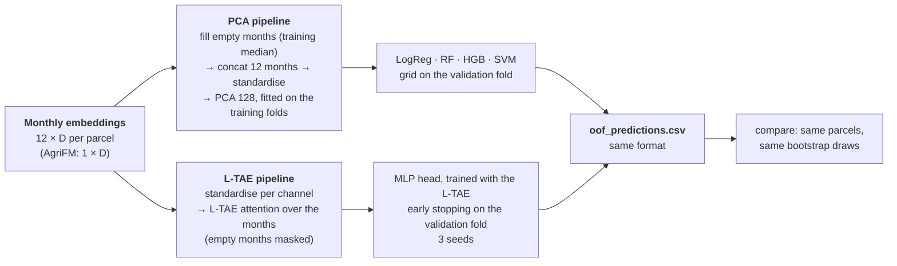
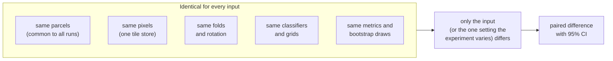

# Evaluation protocol

This protocol defines the rules common to all experiments and ensures that results are comparable across inputs,
classifiers and experiments. Any deviation must be declared in the experiment's *What changes* table.

**Contents:** [1 Task](#1-task-and-unit) · [2 Splits](#2-spatial-splits) · [3 Inputs](#3-inputs) ·
[4 Classifiers](#4-classifiers) · [5 Temporal aggregation](#5-temporal-aggregation-two-pipelines) ·
[6 Fairness rules](#6-fairness-rules) · [7 Metrics](#7-metrics-and-uncertainty) ·
[8 Reading a result](#8-how-a-result-is-read) · [9 Reporting](#9-reporting-standard) · [References](#references)

---

## 1. Task and unit

The task is binary classification of **parcels** into irrigated (class 1) and rainfed (class 2), with one label
and one prediction per surveyed parcel; all metrics are computed at parcel level. 8,781 parcels (7,585 irrigated, 1,196 rainfed); inputs are scored on
the parcels present in every run (8,775: six parcels fully covered by overlapping polygons have no own pixel).

## 2. Spatial splits

Parcels are grouped into **20 km blocks**, and the blocks into **5 folds** with the same class balance (about
1,530 irrigated and 240 rainfed parcels each). A block is never split. A place surveyed in both seasons stays in one
fold. Block size and fold assignment: [dataset §5](../phase1_data/dataset.md#5-script-02--make_spatial_folds).

**Main design: PASTIS rotation** (Garnot & Landrieu 2021). Five rounds; in each, 3 folds train, the next fold is
the validation fold, one fold is the test fold:

| Round | Train | Validation (choose settings / early stopping) | Test |
| --- | --- | --- | --- |
| 1 | 2, 3, 4 | 1 | 0 |
| 2 | 3, 4, 0 | 2 | 1 |
| 3 | 4, 0, 1 | 3 | 2 |
| 4 | 0, 1, 2 | 4 | 3 |
| 5 | 1, 2, 3 | 0 | 4 |

The model is trained on the 3 training folds with the setting that scored best on the validation fold. The test
fold is never used for any choice. After 5 rounds every parcel has one **out-of-fold prediction** from a model that
never saw its block. Classifiers and neural networks use the same rotation.

**Why a rotation rather than one fixed split.** (i) Every parcel is tested once, so the rainfed scores rest on all
1,196 rainfed parcels instead of the ~240 of a single test fold. (ii) Five different test areas reveal how strongly
accuracy depends on the region, which a single test area would show only by chance. (iii) Hyperparameters are never
chosen on the test fold, so the reported accuracy is not inflated by tuning (Varma & Simon, 2006). The same
principle of spatially separated folds is implemented in blockCV (Valavi et al., 2019) and used for crop-type
classification with Sentinel-1/2 by Orynbaikyzy et al. (2022); Schratz et al. (2019) recommend spatial folds for
tuning as well as for testing.

**Sensitivity design: nested spatial CV** (`VALIDATION: nested`, experiment [E01](../experiments/E01_frozen_pca_nested/index.md)):
settings chosen by spatial CV on the 4 non-test folds, model refit on all 4.

**Random CV** (stratified, ignoring blocks) is only used inside a run to show how much it overstates accuracy.

## 3. Inputs

Five inputs are compared: a Sentinel-1/2 parcel-feature baseline (12 Sentinel-2 bands, NDVI, NDWI, EVI and
Sentinel-1 VV, VH over 12 months; 204 features) and the embeddings of four frozen foundation models (Clay v1.5,
Prithvi-EO-2.0, TerraMind, AgriFM). A parcel's embedding is the mean of the patch embeddings that cover it, weighted
by the share of each patch inside the parcel; chips are 64 × 64 px and shifted so that the parcel centroid lies at a
patch centre. Bands, patch size and temporal handling per model: [Foundation models · Configuration](../foundation_models.md#configuration-in-this-study).

## 4. Classifiers

| | Classifier | Grid (chosen on the validation fold, by macro-F1) | Fixed |
| --- | --- | --- | --- |
| `logreg` | logistic regression (**linear probe**) | C ∈ {0.01, 0.1, 1, 10} | balanced classes, standardised |
| `rf` | random forest | max_features ∈ {√p, 0.3} · min_samples_leaf ∈ {1, 5} · class_weight ∈ {none, balanced_subsample} | 500 trees |
| `hgb` | histogram gradient boosting | learning_rate ∈ {0.05, 0.1} · max_leaf_nodes ∈ {15, 31} · class_weight ∈ {none, balanced} | |
| `svm` | RBF support vector machine | C ∈ {1, 10} · γ ∈ {scale, 0.01} | balanced classes, standardised |

**Headline classifiers:** random forest (the proposal's baseline classifier) for every input, and logistic
regression (linear probe) for the foundation models. HGB and SVM are robustness checks and are always reported.

## 5. Temporal aggregation: two pipelines

How the 12 monthly embeddings of a parcel become one input for the classifier is the step that differs between
the two pipelines. Everything before (embeddings) and after (comparison, metrics) is shared.

| | PCA pipeline | L-TAE pipeline |
| --- | --- | --- |
| Experiments | [E01](../experiments/E01_frozen_pca_nested/index.md), [E02](../experiments/E02_frozen_pca_pastis/index.md) | [E03](../experiments/E03_frozen_ltae_pastis/index.md) |
| Learns which months matter | no (PCA is unsupervised) | yes (attention weights) |
| Keeps the order of the months | only as positions in the vector | yes (positional encoding) |
| Classifier | the four of §4 | its own MLP head |
| Applies to the baseline | yes (204 features, no PCA) | yes (17 variables × 12 months) |
| Applies to AgriFM | yes | no (one vector per year) |
| Reference | linear probing of frozen features | PANGAEA: single-date encoders + L-TAE (Marsocci et al. 2024); L-TAE (Garnot & Landrieu 2020) |

The L-TAE pipeline is also trained on the monthly S1/S2 features, so that the baseline benefits from the same
temporal model and the comparison remains balanced. Because both pipelines write the same out-of-fold predictions, E03 compares them
directly with the E02 runs on the same parcels.

## 6. Fairness rules

1. Every fitted step (imputation, standardisation, PCA, tuning, early stopping) uses the **training folds only**;
   the validation fold only chooses settings; the test fold is used once, for the prediction.
2. All inputs come from the **same tile store**: same composites, cloud mask, months and parcels.
3. Settings are chosen with the **same budget** for every input (the grids above).
4. Inputs are compared on the **parcels common to all runs**, with the **same bootstrap draws**.
5. An experiment varies **one thing** against the experiment it builds on, and says so in its README.

## 7. Metrics and uncertainty

| Metric | Role |
| --- | --- |
| **Macro-F1** | headline: mean of irrigated F1 and rainfed F1, so the 14% rainfed class counts equally |
| F1, precision, recall per class | rainfed recall: how many rainfed fields are found |
| Balanced accuracy | mean recall of both classes |
| Overall accuracy | for comparison with the literature (predicting "all irrigated" already gives 86%) |
| PR-AUC (rainfed), Brier score, ECE | ranking quality and calibration of the predicted probabilities |
| Macro-F1 per fold, mean ± SD | stability across regions (the proposal's selection criterion) |

The kappa coefficient is not reported, as it is uninformative for accuracy assessment (Pontius & Millones, 2011).

**95% confidence intervals: block bootstrap** (Künsch, 1989). The 91 blocks, not the parcels, are the independent
units. Each of
1,000 draws resamples whole blocks with replacement and recomputes the metric; the 2.5% and 97.5% quantiles give the
interval. The same 1,000 draws are used for every run, so a difference between two inputs is measured on identical
resamples (**paired**).

## 8. How a result is read

- **Δ macro-F1** = input − baseline, with the **same classifier** (runs with their own model, such as L-TAE or
  PSE-TAE, against the baseline random forest).
- An input is **better** (or **worse**) than the baseline only if the 95% CI of Δ excludes 0 **and** the
  Holm-adjusted p-value is below 0.05. Holm corrects for testing all inputs × classifiers together.
- A CI that excludes 0 without surviving Holm is reported as "higher / lower, not significant after Holm".
- Otherwise: **no clear difference**. With ~240 rainfed parcels per fold, differences below about 0.02 macro-F1 are
  usually inside the noise.

## 9. Reporting standard

Every experiment has a report page (`docs/experiments/<name>/report.md`) with, in this order: the **answer** in one or two sentences, the **key
findings**, the setup, the result tables and figures (generated by `experiments/make_report.py` from the results),
the **interpretation**, the **caveats** and the **next steps**. A finished experiment adds a one-line answer to its
`config.yaml`, which appears on the [Results](../results.md) page.

## References

- Garnot, V. S. F., & Landrieu, L. (2020). Lightweight temporal self-attention for classifying satellite images time series. *AALTD workshop, ECML-PKDD*. https://arxiv.org/abs/2007.00586
- Garnot, V. S. F., & Landrieu, L. (2021). Panoptic segmentation of satellite image time series with convolutional temporal attention networks. *ICCV*. https://arxiv.org/abs/2107.07933
- Marsocci, V., et al. (2024). PANGAEA: A global and inclusive benchmark for geospatial foundation models. https://arxiv.org/abs/2412.04204
- Foody, G. M. (2009). Classification accuracy comparison: hypothesis tests and the use of confidence intervals in evaluations of difference, equivalence and non-inferiority. *Remote Sensing of Environment*, 113, 1658–1663.
- Holm, S. (1979). A simple sequentially rejective multiple test procedure. *Scandinavian Journal of Statistics*, 6, 65–70.
- Roberts, D. R., et al. (2017). Cross-validation strategies for data with temporal, spatial, hierarchical, or phylogenetic structure. *Ecography*, 40, 913–929.
- Ploton, P., et al. (2020). Spatial validation reveals poor predictive performance of large-scale ecological mapping models. *Nature Communications*, 11, 4540.

