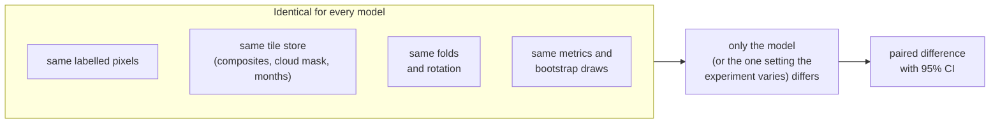

# Evaluation protocol

This protocol defines the rules common to all pixel-wise experiments (E01–E05) and makes their results comparable
across inputs, models and experiments. Any deviation is stated on the experiment's page. The protocol of the earlier
parcel-wise benchmark is kept in the [archive](../archive/parcel_wise_classification/evaluation_protocol.md).

**Contents:** [1 Task](#1-task-and-unit) · [2 Splits](#2-spatial-splits) · [3 Models](#3-models-and-inputs) ·
[4 Fairness rules](#4-fairness-rules) · [5 Metrics](#5-metrics-and-uncertainty) ·
[6 Reading a result](#6-how-a-result-is-read) · [7 Reporting](#7-reporting-standard) · [References](#references)

---

## 1. Task and unit

Every **10 m pixel** is classified into one of three classes: **1 irrigated**, **2 rainfed**, **3 not cropland**
([D16](../decisions.md#d16-pixel-wise-classification-for-continuous-maps),
[D17](../decisions.md#d17-cropland-mask-from-four-products-and-a-not-cropland-class)). The labelled pixels are the
inner pixels of the surveyed parcels (at most 100 per parcel) and not-cropland pixels taken where none of the four
cropland products shows cropland ([pixel samples](../phase1_data/pixel_samples.md)). Every model is scored on the
same labelled pixels. Regions: Morocco (2023/24 and 2024/25 pooled, each pixel with its own year) and Utah
(2023/24), analysed separately.

## 2. Spatial splits

Parcels are grouped into **20 km blocks**, and the blocks into **5 folds** with a similar class balance; a block is
never split, and every labelled pixel takes the fold of its block. Pixels of blocks without labelled parcels (fold
−1) are not used. Fold assignment: [Morocco dataset §5](../phase1_data/morocco.md#5-script-02--make_spatial_folds).

**PASTIS rotation** (Garnot & Landrieu 2021). Five rounds; in each, 3 folds train, the next fold is the validation
fold, one fold is the test fold:

| Round | Train | Validation (early stopping, settings) | Test |
| --- | --- | --- | --- |
| 1 | 2, 3, 4 | 1 | 0 |
| 2 | 3, 4, 0 | 2 | 1 |
| 3 | 4, 0, 1 | 3 | 2 |
| 4 | 0, 1, 2 | 4 | 3 |
| 5 | 1, 2, 3 | 0 | 4 |

The test fold is never used for any choice. After 5 rounds every labelled pixel has one **out-of-fold prediction**
from a model that never saw its block. Models that work on whole 128 px tiles (E03–E05) predict the test tiles and
are read at their labelled pixels; a tile with pixels of several folds contributes only its training-fold labels to
the loss.

**Why a rotation rather than one fixed split.** (i) Every pixel is tested once, so the rainfed scores rest on all
rainfed parcels instead of those of a single test fold. (ii) Five test areas show how strongly accuracy depends on
the region. (iii) Settings are never chosen on the test fold, so the reported accuracy is not inflated by tuning
(Varma & Simon 2006). Spatially separated folds follow Roberts et al. (2017) and Ploton et al. (2020): random splits
of autocorrelated pixels overstate accuracy (Kattenborn et al. 2022).

## 3. Models and inputs

All inputs come from the same tile store: 12 monthly Sentinel-2 composites of the agricultural year, Sentinel-2
only ([D14](../decisions.md#d14-sentinel-2-only-for-every-input)).

| Experiment | Input | Models |
| --- | --- | --- |
| [E01](../experiments/E01_s2_pixel_baseline.md) | pixel time series, 12 months × 12 bands (+ NDVI, NDWI) | random forest, histogram gradient boosting |
| [E02](../experiments/E02_temporal_nn.md) | same pixel time series | TempCNN |
| [E03](../experiments/E03_utae.md) | 128 × 128 px tiles | U-TAE from scratch |
| [E04](../experiments/E04_frozen_geofm.md) | 128 × 128 px tiles | six frozen foundation models + L-TAE + UPerNet ([Foundation models](../foundation_models.md)) |
| [E05](../experiments/E05_prithvi_strategies.md) | 128 × 128 px tiles, 10–100% of the training parcels | Prithvi frozen, LoRA, fully fine-tuned, from scratch |

Neural models: class-weighted cross-entropy (weights from the training pixels), early stopping on the validation
fold, 3 seeds (42, 1042, 2042) per round; the out-of-fold prediction is the mean probability of the seeds. Settings
per experiment are on its page; the shared settings are on the [experiment plan](../experiments/plan.md).

## 4. Fairness rules

1. Every fitted step (normalisation statistics, class weights, early stopping) uses the **training folds** (early
   stopping: the validation fold); the test fold is used once, for the prediction.
2. All inputs come from the **same tile store**.
3. Models are compared on the **same out-of-fold pixels** with the **same bootstrap draws**.
4. An experiment varies **one thing** against the experiment it builds on and states it.

## 5. Metrics and uncertainty

| Metric | Role |
| --- | --- |
| **Cropland macro-F1** | headline: mean F1 of irrigated and rainfed over the parcel pixels; a parcel pixel predicted "not cropland" counts as missed. Comparable across experiments whatever the not-cropland performance |
| 3-class macro-F1 | mean F1 of the three classes |
| F1, precision, recall per class | e.g. rainfed recall: how many rainfed pixels are found |
| Overall accuracy | for comparison with the literature only |
| Confusion matrix | which classes are confused (e.g. rainfed → irrigated) |

The kappa coefficient is not reported (Pontius & Millones 2011). Results are also given per region, per year
(Morocco) and per zone.

**95% confidence intervals: block bootstrap** (Künsch 1989). The 20 km blocks, not the pixels, are the independent
units. Each of 1,000 draws resamples whole blocks with replacement and recomputes the metric from the summed
confusion matrices; the 2.5% and 97.5% quantiles give the interval. The same draws are used for every run, so a
difference between two models is measured on identical resamples (**paired**; Foody 2009).

## 6. How a result is read

- **Δ** = model − reference on the same pixels (references: E01 random forest and E03 U-TAE for E01–E04; within E05
  the strategies against each other).
- A model is **better** (or **worse**) only if the 95% CI of Δ excludes 0 **and** the Holm-adjusted p-value is
  below 0.05 (Holm 1979; correction over all comparisons of a table and metric).
- A CI that excludes 0 without surviving Holm is reported as "higher / lower, not significant after Holm".
- Otherwise: **no clear difference**. With few large blocks per fold, the CIs are wide (0.09–0.14 in Morocco).

## 7. Reporting standard

Every experiment has one page (`docs/experiments/E0<N>_<name>.md`) with the question, what changes from the previous
experiment, the set-up, how to run it, and, once run, the results with confidence intervals, figures, the paired
tests and an interpretation. The comparison table and paired tests of E01–E04 come from
`pixelwise_run/05_compare_experiments.py`; E05 has its own `report.py`. Finished results are summarised on the
[Results](../results.md) page.

## References

- Foody, G. M. (2009). Classification accuracy comparison: hypothesis tests and the use of confidence intervals in
  evaluations of difference, equivalence and non-inferiority. *Remote Sensing of Environment* 113, 1658–1663.
- Garnot, V. S. F., & Landrieu, L. (2021). Panoptic segmentation of satellite image time series with convolutional
  temporal attention networks. *ICCV*. https://arxiv.org/abs/2107.07933
- Holm, S. (1979). A simple sequentially rejective multiple test procedure. *Scandinavian Journal of Statistics* 6,
  65–70.
- Kattenborn, T., et al. (2022). Spatially autocorrelated training and validation samples inflate performance
  assessment of convolutional neural networks. *ISPRS Open Journal of Photogrammetry and Remote Sensing* 5, 100018.
- Künsch, H. R. (1989). The jackknife and the bootstrap for general stationary observations. *Annals of Statistics*
  17, 1217–1241.
- Ploton, P., et al. (2020). Spatial validation reveals poor predictive performance of large-scale ecological
  mapping models. *Nature Communications* 11, 4540.
- Pontius, R. G., & Millones, M. (2011). Death to Kappa. *International Journal of Remote Sensing* 32, 4407–4429.
- Roberts, D. R., et al. (2017). Cross-validation strategies for data with temporal, spatial, hierarchical, or
  phylogenetic structure. *Ecography* 40, 913–929.
- Varma, S., & Simon, R. (2006). Bias in error estimation when using cross-validation for model selection.
  *BMC Bioinformatics* 7, 91.
