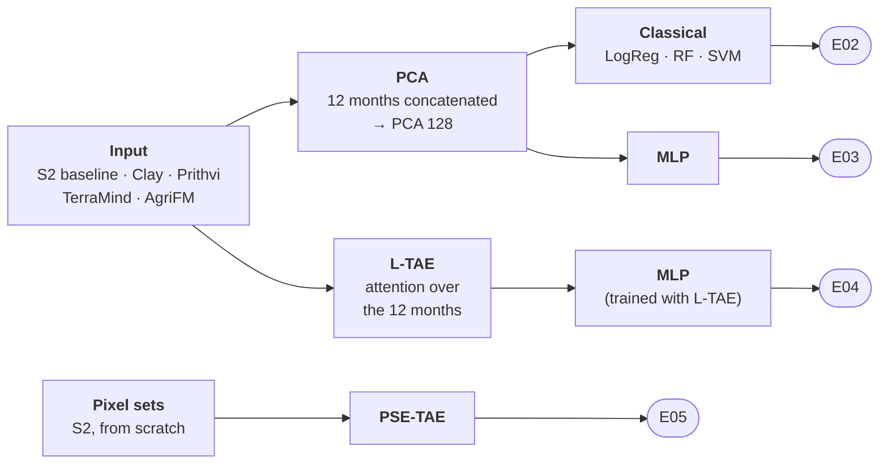

# RQ1 · Experiment plan

This page is the complete plan of the frozen-encoder evaluation of Phase 2 · Model evaluation (RQ1): which experiments are run, what each one
answers, and every setting. It is agreed before the runs start; an experiment page in
[Experiments](../experiments/index.md) is created from it when the experiment is implemented. Rules shared by all
experiments (splits, metrics, fairness) are in the [evaluation protocol](evaluation.md).

**Contents:** [1 Decisions](#1-decisions-this-plan-rests-on) · [2 Shared settings](#2-settings-shared-by-every-experiment) ·
[3 Inputs](#3-inputs) · [4 Design](#4-design-what-is-varied) · [5 Main experiments](#5-main-experiments) ·
[6 Label efficiency](#6-label-efficiency-inside-e02e05) · [7 Ablations](#7-ablations) · [8 Analyses](#8-analyses-on-every-run) ·
[9 Results pages](#9-results-pages) · [10 Order of work](#10-order-of-work) · [11 Size](#11-number-of-runs) ·
[12 Open points](#12-open-points)

**Experiment pages** (setup, settings, how to run; the report is added when the results are in):

| ID | Experiment | Answers | Page |
| --- | --- | --- | --- |
| E02 | PCA + LogReg / RF / SVM | Q1 (main table of RQ1) | [E02 setup](../experiments/E02_frozen_pca/index.md) |
| E03 | PCA + MLP head | Q2 · does the head matter? | [E03 setup](../experiments/E03_frozen_pca_mlp/index.md) |
| E04 | L-TAE + MLP head | Q3 · does attention over the months help? | [E04 setup](../experiments/E04_frozen_ltae/index.md) |
| E05 | PSE-TAE from scratch | Q4 · is a model trained from scratch enough? | [E05 setup](../experiments/E05_psetae_scratch/index.md) |
| E01 | PCA + classifiers, nested CV (done, before D14) | check of the validation design | [E01 setup](../experiments/E01_frozen_pca_nested/index.md) · [report](../experiments/E01_frozen_pca_nested/report.md) |

Label efficiency (Q5) is part of every experiment E02–E05: each one also trains on 10, 25 and 50% of the training
blocks ([§6](#6-label-efficiency-inside-e02e05)). All experiments: [Experiments overview](../experiments/index.md).

---

## 1. Decisions this plan rests on

| Decision | Choice | Reason |
| --- | --- | --- |
| Input data | **Sentinel-2 only** for every foundation model and every baseline | same optical data for all; Morocco and Utah treated alike; Sentinel-1 coverage of Utah changed between years ([D14](../decisions.md#d14-sentinel-2-only-for-every-input)). Sentinel-1 is an ablation for later ([A5](#7-ablations)). |
| Model inputs | each foundation model receives only the bands it was pretrained on; no fusion designed by us | the comparison tests the pretrained models, not a fusion scheme |
| Classifier heads | three classical classifiers (**logistic regression, random forest, SVM**) and one neural head (**MLP**) | linear probe = standard test of frozen features; RF = standard remote-sensing classifier; SVM = strongest in E01; MLP = trainable head as in GeoFM benchmarks. Gradient boosting is dropped: in E01 it was never the best and always within the CI of SVM ([D6](../decisions.md#d6-four-classifiers-instead-of-one-random-forest)). |
| Temporal handling | **PCA** (concatenated months) and **L-TAE** (learned attention over the months) | [D8](../decisions.md#d8-two-temporal-aggregation-pipelines); L-TAE as in PANGAEA (Marsocci et al. 2024) |
| Neural baseline from scratch | **PSE-TAE** on the parcel pixel sets | built for parcel classification from satellite time series (Garnot et al. 2020) |
| Most important extra | **label efficiency** | the main claim for foundation models is that they need fewer labels |
| Regions | **Morocco** and **Utah 2023/24**, same protocol, analysed separately | [D13](../decisions.md#d13-utah-as-a-second-independent-study-area): two independent study areas |

---

## 2. Settings shared by every experiment

| Setting | Value |
| --- | --- |
| Task | irrigated (1) vs rainfed (2), one prediction per parcel |
| Morocco data | views `views/` (2023/24 + 2024/25 pooled), 8,775 parcels scored (7,579 irrigated, 1,196 rainfed) |
| Utah data | views `views_2023-24/` (WRLU 2024 labels), 6,011 parcels with pixels |
| Time | 12 monthly composites of the agricultural year (Morocco Sep–Aug, Utah Oct–Sep) |
| Splits | 5 spatial folds of 20 km blocks; **PASTIS rotation**: per round 3 folds train, the next fold validates (settings, early stopping), 1 fold tests |
| Tuning | grids below, chosen on the validation fold by macro-F1; same grid for every input |
| Fitted steps | imputation, standardisation, PCA, tuning and early stopping use the training folds only |
| Neural networks | 3 seeds (42, 1042, 2042) per run; mean ± SD over seeds; the out-of-fold prediction of a parcel is the mean probability of the 3 seeds |
| Metrics | macro-F1 (headline), F1 / precision / recall per class, balanced and overall accuracy, PR-AUC (rainfed), Brier, ECE |
| Uncertainty | block bootstrap, 1,000 draws, same draws for every run; paired differences; Holm over all comparisons of an experiment |
| Comparison set | parcels present in every run of the region |

---

## 3. Inputs

All five inputs are cut from the same tile store. Sentinel-2 only.

| Input | Data per parcel | Bands | Patch | Per parcel | Months | Script |
| --- | --- | --- | --- | --- | --- | --- |
| **S2 baseline** | median of the parcel's inner pixels | 12 S2 bands + NDVI, NDWI, EVI (15 variables) | parcel | 15 × 12 = 180 features | 12 | `03` (view A) |
| **Clay v1.5** | 64 px chip, p8 grid | 10 S2 bands | 8 px (80 m) | 12 × 1,024 | 12 | `02a` |
| **Prithvi-EO-2.0** | 64 px chip, p16 grid | 6 S2 bands (HLS set) | 16 px (160 m) | 12 × 1,024 | 12 | `02b` |
| **TerraMind** | 64 px chip, p16 grid | 12 S2 bands | 16 px (160 m) | 12 × 768 | 12 | `02c` |
| **AgriFM** | 64 px chip, p16 grid | 10 S2 bands | 4 px patch, stride 32 px (320 m) | 1 × 1,024 (whole year) | 1 | `02d` |
| **Pixel sets** (PSE-TAE only) | all inner pixels of the parcel | 10 S2 bands | pixel | N pixels × 12 × 10 | 12 | `03b` (view B) |

Patch embeddings are pooled over the parcel with the patch-share weights ([models pipeline §5](frozen_encoders.md#5-scripts-02a02d--foundation-model-embeddings)).
Clay and Prithvi also receive the parcel location and the date, as in their pretraining; [A4](#7-ablations) tests
whether the location acts as a shortcut.

---

## 4. Design: what is varied

Three things are varied: the **input**, the **temporal handling** and the **head**. Not every combination exists:
L-TAE is a neural network trained with its own loss, so it cannot feed a random forest, and AgriFM gives one vector
per year, so it has no months for L-TAE.

| Cell | Temporal handling | Head | S2 baseline | Clay | Prithvi | TerraMind | AgriFM | Experiment |
| --- | --- | --- | --- | --- | --- | --- | --- | --- |
| a | PCA | LogReg · RF · SVM | ✓ (no PCA) | ✓ | ✓ | ✓ | ✓ | [**E02**](../experiments/E02_frozen_pca/index.md) |
| b | PCA | MLP | ✓ (no PCA) | ✓ | ✓ | ✓ | ✓ | [**E03**](../experiments/E03_frozen_pca_mlp/index.md) |
| c | L-TAE | MLP | ✓ | ✓ | ✓ | ✓ | – | [**E04**](../experiments/E04_frozen_ltae/index.md) |
| d | from scratch | PSE-TAE | pixel sets | – | – | – | – | [**E05**](../experiments/E05_psetae_scratch/index.md) |

**Which comparison answers which question**

| Question | Comparison | Same in both |
| --- | --- | --- |
| Q1 · Do frozen foundation-model embeddings beat Sentinel-2 features? | each GeoFM vs the S2 baseline, within E02, E03 and E04 | head, temporal handling, parcels |
| Q2 · Does the head matter? | E02 vs E03 (classical vs MLP) | input, PCA |
| Q3 · Does learning which months matter help? | E03 vs E04 (PCA vs L-TAE) | input, MLP head |
| Q4 · Is a model trained from scratch on our labels enough? | E05 vs the best GeoFM setting and the best baseline setting | parcels, folds |
| Q5 · Do foundation models need fewer labels? | learning curves inside E02–E05 (10 / 25 / 50 / 100% of the training blocks) | everything except the training size |
| Q6 · Do the conclusions hold in a second region? | every question in Morocco and in Utah | protocol |

The S2 baseline in E04 (L-TAE on the 15 monthly variables) is the key control for Q1: if L-TAE helps the GeoFMs, the
same L-TAE must be given to the raw features, otherwise the gain could come from L-TAE rather than from the
embeddings.

---

## 5. Main experiments

### E02 · PCA + classical classifiers

Setup page: [E02](../experiments/E02_frozen_pca/index.md)

| | |
| --- | --- |
| **Question** | Q1 with the classical heads; the main table of RQ1 |
| **Inputs** | S2 baseline, Clay, Prithvi, TerraMind, AgriFM |
| **Temporal handling** | months with no clear pixel filled with the training-fold median → 12 months concatenated → standardised → PCA 128 (fitted on the training folds). AgriFM: 1 × 1,024 → PCA 128. Baseline: 180 features, gaps filled by linear interpolation in time per parcel, standardised, no PCA. |
| **Classifiers and grids** | `logreg` C ∈ {0.01, 0.1, 1, 10}, balanced classes · `rf` 500 trees, max_features ∈ {√p, 0.3}, min_samples_leaf ∈ {1, 5}, class_weight ∈ {none, balanced_subsample} · `svm` RBF, C ∈ {1, 10}, γ ∈ {scale, 0.01}, balanced classes |
| **Headline** | logistic regression (linear probe) for the GeoFMs; random forest for the baseline, as in the protocol; all three reported |
| **Runs** | 5 inputs × 2 regions = 10 runs (3 classifiers each) |
| **Script** | `models_run/03_train_evaluate.py` |

### E03 · PCA + MLP

Setup page: [E03](../experiments/E03_frozen_pca_mlp/index.md)

| | |
| --- | --- |
| **Question** | Q2: does a trainable neural head get more out of the same PCA input than the classical heads? |
| **Inputs** | the same 128 PCA components (baseline: the 180 standardised features) as E02 |
| **Head** | MLP 128 → 256 → 128 → 2, ReLU, batch normalisation, dropout 0.2 (same hidden sizes as the E04 head) |
| **Training** | AdamW, learning rate 1e-3, weight decay 1e-4, batch 128, class-weighted cross-entropy, up to 100 epochs, early stopping on validation macro-F1 (patience 15), 3 seeds |
| **Tuning** | none beyond early stopping (same budget for every input) |
| **Runs** | 5 inputs × 2 regions × 3 seeds |
| **Script** | `models_run/03c_train_ltae.py`, `HEAD: mlp` on the PCA input |

### E04 · L-TAE + MLP

Setup page: [E04](../experiments/E04_frozen_ltae/index.md)

| | |
| --- | --- |
| **Question** | Q3: does attention over the months classify better than concatenation + PCA? |
| **Inputs** | monthly sequences: S2 baseline (12 × 15 variables), Clay (12 × 1,024), Prithvi (12 × 1,024), TerraMind (12 × 768). AgriFM excluded (one vector per year). |
| **Pre-processing** | per-channel standardisation with training-fold statistics; months without a clear pixel are masked in the attention, not filled |
| **Model** | L-TAE (Garnot & Landrieu 2020) with the paper's default size: 16 heads, d_k 8, d_model 256, output MLP 256-128; then a linear layer with 2 outputs; sinusoidal encoding of each month's mid-month day (days since the start of the agricultural year), as in L-TAE |
| **Training** | as E03 (AdamW 1e-3, weight decay 1e-4, batch 128, class-weighted cross-entropy, ≤ 100 epochs, patience 15, 3 seeds) |
| **Runs** | 4 inputs × 2 regions × 3 seeds |
| **Script** | `models_run/03c_train_ltae.py`, `HEAD: ltae` |
| **Compared with** | the E03 run of the same input (same head, PCA instead of L-TAE) and the E02 runs |

### E05 · PSE-TAE from scratch

Setup page: [E05](../experiments/E05_psetae_scratch/index.md)

| | |
| --- | --- |
| **Question** | Q4: does a temporal deep model trained only on our labelled parcels match the frozen foundation models? |
| **Input** | pixel sets: inner pixels of the parcel (edge pixels within 10 m left out; parcels with < 4 inner pixels keep all), 10 S2 bands × 12 months |
| **Model** | PSE-TAE (Garnot et al. 2020): 64 pixels sampled per parcel and month; at prediction the mean of 5 random pixel draws |
| **Training** | Adam 1e-3, weight decay 1e-4, batch 128, ≤ 100 epochs, early stopping on validation macro-F1 (patience 15), 3 seeds |
| **Runs** | `morocco_s2`, `utah_s2` × 3 seeds |
| **Script** | `models_run/03b_train_psetae.py` (`N_SEEDS = 3`) |

---

## 6. Label efficiency (inside E02–E05)

Label efficiency is not a separate experiment: every experiment E02–E05 also trains each input on fewer training
blocks, and its report shows the learning curve next to the main result. The block draws are shared, so the curves of
all experiments are directly comparable.

| | |
| --- | --- |
| **Question** | Q5: how much training data does each input and head need? Foundation models are expected to gain most when labels are few; the heads with many trained parameters (MLP, L-TAE, PSE-TAE) may lose most. |
| **Training size** | 10, 25 and 50% of the **training blocks** of each round; 100% = the main run. Validation and test folds stay complete, so only the amount of training data changes. |
| **Sampling** | whole blocks: rainfed and irrigated-only blocks each put in a random order (per region, round and draw), and a fraction takes the first blocks of each list, so the draws are **nested** (10% ⊂ 25% ⊂ 50%); the order is accepted only if its first 10% hold ≥ 20 rainfed parcels. No fraction below 10%. (In Morocco most rainfed parcels lie in a few Doukkala blocks.) |
| **Repeats** | 3 draws per fraction; draw *k* is the same in every experiment, for every input and head (paired) |
| **Seeds** | neural runs (E03–E05): 1 seed per draw (the draws give the spread); the main runs keep 3 seeds, and their 100% point on the curve is scored seed by seed, so every point is single-seed |
| **Settings** | `label_efficiency` block in each experiment's `config.yaml`; `TRAIN_FRACTION` and `FRACTION_DRAW` in scripts 03, 03b and 03c (one shared block-drawing function) |
| **Runs** | per region: E02 45, E03 45, E04 36, E05 9 = 135; 270 for both regions |
| **Result** | in each report: macro-F1 and rainfed F1 vs training fraction, one line per input; in the RQ1 synthesis: all experiments together, the fraction at which each GeoFM reaches the full-data score of the baseline, and whether the best head or PCA vs L-TAE changes with fewer labels |
| **Caveat** | tuning and early stopping still use the complete validation fold, slightly optimistic for a real low-label situation |

---

## 7. Ablations

Short, targeted runs; each changes one setting of a main experiment.

| ID | Question | Change | On | Priority |
| --- | --- | --- | --- | --- |
| **A1** | Does the yearly profile matter at all? | average of the 12 monthly embeddings instead of concat + PCA (`FEATURE_MODE: mean`) | E02, linear probe + SVM | high (cheap) |
| **A2** | Is the PCA size a fragile choice? | PCA 32 / 64 / 128 / 256 | E02, linear probe | medium |
| **A3** | How many months are needed? | 1 peak month / 4 seasonal months / 12 months | best setting of each input | optional |
| **A4** | Do Clay and Prithvi use the location as a shortcut? | location input switched off (Prithvi `USE_COORDS = False`, Clay location set to zero); re-embedding needed | E02, Morocco (rainfed parcels concentrated in Doukkala) | high |
| **A5** | Does Sentinel-1 add information? | TerraMind with Sentinel-1 (`terramind-s1s2`), baseline with radar features (`S1S2_VARIABLES: all`), PSE-TAE `morocco_s2s1` | E02, E04, E05, Morocco only | later |

E01 (nested spatial CV, done before D14 with Sentinel-1 in the baseline and in TerraMind) stays as the check of the
validation design.

---

## 8. Analyses on every run

From the out-of-fold predictions; no new training.

| Analysis | Why | Script |
| --- | --- | --- |
| Paired differences vs the baseline, Holm-adjusted | main test of Q1 | `04_compare_models.py` |
| Results by zone, season, parcel size and patch purity | region shortcut (Morocco rainfed in Doukkala); small parcels inside 160 m patches | `05_breakdown_oof.py` |
| Results by crop group (Utah: rainfed alfalfa vs grain) | where each input fails | later: `05_breakdown_oof.py` extension (needs the crop names joined from `01_labels`) |
| Random vs spatial CV | how much random CV overstates accuracy | `03_train_evaluate.py` |
| Calibration (Brier, ECE) | usable probabilities for maps | `03`, `03b`, `03c` |
| Month importance (permutation, L-TAE attention) | which part of the season separates the classes | `03`, `03c` |
| Compute cost: parameters, embedding time, training time | practical value | collected by hand from the run logs |

---

## 9. Results pages

Every experiment gets its own pages in [Experiments](../experiments/index.md), created when it is implemented and
filled after each run:

- `index.md` (setup): question, what changes against the previous experiment, all settings, how to run.
- `report.md` (results): the answer in one or two sentences first, then the generated tables and figures, then the
  interpretation, caveats and next steps ([protocol §9](evaluation.md#9-reporting-standard)).

Tables and figures are written by `experiments/make_report.py` from the results, so a page always matches its run.
With two regions, every table and figure appears once for Morocco and once for Utah.

| Experiment | Tables | Figures |
| --- | --- | --- |
| **every experiment** | metrics with 95% CI per input × head; macro-F1 per training fraction (label efficiency); differences vs the baseline (Δ macro-F1, CI, Holm) ; per-fold macro-F1 | macro-F1 with CI per input; learning curve (10–100% of the training blocks); macro-F1 per test fold; confusion matrices |
| [E02](../experiments/E02_frozen_pca/index.md) · PCA + classical | the three classifiers side by side; results by zone (focus zone, irrigated-only zones) | month importance (permutation, random forest) per input; breakdown by zone and parcel area |
| [E03](../experiments/E03_frozen_pca_mlp/index.md) · PCA + MLP | MLP vs the E02 classifiers on the same input; macro-F1 per seed | training curves (validation macro-F1 per epoch) |
| [E04](../experiments/E04_frozen_ltae/index.md) · L-TAE + MLP | L-TAE vs PCA (E03) on the same input; macro-F1 per seed | attention weight per month and class; training curves |
| [E05](../experiments/E05_psetae_scratch/index.md) · PSE-TAE | PSE-TAE vs the E02 baseline and GeoFMs; macro-F1 per seed | training curves |
| Ablations | each ablation vs the setting it changes | one comparison figure each |

The [Results](../results.md) page collects the one-line answer of every experiment; the RQ1 synthesis (step 6
below) compares the experiments and the two regions.

## 10. Order of work

One experiment at a time: implement, check on a small run, run in both regions, write the report, then the next.

| Step | Work | Needs |
| --- | --- | --- |
| 0a | ✅ AgriFM normalisation: chip statistics of each region ([D15](../decisions.md#d15-agrifm-normalised-with-the-statistics-of-the-regions-chips)); config statistics as sensitivity run | – |
| 0b | ✅ Code (13 Nov 2026): region in scripts 02a–05; HGB removed; seeds and label efficiency in 03 / 03b / 03c; new `03c_train_ltae.py`; Holm rule in 04; per-region reports; Slurm submitter | – |
| 0c | ✅ Embeddings, Sentinel-2 only (12 Nov 2026): **Morocco** TerraMind and AgriFM again, Clay and Prithvi reused; **Utah** all four (cluster GPU) | 0a, 0b |
| 1 | [**E02**](../experiments/E02_frozen_pca/index.md) Morocco + Utah; report page with tables and figures (`make_report.py` extended to two regions) | 0c |
| 2 | Write `03c_train_ltae.py` (heads `mlp` and `ltae`); [**E03**](../experiments/E03_frozen_pca_mlp/index.md), then [**E04**](../experiments/E04_frozen_ltae/index.md); reports | 1 |
| 3 | [**E05**](../experiments/E05_psetae_scratch/index.md) PSE-TAE (3 seeds) | – (can run any time on the cluster) |
| 5 | Ablations **A1**, **A4**, **A2** (A3, A5 if time allows) | 1 |
| 6 | RQ1 synthesis over both regions | 1–5 |

---

## 11. Number of runs

| Experiment | Runs per region | Both regions | Hardware |
| --- | --- | --- | --- |
| E02 | 5 (× 3 classifiers) | 10 | CPU, minutes each |
| E03 | 5 × 3 seeds | 30 | CPU or GPU, minutes |
| E04 | 4 × 3 seeds | 24 | GPU |
| E05 | 1 × 3 seeds | 6 | GPU |
| Label efficiency (inside E02–E05) | 135 | 270 | CPU (E02) + GPU (E03–E05) |
| Ablations A1, A2, A4 | ~15 | ~25 | CPU (+ GPU for A4 embeddings) |

The label-efficiency runs are the largest part; they reuse the code of E02–E05 and only add the training-block subsampling.

---

## 12. Open points

- Headline classifier: the protocol keeps random forest for the baseline and the linear probe for the GeoFMs; with
  SVM the strongest classifier in E01, all three are always reported.
- Prithvi-EO-2.0 is pretrained on 30 m HLS and applied to 10 m Sentinel-2 (stated as a limitation).
- Fine-tuning (LoRA, RQ2), the 2024 → 2021 temporal test in Utah (RQ3) and the mapping models follow after RQ1.

## References

- Garnot, V. S. F., Landrieu, L., Giordano, S., & Chehata, N. (2020). Satellite image time series classification with pixel-set encoders and temporal self-attention. *CVPR*. https://arxiv.org/abs/1911.07757
- Garnot, V. S. F., & Landrieu, L. (2020). Lightweight temporal self-attention for classifying satellite images time series. *AALTD workshop, ECML-PKDD*. https://arxiv.org/abs/2007.00586
- Garnot, V. S. F., & Landrieu, L. (2021). Panoptic segmentation of satellite image time series with convolutional temporal attention networks. *ICCV*. https://arxiv.org/abs/2107.07933
- Marsocci, V., et al. (2024). PANGAEA: A global and inclusive benchmark for geospatial foundation models. https://arxiv.org/abs/2412.04204
