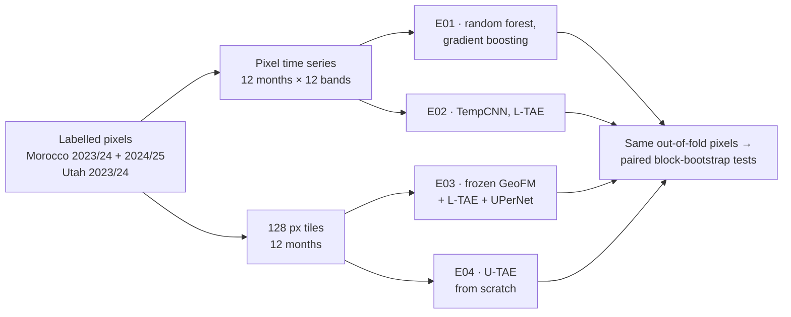

# RQ1 · Experiment plan

**Research question RQ1:** how accurately do geospatial foundation models (GeoFMs) classify irrigated, rainfed and
not-cropland pixels, compared with conventional classifiers trained on Sentinel-2 time series?

RQ1 is answered by the pixel-wise experiments E01–E04 in Morocco and Utah. The settings shared by every experiment
(samples, classes, folds, metrics, statistical tests) are on the [pixel-wise experiment plan](../experiments/plan.md);
this page shows how the experiments answer RQ1 and where they stand. The earlier parcel-wise plan is kept in the
[archive](../archive/parcel_wise_classification/experiment_plan.md).

## Design

Every model classifies **every 10 m pixel** ([D16](../decisions.md#d16-pixel-wise-classification-for-continuous-maps))
from the same 12 monthly Sentinel-2 composites ([D14](../decisions.md#d14-sentinel-2-only-for-every-input)) and is
scored on the same out-of-fold pixels, so every pair of models can be compared on identical pixels.

| Question | Comparison | Experiments |
| --- | --- | --- |
| Q1 · Do frozen GeoFMs beat a classifier on the raw Sentinel-2 time series? | each GeoFM vs the random forest | E03 vs E01 |
| Q2 · Do they beat a neural network trained from scratch on the same tiles? | each GeoFM vs U-TAE | E03 vs E04 |
| Q3 · Does a temporal neural network beat the random forest on the same pixels? | L-TAE, TempCNN vs random forest | E02 vs E01 |
| Q4 · Which GeoFM family works best: image models or pixel time-series models? | Prithvi, Clay, TerraMind, AgriFM vs Presto, TESSERA | within E03 |
| Q5 · Do the conclusions hold in a second region? | every question in Morocco and in Utah | all |

Headline metric: **cropland macro-F1** (mean F1 of irrigated and rainfed); a difference counts when its 95%
block-bootstrap CI excludes 0 and the Holm-corrected p < 0.05 ([evaluation protocol](evaluation.md)).

## Experiments and status

| ID | Model | Status | Cropland macro-F1 Morocco | Cropland macro-F1 Utah |
| --- | --- | --- | --- | --- |
| [E01](../experiments/E01_s2_pixel_baseline.md) | random forest, gradient boosting on the pixel time series | ✅ done | 0.876 (RF) | 0.729 (RF) |
| [E02](../experiments/E02_temporal_nn.md) | TempCNN, L-TAE on the pixel time series | ✅ done | 0.890 (L-TAE) | 0.741 (L-TAE) |
| [E03](../experiments/E03_frozen_geofm.md) | frozen Prithvi, Clay, TerraMind, AgriFM + L-TAE + UPerNet | ✅ done (4 of 6 encoders) | best 0.900 (AgriFM) | best 0.797 (TerraMind) |
| [E03](../experiments/E03_frozen_geofm.md) | frozen Presto, TESSERA + UPerNet | ⏳ to run | – | – |
| [E04](../experiments/E04_utae.md) | U-TAE from scratch | ✅ done | 0.897 | 0.766 |

**So far (cropland macro-F1):**

- **Morocco:** all models lie between 0.876 and 0.900; no model differs significantly from the random forest, and no
  GeoFM from U-TAE.
- **Utah:** the frozen GeoFMs are clearly better. All four beat the random forest by 0.055–0.068 (TerraMind +0.068,
  significant), and U-TAE is the first model trained from scratch to beat it significantly (+0.037). Details and the paired tests are on the
[experiment pages](../experiments/index.md) and the [results](../results.md) page.

## Remaining work for RQ1

1. E03 with Presto and TESSERA (both regions), then the comparison table and paired tests again
   (`pixelwise_run/05_compare_experiments.py`).
2. Label efficiency: whether GeoFMs need fewer labels is tested in [E05](../experiments/E05_prithvi_strategies.md)
   for Prithvi in Utah (10–100% of the training parcels); extending it to the other models is an optional ablation
   ([experiment plan §4](../experiments/plan.md#4-optional-ablations)).
3. Write-up of RQ1 from E01–E04.

Fine-tuning (frozen vs LoRA vs full fine-tuning vs from scratch) belongs to RQ2:
[RQ2 · Fine-tuning](fine_tuning.md).
