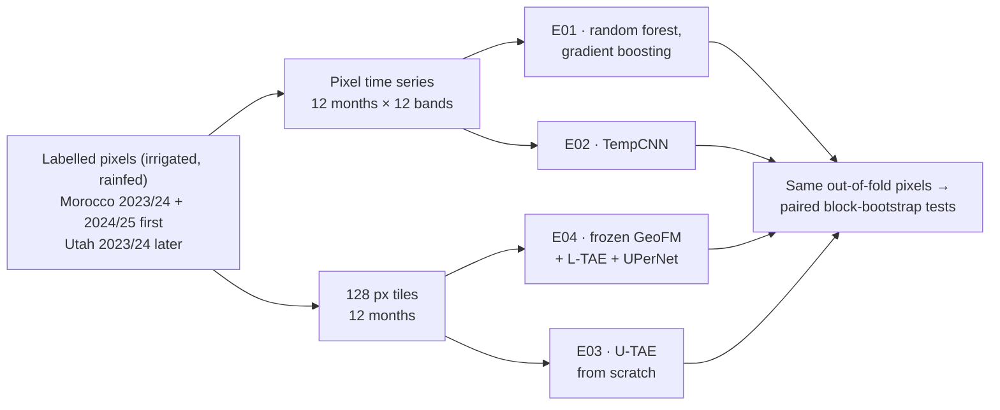

# RQ1 · Experiment plan

**Research question RQ1:** how accurately do geospatial foundation models (GeoFMs) separate irrigated from rainfed
pixels, compared with conventional classifiers trained on Sentinel-2 time series?

RQ1 is answered by the pixel-wise experiments E01–E04, Morocco first and Utah afterwards. The settings shared by every experiment
(samples, classes, folds, metrics, statistical tests) are on the [pixel-wise experiment plan](../experiments/plan.md);
this page shows how the experiments answer RQ1 and where they stand. The earlier parcel-wise plan is kept in the
[archive](../archive/parcel_wise_classification/experiment_plan.md).

## Design

Every model classifies the **10 m pixels of the surveyed parcels** into irrigated and rainfed
([D16](../decisions.md#d16-pixel-wise-classification-for-continuous-maps),
[D19](../decisions.md#d19-two-class-experiments-cropland-extent-in-the-mapping-phase)) from the same 12 monthly Sentinel-2 composites ([D14](../decisions.md#d14-sentinel-2-only-for-every-input)) and is
scored on the same out-of-fold pixels, so every pair of models can be compared on identical pixels.

| Question | Comparison | Experiments |
| --- | --- | --- |
| Q1 · Do frozen GeoFMs beat a classifier on the raw Sentinel-2 time series? | each GeoFM vs the random forest | E04 vs E01 |
| Q2 · Do they beat a neural network trained from scratch on the same tiles? | each GeoFM vs U-TAE | E04 vs E03 |
| Q3 · Does a temporal neural network beat the random forest on the same pixels? | TempCNN vs random forest | E02 vs E01 |
| Q4 · Which GeoFM family works best: image models or pixel time-series models? | Prithvi, Clay, TerraMind, AgriFM vs Presto, TESSERA | within E04 |
| Q5 · Do the conclusions hold in a second region? | every question in Morocco and in Utah | all |

Headline metric: **macro-F1** (mean F1 of irrigated and rainfed); a difference counts when its 95%
block-bootstrap CI excludes 0 and the Holm-corrected p < 0.05 ([evaluation protocol](evaluation.md)).

## Experiments and status

| ID | Model | Status |
| --- | --- | --- |
| [E01](../experiments/E01_s2_pixel_baseline.md) | random forest, gradient boosting on the pixel time series | Morocco done: RF 0.894, GB 0.893 |
| [E02](../experiments/E02_temporal_nn.md) | TempCNN on the pixel time series | Morocco done: 0.912 |
| [E03](../experiments/E03_utae.md) | U-TAE from scratch | Morocco done: 0.900 |
| [E04](../experiments/E04_frozen_geofm.md) | frozen Prithvi, Clay, TerraMind, AgriFM, Presto, TESSERA + L-TAE + UPerNet | Morocco done: TerraMind 0.927 best |

All runs side by side with the paired tests and the Morocco answers to Q1–Q4: [comparison of the experiments](../experiments/comparison.md#answers-to-the-rq1-questions-morocco).

## Remaining work for RQ1

1. Run E01–E04 for Morocco; comparison table and paired tests: done (22 November 2026).
2. The same for Utah.
3. Label efficiency: whether GeoFMs need fewer labels is tested in [E05](../experiments/E05_prithvi_strategies.md)
   for Prithvi (10–100% of the training parcels); extending it to the other models is an optional ablation
   ([experiment plan §4](../experiments/plan.md#4-optional-ablations)).
4. Write-up of RQ1 from E01–E04.

Fine-tuning (frozen vs LoRA vs full fine-tuning vs from scratch) belongs to RQ2:
[RQ2 · Fine-tuning](fine_tuning.md).
