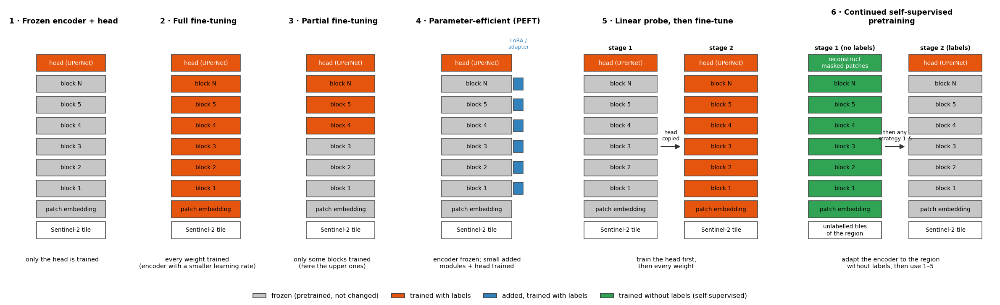
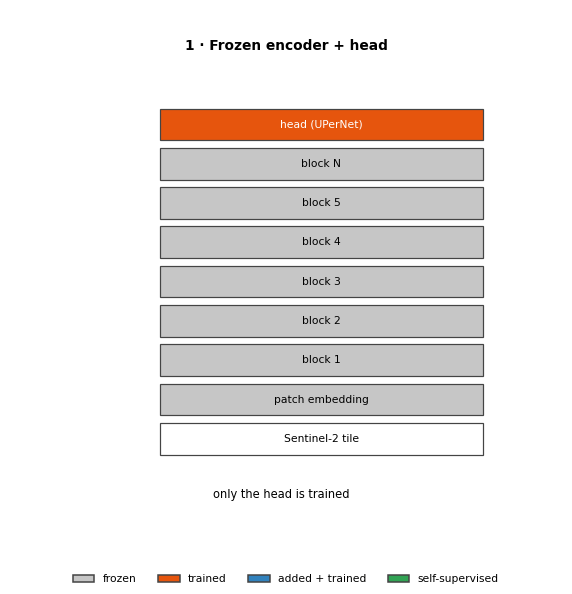
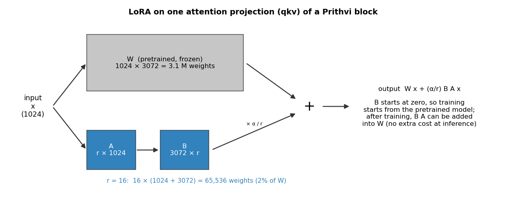
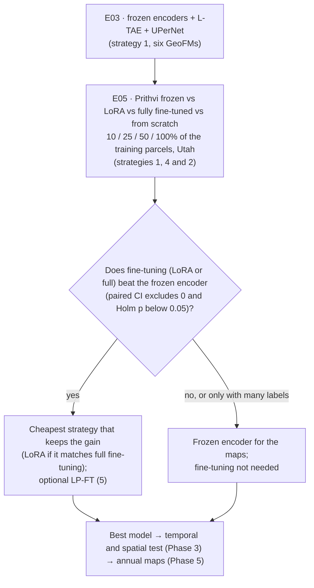

# RQ2 · Fine-tuning and mapping model

**Research question RQ2:** to what extent does fine-tuning a geospatial foundation model (GeoFM) improve on the
frozen encoder, and how does the answer depend on the number of labelled parcels?

## Design

The frozen-encoder benchmark of RQ1 pools embeddings over parcel polygons and cannot produce wall-to-wall maps. RQ2
therefore uses a pixel-level model that serves both as the fine-tuning experiment and as the mapping model of
[Phase 5](../phase5_maps/index.md) ([decision D11](../decisions.md#d11-two-kinds-of-head-parcel-benchmark-and-mapping-model)).

| Component | Description | Where |
| --- | --- | --- |
| Frozen encoder + segmentation head | each GeoFM with an L-TAE over the months and a UPerNet head trained on the labelled pixels of the tiles, as in PANGAEA | [E03](../experiments/E03_frozen_geofm.md) |
| Fine-tuning and training from scratch | Prithvi-EO-2.0 with the same head: frozen, LoRA (low-rank adapters), fully fine-tuned, or trained from random weights, with 10–100% of the training parcels | [E05](../experiments/E05_prithvi_strategies.md) |
| Classical baseline | random forest on the per-pixel Sentinel-2 time series | [E01](../experiments/E01_s2_pixel_baseline.md) |
| Neural baselines | TempCNN and L-TAE (pixel time series), U-TAE (image time series), trained from scratch | [E02](../experiments/E02_temporal_nn.md), [E04](../experiments/E04_utae.md) |

Training, tuning and testing follow the [evaluation protocol](evaluation.md): the same spatial folds and the PASTIS
rotation, and the same out-of-fold pixels for every model ([experiment plan](../experiments/plan.md)).

## What fine-tuning means

A GeoFM is pretrained once, without labels, on very large amounts of imagery. Its **encoder** turns an image into
features. For a task such as irrigated / rainfed mapping, a small **head** is added that turns the features into
classes, and the head is trained on the labelled pixels.

*Adapting* the model means deciding **which weights change** during this training with labels: only the head, every
weight, some of them, or a few new ones added to the encoder. The more weights change, the more the model can fit the
new task, but the more labels and GPU memory it needs and the higher the risk of overfitting or of overwriting what
was learnt in pretraining.

## Six ways to adapt a pretrained encoder

*Grey: pretrained weights left unchanged. Orange: weights trained with the labels. Blue: small modules added to
the encoder and trained with the labels. Green: weights trained without labels. Blocks drawn: 6 (Prithvi-EO-2.0-300M
has 24).*

??? example "The same, one strategy at a time (animation)"
    

| | Strategy | Trained | Trained weights (Prithvi-EO-2.0-300M) | Labels and memory needed | Main risk |
| --- | --- | --- | --- | --- | --- |
| 1 | **Frozen encoder + head** (linear probe, or a decoder such as UPerNet) | head only | ≈ 2.5 M (our head) | lowest | features do not fit the task |
| 2 | **Full fine-tuning** | every weight | ≈ 306 M | highest | overfitting; pretrained features overwritten |
| 3 | **Partial fine-tuning** | some encoder blocks + head | between 1 and 2 | medium | choosing the right blocks |
| 4 | **Parameter-efficient fine-tuning (PEFT)**: LoRA, adapters, prompt tuning, BitFit | small added or selected weights + head | ≈ 1–20 M (0.3–7% of the encoder) | low | less flexible than full fine-tuning |
| 5 | **Linear probe, then fine-tune (LP-FT)** | stage 1 head, stage 2 every weight | as 2 | as 2 | as 2, but milder |
| 6 | **Continued self-supervised pretraining** on unlabelled imagery of the region, then 1–5 | encoder (or adapters) without labels, then as chosen | as chosen | unlabelled imagery and a pretraining run | cost |

**1 · Frozen encoder + head.** The encoder is used as a fixed feature extractor; only the head learns. A *linear
probe* is the smallest head (one linear layer, Alain & Bengio 2016); in segmentation a decoder such as UPerNet is
common (PANGAEA). *Embeddings as data* is the extreme case: the features are computed once and any classifier is
trained on them (TESSERA, AlphaEarth). Cheap, hard to overfit, and a direct test of what pretraining learnt; but if
the task needs features the encoder never learnt, the head cannot create them. This is E03 and the "frozen" run of
E05.

**2 · Full fine-tuning.** Every encoder and head weight is trained, starting from the pretrained weights. It can
adapt the features to the task, so it usually wins when there are enough labels, but it needs gradients and optimiser
states for all ≈ 304 M encoder weights and can overfit small datasets. Two safeguards are standard:

- **discriminative learning rates:** a smaller learning rate for the encoder than for the head (Howard & Ruder 2018),
  or *layer-wise learning-rate decay*, where each earlier block gets a smaller rate;
- **warm-up and gradient clipping**, so that the large, noisy gradients of a still-random head do not damage the
  encoder in the first steps.

This is the "finetune" run of E05: encoder 10⁻⁵, head 10⁻⁴, 1 epoch of warm-up, gradient clipping at 1.0.

**3 · Partial ("surgical") fine-tuning.** Only some blocks are trained and the rest stay frozen. Training the upper
blocks adapts the high-level features; training the first blocks suits a change in the input itself (a new sensor,
resolution or band set). Lee et al. (2023) showed that the best choice depends on the kind of shift and can beat
full fine-tuning.

**4 · Parameter-efficient fine-tuning (PEFT).** The encoder stays frozen and a small number of weights are added or
selected and trained with the head:

- **LoRA** (low-rank adaptation; Hu et al. 2021): a low-rank update B·A next to a frozen weight matrix (see below);
- **adapters** (Houlsby et al. 2019): small bottleneck MLPs inserted in each block;
- **visual prompt tuning** (VPT; Jia et al. 2022): learnable extra tokens fed to the blocks with the image tokens;
- **BitFit** (Ben Zaken et al. 2022): only the bias terms are trained.

The model keeps most of its pretrained knowledge while adapting; memory is close to the frozen case, and each task
stores only a small file. Xin et al. (2024) review the vision methods.

**5 · Linear probe, then fine-tune (LP-FT).** First the head is trained on the frozen encoder (strategy 1), then
every weight is fine-tuned starting from that trained head (strategy 2). Kumar et al. (2022) showed why this helps:
with a random head, the first fine-tuning steps change the encoder to fit an arbitrary head and distort the
pretrained features; starting from a good head avoids that.

**6 · Continued self-supervised pretraining.** Before using any labels, the encoder (or only adapters added to it) is
pretrained further on unlabelled imagery of the target region or sensor with the original self-supervised task, for
example masked-patch reconstruction. It brings the features closer to the target data, and then any of strategies
1–5 follows (Mendieta et al. 2023; Scheibenreif et al. 2024).

### LoRA in detail

A linear layer computes W x with a pretrained matrix W (in Prithvi's attention, 1024 → 3072 values). LoRA keeps W
frozen and adds a second path through two small matrices, A (r × 1024) and B (3072 × r), with a small rank r. Only A
and B are trained. B starts at zero, so training starts exactly from the pretrained model; after training, B·A can be
added into W, so the model is as fast as before. In E05, LoRA has rank 16 on the `qkv` projection and the two MLP
layers (`fc1`, `fc2`) of every Prithvi block: 24 × (65,536 + 81,920 + 81,920) ≈ 5.5 M weights, about 1.8% of the
encoder (Marti-Escofet et al. 2025).

## What this research does

- **E05 measures the two ends and the middle:** strategy 1 (frozen), strategy 4 (LoRA) and strategy 2 (full
  fine-tuning), plus the same network from random weights, which separates the value of *pretraining* (fine-tuned vs
  from scratch) from the value of *training the encoder* (fine-tuned vs frozen), and shows whether a small
  adaptation (LoRA vs full fine-tuning) is enough.
- **The label shares** (10–100%) test the claim of several studies that pretraining matters most when labels are few.
- **LoRA runs after the other three strategies** (same jobs, later). LP-FT (5) is optional, if E05 shows a gain from
  training the encoder. Continued pretraining (6) is left out: it needs a pretraining run per region.
- In E05, "fine-tuned" means **full fine-tuning with discriminative learning rates**; the LoRA runs are named
  separately ("LoRA": rank 16, α 32, on the `qkv`, `fc1` and `fc2` layers, 5.5 M adapter weights).

## Papers to read

Six papers, in reading order. Each one adapts a pretrained model differently; together they cover the strategies
above and the evidence for and against fine-tuning GeoFMs.

### 1 · Tomotaki-Dawoud et al. (2025) — Prithvi frozen vs fully fine-tuned vs from scratch

*Fine-tuning the Prithvi foundation model for crop-type and health mapping in smallholder farms.* Procedia Computer
Science 270. [Summary page](../references/tomotaki-dawoud-2025-prithvi-finetuning.md).

- **Their fine-tuning:** strategies 1 and 2 with Prithvi-EO-2.0-300M and a segmentation decoder, plus training from
  scratch; one learning rate (10⁻⁴) for all weights, 100 epochs; 20–100% of the training data.
- **Finding:** full fine-tuning best for crop type (macro-F1 0.79 vs 0.56 frozen and 0.63 from scratch), with the
  largest gain over training from scratch at 20–40% of the data; overfitting on the imbalanced crop-health task.
- **Why read it:** the direct model for E05. Its 601 parcels, single split and 30 m imagery upsampled to 0.5 m make
  the result a hypothesis to test rather than firm evidence.

### 2 · Marti-Escofet et al. (2025) — PEFT for GeoFMs

*Fine-tune smarter, not harder: parameter-efficient fine-tuning for geospatial foundation models.*
[arXiv:2504.17397](https://arxiv.org/abs/2504.17397).

- **Their fine-tuning:** strategies 1, 2 and 4 compared on Prithvi 1.0 and 2.0, Clay and DeCUR, five segmentation
  datasets (floods, burn scars, land cover, cashew plantations, South African crop types), 5 seeds each; LoRA with
  rank 16 on the attention query and value and the feed-forward layers, VPT with 100 prompts, ViT adapter.
- **Finding:** for Prithvi-EO-2.0-300M, LoRA (5.5 M weights, 1.8% of the encoder) matched full fine-tuning on average
  (test mIoU 68.02 vs 68.14), and both were far above the linear probe (51.55). On held-out regions LoRA generalised
  better (floods: 87.57 vs 82.07). For Clay, LoRA stayed below full fine-tuning. Among decoders, UNet did best and
  UPerNet worst in most settings.
- **Why read it:** the closest study to the LoRA run of E05 (same encoder, same LoRA set-up), from the authors of
  TerraTorch; the decoder result is relevant to the UPerNet head used here.

### 3 · Kumar et al. (2022) — why full fine-tuning can hurt (LP-FT)

*Fine-tuning can distort pretrained features and underperform out-of-distribution.* ICLR 2022.
[arXiv:2202.10054](https://arxiv.org/abs/2202.10054).

- **Their fine-tuning:** strategies 1, 2 and 5 on 10 datasets with a distribution shift between training and test.
- **Finding:** full fine-tuning was about 2% better than linear probing on data like the training data but about 7%
  worse out of distribution; LP-FT was about 1% better than full fine-tuning on the former and about 10% better on the
  latter.
- **Why read it:** the explanation of feature distortion behind the warm-up and small encoder learning rate of E05;
  relevant to RQ3 and RQ4, where the test year or region differs from training.

### 4 · Hu et al. (2021) — LoRA

*LoRA: low-rank adaptation of large language models.* [arXiv:2106.09685](https://arxiv.org/abs/2106.09685).

- **Their fine-tuning:** strategy 4: frozen weights plus trainable low-rank updates B·A in the attention layers of
  language models (RoBERTa, DeBERTa, GPT-2, GPT-3).
- **Finding:** on par with or better than full fine-tuning; for GPT-3 175B, 10,000 times fewer trained weights and
  3 times less GPU memory, and no extra cost at inference.
- **Why read it:** the method itself (rank, scaling α/r, zero start of B), implemented in `add_lora`.

### 5 · Scheibenreif, Mommert & Borth (2024) — self-supervised adaptation with low-rank adapters

*Parameter efficient self-supervised geospatial domain adaptation.* CVPR 2024, 27841–27851.
[Paper](https://openaccess.thecvf.com/content/CVPR2024/papers/Scheibenreif_Parameter_Efficient_Self-Supervised_Geospatial_Domain_Adaptation_CVPR_2024_paper.pdf).

- **Their fine-tuning:** strategies 6 + 4: scaled low-rank (SLR) adapters (a LoRA-like low-rank path plus two
  learnable scaling vectors) are added to the attention and MLP layers of ViT-L models (MAE, SatMAE, Scale-MAE);
  they are first trained with masked autoencoding on unlabelled target-domain images, then the model is evaluated
  with a linear head or fine-tuned on 8 remote sensing datasets (optical, multispectral, SAR).
- **Finding:** linear-evaluation accuracy up 4–6 points and few-shot accuracy up 6–10 points; better than full
  fine-tuning while training 1–2% of the weights.
- **Why read it:** the cheapest way to adapt a GeoFM to a new region or sensor without labels.

### 6 · Feng et al. (2025) — TESSERA: no gain from fine-tuning

*TESSERA: temporal embeddings of surface spectra for Earth representation and analysis.*
[arXiv:2506.20380](https://arxiv.org/abs/2506.20380). [Summary page](../references/tessera.md).

- **Their fine-tuning:** strategy 1 (frozen embeddings with small heads) as the main use; ablations with full
  fine-tuning of the encoder at three learning-rate settings, and with random weights.
- **Finding:** fine-tuning gave no gain over the frozen embeddings, while pretraining itself was worth 33.5 F1 points
  (crop classification, Austria).
- **Why read it:** the counter-example to paper 1. For a pixel time-series model with a strong pretraining objective,
  the frozen encoder was enough.

## Open points

- LoRA rank and target layers: E05 follows Marti-Escofet et al. (2025) (rank 16 on attention and feed-forward
  layers); no search over the rank.
- Decoder: UPerNet in E03–E05 (as PANGAEA); Marti-Escofet et al. (2025) found a UNet decoder better for fine-tuned
  GeoFMs.
- Aggregation of the pixel predictions to parcels for a comparison with the parcel-wise results of RQ1.

## References

- Alain, G., & Bengio, Y. (2016). Understanding intermediate layers using linear classifier probes. arXiv:1610.01644.
- Ben Zaken, E., Ravfogel, S., & Goldberg, Y. (2022). BitFit: simple parameter-efficient fine-tuning for
  transformer-based masked language-models. *ACL 2022*. arXiv:2106.10199.
- Feng, Z., Atzberger, C., Jaffer, S., et al. (2025). TESSERA: temporal embeddings of surface spectra for Earth
  representation and analysis. arXiv:2506.20380.
- Houlsby, N., Giurgiu, A., Jastrzebski, S., et al. (2019). Parameter-efficient transfer learning for NLP. *ICML 2019*.
  arXiv:1902.00751.
- Howard, J., & Ruder, S. (2018). Universal language model fine-tuning for text classification. *ACL 2018*, 328–339.
- Hu, E. J., Shen, Y., Wallis, P., et al. (2021). LoRA: low-rank adaptation of large language models.
  arXiv:2106.09685.
- Jia, M., Tang, L., Chen, B.-C., et al. (2022). Visual prompt tuning. *ECCV 2022*. arXiv:2203.12119.
- Kumar, A., Raghunathan, A., Jones, R., Ma, T., & Liang, P. (2022). Fine-tuning can distort pretrained features and
  underperform out-of-distribution. *ICLR 2022*. arXiv:2202.10054.
- Lee, Y., Chen, A. S., Tajwar, F., Kumar, A., Yao, H., Liang, P., & Finn, C. (2023). Surgical fine-tuning improves
  adaptation to distribution shifts. *ICLR 2023*. arXiv:2210.11466.
- Marsocci, V., et al. (2024). PANGAEA: a global and inclusive benchmark for geospatial foundation models.
  arXiv:2412.04204.
- Marti-Escofet, F., Blumenstiel, B., Scheibenreif, L., Fraccaro, P., & Schindler, K. (2025). Fine-tune smarter, not
  harder: parameter-efficient fine-tuning for geospatial foundation models. arXiv:2504.17397.
- Mendieta, M., Han, B., Shi, X., Zhu, Y., & Chen, C. (2023). Towards geospatial foundation models via continual
  pretraining. *ICCV 2023*. arXiv:2302.04476.
- Scheibenreif, L., Mommert, M., & Borth, D. (2024). Parameter efficient self-supervised geospatial domain
  adaptation. *CVPR 2024*, 27841–27851.
- Tomotaki-Dawoud, K., Chaliganti, R., Chauhan, S. C., Wolffram, P., Türkes, O., & Bosse, S. (2025). Fine-tuning the
  Prithvi foundation model for crop-type and health mapping in smallholder farms. *Procedia Computer Science* 270,
  5055–5064. doi:10.1016/j.procs.2025.09.632.
- Xin, Y., et al. (2024). Parameter-efficient fine-tuning for pre-trained vision models: a survey.
  arXiv:2402.02242.
