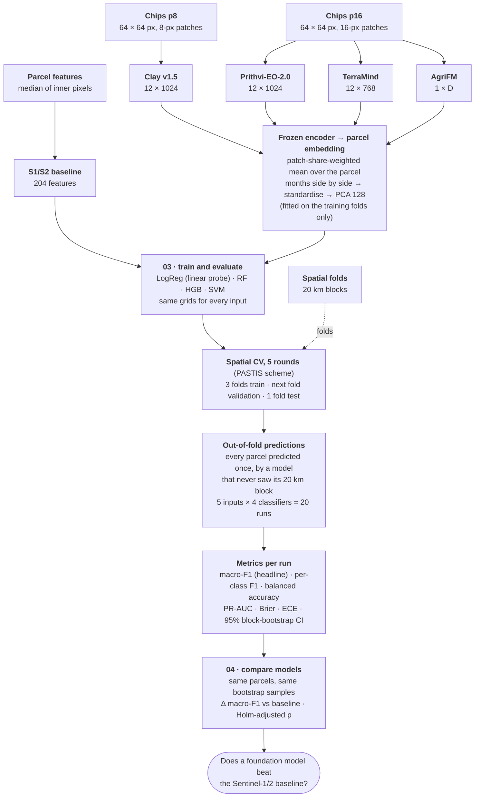
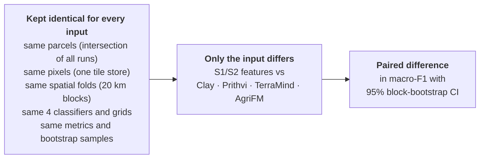
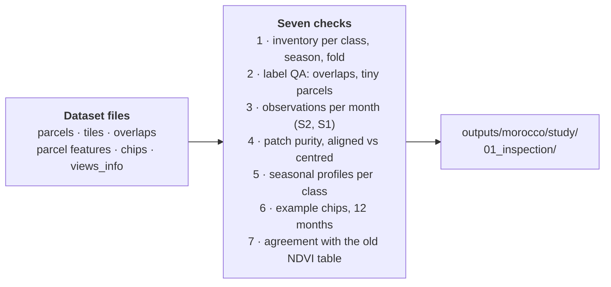
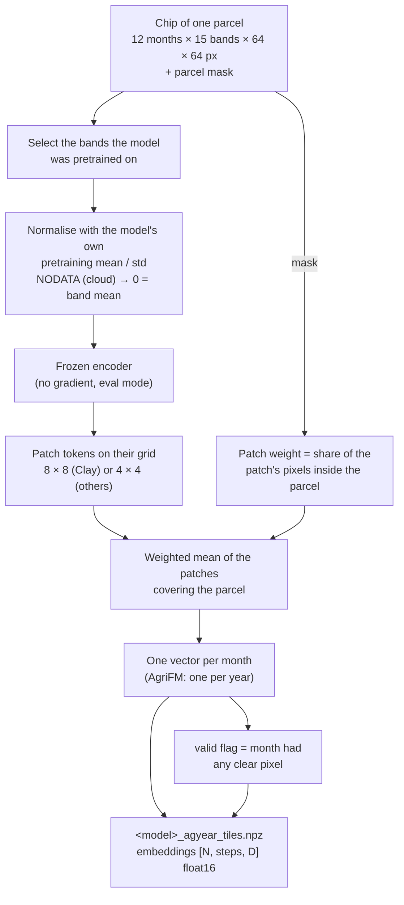
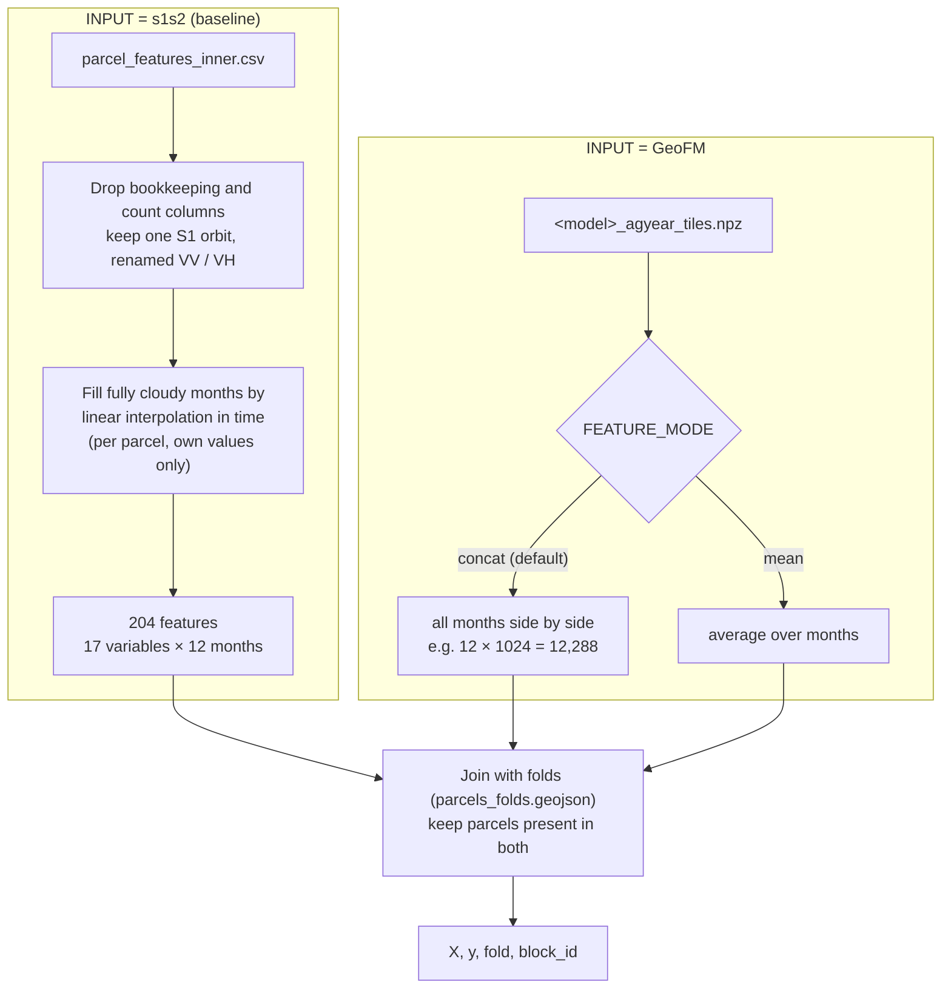
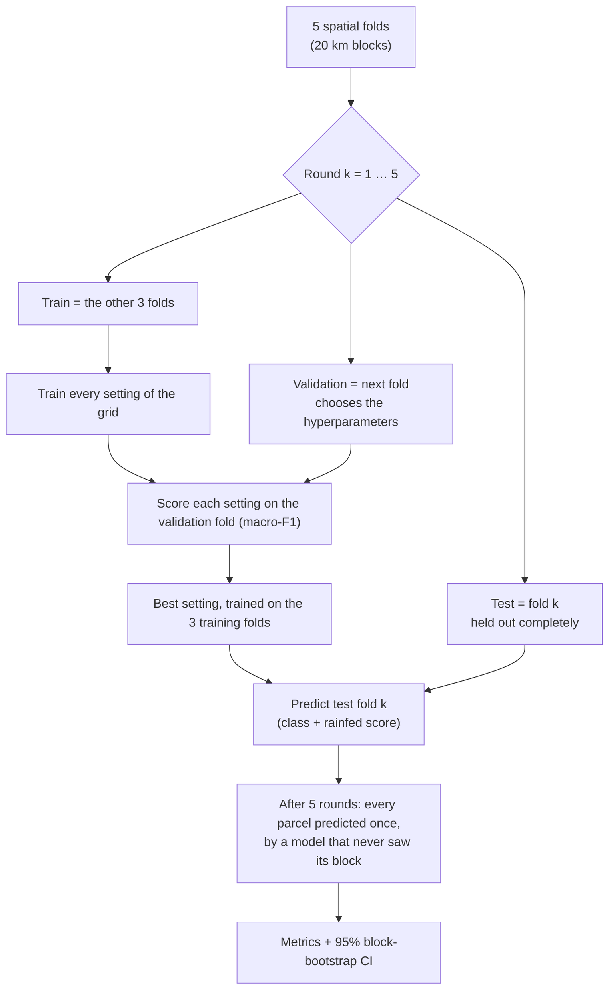
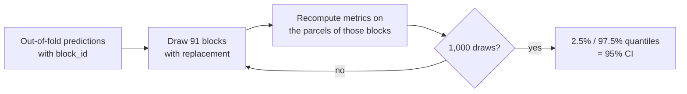
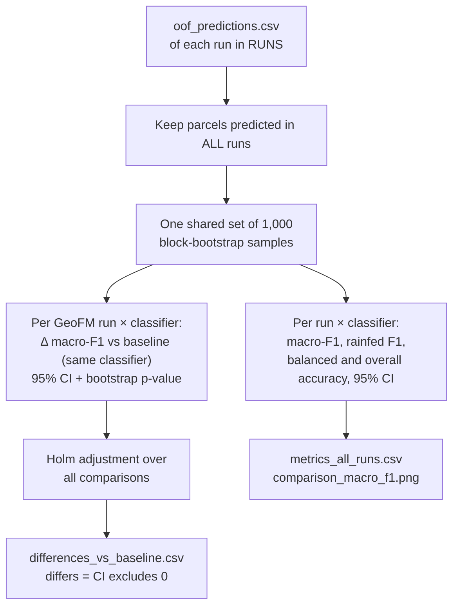

# RQ1 · Frozen encoders: embeddings and classifiers

This page documents the frozen-encoder evaluation of Phase 2 (RQ1), which tests whether frozen embeddings of geospatial foundation models (GeoFMs) discriminate **irrigated** from **rainfed** cropland parcels in Morocco better than a conventional Sentinel-2 feature baseline under an identical spatial validation design. Every input uses Sentinel-2 only ([D14](../decisions.md#d14-sentinel-2-only-for-every-input)).

It reads only the ML-ready dataset produced in [`ml_dataset_prep/`](../phase1_data/morocco.md). The rules of the comparison are summarised in the [evaluation protocol](evaluation.md); reported results are produced as [experiments](../experiments/index.md), which run these scripts with the settings of a config file.

**Contents**

1. [Overview](#1-overview)
2. [Research questions and design](#2-research-questions-and-design)
3. [Inputs compared](#3-inputs-compared)
4. [Script 01 — inspect the dataset](#4-script-01--inspect_dataset)
5. [Scripts 02a–02d — foundation-model embeddings](#5-scripts-02a02d--foundation-model-embeddings)
6. [Script 03 — train and evaluate](#6-script-03--train_evaluate)
7. [Script 04 — compare inputs](#7-script-04--compare_models)
8. [Output layout](#8-output-layout)
9. [Running, settings and run time](#9-running-settings-and-run-time)
10. [Choices to report and open points](#10-choices-to-report-and-open-points)
11. [References](#11-references)

---

## 1. Overview

The workflow below leads from the ML-ready dataset of Phase 1 to the final comparison: the five inputs (feature baseline and four frozen foundation models), the classifiers and their tuning grids, the spatial validation and the paired comparison.



Per-model bands, patches and temporal handling: [Foundation models](../foundation_models.md#configuration-in-this-study).

Classifier grids: [evaluation protocol §4](evaluation.md#4-classifiers). Optional sensitivity runs:
Sentinel-1 added to the baseline and to TerraMind (Morocco), embeddings averaged over the months instead of PCA.


| Step | Script | GPU | What it does |
| --- | --- | --- | --- |
| 1 | `01_inspect_dataset.py` | no | checks the dataset before any model is trained |
| 2 | `02a_embed_clay.py` … `02d_embed_agrifm.py` | recommended | frozen GeoFM embeddings per parcel |
| 3 | `03_train_evaluate.py` | no | trains and evaluates the classifiers for one input (run once per input) |
| 4 | `04_compare_models.py` | no | compares all inputs on the same parcels |

---

## 2. Research questions and design

1. **Main:** does a frozen GeoFM embedding classify irrigated vs rainfed parcels better than Sentinel-1/2 parcel features, when tested on areas the model has never seen?
2. Which GeoFM works best, and does the classifier on top matter?
3. How much does random cross-validation overstate accuracy compared with spatial cross-validation?
4. Which months (and, for the baseline, which variables) carry the signal?

The design keeps everything equal except the input:



The foundation models are used **frozen**, as fixed feature extractors, following the linear-probing protocol. No fine-tuning is performed at this stage; the evaluation therefore measures the information contained in the pretrained representations, at low computational cost and under identical conditions for all inputs.

---

## 3. Inputs compared

The five inputs (Sentinel-2 baseline and four frozen GeoFMs, all Sentinel-2 only), their bands, patch sizes and
temporal handling, and the optional Sentinel-1 ablation are specified in
[Foundation models · Configuration](../foundation_models.md#configuration-in-this-study).

---

## 4. Script 01 — `inspect_dataset`

**Purpose:** find problems in the data before they show up as strange model results. It reads the dataset only and changes nothing.



What to look for:
- **Inventory:** all 8,781 parcels should reach view A and both chip folders. Missing parcels point to tiles that failed to download.
- **Observations:** winter months (Dec–Feb) have the fewest clear Sentinel-2 views. If a month is empty for most parcels, its features carry little information.
- **Purity:** the aligned chips should have a clearly higher median purity than the centred chips, especially for 16-px patches and small parcels.
- **Profiles:** rainfed parcels should peak in winter (around February) and be bare from May. Irrigated parcels should stay green, or green up again, in summer. This is the signal every model should find.
- **Legacy agreement:** high per-month correlation with the old Earth Engine NDVI confirms the new compositing. The old table used 30-day periods rather than calendar months, so the numbers will not be identical.

**Outputs:**
- `inventory.csv`
- `label_qa.csv`
- `observations_per_month.csv` / `.png`
- `purity_summary.csv`, `purity.png`
- `seasonal_profiles.png`
- `examples_irrigated.png`, `examples_rainfed.png`
- `legacy_agreement.csv`

The resulting figures are shown in [Dataset preparation §7.6](../phase1_data/morocco.md#76-dataset-inspection).

For a closer look in QGIS, `tools/a3_export_chips_geotiff.py` writes single chips as georeferenced GeoTIFFs to `01_inspection/chips_geotiff/`.

---

## 5. Scripts 02a–02d — foundation-model embeddings

All four scripts follow the same pattern. Only the model, its bands and its normalisation change.



**Pooling.** Each patch token is weighted by the share of its pixels inside the parcel. Patches without any parcel pixel get weight 0. The parcel embedding is the weighted mean, so it describes the parcel and not the whole 640 m chip. The patch-aligned chips ([dataset §7.3](../phase1_data/morocco.md#73-view-c--patch-aligned-chips-for-the-foundation-models)) put most of the weight on one patch centred on the parcel.

**Cloudy pixels.** NODATA pixels are set to 0 after normalisation, which equals the band mean. A month with no clear pixel at all is flagged `valid = False`, and script 03 fills it with the training median.

**Resume.** Embeddings are saved in batches (`_parts_<model>_agyear_tiles/`) and merged at the end. A stopped run continues from the last batch.

### 5.1 Scripts per model

| Script | Model | Output |
| --- | --- | --- |
| `02a_embed_clay.py` | Clay v1.5 | `[N, 12, 1024]` |
| `02b_embed_prithvi.py` | Prithvi-EO-2.0-300M-TL | `[N, 12, 1024]` |
| `02c_embed_terramind.py` | TerraMind-1.0-base | `[N, 12, 768]` |
| `02d_embed_agrifm.py` | AgriFM | `[N, 1, 1024]` |

AgriFM uses the patch size of its pretrained Sentinel-2 patch embedding (4 × 4 px, output stride 32 px), and the
script stops unless every encoder weight is loaded from `AgriFM.pth`; embeddings produced before 6 Nov 2026 came
from an untrained encoder ([D12](../decisions.md#d12-agrifm-with-its-pretrained-4-px-patch-embedding)).

Model-specific bands, normalisation, auxiliary inputs (date, location, wavelengths) and known limitations are
described in [Foundation models · Model notes](../foundation_models.md#model-notes). AgriFM is normalised with the
statistics of the region's own chips ([D15](../decisions.md#d15-agrifm-normalised-with-the-statistics-of-the-regions-chips)).

**Region.** Each script has `REGION` and `VIEWS_NAME` at the top; the environment variables `EMBED_REGION` and
`EMBED_VIEWS` set them without editing the script (Slurm jobs):

```bash
python models_run/02a_embed_clay.py                                              # Morocco, views/
EMBED_REGION=utah EMBED_VIEWS=views_2023-24 python models_run/02a_embed_clay.py  # Utah 2023/24
```

### 5.2 Embedding file format

```
outputs/<REGION>/study/02_embeddings/<model>_agyear_tiles.npz          Morocco (views/)
outputs/<REGION>/study/02_embeddings/<model>_agyear_tiles_2023-24.npz  Utah (views_2023-24/)
    parcel_id [N]   label [N]   ag_season [N]
    steps [T]                    month names (Sep … Aug), or ["year"] for AgriFM
    embeddings [N, T, D]         float16
    valid [N, T]                 False = month without any clear pixel
```

---

## 6. Script 03 — `train_evaluate`

**Purpose:** one script for every input, so all inputs are evaluated in exactly the same way. Set `INPUT` at the top and run it once per input.

### 6.1 From input to feature matrix



**Preprocessing inside every model pipeline.** It is fitted on the training folds only, so no information leaks from the test fold:
- Baseline: median imputation of any remaining gap.
- Embeddings: median imputation of empty months, then standardisation. In `concat` mode, **PCA to 128 components** follows.

### 6.2 Classifiers and hyperparameter grids

| Name | Classifier | Principle | Grid (chosen on the validation fold) | Fixed settings |
| --- | --- | --- | --- | --- |
| `logreg` | Logistic regression | one linear decision boundary; on frozen embeddings the standard **linear probe** (Alain & Bengio, 2016), which measures the information contained in the features | C ∈ {0.01, 0.1, 1, 10} | L2 penalty, lbfgs, `max_iter = 5000`, `class_weight = "balanced"`, standardised inputs |
| `rf` | Random forest (Breiman, 2001) | vote of many decision trees, each grown on a bootstrap sample and random feature subsets; the usual classifier in irrigation mapping | max_features ∈ {√p, 0.3}; min_samples_leaf ∈ {1, 5}; class_weight ∈ {none, balanced_subsample} | 500 trees, no depth limit, seed 42 |
| `hgb` | Histogram gradient boosting | small trees added sequentially, each correcting the previous errors; features binned into histograms | learning_rate ∈ {0.05, 0.1}; max_leaf_nodes ∈ {15, 31}; class_weight ∈ {none, balanced} | 300 boosting rounds; built-in early stopping off, because it would use a random rather than a spatial validation split |
| `svm` | RBF support vector machine | maximum-margin boundary, made non-linear by the RBF kernel; used for irrigation mapping with Sentinel-1/2 (Gao et al., 2018; Elwan et al., 2022) | C ∈ {1, 10}; γ ∈ {scale, 0.01} | `class_weight = "balanced"`, standardised inputs; no probability calibration (the decision score is used for PR-AUC) |

The settings selected in each round are reported per experiment
([E01](../experiments/E01_frozen_pca_nested/report.md#selected-hyperparameters)).

The selection score is macro-F1, the mean of the irrigated F1 and rainfed F1. It treats the 14% rainfed class as equally important.

### 6.3 Spatial cross-validation: train / validation / test

Each round uses the 5 spatial folds in the same way as the PASTIS benchmark (Garnot & Landrieu 2021): 3 folds train, the next fold is the validation fold, and one fold is the test fold. Rotating through 5 rounds tests every fold once.

| Round | Train | Validation | Test |
| --- | --- | --- | --- |
| 1 | folds 2, 3, 4 | fold 1 | fold 0 |
| 2 | folds 3, 4, 0 | fold 2 | fold 1 |
| 3 | folds 4, 0, 1 | fold 3 | fold 2 |
| 4 | folds 0, 1, 2 | fold 4 | fold 3 |
| 5 | folds 1, 2, 3 | fold 0 | fold 4 |



The validation fold is used only to choose the classifier's hyperparameters; the test fold is never used for any choice. The same scheme is used for every input, so the classifiers and a later neural-network baseline are trained, tuned and tested identically. `VALIDATION = "nested"` in `03_train_evaluate.py` gives the alternative design (tuning by spatial CV on the 4 training folds, refit on all 4), for a sensitivity check; its runs get the suffix `_nested`.

Every parcel is predicted once, by a model that saw neither its block in training nor any information from it during tuning. That makes the score an estimate of how well the model maps **new areas**.

### 6.4 Metrics and uncertainty

| Metric | Why |
| --- | --- |
| **Macro-F1** (headline) | balances both classes; insensitive to the 86 / 14 split |
| F1, precision, recall per class | rainfed recall shows how many rainfed parcels are found |
| Balanced accuracy | mean recall of both classes |
| Overall accuracy | for comparison with the literature; the trivial "all irrigated" model already gets 86% |
| PR-AUC (rainfed) | threshold-free ranking quality for the minority class |
| Brier score, expected calibration error | quality of the predicted probabilities |

**95% confidence intervals: block bootstrap.** Parcels in one 20 km block are correlated, so blocks, not parcels, are the independent units. Each of the 1,000 draws resamples whole blocks with replacement and recomputes every metric. The 2.5% and 97.5% quantiles give the interval.



### 6.5 Further analyses in the same run

1. **Classifier comparison:** paired macro-F1 differences between the 4 classifiers on the same parcels, with block-bootstrap CIs.
2. **Spatial vs random CV:** the same hyperparameters re-evaluated with the stratified `random_fold`. The gap shows how much random validation overstates accuracy.
3. **Grouped permutation importance:** uses the random forest of each outer fold, on its test fold. For the baseline it is computed by variable (NDVI, VH, …) and by month; for embeddings, by month.
4. **Seasonal profiles** (baseline): class medians per variable and month.
5. **Final models:** refit on all parcels (`final_model_<name>.joblib`), for mapping later.

**Outputs** (`experiments/<EXPERIMENT>/results/<RUN_NAME>/` in experiment mode; `outputs/morocco/study/03_models/<RUN_NAME>/` for development runs with `EXPERIMENT = None`):
- `metrics_summary.csv`, `metrics_with_ci.csv`, `metrics_per_fold.csv`
- `paired_model_differences.csv`
- `cv_random_vs_spatial.csv` / `.png`
- `oof_predictions.csv`
- `selected_hyperparameters.csv`, `inner_tuning_scores.csv`
- `importance.csv` / `.png`
- `confusion_matrices.png`
- `seasonal_profiles.png`, `gap_filling.csv` (baseline only)
- `final_model_*.joblib`
- `run_config.json`, `run.log`

**Run names:**
- Baseline: `s1s2-<variables>_agyear_tiles-<inner|all>[-<orbit>]`, e.g. `s1s2-s2_agyear_tiles-inner` (Sentinel-2 only, no orbit) or `s1s2-all_agyear_tiles-inner-asc`.
- GeoFMs: `<model>_agyear_tiles_<concat|mean>`, e.g. `clay_agyear_tiles_concat`.

---

## 7. Script 04 — `compare_models`

**Purpose:** answer the main research question by comparing every input with the baseline, on the same parcels.



- **Paired:** the same bootstrap blocks are used for every run, so each difference is measured on identical resamples (Foody 2009).
- **Multiple comparisons:** 4 GeoFMs × 4 classifiers = 16 comparisons, Holm-adjusted.
- **Interpretation:** a GeoFM is better than the baseline only if the 95% interval of Δ macro-F1 lies entirely above 0.

`BASELINE_RUN` is the Sentinel-2 baseline `s1s2-s2_agyear_tiles-inner`; for a run with Sentinel-1 it must match the orbit that was actually used (`views_info.json`), for example `s1s2-all_agyear_tiles-inner-asc`.

### 7.1 Script 05 — `breakdown_oof` (results by region, season and purity)

**Purpose:** test whether the pooled metrics reflect the irrigation signal or the region. Rainfed parcels are
concentrated in Doukkala (94%), and Gharb, Tadla and El Haouz contain almost only irrigated parcels, so a classifier
can score well by recognising the region (shortcut learning). The 16-px chips also mix each parcel with its
neighbours (median purity 0.30). The script reads the out-of-fold predictions of one experiment; no model is
trained.

| Output (`experiments/<E>/results/breakdown/`) | Content |
| --- | --- |
| `doukkala.csv` | macro-F1 in Doukkala, the only zone with both classes, with 95% block-bootstrap CI and the paired difference to the baseline |
| `irrigated_only_zones.csv` | share of irrigated parcels predicted rainfed in Gharb, Tadla and El Haouz, with CI |
| `by_zone_season.csv` | rainfed recall and precision, false-rainfed rate and macro-F1 per zone and agricultural year |
| `by_purity.csv`, `by_area.csv` | macro-F1 per 16-px patch-purity bin and per parcel-area bin |
| `breakdown.png` | Doukkala macro-F1 and false-rainfed rate per input |

First application (E01, nested CV, 8,775 parcels; AgriFM excluded): in Doukkala, no frozen GeoFM exceeds the
baseline (baseline SVM 0.896 [0.818–0.952]; the GeoFM random forests are 0.03–0.07 lower, with intervals that
exclude 0). In the irrigated-only zones every input labels at most 2% of the irrigated parcels as rainfed, so these
zones contribute little to the differences between inputs. The GeoFM advantage in the hardest fold comes from
Souss (69 rainfed parcels): rainfed recall 0.75–0.84 for Clay and Prithvi (SVM) against 0.26 for the baseline.
GeoFM macro-F1 increases with patch purity more steeply than that of the baseline. The analysis is repeated on E02.

---

## 8. Output layout

```
outputs/morocco/study/
├── 01_inspection/                    script 01 (+ chips_geotiff/ from tools/a3)
├── 02_embeddings/
│   ├── clay_agyear_tiles.npz
│   ├── prithvi_agyear_tiles.npz
│   ├── terramind_agyear_tiles.npz          Sentinel-2 only (terramind-s1s2_… = with Sentinel-1)
│   ├── agrifm_agyear_tiles.npz
│   └── _parts_<model>_agyear_tiles/  batch files (resume)
├── 03_models/                        development runs only (EXPERIMENT = None)
└── 04_comparison/                    development runs only

experiments/<EXPERIMENT>/results/     runs that are reported (see the Experiments pages)
├── s1s2-s2_agyear_tiles-inner/
├── clay_agyear_tiles_concat/
├── …                                 one folder per run
├── comparison/                       metrics_all_runs.csv · differences_vs_baseline.csv · comparison_macro_f1.png
```

The embeddings (`02_embeddings/`) depend only on the dataset and the model, so every experiment shares them.

---

## 9. Running, settings and run time

```bash
conda activate condaml
python models_run/01_inspect_dataset.py
python models_run/02a_embed_clay.py          # GPU recommended; resumable
python models_run/02b_embed_prithvi.py
python models_run/02c_embed_terramind.py
python models_run/02d_embed_agrifm.py
# steps 03 + 04 + report as an experiment (set EXPERIMENT at the top of run_experiment.py):
python experiments/run_experiment.py
# or one run by hand, for development (EXPERIMENT = None in the script, results in outputs/morocco/study/):
python models_run/03_train_evaluate.py
python models_run/04_compare_models.py
```

`QUICK_TEST = True` in script 03 gives a fast check: 100 trees, 100 bootstrap draws, one setting per classifier.

| Script | Main settings |
| --- | --- |
| 01 | `EXAMPLE_PATCH = 16`, `N_EXAMPLES = 3`, `SEED = 42` |
| 02a–02d | `CHIP_SOURCE = "tiles"`, `CHIP_PATCH_PX` (8 Clay, 16 others), `BATCH_PARCELS`, `EMBED_BATCH`, `DEVICE`. Model-specific: `FRAMES_PER_PASS`, `USE_COORDS` (Prithvi); `MODALITIES` (TerraMind) |
| 03 | `INPUT`, `S1S2_VARIABLES` (s2 default / all / s1), `TILE_FEATURES` (inner / all), `S1_ORBIT` (chips / ASC / DSC / both), `FEATURE_MODE` (concat / mean), `PCA_DIM = 128`, `RF_TREES = 500`, `N_BOOT = 1000`, `QUICK_TEST` |
| 04 | `BASELINE_RUN`, `RUNS`, `N_BOOT = 1000`, `SEED = 42`; in experiment mode `EXTRA_RUNS` |
| 03, 03b, 04 | `EXPERIMENT`: name of a folder in `experiments/`; its `config.yaml` replaces the settings above (same names) and the results go to that folder |
| 03b | `REGION`, `VIEWS_NAME`, `BANDS` (s2 / s2s1); `CONFIG`: a file in `experiments/<EXPERIMENT>/configs/` with all settings of one run (E04: `morocco_s2`, `morocco_s2s1`, `utah_s2`, `utah_s2s1`), also settable as the environment variable `PSETAE_CONFIG` |

---

## 10. Choices to report and open points

| Choice | Value | Reason |
| --- | --- | --- |
| Frozen encoders, no fine-tuning | all four GeoFMs | tests the pretrained representation; equal cost for all |
| Parcel pooling | patch-share-weighted mean | describes the parcel, not the surroundings |
| AgriFM patch size | 4 × 4 px (pretrained), stride 32 px | every pretrained weight is used; coarsest grid of the four models ([D12](../decisions.md#d12-agrifm-with-its-pretrained-4-px-patch-embedding)) |
| Chips | 64 × 64 px, patch-aligned | centroid at a patch centre (see dataset §7.3) |
| Time | 12 monthly composites, Sep–Aug | covers the winter rainfed cycle and summer irrigation |
| Embedding reduction | concat + PCA 128, fitted on training folds | keeps the timing information; same dimension for every model |
| Inputs | Sentinel-2 only for every model and the baseline | same optical data for all; S1 coverage of Utah changed between years ([D14](../decisions.md#d14-sentinel-2-only-for-every-input)) |
| Baseline features | inner-pixel medians of 12 S2 bands, NDVI, NDWI, EVI | same pixels as the chips |
| Validation | 5 spatial folds (20 km blocks), per round 3 train / 1 validation / 1 test, as PASTIS | estimates mapping of unseen areas; identical for classifiers and neural networks |
| Uncertainty | block bootstrap, Holm | blocks are the independent units |

**Open points:**
- Prithvi on 10 m instead of 30 m data.
- Results per zone, since rainfed parcels are concentrated in Doukkala.

---

## 11. References

- Garnot, V. S. F., & Landrieu, L. (2021). Panoptic segmentation of satellite image time series with convolutional temporal attention networks. *ICCV*. https://arxiv.org/abs/2107.07933
- Clay Foundation (2024). Clay foundation model v1.5. https://huggingface.co/made-with-clay/Clay, doi:10.57967/hf/1537.
- Foody, G. M. (2009). Classification accuracy comparison: hypothesis tests and the use of confidence intervals in evaluations of difference, equivalence and non-inferiority. *Remote Sensing of Environment*, 113, 1658–1663.
- Holm, S. (1979). A simple sequentially rejective multiple test procedure. *Scandinavian Journal of Statistics*, 6, 65–70.
- Jakubik, J., et al. (2025). TerraMind: large-scale generative multimodality for Earth observation. arXiv:2504.11171.
- Li, W., et al. (2025). AgriFM: a multi-source temporal remote sensing foundation model for crop mapping. arXiv:2505.21357.
- Roberts, D. R., et al. (2017). Cross-validation strategies for data with temporal, spatial, hierarchical, or phylogenetic structure. *Ecography*, 40, 913–929.
- Szwarcman, D., et al. (2024). Prithvi-EO-2.0: a versatile multi-temporal foundation model for Earth observation applications. arXiv:2412.02732.
- Varma, S., & Simon, R. (2006). Bias in error estimation when using cross-validation for model selection. *BMC Bioinformatics*, 7, 91. (nested cross-validation)

