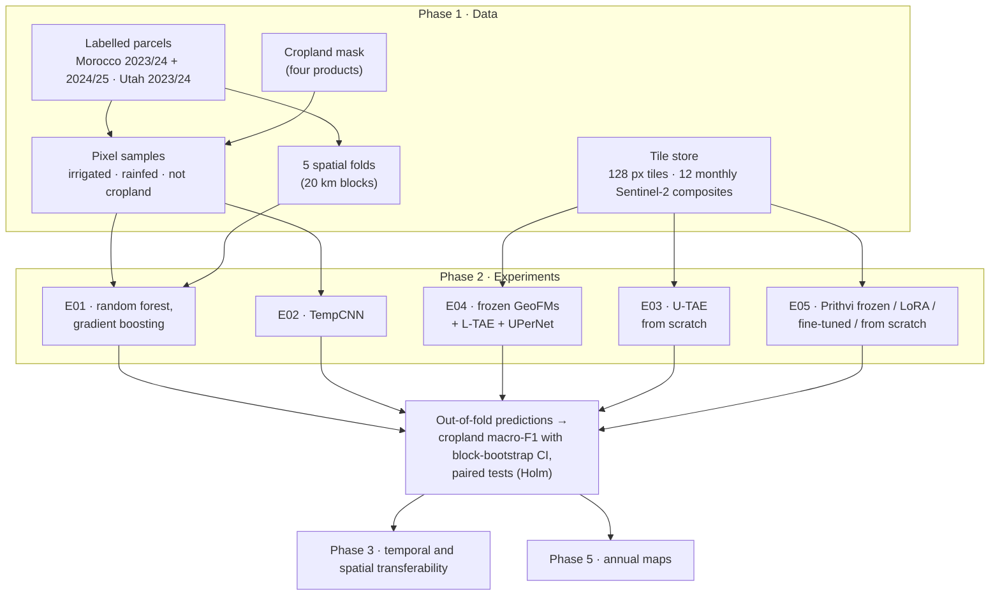

# Phase 2 · Model evaluation

Phase 2 compares geospatial foundation models (GeoFMs) and ways of adapting them for classifying **every 10 m pixel**
as irrigated, rainfed or not cropland ([D16](../decisions.md#d16-pixel-wise-classification-for-continuous-maps)), in
Morocco and Utah ([D13](../decisions.md#d13-utah-as-a-second-independent-study-area)). It answers two research
questions under one [evaluation protocol](evaluation.md); every model is scored on the same out-of-fold pixels.

| RQ | Question | Experiments | Status | Page |
| --- | --- | --- | --- | --- |
| **RQ1** | How accurately do frozen GeoFMs classify the pixels, compared with classifiers trained on the Sentinel-2 time series and a network trained from scratch? | E01–E04 | ✅ done for four of six GeoFMs (Presto and TESSERA to run) | [RQ1 · Experiment plan](experiment_plan.md) |
| **RQ2** | To what extent does fine-tuning (LoRA or full) improve on the frozen encoder and on training from scratch, and how does this depend on the number of labelled parcels? | E05 (Prithvi, Utah) | ⏳ frozen, fine-tuned and from scratch running; LoRA later | [RQ2 · Fine-tuning](fine_tuning.md) |

## Workflow

| Page | Content |
| --- | --- |
| [RQ1 · Experiment plan](experiment_plan.md) | how E01–E04 answer RQ1, status and scores |
| [RQ2 · Fine-tuning](fine_tuning.md) | the ways to adapt a GeoFM, what E05 tests, papers to read |
| [Evaluation protocol](evaluation.md) | task, spatial folds, fairness rules, metrics, confidence intervals, how a result is read |
| [Experiment plan (all experiments)](../experiments/plan.md) | shared settings of E01–E05 |
| [Foundation models](../foundation_models.md) | the six GeoFMs and how each is applied |

The earlier parcel-wise Phase 2 (frozen embeddings pooled over parcels, PCA or L-TAE and classifiers) is in the
[archive](../archive/parcel_wise_classification/workflow.md).
