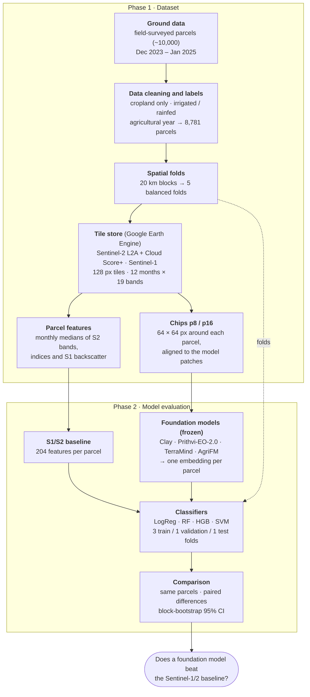

# Phase 2 · Model evaluation

Phase 2 addresses Objective 1, the comparison of foundation models and adaptation strategies in Morocco, through two
research questions. Both are evaluated on spatially independent areas under one [evaluation protocol](evaluation.md).

| RQ | Question | Approach | Status | Page |
| --- | --- | --- | --- | --- |
| **RQ1** | What accuracy does each foundation model achieve, compared with a conventional Sentinel-based classifier? | frozen encoders → parcel embeddings → classifiers, vs a Sentinel-1/2 feature baseline | ⏳ E01 done, E02 running, E03 planned | [RQ1 · Frozen encoders](frozen_encoders.md) |
| **RQ2** | To what extent does parameter-efficient fine-tuning improve on a frozen encoder? | segmentation head on frozen and LoRA-adapted encoders; neural baselines | 📝 planned | [RQ2 · Fine-tuning](fine_tuning.md) |

The remainder of this page summarises the RQ1 workflow, which forms the reference for all later comparisons.

> **Unit of analysis.** Each parcel carries one label recorded in the field survey. Models predict this label from
> satellite time series alone and are evaluated exclusively on parcels located in areas excluded from training.

---

## Workflow

## Step by step

**1. Labels.** The Moroccan field survey (Ouassanouan et al., 2026) records crop type and irrigation system for each
parcel. Cropland parcels are labelled *irrigated* (flood, sprinkler, drip, pivot and related systems) or *rainfed*.
Rainfed parcels constitute 14% of the sample; macro-averaged metrics are therefore used so that both classes carry
equal weight.

**2. Spatial folds.** Spatial autocorrelation between neighbouring parcels inflates accuracy when training and test
parcels are adjacent (Roberts et al., 2017). The study area is therefore partitioned into 20 km blocks, and whole
blocks are assigned to five folds. Every model is evaluated on blocks that were not used in training.

**3. Common image store.** For the agricultural year of each parcel (September–August), Sentinel-2 observations
(cloud-masked with Cloud Score+) and Sentinel-1 backscatter are aggregated into 12 monthly composites and stored as
non-overlapping 1.28 km tiles. The baseline and all foundation models read the same pixels, so that differences in
performance are attributable to the representation rather than to the input data.

**4. Parcel representations.**

- *Feature baseline:* for each of the 12 months, the median of the parcel's inner pixels for the Sentinel-2 bands,
  three spectral indices and Sentinel-1 backscatter, yielding 204 features. Months without clear observations are
  temporally interpolated.
- *Foundation-model embedding:* a 64 × 64 px window (640 m) around the parcel is passed through the frozen encoder.
  The resulting patch embeddings are averaged with weights equal to the fraction of each patch inside the parcel.
  Clay, Prithvi-EO-2.0 and TerraMind are applied month by month; AgriFM processes the full year in one pass
  ([Foundation models](../foundation_models.md)).

**5. Temporal aggregation.** A foundation model yields up to 12 × 1,024 values per parcel. Two aggregation schemes
are evaluated:

- *PCA pipeline:* monthly embeddings are concatenated and reduced to 128 principal components, fitted on the
  training folds only.
- *L-TAE pipeline (planned):* a lightweight temporal attention encoder learns the relative importance of the months,
  following the PANGAEA benchmark protocol.

**6. Classifiers.** Four classifiers (logistic regression, random forest, histogram gradient boosting and a support
vector machine) are trained on every representation with identical hyperparameter grids. Logistic regression on
frozen embeddings corresponds to the standard linear probe and measures the information already present in the
pretrained representation.

**7. Evaluation.** Five rotations are performed: three folds for training, one for hyperparameter selection and one
for testing. Each parcel thus receives exactly one out-of-fold prediction from a model that was not trained on its
block.

**8. Comparison.** All inputs are evaluated on the same parcels. Uncertainty is estimated with a block bootstrap
(1,000 resamples of 20 km blocks), using identical resamples for every input so that differences are paired. A
foundation model is considered superior only if the 95% confidence interval of the difference in macro-F1 excludes
zero after Holm correction for multiple comparisons.

## Scope of inference

- The results quantify performance on **unseen areas within the surveyed Moroccan regions**.
- They do not yet establish performance **in other years** or **in other countries**; these are addressed by RQ3 and
  RQ4.
- Region and survey year are partly confounded (El Gharb and Tadla surveyed only in 2023/24, Souss only in 2024/25);
  differences between regions may therefore partly reflect differences between years.
