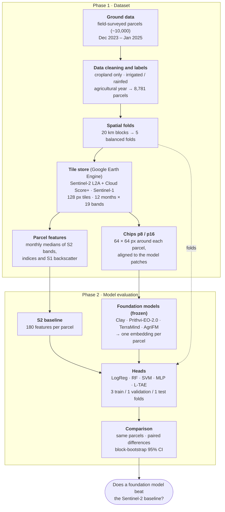

# Phase 2 · Model evaluation

Phase 2 addresses Objective 1, the comparison of foundation models and adaptation strategies in Morocco, through two
research questions. Both are evaluated on spatially independent areas under one [evaluation protocol](evaluation.md).

| RQ | Question | Approach | Status | Page |
| --- | --- | --- | --- | --- |
| **RQ1** | What accuracy does each foundation model achieve, compared with a conventional Sentinel-based classifier? | frozen encoders → parcel embeddings → classifiers, vs a Sentinel-2 feature baseline | ⏳ E01 done; E02–E05 planned (each with label efficiency) ([experiment plan](experiment_plan.md)) | [RQ1 · Frozen encoders](frozen_encoders.md) |
| **RQ2** | To what extent does parameter-efficient fine-tuning improve on a frozen encoder? | segmentation head on frozen and LoRA-adapted encoders; neural baselines | 📝 planned | [RQ2 · Fine-tuning](fine_tuning.md) |

The remainder of this page summarises the RQ1 workflow, which forms the reference for all later comparisons.

> **Unit of analysis.** Each parcel carries one label recorded in the field survey. Models predict this label from
> satellite time series alone and are evaluated exclusively on parcels located in areas excluded from training.

---

## Workflow



## Step by step

**1. Labels.** The Moroccan field survey (Ouassanouan et al., 2026) records crop type and irrigation system for each
parcel. Cropland parcels are labelled *irrigated* (flood, sprinkler, drip, pivot and related systems) or *rainfed*.
Rainfed parcels constitute 14% of the sample; macro-averaged metrics are therefore used so that both classes carry
equal weight.

**2. Spatial folds.** Spatial autocorrelation between neighbouring parcels inflates accuracy when training and test
parcels are adjacent (Roberts et al., 2017). The study area is therefore partitioned into 20 km blocks, and whole
blocks are assigned to five folds. Every model is evaluated on blocks that were not used in training.

**3. Common image store.** For the agricultural year of each parcel (September–August), Sentinel-2 observations
(cloud-masked with Cloud Score+) and Sentinel-1 backscatter are aggregated into 12 monthly composites and stored as
non-overlapping 1.28 km tiles. The baseline and all foundation models read the same pixels, so that differences in
performance are attributable to the representation rather than to the input data.

**4. Parcel representations.**

- *Feature baseline:* for each of the 12 months, the median of the parcel's inner pixels for the Sentinel-2 bands,
  three spectral indices, yielding 180 features (Sentinel-2 only, [D14](../decisions.md#d14-sentinel-2-only-for-every-input)). Months without clear observations are
  temporally interpolated.
- *Foundation-model embedding:* a 64 × 64 px window (640 m) around the parcel is passed through the frozen encoder.
  The resulting patch embeddings are averaged with weights equal to the fraction of each patch inside the parcel.
  Clay, Prithvi-EO-2.0 and TerraMind are applied month by month; AgriFM processes the full year in one pass
  ([Foundation models](../foundation_models.md)).

**5. Temporal aggregation.** A foundation model yields up to 12 × 1,024 values per parcel. Two aggregation schemes
are evaluated:

- *PCA pipeline* ([E02](../experiments/E02_frozen_pca/index.md), [E03](../experiments/E03_frozen_pca_mlp/index.md)):
  monthly embeddings are concatenated and reduced to 128 principal components, fitted on the training folds only.
- *L-TAE pipeline* ([E04](../experiments/E04_frozen_ltae/index.md)): a lightweight temporal attention encoder learns
  the relative importance of the months, following the PANGAEA benchmark protocol.

??? info "PCA pipeline: what it does"

    **Principal Component Analysis (PCA)** compresses many correlated numbers into a few new ones that keep most of
    the differences between parcels.

    ```mermaid
    flowchart LR
        M["12 monthly embeddings<br/>12 × 1,024 numbers"] --> C["<b>concatenate</b><br/>one row of 12,288 numbers"]
        C --> S["<b>standardise</b><br/>each number: mean 0, SD 1"]
        S --> P["<b>PCA</b><br/>keep the 128 directions<br/>with the largest spread"]
        P --> O["128 numbers per parcel<br/>→ classifier"]
    ```

    - **What a component is:** the first component is the direction in which parcels differ most, the second the
      next largest spread at right angles to the first, and so on. Each component is a weighted mix of all 12,288
      numbers, so it has no simple meaning such as "July NDVI".
    - **Why compress:** 12,288 numbers against roughly 1,200–5,000 training parcels per round invites overfitting,
      and neighbouring months and embedding dimensions largely repeat each other. 128 components remove most of
      this redundancy and give every model an input of the same size.
    - **No leakage:** in every round, PCA is fitted on the training parcels only and then applied to the
      validation and test parcels.
    - **What PCA does not do:** it is unsupervised (it never sees the labels) and treats the months only as
      positions in a long vector. It cannot learn that, say, July matters more than March.

??? info "L-TAE pipeline: what it does"

    The **lightweight temporal attention encoder** (L-TAE; Garnot & Landrieu 2020,
    [paper](https://arxiv.org/abs/2007.00586) · [summary](../references/ltae.md)) keeps the 12 months as a sequence
    and learns, together with the classifier, how much weight each month gets. PANGAEA (Marsocci et al. 2024,
    [paper](https://arxiv.org/abs/2412.04204) · [summary](../references/pangaea.md)) uses the same module to combine the
    dates of single-date GeoFMs; this study follows that protocol.

    ```mermaid
    flowchart LR
        M["12 monthly embeddings<br/>12 × 1,024"] --> L["<b>project</b><br/>each month → 256 numbers<br/>+ date code (mid-month day)"]
        L --> A["<b>attention</b><br/>16 heads, each with a learned query:<br/>score every month → softmax<br/>→ month weights (sum = 1)"]
        A --> W["<b>weighted sum</b><br/>of the months, per head<br/>→ 256 numbers for the year"]
        W --> H["MLP 256 → 128 → 2<br/>irrigated / rainfed"]
    ```

    - **Attention:** each head scores the 12 months, and softmax turns the scores into weights that sum to 1. A
      month with weight 0.20 counts more than one with 0.05. The 16 heads can each focus on different months.
    - **Date code:** a sine/cosine code of the mid-month day is added to each month, so the model knows which month
      it is looking at (attention by itself ignores order).
    - **Missing months:** months without a clear Sentinel-2 pixel get weight 0.
    - **Trained with the labels:** unlike PCA, the weights are learned to separate irrigated from rainfed parcels,
      and they can differ from parcel to parcel. The average weights per month are reported as a figure in E04.
    - **Applies to** Clay, Prithvi, TerraMind and the S2 baseline (15 variables × 12 months). It does not apply to
      AgriFM, which gives one vector for the whole year.


**6. Classifiers.** Three classical classifiers (logistic regression, random forest and a support vector machine)
are trained on every representation with identical hyperparameter grids
([D6](../decisions.md#d6-four-classifiers-instead-of-one-random-forest)). Logistic regression on frozen embeddings
corresponds to the standard linear probe and measures the information already present in the pretrained
representation. Two neural heads are added: an MLP on the PCA input (E03) and the L-TAE with its own MLP (E04).
PSE-TAE (E05) is a complete model trained from scratch on the pixels, the neural baseline.

| Model | Type | Input | Experiment | Runs per round |
| --- | --- | --- | --- | --- |
| Logistic regression | linear (linear probe) | PCA 128 (baseline: 180 features) | E02 | 1 |
| Random forest | 500 decision trees | same | E02 | 1 |
| SVM (RBF kernel) | non-linear, margin-based | same | E02 | 1 |
| MLP | small neural network | same | E03 | 3 seeds |
| L-TAE + MLP | temporal attention + neural network | 12 monthly vectors (no PCA) | E04 | 3 seeds |
| PSE-TAE | full model, no pretraining | 64 raw pixels per parcel × 12 months | E05 | 3 seeds |

??? info "Logistic regression (linear probe)"

    Draws one straight boundary (a hyperplane) through the input space: every input number gets a weight, the
    weighted sum is turned into a probability of "rainfed" with the logistic function, and ≥ 0.5 means rainfed.

    - **Why it is used:** on frozen embeddings it is the standard *linear probe*. If a straight boundary already
      separates the classes, the information is in the embedding itself, not in a clever classifier.
    - **Settings:** inputs standardised; class weights balanced (rainfed errors count more); grid over the
      regularisation strength `C` ∈ {0.01, 0.1, 1, 10}. Small `C` = simpler boundary.
    - **Limitation:** it cannot model curved boundaries or interactions between inputs.

??? info "Random forest"

    500 decision trees, each grown on a random sample of parcels; at every split a tree looks at a random subset of
    the inputs and asks one yes/no question about one of them ("is input 37 > 0.4?"). The trees vote, and the share
    of votes is the probability.

    - **Why it is used:** the classic classifier of irrigation and crop mapping, and the baseline classifier of the
      comparison script.
    - **Settings:** grid over `max_features` ∈ {√n, 30% of the inputs}, `min_samples_leaf` ∈ {1, 5} and
      `class_weight` ∈ {none, balanced per tree}; fixed seed.
    - **Strength and weakness:** very good when each input means something on its own (NDVI in August, SWIR in
      December), so it is the best classifier for the S2 features in Utah. On PCA components, which are mixes of
      thousands of embedding numbers, one-input-at-a-time splits work poorly: it is the weakest classifier on every
      GeoFM (E02).

??? info "Support vector machine (SVM, RBF kernel)"

    Finds the boundary with the widest margin between the classes. The RBF kernel measures how similar two parcels
    are (close in input space = similar), which lets the boundary curve around groups of parcels.

    - **Why it is used:** a strong non-linear classifier for dense features, used in earlier irrigation-mapping
      studies with Sentinel-1/2 (Gao et al. 2018; Elwan et al. 2022).
    - **Settings:** inputs standardised; class weights balanced; grid over `C` ∈ {1, 10} (how strongly
      training errors are penalised) and `gamma` ∈ {scale, 0.01} (how local the similarity is). It gives a
      decision score, not a calibrated probability.
    - **Result:** the best classical classifier for every GeoFM, in both regions (E02).

??? info "MLP head (E03)"

    A small neural network on the same PCA input: 128 → 256 → 128 → 2, each hidden layer with batch normalisation,
    ReLU and dropout 0.2.

    - **Why it is used:** most GeoFM benchmarks report a linear probe or an MLP head. E03 tests whether a trained,
      non-linear head gets more out of the embeddings than the classical classifiers.
    - **Training:** AdamW (learning rate 1e-3, weight decay 1e-4), batch 128, class-weighted cross-entropy, up to
      100 epochs, early stopping on the validation fold's macro-F1 (patience 15). Settings are fixed, not tuned.
    - **Result:** equal to SVM for every input (within ±0.01), clearly better than LogReg and RF on most GeoFMs.

??? info "L-TAE + MLP head (E04)"

    The 12 monthly vectors are not concatenated and compressed with PCA. Instead, a temporal attention encoder
    learns how much weight each month gets, and its output goes to an MLP (256 → 128 → 2). How it works: see
    *L-TAE pipeline: what it does* under step 5.
    Paper: Garnot & Landrieu (2020), [Lightweight temporal self-attention for classifying satellite images time
    series](https://arxiv.org/abs/2007.00586) · [summary](../references/ltae.md).

    - **Training:** the same optimiser, loss, early stopping and 3 seeds as the MLP head; attention and head are
      trained together.
    - **Result:** equal to PCA + MLP for every input (within ±0.01). Not used for AgriFM, which has no monthly
      sequence.

??? info "PSE-TAE: pixel-set encoder + temporal attention, trained from scratch (E05)"

    PSE-TAE (Garnot, Landrieu, Giordano & Chehata 2020, *CVPR*:
    [Satellite image time series classification with pixel-set encoders and temporal
    self-attention](https://arxiv.org/abs/1911.07757) · [code](https://github.com/VSainteuf/pytorch-psetae)) was
    designed for exactly this task: classifying agricultural parcels from a satellite time series. It uses no
    foundation model and no pretraining. It learns everything from our labelled parcels.
    ```mermaid
    flowchart TD
        P["<b>Parcel</b><br/>all inner pixels × 10 S2 bands × 12 months"] --> S["<b>random set of 64 pixels</b><br/>no image grid, no order<br/>(small parcels: all their pixels)"]
        S --> PSE["<b>1 · Pixel-Set Encoder</b>, per month<br/>each pixel: 10 bands → MLP → 64 numbers<br/>pool over the pixels: mean + SD → 128<br/>→ MLP → 128 numbers per month"]
        PSE --> TAE["<b>2 · Temporal Attention Encoder</b><br/>12 months + date code<br/>4 attention heads weight the months<br/>→ MLP 512 → 128 → 128: one vector per parcel"]
        TAE --> DEC["<b>3 · Decoder</b><br/>MLP 128 → 64 → 32 → 2<br/>irrigated / rainfed"]
    ```

    **1. Pixel-Set Encoder (PSE).** Parcels have different shapes and sizes, so PSE-TAE treats a parcel as an
    unordered *set* of pixels instead of an image. For each month, every one of 64 randomly chosen pixels goes
    through the same small network (10 band values → 32 → 64 numbers). The 64 results are then pooled in two ways:
    the **mean** (what the parcel looks like on average) and the **standard deviation** (how uniform it is: a
    patchy field differs from a homogeneous one). A plain parcel average, as in the S2 baseline, loses this second
    part. Another small network turns the pooled 128 numbers into one 128-number vector per month.

    **2. Temporal Attention Encoder (TAE).** The 12 monthly vectors get a date code (sine/cosine of the mid-month
    day). Four attention heads score the months and take a weighted sum, so the model learns which parts of the year
    separate irrigated from rainfed parcels. Unlike L-TAE (E04), the TAE computes its query from the parcel's own
    sequence, with fewer, larger heads (4 × 32): L-TAE is its lighter successor by the same authors.

    **3. Decoder.** A small network (128 → 64 → 32 → 2) gives the probability of each class.

    | Setting | Value |
    | --- | --- |
    | Input | inner pixels of the parcel (edge pixels within 10 m left out; parcels with fewer than 4 inner pixels keep all), 10 Sentinel-2 bands × 12 months, standardised with training statistics |
    | Pixels per parcel | 64, drawn anew every epoch (acts as data augmentation); at prediction, the mean of 5 random draws |
    | Layer sizes | paper defaults: MLP1 32-64, mean + SD pooling, MLP2 128, 4 heads with d_k 32, MLP3 512-128-128, decoder 64-32-2 |
    | Not used | the paper's extra parcel-shape features (area, perimeter): the model sees only the pixels |
    | Training | Adam (learning rate 1e-3, weight decay 1e-4), batch 128, class-weighted cross-entropy, up to 100 epochs, early stopping on validation macro-F1 (patience 15) |
    | Seeds | 3 per round; the out-of-fold prediction is the mean probability |

    - **Why it is the right baseline:** it learns from the raw pixels and from their spread inside the parcel, with
      its own temporal attention. If a frozen GeoFM cannot beat it, pretraining adds nothing over a good supervised
      model.
    - **Result (E05):** Morocco 0.911, the highest macro-F1 of RQ1, a tie with the best S2 and GeoFM runs. Utah
      0.755, equal to the S2 random forest but significantly below Clay (−0.03 to −0.04). It finds the most rainfed
      parcels of all models, but in Utah it also over-predicts them.
      [E05 report](../experiments/E05_psetae_scratch/report.md).

**7. Evaluation.** Five rotations are performed: three folds for training, one for hyperparameter selection and one
for testing. Each parcel thus receives exactly one out-of-fold prediction from a model that was not trained on its
block.

**8. Comparison.** All inputs are evaluated on the same parcels. Uncertainty is estimated with a block bootstrap
(1,000 resamples of 20 km blocks), using identical resamples for every input so that differences are paired. A
foundation model is considered superior only if the 95% confidence interval of the difference in macro-F1 excludes
zero after Holm correction for multiple comparisons.

## Scope of inference

- The results quantify performance on **unseen areas within the surveyed Moroccan regions**.
- They do not yet establish performance **in other years** or **in other countries**; these are addressed by RQ3 and
  RQ4.
- Region and survey year are partly confounded (El Gharb and Tadla surveyed only in 2023/24, Souss only in 2024/25);
  differences between regions may therefore partly reflect differences between years.
